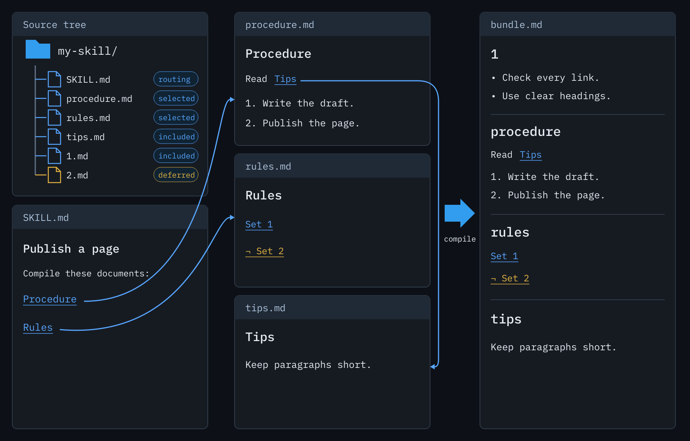

# 🧩 Prosiform

[](https://github.com/m2ux/prosiform/blob/engineering/artifacts/planning/2026-10-17-prosiform-v1/design.md)
[](https://commonmark.org/)

A deterministic compiler for instruction sets written as linked Markdown. Give it a document or a section; it returns that content and every local Markdown dependency it reaches, as one validated bundle.

---
**[Invocation](invocation.md)** • **[Checks](checks.md)** • **[Glossary](docs/glossary.md)** • **[Fixtures](fixtures/README.md)** • **[Source](src/README.md)** • **[Docs](docs/README.md)** • **[Check implementation](checks/README.md)** • **[Example](example/README.md)**

---

## 🎯 Overview

Agent skills are authored as collections of linked documents: an entry point links to procedures, and procedures link to the sections that govern them. Reaching the complete context for one operation means resolving that graph at read time. prosiform moves that work into a compilation step, so retrieval stops being part of the reasoning task.

Authors can maintain shared rules in one place and reuse them across procedures. The agent receives the selected material in one continuous document, with repeated content included once and links pointing to the relevant sections. Each bundle is validated before delivery; missing dependencies or invalid content produce an explicit failure. Completeness follows the links authors provide.

### Why?

Leaving retrieval to the agent costs:

* **Missed prerequisites** — a link names a destination; it does not retrieve it
* **Unbounded reads** — one procedure in a real skill reaches 39 documents and 318,018 bytes when read whole
* **No completeness signal** — a prerequisite skipped and one never needed produce the same result
* **Duplicated rules** — shared context gets copied into each document rather than linked once

### How It Works

```bash
prosiform --root my-skill --output bundle.md procedure.md rules.md
```



## Installation

Requires Python 3.13+ on Linux or macOS. From the repository root:

```bash
pip install ./src
prosiform --version
```
## Usage

Run these from the repository root. Each command writes a validated Markdown bundle to standard output.

### Bundle a Source and its Dependencies

```bash
prosiform --root example/work-tracker modes/plan-mode.md
```

### Compile a Selected Section

```bash
prosiform --root example/work-tracker 'artifacts/epic.md#delivery-findings'
```

See [worked input and output examples](example/README.md) and the [full option reference](invocation.md).
