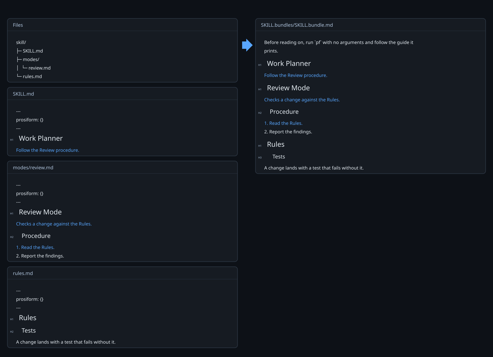

#  Prosiform

[](LICENSE)
[](https://github.com/m2ux/prosiform/blob/ea76fd37b0a89663a341d802c024e8a509d88cff/artifacts/planning/2026-10-17-prosiform-v1/design.md)
[](https://commonmark.org/)

A deterministic compiler for instruction sets written as linked Markdown. Give it a document or a section; it returns that content and every local Markdown dependency it reaches as one validated bundle, and each target it dispatches as a bundle of its own.

---
**[Invocation](invocation.md)** • **[Architecture](docs/architecture.md)** • **[Glossary](docs/glossary.md)** • **[Fixtures](fixtures/README.md)** • **[Docs](docs/README.md)** • **[Examples](https://github.com/m2ux/prosiform/blob/engineering/artifacts/planning/2026-10-22-work-planner-compact-diagram/work-planner-compact.review.md)**

---

## 🎯 Overview

Agent skills are authored as collections of linked documents: an entry point links to procedures, and procedures link to the sections that govern them. Reaching the complete context for one operation means resolving that graph at read time. prosiform moves that work into a compilation step, so retrieval stops being part of the reasoning task.

Authors can maintain shared rules in one place and reuse them across procedures. The agent receives the selected material in one continuous document, with repeated content included once and links pointing to the relevant sections. Each bundle is validated before delivery; a link naming a missing section, an operator naming no document, or invalid content produces an explicit failure. Completeness follows the links authors provide to the documents that declare `prosiform`.

### Why?

Leaving retrieval to the agent costs:

* **Missed prerequisites** — a link names a destination; it does not retrieve it
* **Unbounded reads** — linked content in a real skill spans to many documents when read whole
* **No completeness signal** — a prerequisite skipped and one never needed produce the same result
* **Duplicated rules** — shared context gets copied into each document rather than linked once

### How It Works

`SKILL.md` links a procedure, and the procedure links the rules it is held to. One run over `SKILL.md` reads all three files and writes one bundle, in which each link that named another file names a heading inside it. [Bundles](docs/bundles.md) walks through the run.



## Installation

Requires Python 3.13+ on Linux or macOS. From the repository root:

```bash
pip install ./src
pf -v
```
## Usage

Each example below runs over a [corpus fixture](fixtures/README.md)'s source tree from the repository root, and the fixture records the bundles the run writes. A run writes its bundles into a folder of its own, named for its entry with the `.bundles` suffix, in the working directory or in the folder `-o` names, made if absent: the entry's bundle under its derived name, and a bundle for each target its dispatches reach. Several entries join their names with `+`. The folder is written whole and swapped in, so a reader sees one run's bundle set and never a mixture of two. File and directory names use hyphens rather than underscores. [Invocation](invocation.md) states every option, budget and exit status.

### Print the Guide

```bash
pf
```

With no arguments, `pf` prints the guide an agent follows a skill by: the compile step, the rule that a link whose text opens with `↳` names an inline target to compile, read whole and follow, and that a bundle opening with a Prosiform section is followed from there. A skill's bootstrap is one instruction: run `pf` and follow it.

### Declare a Source

A document is compiled when its leading YAML frontmatter declares `prosiform`; a link to a document that declares nothing is left as written. Each key under `prosiform` is a preset: `default` is in force wherever the document is compiled, and another is in force where the title of the section linking the document names it. A preset's `group` pair places the document's sections in a shared group at a depth, and its `subst` pairs redirect the links the document writes. [Sources](docs/sources.md#frontmatter) states the presets in full.

```yaml
---
prosiform:
  default:
    group: {rules: 2}
---
```

### Bundle a Source and its Dependencies

```bash
cd fixtures/dispatch/a-dispatched-target-is-a-bundle-of-its-own/source
pf guide.md
```

### Compile a Selected Section

```bash
cd fixtures/extraction/section-to-the-next-sibling/source
pf 'guide.md#run'
```

### Defer a Link

```bash
cd fixtures/deferral/a-marked-reference-is-not-compiled/source
pf guide.md
```

A link whose text opens with `¬` is left for a run of its own: the document it names is not opened, and the bundle carries the link with the mark removed. [References](docs/references.md#operators) states the operators.

### Dispatch to Sub-agents

A link whose text opens with `⇉` dispatches its target, as the guide's link to its shared rules does in the first run above. The run compiles that target, and each target it dispatches in turn, as a bundle of its own in the same folder. The link points at a `Dispatch <link text>` sub-section one level below its section, whose one line names the bundle to hand to a sub-agent. The `⫽` links in one section's own content form a parallel set, pointing at one `Dispatch in parallel` sub-section that lists the bundles to dispatch together.

A bundle that dispatches opens with a `# Prosiform` section stating how: `## Dispatch` whenever it dispatches, and `## Parallel dispatch` when it carries a set. Each sub-section links the protocol it follows, and the protocols are the same bytes in every bundle. A dispatched bundle that carries a deferred dispatch or a `↳` line opens with `## Run pf first` too, as [Dispatch](docs/dispatch.md#the-prosiform-section) states.

### Compose a Section

```bash
cd fixtures/composition/titles-from-several-sources-share-one-destination-section/source
pf guide.md
```

A link labelled with one arrow, as in `[→](read.md#inputs)`, is a composition directive. It places the section it names beneath the section that writes it, and `[¬→](read.md#inputs)` defers that placement to a later run. [Composition](docs/composition.md) states the grammar.
