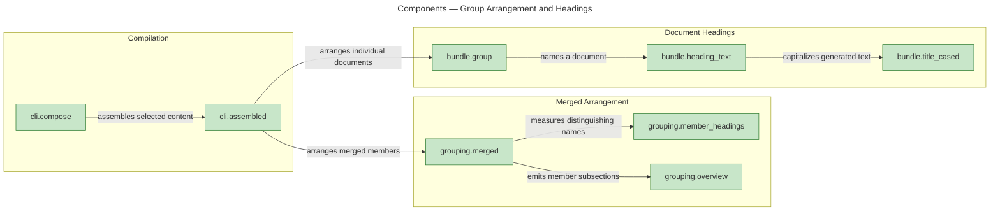
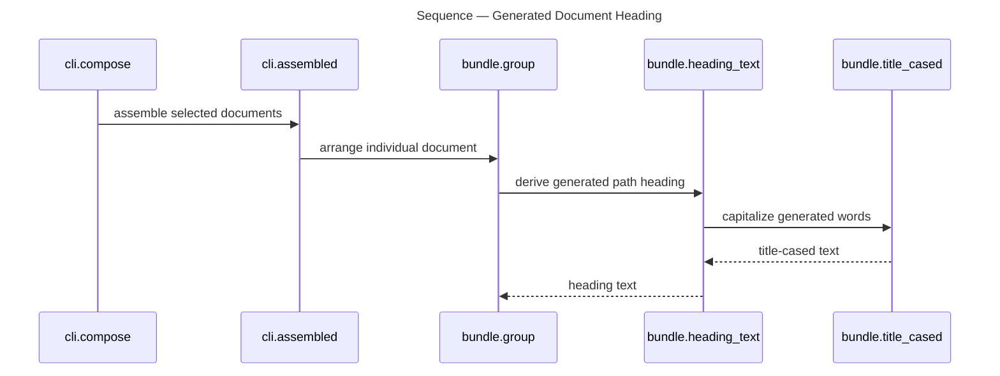

# Architecture Overview — Merged Groups

> architecture-overview · [m2ux/prosiform#198](https://github.com/m2ux/prosiform/pull/198) · 2026-10-22

## Summary

The compiler gives every merged member a name and distinct destination, wraps member subsections when merged sections also exist, and consistently cases generated headings. Generated bundles are recognized by their opening declaration when offered as input. The examples and diagrams show the resulting output.

## Structure

The measured call graph places orchestration in `cli.py`, merged-member arrangement in `grouping.py`, and individual-document headings in `bundle.py`. The diagram shows direct indexed calls among the functions responsible for arranging and naming the output.

### Merged Arrangement

- **Member names.**
  [member_headings](https://github.com/m2ux/prosiform/blob/aea9a90f5ba1b83b4f27cefe985ff68073e25b59/src/prosiform/grouping.py#L140) measures the shortest distinguishing path against the whole group. Overview subsections and pooled variants use that same name.
- **Overview.**
  [overview](https://github.com/m2ux/prosiform/blob/aea9a90f5ba1b83b4f27cefe985ff68073e25b59/src/prosiform/grouping.py#L516) emits member subsections under Overview when merged sections coexist; otherwise those subsections sit directly under the group heading.
- **Pooled contributions.**
  [sections](https://github.com/m2ux/prosiform/blob/aea9a90f5ba1b83b4f27cefe985ff68073e25b59/src/prosiform/grouping.py#L601) preserves a named variant for each contributor. A pooled section is a section formed from members sharing a heading at the grouping depth.

### Document Headings

- **Generated text.**
  [heading_text](https://github.com/m2ux/prosiform/blob/aea9a90f5ba1b83b4f27cefe985ff68073e25b59/src/prosiform/bundle.py#L261) applies title casing to path-derived headings; source spelling remains available for filesystem paths and authored headings.

## Behaviour

The measured `proc_25_compose` flow shows how an individual document receives its generated heading within bundle composition.

### Generated Document Heading

Composition reaches the individual-document arrangement, which derives its heading from the document path.

- **Measured order.**
  The graph records compose, assembled, group, heading_text and title_cased as steps 1–5. These are the persisted trace steps, rather than an inferred ordering of neighboring functions.
- **Merged-member path.**
  The separate measured relationship `assembled → merged` selects the merged arrangement. Its member subsections and variants supply distinct link destinations.
- **Input boundary.**
  [generated](https://github.com/m2ux/prosiform/blob/aea9a90f5ba1b83b4f27cefe985ff68073e25b59/src/prosiform/cli.py#L860) recognizes the opening declaration independently of capitalization in source paths. Authored sibling titles remain ordinary source content.

## What Changed

### Arrangement

- **Named members and destinations.**
  Every merged member has an emitted identity. Pooled contributions use member variants, with the same group-wide distinguishing name used throughout the arrangement.
- **Conditional wrapper.**
  Groups containing only member subsections place them directly beneath the group heading.

### Output and Documentation

- **One generated casing.**
  The generated heading convention covers document paths, nested paths and member variants while preserving authored text.
- **Executable examples.**
  The guide illustrates both wrapper outcomes. The published SVGs and PNGs show the headings emitted by their adjacent commands.

## Reading Order

1. **[cli.py](https://github.com/m2ux/prosiform/blob/aea9a90f5ba1b83b4f27cefe985ff68073e25b59/src/prosiform/cli.py#L1466)** — start at assembled to see the individual-document and merged-member branches.
2. **[grouping.py](https://github.com/m2ux/prosiform/blob/aea9a90f5ba1b83b4f27cefe985ff68073e25b59/src/prosiform/grouping.py#L415)** — follow merged through shared member naming, Overview and pooled sections.
3. **[bundle.py](https://github.com/m2ux/prosiform/blob/aea9a90f5ba1b83b4f27cefe985ff68073e25b59/src/prosiform/bundle.py#L250)** — inspect the generated heading convention.
4. **[test_grouping.py](https://github.com/m2ux/prosiform/blob/aea9a90f5ba1b83b4f27cefe985ff68073e25b59/src/tests/test_grouping.py#L197)** — read output-shape and member-destination examples.
5. **[example/README.md](https://github.com/m2ux/prosiform/blob/aea9a90f5ba1b83b4f27cefe985ff68073e25b59/example/README.md#L106)** — compare the documented commands and emitted grouping excerpts.

## Risks and Watch Points

- **Graph coverage.**
  GitNexus indexed this exact head and reported 361 changed files, 126 symbols and 26 affected flows against origin/main. Trace budgets omitted some branches; the diagrams show measured edges and one complete persisted flow, without claiming exhaustive execution coverage.
- **Review state.**
  All nine epic criteria and all eight task rows are complete. The epic review remains draft; integration into main is pending the user's ready mark.

## References

- **R1.** [Review change and task references](https://github.com/m2ux/prosiform/pull/198) — the merged task PRs and functional changes.
- **R2.** [W08 validation](../2026-10-22-195-i01-e02-w08-documented-grouping-and-its/validation.md) — exact command, diagram and CI evidence.
