# Group command visual review

**36 diagrams of actual compiler output.**

Source revision: [08a8c0317924](https://github.com/m2ux/prosiform/commit/08a8c0317924e69d5377464ee6961bbc948be85b).

Each diagram shows its participating source files and complete output, including the entry preamble. Deferred targets are shown as inputs but contribute no body. Blue text indicates links; amber text indicates deferred links. Exact destinations are in the adjacent Markdown.

[Coverage and reproduction](README.md) · [Case definitions](cases.json) · [Run records](runs.json)

## Contents

- [01-plain-content: Plain content](#case-01-plain-content)
- [02-preamble-and-sections: Preamble and sections](#case-02-preamble-and-sections)
- [03-own-title-absorption: Own title absorption](#case-03-own-title-absorption)
- [04-different-title: Different title](#case-04-different-title)
- [05-later-title: Later title](#case-05-later-title)
- [06-headings-only: Headings only](#case-06-headings-only)
- [07-title-only: Title only](#case-07-title-only)
- [08-empty-member: Empty member](#case-08-empty-member)
- [09-unique-sections: Unique sections](#case-09-unique-sections)
- [10-shared-sections: Shared sections](#case-10-shared-sections)
- [11-mixed-sections: Mixed sections](#case-11-mixed-sections)
- [12-body-only-contributions: Body only contributions](#case-12-body-only-contributions)
- [13-nested-contributions: Nested contributions](#case-13-nested-contributions)
- [14-empty-contributions: Empty contributions](#case-14-empty-contributions)
- [15-simple-names: Simple names](#case-15-simple-names)
- [16-nested-names: Nested names](#case-16-nested-names)
- [17-stem-clashes: Stem clashes](#case-17-stem-clashes)
- [18-deep-clashes: Deep clashes](#case-18-deep-clashes)
- [19-formatting-clashes: Formatting clashes](#case-19-formatting-clashes)
- [20-group-suffixes: Group suffixes](#case-20-group-suffixes)
- [21-consistent-variant-names: Consistent variant names](#case-21-consistent-variant-names)
- [22-whole-member-links: Whole member links](#case-22-whole-member-links)
- [23-pooled-section-links: Pooled section links](#case-23-pooled-section-links)
- [24-absorbed-title-links: Absorbed title links](#case-24-absorbed-title-links)
- [25-selected-sections: Selected sections](#case-25-selected-sections)
- [26-deferred-links: Deferred links](#case-26-deferred-links)
- [27-harness-selection: Harness selection](#case-27-harness-selection)
- [28-ungrouped-baseline: Ungrouped baseline](#case-28-ungrouped-baseline)
- [29-multiple-groups: Multiple groups](#case-29-multiple-groups)
- [30-nested-precedence: Nested precedence](#case-30-nested-precedence)
- [31-repeated-directory-names: Repeated directory names](#case-31-repeated-directory-names)
- [32-unmatched-group: Unmatched group](#case-32-unmatched-group)
- [33-missing-depth: Missing depth](#case-33-missing-depth)
- [34-invalid-depth: Invalid depth](#case-34-invalid-depth)
- [35-duplicate-slug: Duplicate slug](#case-35-duplicate-slug)
- [36-heading-overflow: Heading overflow](#case-36-heading-overflow)

## Case 01-plain-content

Members sit directly beneath Rules when no sections are pooled.

Area: Member structure · Exit status: 0

```bash
prosiform --root sources/01-plain-content/my-skill --group rules:2 rules/blue.md rules/red.md
```

[Open SVG](cases/01-plain-content.svg) · [Exact stdout](cases/01-plain-content.stdout.md) · [Diagnostics](cases/01-plain-content.stderr.txt) · [Contents](#contents)

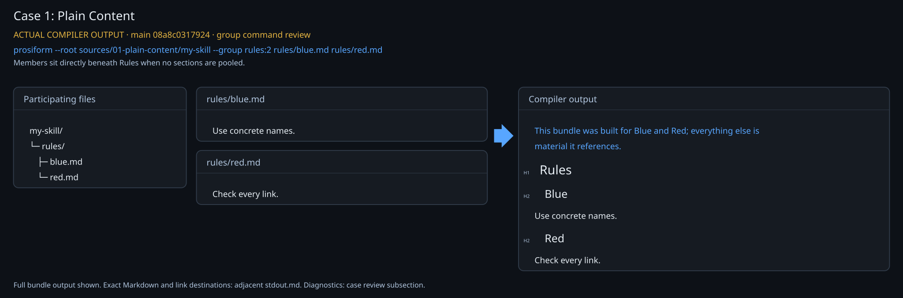

## Case 02-preamble-and-sections

Overview holds preambles beside the pooled Style section.

Area: Member structure · Exit status: 0

```bash
prosiform --root sources/02-preamble-and-sections/my-skill --group rules:2 rules/blue.md rules/red.md
```

[Open SVG](cases/02-preamble-and-sections.svg) · [Exact stdout](cases/02-preamble-and-sections.stdout.md) · [Diagnostics](cases/02-preamble-and-sections.stderr.txt) · [Contents](#contents)

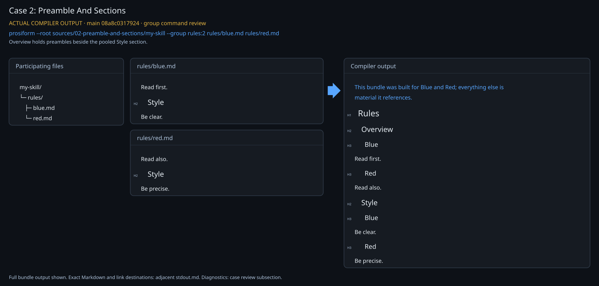

## Case 03-own-title-absorption

A leading own H1 is represented once by its member heading.

Area: Member structure · Exit status: 0

```bash
prosiform --root sources/03-own-title-absorption/my-skill --group rules:2 rules/identity.md
```

[Open SVG](cases/03-own-title-absorption.svg) · [Exact stdout](cases/03-own-title-absorption.stdout.md) · [Diagnostics](cases/03-own-title-absorption.stderr.txt) · [Contents](#contents)

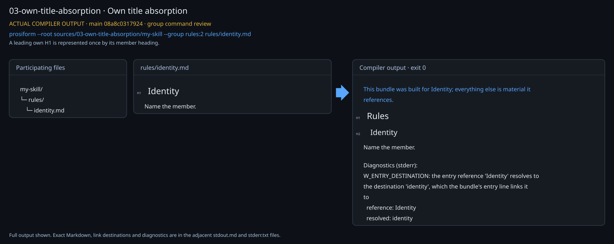

## Case 04-different-title

An authored title different from the filename survives beneath the member.

Area: Member structure · Exit status: 0

```bash
prosiform --root sources/04-different-title/my-skill --group rules:2 rules/other-title.md
```

[Open SVG](cases/04-different-title.svg) · [Exact stdout](cases/04-different-title.stdout.md) · [Diagnostics](cases/04-different-title.stderr.txt) · [Contents](#contents)

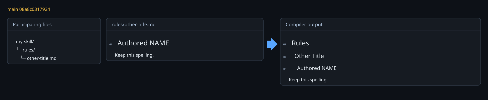

## Case 05-later-title

The first own-name H1 is absorbed even when paragraph content precedes it; both paragraphs survive.

Area: Member structure · Exit status: 0

```bash
prosiform --root sources/05-later-title/my-skill --group rules:2 rules/later-title.md
```

[Open SVG](cases/05-later-title.svg) · [Exact stdout](cases/05-later-title.stdout.md) · [Diagnostics](cases/05-later-title.stderr.txt) · [Contents](#contents)

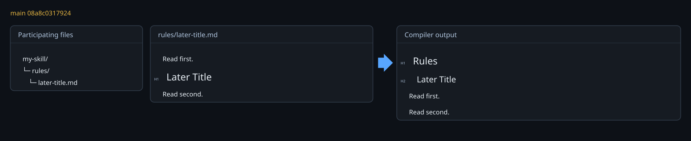

## Case 06-headings-only

Heading-only sections contribute visible structure.

Area: Member structure · Exit status: 0

```bash
prosiform --root sources/06-headings-only/my-skill --group rules:2 rules/outline.md
```

[Open SVG](cases/06-headings-only.svg) · [Exact stdout](cases/06-headings-only.stdout.md) · [Diagnostics](cases/06-headings-only.stderr.txt) · [Contents](#contents)

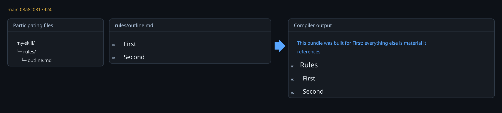

## Case 07-title-only

Absorbing the only title preserves a named member.

Area: Member structure · Exit status: 0

```bash
prosiform --root sources/07-title-only/my-skill --group rules:2 rules/identity.md
```

[Open SVG](cases/07-title-only.svg) · [Exact stdout](cases/07-title-only.stdout.md) · [Diagnostics](cases/07-title-only.stderr.txt) · [Contents](#contents)

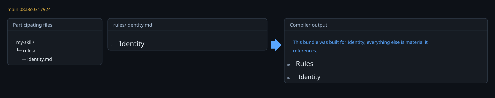

## Case 08-empty-member

An empty document still has a member destination.

Area: Member structure · Exit status: 0

```bash
prosiform --root sources/08-empty-member/my-skill --group rules:2 rules/empty.md
```

[Open SVG](cases/08-empty-member.svg) · [Exact stdout](cases/08-empty-member.stdout.md) · [Diagnostics](cases/08-empty-member.stderr.txt) · [Contents](#contents)

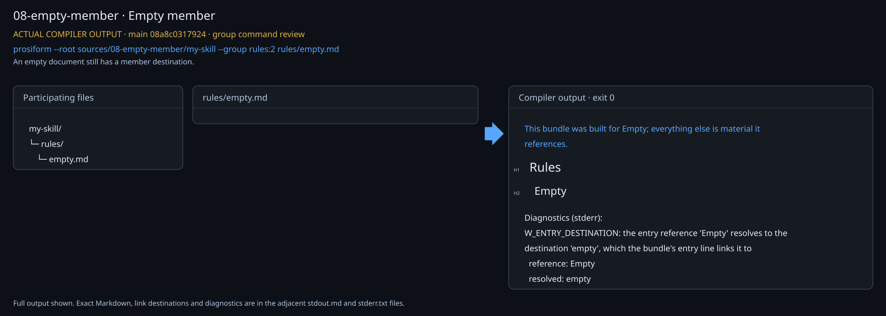

## Case 09-unique-sections

Unique section names need no contributor wrappers.

Area: Pooled sections · Exit status: 0

```bash
prosiform --root sources/09-unique-sections/my-skill --group rules:2 rules/blue.md rules/red.md
```

[Open SVG](cases/09-unique-sections.svg) · [Exact stdout](cases/09-unique-sections.stdout.md) · [Diagnostics](cases/09-unique-sections.stderr.txt) · [Contents](#contents)

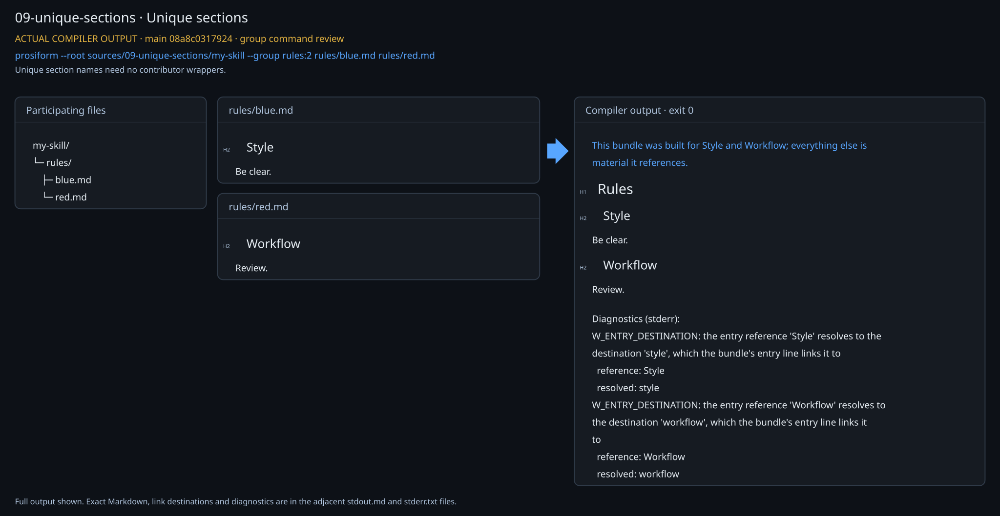

## Case 10-shared-sections

A shared heading contains a named contribution from each member.

Area: Pooled sections · Exit status: 0

```bash
prosiform --root sources/10-shared-sections/my-skill --group rules:2 rules/blue.md rules/red.md
```

[Open SVG](cases/10-shared-sections.svg) · [Exact stdout](cases/10-shared-sections.stdout.md) · [Diagnostics](cases/10-shared-sections.stderr.txt) · [Contents](#contents)

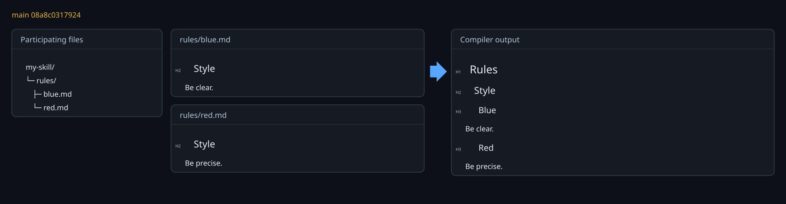

## Case 11-mixed-sections

Shared and single-contributor sections coexist.

Area: Pooled sections · Exit status: 0

```bash
prosiform --root sources/11-mixed-sections/my-skill --group rules:2 rules/blue.md rules/red.md
```

[Open SVG](cases/11-mixed-sections.svg) · [Exact stdout](cases/11-mixed-sections.stdout.md) · [Diagnostics](cases/11-mixed-sections.stderr.txt) · [Contents](#contents)

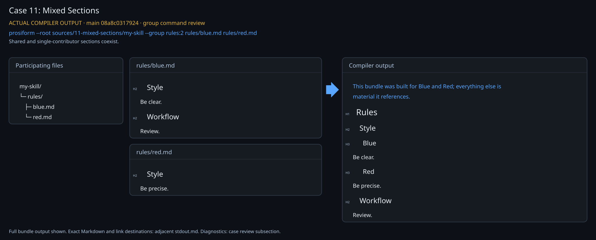

## Case 12-body-only-contributions

Body-only contributions retain member identity at depth one.

Area: Pooled sections · Exit status: 0

```bash
prosiform --root sources/12-body-only-contributions/my-skill --group rules:1 rules/blue.md rules/red.md
```

[Open SVG](cases/12-body-only-contributions.svg) · [Exact stdout](cases/12-body-only-contributions.stdout.md) · [Diagnostics](cases/12-body-only-contributions.stderr.txt) · [Contents](#contents)

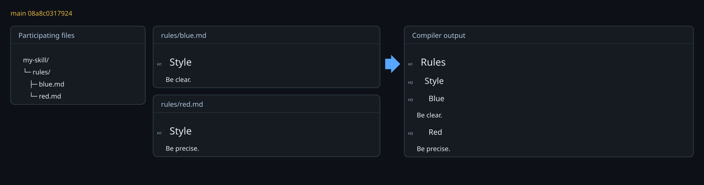

## Case 13-nested-contributions

Each contributor retains its own child section beneath the pooled heading.

Area: Pooled sections · Exit status: 0

```bash
prosiform --root sources/13-nested-contributions/my-skill --group rules:2 rules/blue.md rules/red.md
```

[Open SVG](cases/13-nested-contributions.svg) · [Exact stdout](cases/13-nested-contributions.stdout.md) · [Diagnostics](cases/13-nested-contributions.stderr.txt) · [Contents](#contents)

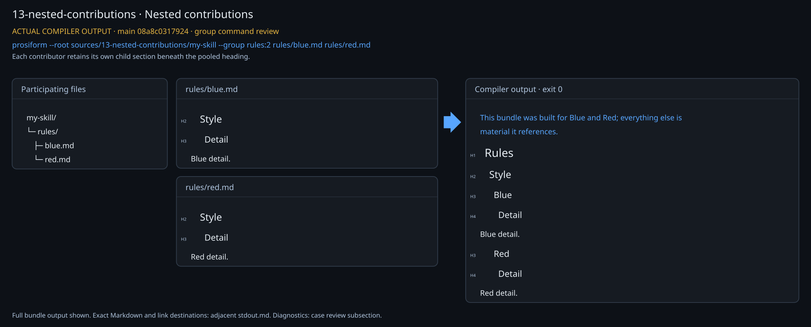

## Case 14-empty-contributions

A shared heading with empty contributions still names both contributors.

Area: Pooled sections · Exit status: 0

```bash
prosiform --root sources/14-empty-contributions/my-skill --group rules:2 rules/blue.md rules/red.md
```

[Open SVG](cases/14-empty-contributions.svg) · [Exact stdout](cases/14-empty-contributions.stdout.md) · [Diagnostics](cases/14-empty-contributions.stderr.txt) · [Contents](#contents)

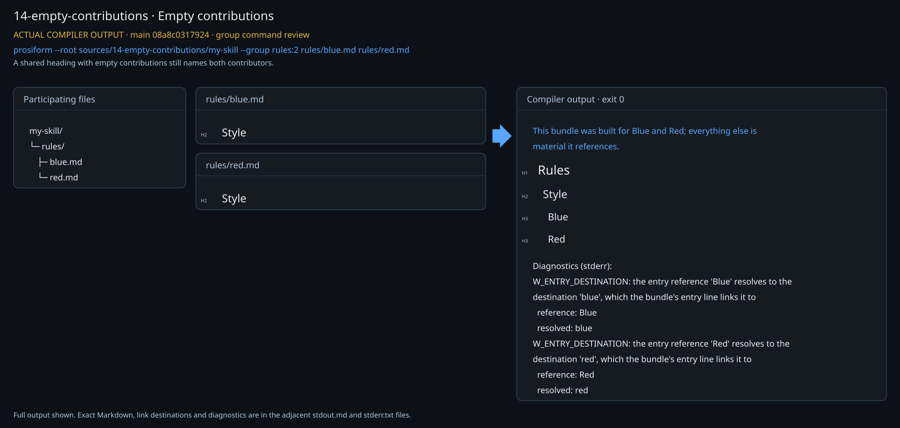

## Case 15-simple-names

Generated names title-case separators and preserve HTTP.

Area: Names and casing · Exit status: 0

```bash
prosiform --root sources/15-simple-names/my-skill --group rules:2 rules/HTTP-checks.md rules/quick_start.md
```

[Open SVG](cases/15-simple-names.svg) · [Exact stdout](cases/15-simple-names.stdout.md) · [Diagnostics](cases/15-simple-names.stderr.txt) · [Contents](#contents)

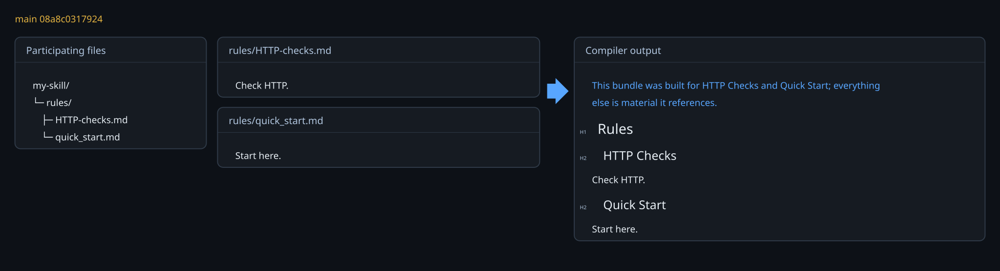

## Case 16-nested-names

A unique nested member needs only its filename stem.

Area: Names and casing · Exit status: 0

```bash
prosiform --root sources/16-nested-names/my-skill --group rules:2 rules/nested/deep-note.md rules/plain.md
```

[Open SVG](cases/16-nested-names.svg) · [Exact stdout](cases/16-nested-names.stdout.md) · [Diagnostics](cases/16-nested-names.stderr.txt) · [Contents](#contents)

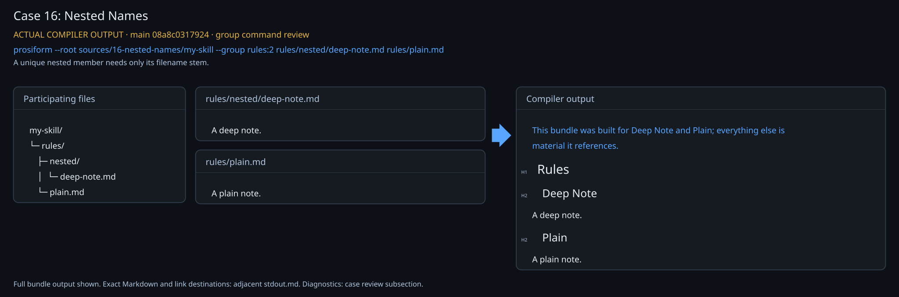

## Case 17-stem-clashes

Directory suffixes distinguish identical stems.

Area: Names and casing · Exit status: 0

```bash
prosiform --root sources/17-stem-clashes/my-skill --group rules:2 rules/api/common.md rules/web/common.md
```

[Open SVG](cases/17-stem-clashes.svg) · [Exact stdout](cases/17-stem-clashes.stdout.md) · [Diagnostics](cases/17-stem-clashes.stderr.txt) · [Contents](#contents)

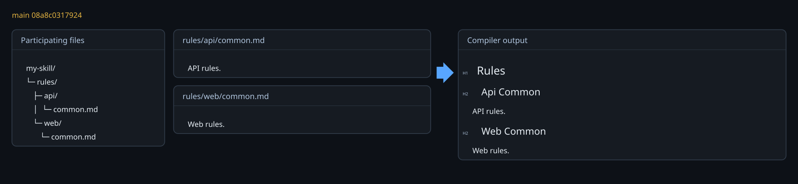

## Case 18-deep-clashes

Qualification reaches the directory segment that distinguishes members.

Area: Names and casing · Exit status: 0

```bash
prosiform --root sources/18-deep-clashes/my-skill --group rules:2 rules/team-a/web/shared.md rules/team-b/web/shared.md
```

[Open SVG](cases/18-deep-clashes.svg) · [Exact stdout](cases/18-deep-clashes.stdout.md) · [Diagnostics](cases/18-deep-clashes.stderr.txt) · [Contents](#contents)

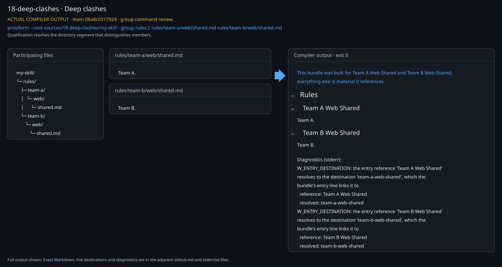

## Case 19-formatting-clashes

Names remain distinct after hyphens and underscores become spaces.

Area: Names and casing · Exit status: 0

```bash
prosiform --root sources/19-formatting-clashes/my-skill --group rules:2 rules/a/one-two.md rules/b/one_two.md
```

[Open SVG](cases/19-formatting-clashes.svg) · [Exact stdout](cases/19-formatting-clashes.stdout.md) · [Diagnostics](cases/19-formatting-clashes.stderr.txt) · [Contents](#contents)

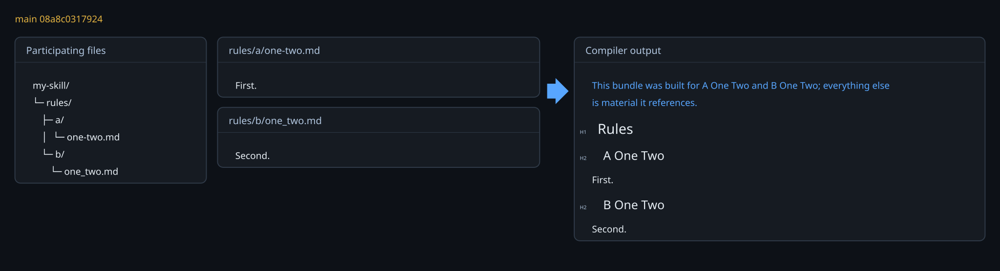

## Case 20-group-suffixes

Member names omit the redundant group kind when names stay distinct.

Area: Names and casing · Exit status: 0

```bash
prosiform --root sources/20-group-suffixes/my-skill --group modes:2 modes/plan-mode.md modes/review-mode.md
```

[Open SVG](cases/20-group-suffixes.svg) · [Exact stdout](cases/20-group-suffixes.stdout.md) · [Diagnostics](cases/20-group-suffixes.stderr.txt) · [Contents](#contents)

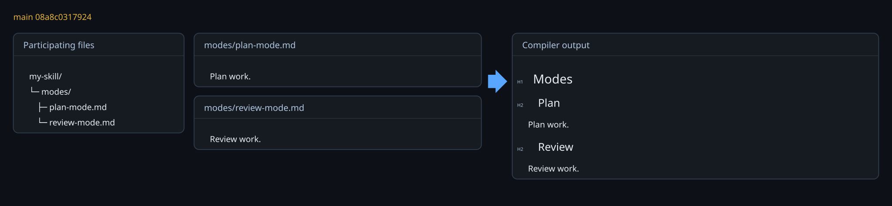

## Case 21-consistent-variant-names

Overview and pooled variants share the group-wide member names, including a noncontributor.

Area: Names and casing · Exit status: 0

```bash
prosiform --root sources/21-consistent-variant-names/my-skill --group rules:2 rules/a/common.md rules/b/common.md rules/c/common.md
```

[Open SVG](cases/21-consistent-variant-names.svg) · [Exact stdout](cases/21-consistent-variant-names.stdout.md) · [Diagnostics](cases/21-consistent-variant-names.stderr.txt) · [Contents](#contents)

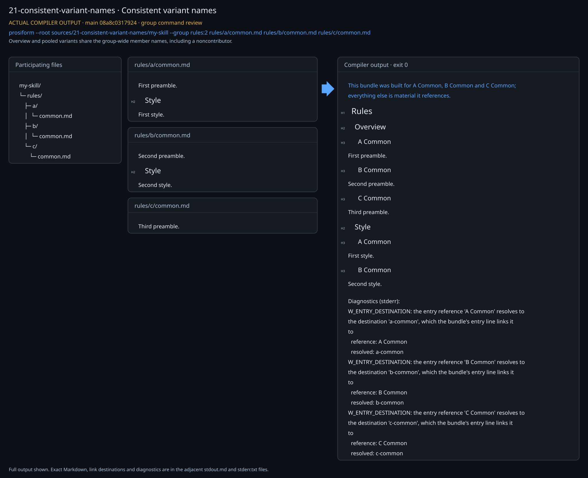

## Case 22-whole-member-links

Whole-document links reach distinct contributor headings.

Area: Links and selection · Exit status: 0

```bash
prosiform --root sources/22-whole-member-links/my-skill --group rules:2 route.md
```

[Open SVG](cases/22-whole-member-links.svg) · [Exact stdout](cases/22-whole-member-links.stdout.md) · [Diagnostics](cases/22-whole-member-links.stderr.txt) · [Contents](#contents)

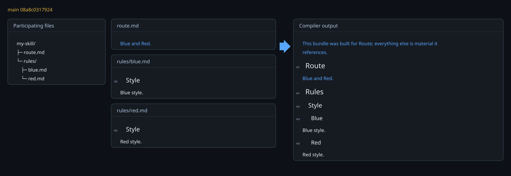

## Case 23-pooled-section-links

References to each source Style section reach its own variant.

Area: Links and selection · Exit status: 0

```bash
prosiform --root sources/23-pooled-section-links/my-skill --group rules:2 route.md
```

[Open SVG](cases/23-pooled-section-links.svg) · [Exact stdout](cases/23-pooled-section-links.stdout.md) · [Diagnostics](cases/23-pooled-section-links.stderr.txt) · [Contents](#contents)

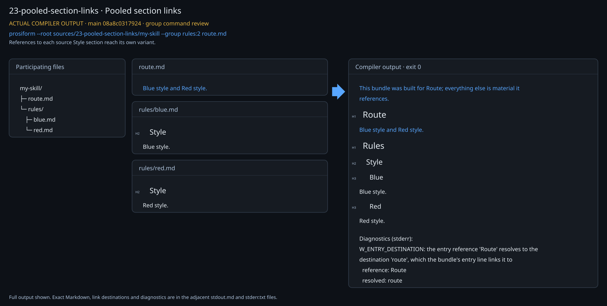

## Case 24-absorbed-title-links

A link to an absorbed title reaches the member heading.

Area: Links and selection · Exit status: 0

```bash
prosiform --root sources/24-absorbed-title-links/my-skill --group rules:2 route.md
```

[Open SVG](cases/24-absorbed-title-links.svg) · [Exact stdout](cases/24-absorbed-title-links.stdout.md) · [Diagnostics](cases/24-absorbed-title-links.stderr.txt) · [Contents](#contents)

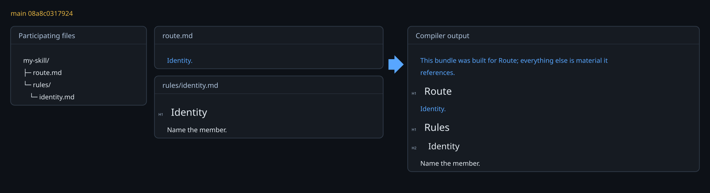

## Case 25-selected-sections

Selecting one section preserves its outline and excludes its sibling body.

Area: Links and selection · Exit status: 0

```bash
prosiform --root sources/25-selected-sections/my-skill --group rules:2 'rules/guide.md#selected'
```

[Open SVG](cases/25-selected-sections.svg) · [Exact stdout](cases/25-selected-sections.stdout.md) · [Diagnostics](cases/25-selected-sections.stderr.txt) · [Contents](#contents)

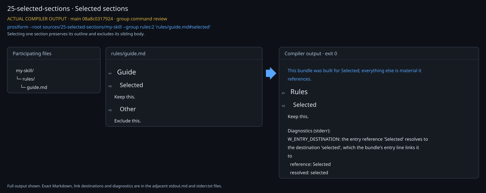

## Case 26-deferred-links

Deferred targets exist but contribute no body.

Area: Links and selection · Exit status: 0

```bash
prosiform --root sources/26-deferred-links/my-skill --group rules:2 rules/common.md
```

[Open SVG](cases/26-deferred-links.svg) · [Exact stdout](cases/26-deferred-links.stdout.md) · [Diagnostics](cases/26-deferred-links.stderr.txt) · [Contents](#contents)

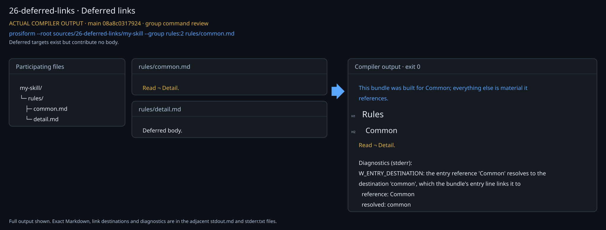

## Case 27-harness-selection

Selecting Codex includes its common rules and leaves Claude deferred.

Area: Links and selection · Exit status: 0

```bash
prosiform --root sources/27-harness-selection/my-skill --group rules:2 rules/codex.md
```

[Open SVG](cases/27-harness-selection.svg) · [Exact stdout](cases/27-harness-selection.stdout.md) · [Diagnostics](cases/27-harness-selection.stderr.txt) · [Contents](#contents)

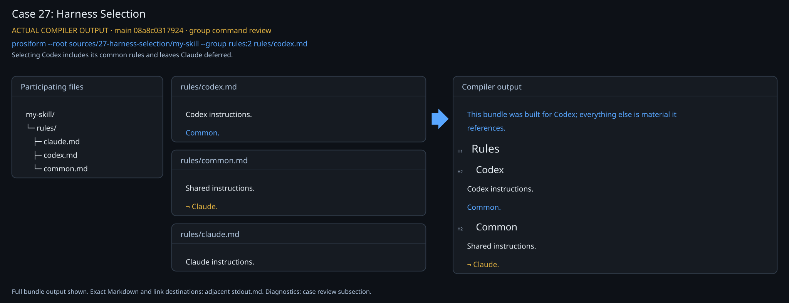

## Case 28-ungrouped-baseline

Ungrouped generated names retain paths and authored heading spelling.

Area: Group combinations · Exit status: 0

```bash
prosiform --root sources/28-ungrouped-baseline/my-skill procedure.md rules/HTTP-checks.md
```

[Open SVG](cases/28-ungrouped-baseline.svg) · [Exact stdout](cases/28-ungrouped-baseline.stdout.md) · [Diagnostics](cases/28-ungrouped-baseline.stderr.txt) · [Contents](#contents)

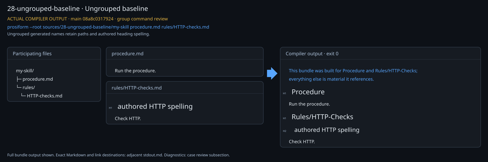

## Case 29-multiple-groups

Distinct slugs contribute independent groups.

Area: Group combinations · Exit status: 0

```bash
prosiform --root sources/29-multiple-groups/my-skill --group rules:2 --group checks:1 rules/common.md checks/final.md
```

[Open SVG](cases/29-multiple-groups.svg) · [Exact stdout](cases/29-multiple-groups.stdout.md) · [Diagnostics](cases/29-multiple-groups.stderr.txt) · [Contents](#contents)

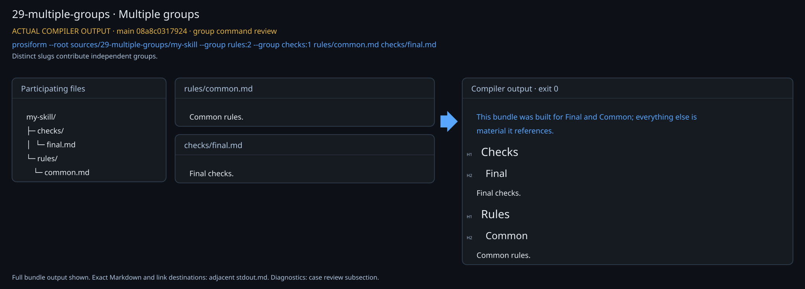

## Case 30-nested-precedence

The deepest named directory owns its member; both groups have content.

Area: Group combinations · Exit status: 0

```bash
prosiform --root sources/30-nested-precedence/my-skill --group rules:2 --group visual:1 rules/plain.md rules/visual/blue.md
```

[Open SVG](cases/30-nested-precedence.svg) · [Exact stdout](cases/30-nested-precedence.stdout.md) · [Diagnostics](cases/30-nested-precedence.stderr.txt) · [Contents](#contents)

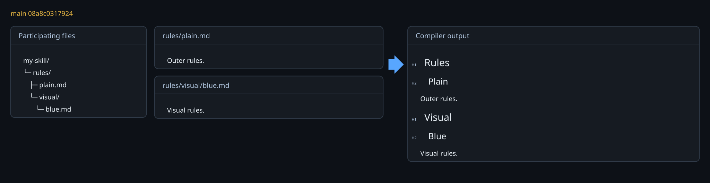

## Case 31-repeated-directory-names

One slug groups matching directories in separate branches.

Area: Group combinations · Exit status: 0

```bash
prosiform --root sources/31-repeated-directory-names/my-skill --group rules:2 a/rules/blue.md b/rules/red.md
```

[Open SVG](cases/31-repeated-directory-names.svg) · [Exact stdout](cases/31-repeated-directory-names.stdout.md) · [Diagnostics](cases/31-repeated-directory-names.stderr.txt) · [Contents](#contents)

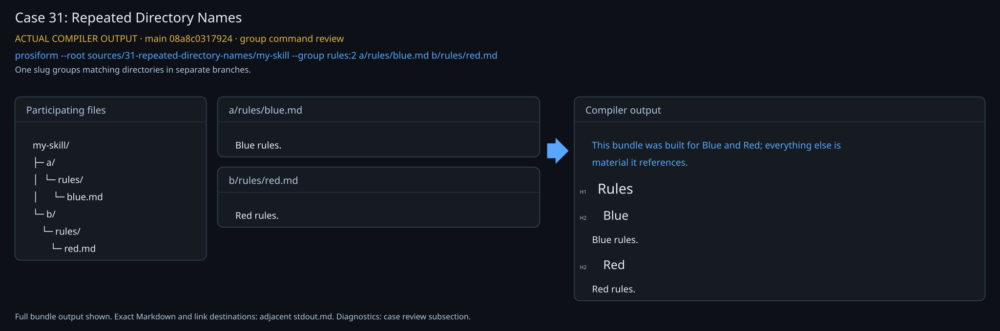

## Case 32-unmatched-group

An existing directory with no reached members warns while the selected document compiles.

Area: Group combinations · Exit status: 0

```bash
prosiform --root sources/32-unmatched-group/my-skill --group rules:2 procedure.md
```

[Open SVG](cases/32-unmatched-group.svg) · [Exact stdout](cases/32-unmatched-group.stdout.md) · [Diagnostics](cases/32-unmatched-group.stderr.txt) · [Contents](#contents)

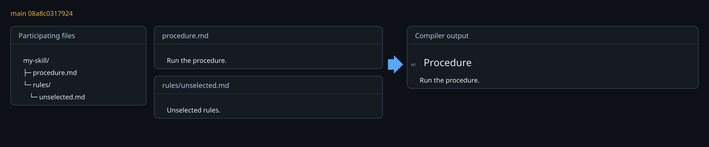

## Case 33-missing-depth

A folder-only group argument is invalid usage and emits no bundle.

Area: Rejected commands/output · Exit status: 2

```bash
prosiform --root sources/33-missing-depth/my-skill --group rules rules/plain.md
```

[Open SVG](cases/33-missing-depth.svg) · [Exact stdout](cases/33-missing-depth.stdout.md) · [Diagnostics](cases/33-missing-depth.stderr.txt) · [Contents](#contents)


## Case 34-invalid-depth

A depth outside one through six is invalid usage.

Area: Rejected commands/output · Exit status: 2

```bash
prosiform --root sources/34-invalid-depth/my-skill --group rules:7 rules/plain.md
```

[Open SVG](cases/34-invalid-depth.svg) · [Exact stdout](cases/34-invalid-depth.stdout.md) · [Diagnostics](cases/34-invalid-depth.stderr.txt) · [Contents](#contents)

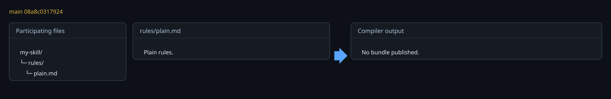

## Case 35-duplicate-slug

A slug may be declared only once, even with different depths.

Area: Rejected commands/output · Exit status: 2

```bash
prosiform --root sources/35-duplicate-slug/my-skill --group rules:1 --group rules:2 rules/plain.md
```

[Open SVG](cases/35-duplicate-slug.svg) · [Exact stdout](cases/35-duplicate-slug.stdout.md) · [Diagnostics](cases/35-duplicate-slug.stderr.txt) · [Contents](#contents)


## Case 36-heading-overflow

A carried heading that would exceed H6 prevents publication.

Area: Rejected commands/output · Exit status: 1

```bash
prosiform --root sources/36-heading-overflow/my-skill --group rules:2 rules/deep.md
```

[Open SVG](cases/36-heading-overflow.svg) · [Exact stdout](cases/36-heading-overflow.stdout.md) · [Diagnostics](cases/36-heading-overflow.stderr.txt) · [Contents](#contents)

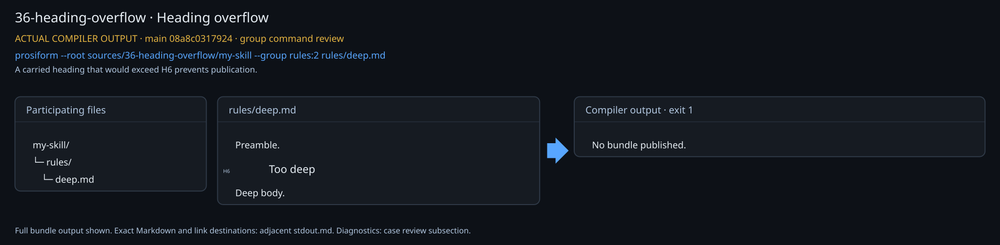
