# My-skill visual review — issues #194 and #195

**Proposed output, not current compiler output.** These images show what the tool would generate after the current issue designs are applied. The current compiler still requires `--group SLUG:DEPTH`; the proposed commands use `--group SLUG`.

Each image includes its participating file tree, rendered source fragments, and the complete proposed bundle body. Only the generated entry preamble is omitted. Click the SVG link to zoom; the adjacent Markdown contains exact heading levels and link destinations.

Generated headings use the existing title convention: capitalize the first character of each word, preserve the rest (including HTTP), turn hyphens into spaces, and retain path separators in ungrouped document names. Authored headings retain their spelling.

**Review assumptions:** member order follows source paths; nested grouping retains deepest-folder membership; CLI rejections specify no exact diagnostic wording. These boundary cases are labeled in their images. This suite covers the current issue bodies, not the historical section-group/folder-group proposal preserved in issue comments.

[Source layout, coverage, and reproduction](README.md) · [Case definitions](cases.json) · [Current compiler observations](current-observations/runs.json)

## Contents

- [01-root-documents: Root documents: generated title case](#case-01-root-documents)
- [02-default-paths: Ungrouped nested and hyphenated names](#case-02-default-paths)
- [03-preamble-only: Grouped member with no headings](#case-03-preamble-only)
- [04-preamble-headings: Preamble and authored sections stay together](#case-04-preamble-headings)
- [05-shared-section-names: Repeated Style sections do not merge](#case-05-shared-section-names)
- [06-absorb-h1: Own title absorbed at H1](#case-06-absorb-h1)
- [07-absorb-h2: Own title absorbed at H2](#case-07-absorb-h2)
- [08-absorb-h3: Own title absorbed at H3](#case-08-absorb-h3)
- [09-absorb-h4: Own title absorbed at H4](#case-09-absorb-h4)
- [10-absorb-h5: Own title absorbed at H5](#case-10-absorb-h5)
- [11-absorb-h6: Own title absorbed at H6](#case-11-absorb-h6)
- [12-own-title-children: Own title with an authored child](#case-12-own-title-children)
- [13-other-title: A different authored title is retained](#case-13-other-title)
- [14-headings-only: Member with only authored headings](#case-14-headings-only)
- [15-title-only: Member with only its own title](#case-15-title-only)
- [16-later-title: A later matching heading is not a leading title](#case-16-later-title)
- [17-stem-clash: Duplicate Common stems need parent names](#case-17-stem-clash)
- [18-deep-stem-clash: A parent-name clash needs another path segment](#case-18-deep-stem-clash)
- [19-unique-nested-member: Unique nested member uses its stem](#case-19-unique-nested-member)
- [20-generated-versus-authored: Generated casing versus authored spelling](#case-20-generated-versus-authored)
- [21-member-destinations: Whole-member and repeated-heading destinations](#case-21-member-destinations)
- [22-clash-destinations: Links to members with duplicate stems](#case-22-clash-destinations)
- [23-shared-skill: Shared context and deferred harness selection](#case-23-shared-skill)
- [24-harness-codex: Second stage: Codex as a member](#case-24-harness-codex)
- [25-harness-claude: Second stage: Claude as a member](#case-25-harness-claude)
- [26-multiple-groups: Repeated option for different folder slugs](#case-26-multiple-groups)
- [27-old-depth-rejected: Retired depth syntax is rejected](#case-27-old-depth-rejected)
- [28-duplicate-group-rejected: Repeated identical folder rule is rejected](#case-28-duplicate-group-rejected)
- [29-deepest-matching-folder: Nested matching folders use the deepest group](#case-29-deepest-matching-folder)
- [30-ungrouped-harness: Ungrouped harness path is title-cased](#case-30-ungrouped-harness)

## Case 01-root-documents

Root documents: generated title case

**Review:** Procedure and Tips are title-cased; source files stay at the root.

**Coverage:** 194 AC1, 195 AC6

```bash
prosiform --root my-skill procedure.md
```

[Open SVG](cases/01-root-documents.svg) · [Exact expected Markdown](cases/01-root-documents.expected.md) · [Back to contents](#contents)

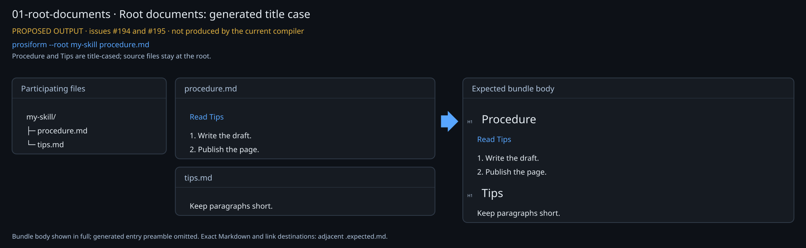

## Case 02-default-paths

Ungrouped nested and hyphenated names

**Review:** Generated paths preserve slashes and HTTP; the authored heading keeps its spelling.

**Coverage:** 194 AC1, 194 AC2, 195 AC6, 195 AC7

```bash
prosiform --root my-skill quick-start.md guides/HTTP-setup.md
```

[Open SVG](cases/02-default-paths.svg) · [Exact expected Markdown](cases/02-default-paths.expected.md) · [Back to contents](#contents)

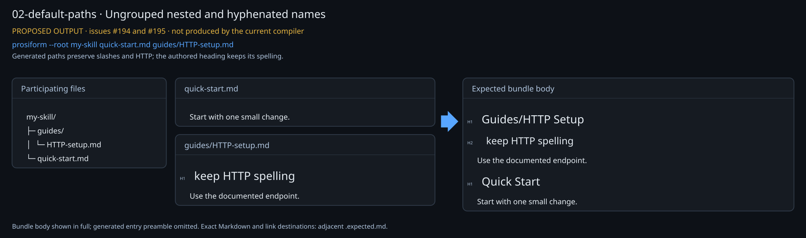

## Case 03-preamble-only

Grouped member with no headings

**Review:** One member section; no Overview wrapper.

**Coverage:** 195 AC1, 195 AC5

```bash
prosiform --root my-skill --group rules rules/visual/plain.md
```

[Open SVG](cases/03-preamble-only.svg) · [Exact expected Markdown](cases/03-preamble-only.expected.md) · [Back to contents](#contents)

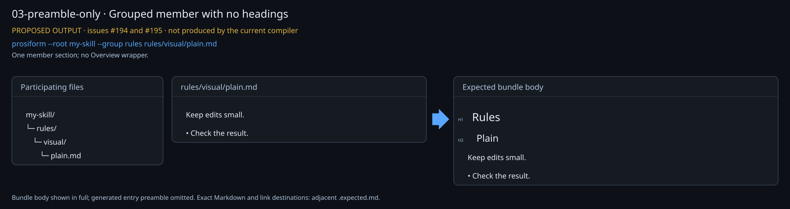

## Case 04-preamble-headings

Preamble and authored sections stay together

**Review:** The preamble and both source sections remain inside Preamble.

**Coverage:** 195 AC1, 195 AC7

```bash
prosiform --root my-skill --group rules rules/visual/preamble.md
```

[Open SVG](cases/04-preamble-headings.svg) · [Exact expected Markdown](cases/04-preamble-headings.expected.md) · [Back to contents](#contents)

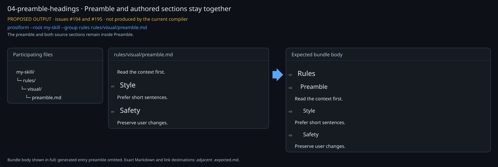

## Case 05-shared-section-names

Repeated Style sections do not merge

**Review:** Blue and Red stay whole; neither Style section collects the other member.

**Coverage:** 195 AC1, 195 AC4

```bash
prosiform --root my-skill --group rules rules/visual/blue.md rules/visual/red.md
```

[Open SVG](cases/05-shared-section-names.svg) · [Exact expected Markdown](cases/05-shared-section-names.expected.md) · [Back to contents](#contents)

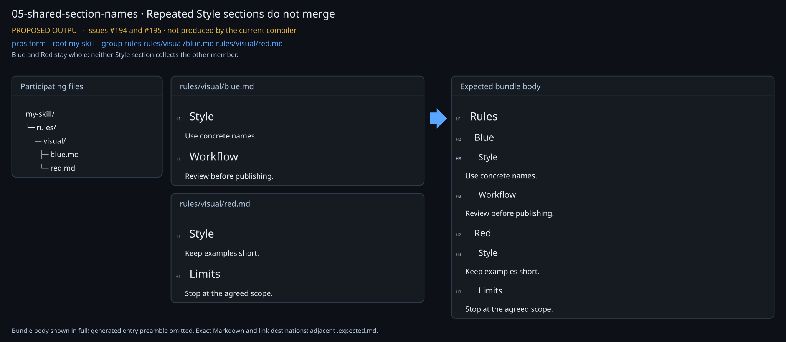

## Case 06-absorb-h1

Own title absorbed at H1

**Review:** The leading H1 becomes the member title exactly once.

**Coverage:** 195 AC2

```bash
prosiform --root my-skill --group rules rules/visual/heading-h1.md
```

[Open SVG](cases/06-absorb-h1.svg) · [Exact expected Markdown](cases/06-absorb-h1.expected.md) · [Back to contents](#contents)

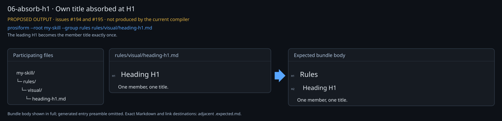

## Case 07-absorb-h2

Own title absorbed at H2

**Review:** The leading H2 becomes the member title exactly once.

**Coverage:** 195 AC2

```bash
prosiform --root my-skill --group rules rules/visual/heading-h2.md
```

[Open SVG](cases/07-absorb-h2.svg) · [Exact expected Markdown](cases/07-absorb-h2.expected.md) · [Back to contents](#contents)

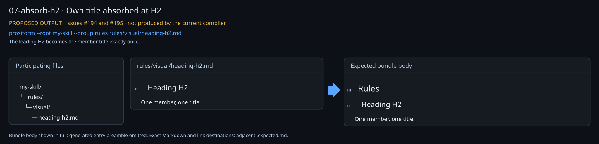

## Case 08-absorb-h3

Own title absorbed at H3

**Review:** The leading H3 becomes the member title exactly once.

**Coverage:** 195 AC2

```bash
prosiform --root my-skill --group rules rules/visual/heading-h3.md
```

[Open SVG](cases/08-absorb-h3.svg) · [Exact expected Markdown](cases/08-absorb-h3.expected.md) · [Back to contents](#contents)

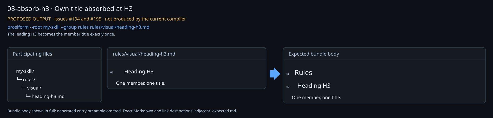

## Case 09-absorb-h4

Own title absorbed at H4

**Review:** The leading H4 becomes the member title exactly once.

**Coverage:** 195 AC2

```bash
prosiform --root my-skill --group rules rules/visual/heading-h4.md
```

[Open SVG](cases/09-absorb-h4.svg) · [Exact expected Markdown](cases/09-absorb-h4.expected.md) · [Back to contents](#contents)


## Case 10-absorb-h5

Own title absorbed at H5

**Review:** The leading H5 becomes the member title exactly once.

**Coverage:** 195 AC2

```bash
prosiform --root my-skill --group rules rules/visual/heading-h5.md
```

[Open SVG](cases/10-absorb-h5.svg) · [Exact expected Markdown](cases/10-absorb-h5.expected.md) · [Back to contents](#contents)


## Case 11-absorb-h6

Own title absorbed at H6

**Review:** The leading H6 becomes the member title exactly once.

**Coverage:** 195 AC2

```bash
prosiform --root my-skill --group rules rules/visual/heading-h6.md
```

[Open SVG](cases/11-absorb-h6.svg) · [Exact expected Markdown](cases/11-absorb-h6.expected.md) · [Back to contents](#contents)

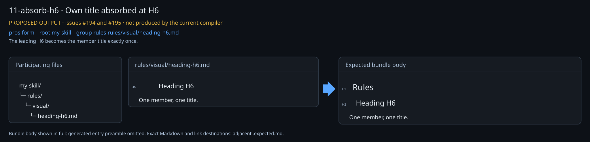

## Case 12-own-title-children

Own title with an authored child

**Review:** Identity is absorbed; its child keeps its exact authored case.

**Coverage:** 194 AC2, 195 AC2, 195 AC7

```bash
prosiform --root my-skill --group rules rules/visual/identity.md
```

[Open SVG](cases/12-own-title-children.svg) · [Exact expected Markdown](cases/12-own-title-children.expected.md) · [Back to contents](#contents)

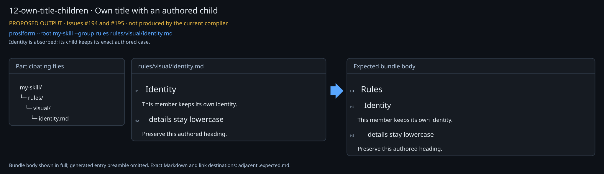

## Case 13-other-title

A different authored title is retained

**Review:** The filename supplies Other Title; the different authored title remains beneath it.

**Coverage:** 194 AC2, 195 AC1, 195 AC7

```bash
prosiform --root my-skill --group rules rules/visual/other-title.md
```

[Open SVG](cases/13-other-title.svg) · [Exact expected Markdown](cases/13-other-title.expected.md) · [Back to contents](#contents)

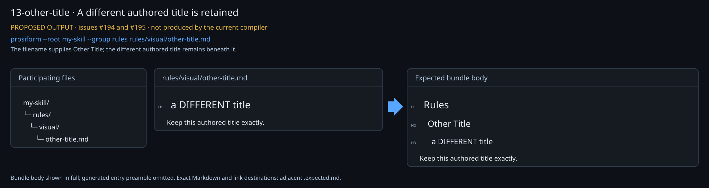

## Case 14-headings-only

Member with only authored headings

**Review:** The member is named even without paragraph content.

**Coverage:** 195 AC1

```bash
prosiform --root my-skill --group rules rules/visual/headings-only.md
```

[Open SVG](cases/14-headings-only.svg) · [Exact expected Markdown](cases/14-headings-only.expected.md) · [Back to contents](#contents)

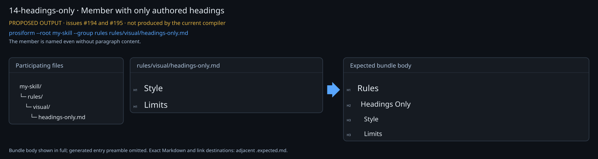

## Case 15-title-only

Member with only its own title

**Review:** Title absorption does not erase the member.

**Coverage:** 195 AC1, 195 AC2

```bash
prosiform --root my-skill --group rules rules/visual/title-only.md
```

[Open SVG](cases/15-title-only.svg) · [Exact expected Markdown](cases/15-title-only.expected.md) · [Back to contents](#contents)

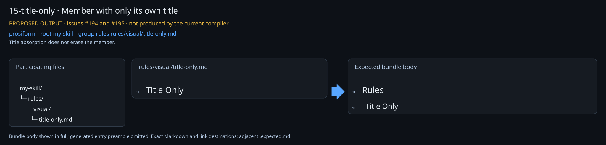

## Case 16-later-title

A later matching heading is not a leading title

**Review:** Only a leading own-title heading qualifies for absorption.

**Coverage:** 195 AC2, 195 AC7

```bash
prosiform --root my-skill --group rules rules/visual/later-title.md
```

[Open SVG](cases/16-later-title.svg) · [Exact expected Markdown](cases/16-later-title.expected.md) · [Back to contents](#contents)

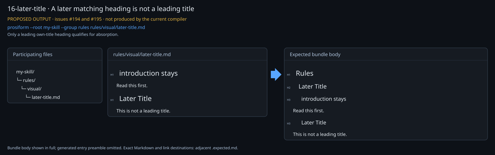

## Case 17-stem-clash

Duplicate Common stems need parent names

**Review:** Use the shortest distinguishing suffix after the shared prefix: Api Common and Web Common.

**Coverage:** 195 AC3

```bash
prosiform --root my-skill --group rules rules/visual/web/common.md rules/visual/api/common.md
```

**Review note:** The existing casing convention capitalizes only the first character of each word: api becomes Api, not API.

[Open SVG](cases/17-stem-clash.svg) · [Exact expected Markdown](cases/17-stem-clash.expected.md) · [Back to contents](#contents)

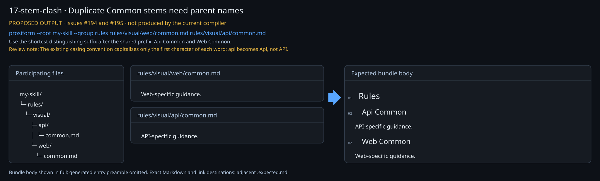

## Case 18-deep-stem-clash

A parent-name clash needs another path segment

**Review:** Web Shared still clashes, so retain the distinguishing Team A or Team B segment.

**Coverage:** 195 AC3, 194 AC1

```bash
prosiform --root my-skill --group rules rules/visual/team-a/web/shared.md rules/visual/team-b/web/shared.md
```

[Open SVG](cases/18-deep-stem-clash.svg) · [Exact expected Markdown](cases/18-deep-stem-clash.expected.md) · [Back to contents](#contents)

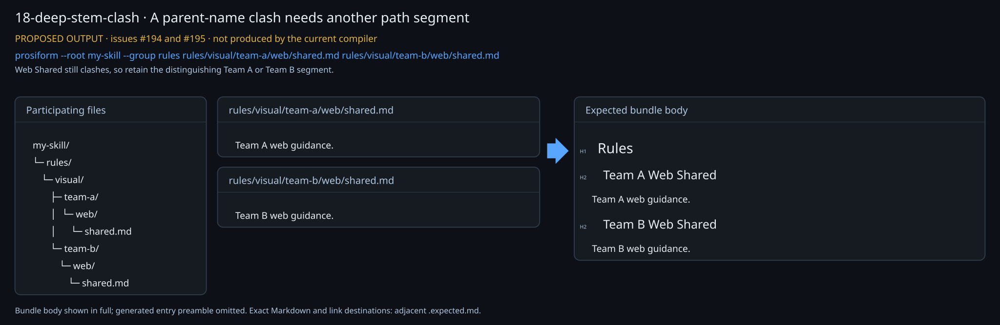

## Case 19-unique-nested-member

Unique nested member uses its stem

**Review:** A unique filename needs no directory qualifier.

**Coverage:** 195 AC1, 195 AC3, 195 AC6

```bash
prosiform --root my-skill --group rules rules/visual/nested/deep-note.md
```

[Open SVG](cases/19-unique-nested-member.svg) · [Exact expected Markdown](cases/19-unique-nested-member.expected.md) · [Back to contents](#contents)

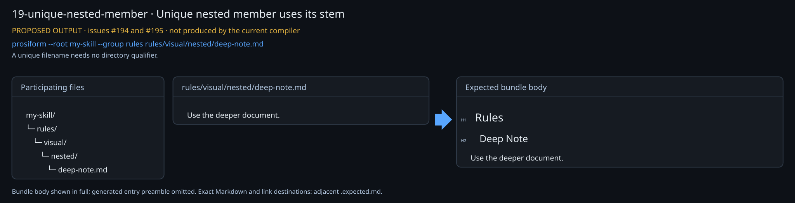

## Case 20-generated-versus-authored

Generated casing versus authored spelling

**Review:** Preserve HTTP in the generated name and every character of the authored heading.

**Coverage:** 194 AC1, 194 AC2, 195 AC6, 195 AC7

```bash
prosiform --root my-skill --group rules rules/visual/HTTP-checks.md
```

[Open SVG](cases/20-generated-versus-authored.svg) · [Exact expected Markdown](cases/20-generated-versus-authored.expected.md) · [Back to contents](#contents)

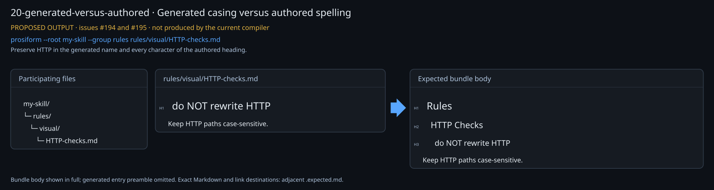

## Case 21-member-destinations

Whole-member and repeated-heading destinations

**Review:** Blue and Red whole-document links have distinct destinations; duplicate Style fragments remain distinct.

**Coverage:** 195 AC1, 195 AC4

```bash
prosiform --root my-skill --group rules rules/visual/route.md
```

[Open SVG](cases/21-member-destinations.svg) · [Exact expected Markdown](cases/21-member-destinations.expected.md) · [Back to contents](#contents)

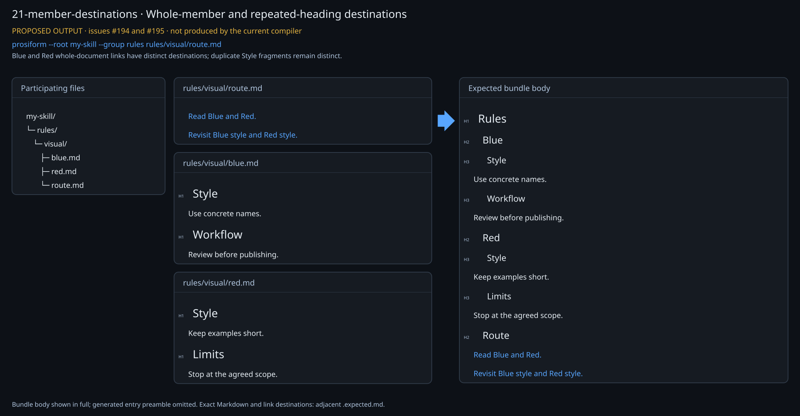

## Case 22-clash-destinations

Links to members with duplicate stems

**Review:** The same-stem members each have a distinct named destination.

**Coverage:** 195 AC3, 195 AC4

```bash
prosiform --root my-skill --group rules rules/visual/clash-route.md
```

[Open SVG](cases/22-clash-destinations.svg) · [Exact expected Markdown](cases/22-clash-destinations.expected.md) · [Back to contents](#contents)

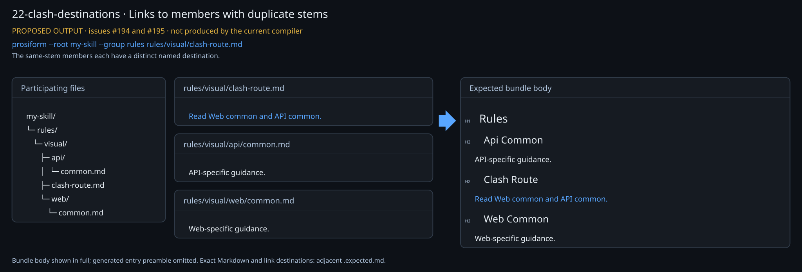

## Case 23-shared-skill

Shared context and deferred harness selection

**Review:** Rules contains Agents and Common directly; harness files remain deferred.

**Coverage:** 195 AC1, 195 AC4, 195 AC6, 195 AC8

```bash
prosiform --root my-skill --group rules procedure.md rules/common.md
```

[Open SVG](cases/23-shared-skill.svg) · [Exact expected Markdown](cases/23-shared-skill.expected.md) · [Back to contents](#contents)

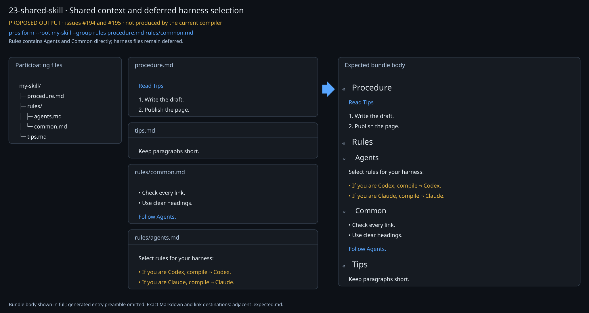

## Case 24-harness-codex

Second stage: Codex as a member

**Review:** Only the selected harness is present; no Overview wrapper.

**Coverage:** 195 AC1, 195 AC4, 195 AC8

```bash
prosiform --root my-skill --group rules rules/codex.md
```

[Open SVG](cases/24-harness-codex.svg) · [Exact expected Markdown](cases/24-harness-codex.expected.md) · [Back to contents](#contents)

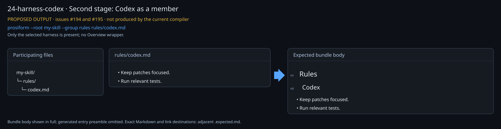

## Case 25-harness-claude

Second stage: Claude as a member

**Review:** Only the selected harness is present; no Overview wrapper.

**Coverage:** 195 AC1, 195 AC4, 195 AC8

```bash
prosiform --root my-skill --group rules rules/claude.md
```

[Open SVG](cases/25-harness-claude.svg) · [Exact expected Markdown](cases/25-harness-claude.expected.md) · [Back to contents](#contents)

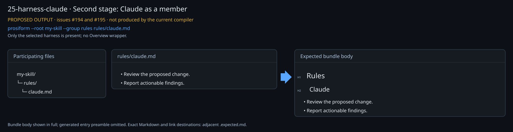

## Case 26-multiple-groups

Repeated option for different folder slugs

**Review:** Each named folder contributes its own group.

**Coverage:** 195 AC5, 195 AC6

```bash
prosiform --root my-skill --group rules --group checks rules/visual/plain.md checks/visual/final-check.md
```

[Open SVG](cases/26-multiple-groups.svg) · [Exact expected Markdown](cases/26-multiple-groups.expected.md) · [Back to contents](#contents)

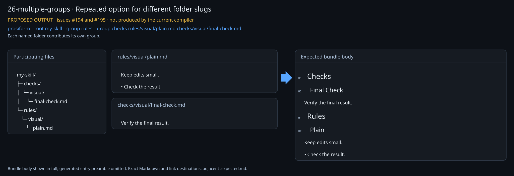

## Case 27-old-depth-rejected

Retired depth syntax is rejected

**Review:** The proposed CLI rejects --group rules:1 and publishes no bundle.

**Coverage:** 195 AC5

```bash
prosiform --root my-skill --group rules:1 rules/visual/plain.md
```

[Open SVG](cases/27-old-depth-rejected.svg) · [Exact expected Markdown](cases/27-old-depth-rejected.expected.md) · [Back to contents](#contents)

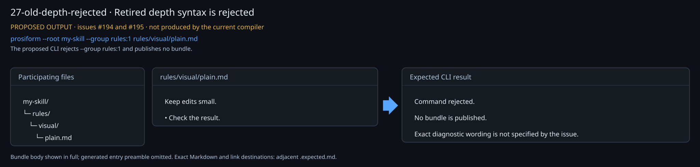

## Case 28-duplicate-group-rejected

Repeated identical folder rule is rejected

**Review:** Repeatable means different folder slugs; the same slug twice is rejected.

**Coverage:** 195 AC5

```bash
prosiform --root my-skill --group rules --group rules rules/visual/plain.md
```

[Open SVG](cases/28-duplicate-group-rejected.svg) · [Exact expected Markdown](cases/28-duplicate-group-rejected.expected.md) · [Back to contents](#contents)

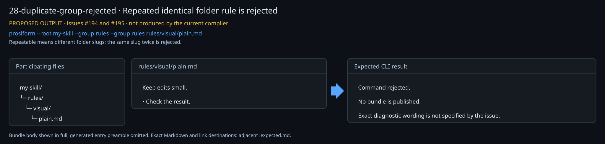

## Case 29-deepest-matching-folder

Nested matching folders use the deepest group

**Review:** Existing deepest-folder selection is retained; the unused outer rule contributes no section.

**Coverage:** 195 AC1, 195 AC5

```bash
prosiform --root my-skill --group rules --group nested rules/visual/nested/deep-note.md
```

**Review note:** Scope assumption: the issue changes arrangement, not deepest-directory membership. Confirm this retained behavior during review.

[Open SVG](cases/29-deepest-matching-folder.svg) · [Exact expected Markdown](cases/29-deepest-matching-folder.expected.md) · [Back to contents](#contents)

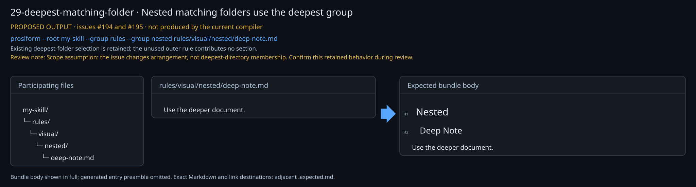

## Case 30-ungrouped-harness

Ungrouped harness path is title-cased

**Review:** Title casing also covers the default document heading, without --group.

**Coverage:** 194 AC1, 195 AC6

```bash
prosiform --root my-skill rules/codex.md
```

[Open SVG](cases/30-ungrouped-harness.svg) · [Exact expected Markdown](cases/30-ungrouped-harness.expected.md) · [Back to contents](#contents)

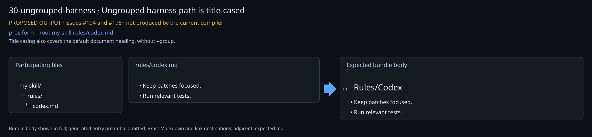
