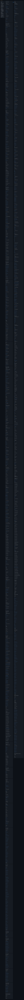

# advance-mode.md

Compiler: main 64bac30b870083b64a3fd57744c042257aa4697c

Source files opened by the compiler appear beside the bundle body. The opening compiler paragraph appears under Entry Points, with links into the exact stdout file. Opened files can include deferred targets; their presence does not imply their content is bundled. Images simplify Markdown presentation; the stdout file preserves exact content and link destinations. Compact view replaces body content with … while retaining headings and links. Titles below H3 appear only when their section, including subsections, contains links.



### Command

```bash
prosiform --root /tmp/prosiform-diagram-engineering/artifacts/planning/2026-10-22-work-planner-compact-diagram/work-planner --max-output-bytes 1048576 --group artifacts:2 --group protocols:2 modes/advance-mode.md
```

### Entry Points

This bundle was built for [Modes/Advance-Mode](advance.stdout.md#modesadvance-mode); everything else is material it references.

### Diagnostics

Exit status: 0

```text
W_ENTRY_DESTINATION: the entry reference 'Modes/Advance-Mode' resolves to the destination 'modesadvance-mode', which the bundle's entry line links it to
  reference: Modes/Advance-Mode
  resolved: modesadvance-mode
```
