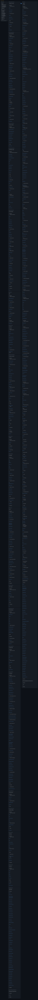

# align-mode.md

Compiler: main 68dd39c10ad0f5b1ba8087dabbf924be960f50a1

Source files opened by the compiler appear beside the bundle body. The opening compiler paragraph appears under Entry Points, with links into the exact stdout file. Opened files can include deferred targets; their presence does not imply their content is bundled. Images simplify Markdown presentation; the stdout file preserves exact content and link destinations. Compact view replaces body content with … while retaining headings and links.



### Command

```bash
prosiform --root /tmp/prosiform-diagram-engineering/artifacts/planning/2026-10-22-work-planner-compact-diagram/work-planner --max-output-bytes 1048576 --group artifacts:2 --group protocols:2 modes/align-mode.md
```

### Entry Points

This bundle was built for [Modes/Align-Mode](align.stdout.md#modesalign-mode); everything else is material it references.

### Diagnostics

Exit status: 0

```text
W_EMPTY_GROUP_RULE: the grouping rule for 'protocols' arranges nothing, because the closure carries no document under a directory of that slug
W_ENTRY_DESTINATION: the entry reference 'Modes/Align-Mode' resolves to the destination 'modesalign-mode', which the bundle's entry line links it to
  reference: Modes/Align-Mode
  resolved: modesalign-mode
```
