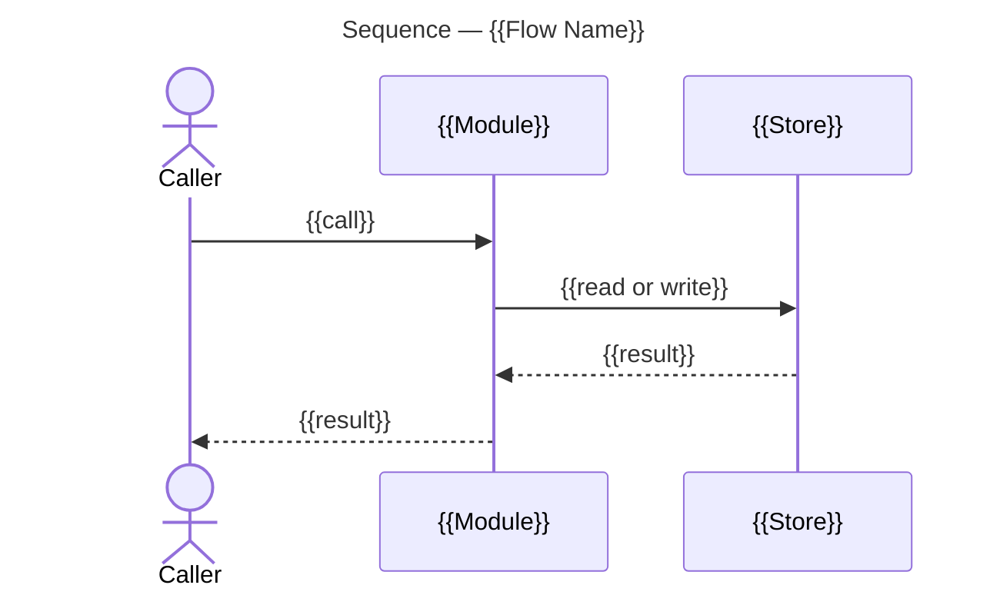

This bundle was built for [Standup Mode](#standup-mode); everything else is material it references.

# Artifacts

## Operations

### Acceptance Criteria

#### *Verify* Selected Criteria

The verification evidence for a supplied set of criteria whose delivery is ready.

**Inputs:** Criterion ids, current issue body, delivery findings, delivery revisions, named instruments and the project checkout to run them in.

1. Confirm the supplied delivery findings establish [Readiness](#readiness) for each selected criterion.
   - Return an undelivered or unreadable dependency as a blocker for that criterion.
2. Check out each branch the delivering pull requests merged into, in the supplied project checkout, meeting [Instrument Checkout](#instrument-checkout).
   - Run each criterion's named instrument there.
   - Record the result against the tested revisions, meeting [Instrument Result](#instrument-result).
3. Return verified criterion ids with their evidence and each unresolved criterion with what is missing.
   - Leave body publication and further planning to the caller.

#### *Tick* Verified Criteria

The confirmed criteria and completed rows recorded in an epic or initiative body.

**Inputs:** Issue JSON, verified criterion ids, output body file, and the pull request records with the complete issue-link snapshot for an epic or every linked epic record for an initiative.

1. Record the criteria, meeting [Tick State](#tick-state).
   - For an epic, run [Record Epic Criteria](#record-epic-criteria) with the issue JSON, pull request records, complete issue-link snapshot, verified criterion ids and output body file.
   - For an initiative, run [Record Initiative Criteria](#record-initiative-criteria) with the issue JSON, every linked epic record, verified criterion ids and output body file.
2. Return the resulting body and any criteria refused as not ready to verify. The artifact operations return the updated bodies for publication.

### Architecture Overview

#### *Populate* Architecture Overview

One architecture overview from supplied measurements.

**Inputs:** Measured structure and flows, pull request head, code permalinks and the output path.

1. Take the graph measurements supplied by the caller and check the proposed diagrams.
   - The diagrams must meet [Measured Structure](#measured-structure) and [Diagrams](#diagrams).
2. Populate the overview from the [Template](#template) at the supplied output path.
   - All populated fields must meet [Fields](#architecture-overview-1), including the required [Sections](#sections).
3. Pin each code reference.
   - Each reference must meet [Code References](#code-references).
4. Return the file for the caller to register in its planning record.

### Board Delivery

#### *Plan* Board Changes

The board changes implied by supplied delivery state.

**Inputs:** Initiative JSON, epic and task records, pull request records, complete issue-link snapshot, board identity, fields and items, output directory, assignee login and resolved off-board issue files.

1. Require the complete pull-request issue-link snapshot; refuse the computation without it.
2. Run [Compute Board Changes](#compute-board-changes), mapping the supplied records and board context to its parameters.
3. Return the generated calls and unresolved references, meeting [Fields](#board-delivery-1). The caller gathers missing evidence, applies changes and confirms their live state.

#### *Record* Board Delivery

The board's status and assignees after its issues record delivery.

**Inputs:** Saved initiative, epic and task identities, board identity, output directory, and the repositories the board's issues live in.

1. Read the issues, the board and its delivery records.
   - Run [Read Tracker Issue](#read-tracker-issue) for the saved initiative, epic and task identities.
   - Run [Read Board State](#read-board-state) for the selected board.
   - Run [Fetch All Initiative Pull Requests](#fetch-all-initiative-pull-requests) for its repositories.
   - Run [Fetch Pull Request Issue Links](#fetch-pull-request-issue-links) for those records.
   - Run [Read Board Configuration](#read-board-configuration) with the board and output paths.
   - Run [Read Board Assignee](#read-board-assignee) for the assignment login.
   - Pass these returned snapshots to Plan Board Changes.
2. Run [Plan Board Changes](#plan-board-changes) with the initiative JSON, linked epic records, task issue records, pull request records, complete issue-link snapshot, board identity, board fields, board items, output directory, and assignee login.
   - Fetch each unresolved issue.
   - Pass the fetched files to Plan Board Changes as resolved off-board issue files.
3. Run each emitted call, including the assignee calls, which act on the issue rather than the board item.
   - Run [Read Board Configuration](#read-board-configuration) with the board identity, output paths and changed item identity to confirm its current status.
   - If that item still shows the preceding status:
     - Repeat its write.
     - Repeat the same item read. The item list can lag a write.
4. Fetch the issues and items again.
   - Run [Plan Board Changes](#plan-board-changes) with the refreshed initiative JSON, linked epic records, task issue records, pull request records, complete issue-link snapshot, board identity, board fields, board items, output directory, assignee login, and every resolved off-board issue file.
   - Stop when it emits no further call and every changed item has been confirmed. An issue added in one pass gets its status in the next.

### Board

#### *Select* Project Board

The theme or proposals board the request names.

**Inputs:** Board owner and either a theme name or the proposals-board selection.

1. Run [Find Theme Board](#find-theme-board) for the named theme, or [Find Proposals Board](#find-proposals-board) when the request names proposals. The selection meets [Themes](#themes) or [Proposals](#proposals).
2. Return a missing-selection result when neither a theme nor proposals is specified; the caller obtains that choice.
3. Return the selected board number, or an absent-board result for [Copy Project Board](#copy-project-board). Work one board at a time.

#### *Copy* Project Board

A missing theme board, or a missing proposals board.

**Inputs:** Board owner, repository, selected board kind, theme title and originating proposal record when applicable.

1. When no open board is titled `Proposals`, run [Create Proposals Board](#create-proposals-board). The copy source and the title meet [Proposals](#proposals).
2. When the selected theme board is absent:
   - Run [Create Theme Board](#create-theme-board) with the owner, repository, theme title and originating proposal record when applicable.
   - Require the new theme's label and board before an initiative takes that theme.

#### *Create* Proposals Board

A new proposals board linked to the supplied repository.

**Inputs:** Board owner and repository.

1. Run [Find Board Template](#find-board-template) with the owner and the exact title `Proposals Template`.
2. Use the returned number as the copy source.
3. Run [Copy Board Template](#copy-board-template) with that template number, the owner and the title `Proposals`.
4. Retain the new board number. The copy meets [Proposals](#proposals).
5. Run [Link Board to Repository](#link-board-to-repository) with the owner, new board number and repository.
6. Return the new board number after linking succeeds.

#### *Create* Theme Board

A new theme board linked to the supplied repository.

**Inputs:** Board owner, repository, theme title and originating proposal record when applicable.

1. Require the originating proposal record for a proposal-derived board; return a missing-input finding when its designator is unavailable.
2. Run [Find Board Template](#find-board-template) with the owner and the exact title `Initiative Template`.
3. Use the returned number as the copy source.
4. Run [Copy Board Template](#copy-board-template) with that template number, the owner and the title required by [One Board Per Theme](#one-board-per-theme).
5. Retain the new board number. The copy carries the template's Status options: Backlog, Ready, In Progress, In Review and Done.
6. Run [Link Board to Repository](#link-board-to-repository) with the owner, new board number and repository.
7. Return the new board number after linking succeeds.

#### *Read* Board State

The selected board's items and status fields.

**Inputs:** Existing board owner and number, as [Select Project Board](#select-project-board) or [Copy Project Board](#copy-project-board) returns them, whether the caller ran that operation or carries its result.

1. Run [Find Status Field](#find-status-field) for the board number.
2. Run [Fetch Board Items with Status](#fetch-board-items-with-status), passing that field id and board number.
3. Return the items, Status field, item ids and the board's [Repositories](#repositories) to the caller.

#### *Read* Board Assignee

The authenticated login available for board assignments.

**Inputs:** Authenticated repository access.

1. Run [Find User](#find-user).
2. Return its login for the caller's assignment decisions.

#### *Read* Board Configuration

One board's field definitions and requested item state.

**Inputs:** Board owner and number, output paths and optional item identity.

1. Run [Fetch Board Fields](#fetch-board-fields) for the supplied board.
2. When a single item is requested for write confirmation, run [Fetch Board Item](#fetch-board-item). A list snapshot may lag a write.
3. Return the field definitions and requested current item.

### Delivery Branches

#### *Update* Epic Base

The current long-lived target merged into an epic base.

**Inputs:** Project checkout and epic base branch.

1. Take the long-lived target and the worktree path from the base name, meeting [Epic Bases](#epic-bases).
2. Run [Fetch Remote Branch](#fetch-remote-branch) in the project checkout with that epic base; stop on failure.
3. Run [Add Epic Base Worktree](#add-epic-base-worktree) for an absent worktree, and reuse an existing one; stop on failure, which a base checked out elsewhere returns.
4. Run [Fetch Remote Branch](#fetch-remote-branch) in that worktree with the long-lived target, such as `main`; stop on failure.
5. Run [Merge Remote Branch](#merge-remote-branch) in that worktree with the target branch name, such as `main`, to merge `origin/main`. A conflict stops the update, leaves the pull request open and is reported.
6. After a successful merge:
   - Run [Push Epic Base](#push-epic-base) in the same worktree.
   - Return the updated branch or the failure.

#### *Create* Pull Request Worktree

The detached worktree where the graph reads the reviewed change.

**Inputs:** Repository checkout, pull request number and verified head commit.

1. Run [Fetch Review Head](#fetch-review-head) in the checkout of the repository the pull request changes, passing its number; stop on failure.
2. Run [Read Checkout Revision](#read-checkout-revision) in the repository checkout for `FETCH_HEAD`.
3. If it differs from the verified head, return a changed-head finding before creating a worktree.
4. Take the worktree path from the pull request number, meeting [Review Worktrees](#review-worktrees).
5. If that worktree already exists:
   - Run Read Checkout Revision there for `HEAD`.
   - Run [Read Checkout Status](#read-checkout-status) there.
   - Reuse it only at the verified head and when its status reports detached HEAD with no tracked or untracked changes.
   - Otherwise retain it and select an unused path suffixed with the verified commit.
6. For an unused path, run [Add Review Worktree](#add-review-worktree) with that path and the verified commit.
7. Confirm its HEAD through Read Checkout Revision.
8. Return the selected detached worktree path and head, or the discrepancy before measuring.

#### *Read* Target Requirements

The protection and active rules governing one target branch.

**Inputs:** Repository, target branch and output files.

1. Run [Fetch Branch Protection](#fetch-branch-protection) for the supplied target.
2. Run [Fetch Active Branch Rules](#fetch-active-branch-rules) for the same target.
3. Return both records. An unreadable requirement remains unresolved; a protection 404 does not establish the absence of active rules.

#### *Read* Delivery Branches

The configured long-lived branches and existing epic bases.

**Inputs:** Project checkout and epic identity.

1. Run [List Long-Lived Branches](#list-long-lived-branches) with the supplied checkout. Missing or empty configuration leaves branch names unevaluable.
2. Run [List Epic Bases](#list-epic-bases) for the supplied epic.
3. Return both collections and any missing configuration.

### Delivery Evidence

#### *Read* Delivery Evidence

The pull requests and issue links that establish current delivery.

**Inputs:** Selected repositories and initiative prefix, fetched epic JSON, authenticated access and destination snapshot files.

1. Fetch the pull requests and their links.
   - Run [Read Initiative Pull Requests](#read-initiative-pull-requests).
   - Run [Fetch Pull Request Issue Links](#fetch-pull-request-issue-links).
   - Use [Access Development Links](#access-development-links) for the actual complete link sets.
2. Run [Inspect Epic Delivery](#inspect-epic-delivery) with the epic JSON, pull request records and complete issue-link snapshot.
   - Route the returned [Delivery Findings](#delivery-findings) to matching, verification or user decisions.
   - Fetch any linked pull request absent from the input with [Read Pull Request State](#read-pull-request-state).
   - Repeat Inspect Epic Delivery with the same epic JSON, refreshed pull request records and complete issue-link snapshot.
3. Repair a title the user confirms delivers an epic it does not name, meeting [Named Delivery](#named-delivery).
   - Run [Publish Pull Request](#publish-pull-request) with the confirmed epic prefix and purpose.
   - Repeat the fetch and match steps with the saved title before returning.
4. Return the current pull request records, complete issue-link snapshot and per-epic findings to the caller, reporting incomplete evidence as a blocker.

### Epic Issue Body

#### *Populate* Epic Issue Body

One epic body and its local validation findings.

**Inputs:** Initiative context, epic scope, draft title and labels, criteria, proposed task rows, available pull request records, corpus branch and output path.

1. Populate the body from the [Template](#template-1) at the supplied output path.
   - Every section must meet [Fields](#epic-issue-body-1).
   - Shared content must meet the common [body conditions](#issue-body-1).
2. Populate the shared table through [Write Issue Table](#write-issue-table).
3. Fill the epic-specific cells.
   - Each row must meet [Work Breakdown](#work-breakdown).
4. Call [Build Body Snapshot](#build-body-snapshot) with the draft body, title, labels and existing issue JSON when present.
5. Pass that snapshot, initiative context, available pull request records, corpus branch and output file to [Validate Epic Body](#validate-epic-body).
6. Identify unresolved publication links separately; they remain pending until tracker identities exist.
7. Return the draft rows, their dependency references and the validation findings for the caller's cross-body ordering check.

#### *Record* Epic Delivery

One epic body with supplied delivery matches and completed rows recorded.

**Inputs:** Epic JSON, pull request records, complete issue-link snapshot, task issue records, confirmed task-to-pull-request matches, project checkout and output body file.

1. Run [Sync Epic](#sync-epic), mapping pull requests to `--prs`, links to `--links`, task issues to `--tasks`, each confirmed match to `--link`, the checkout to `--project` and the output file to `--fix`.
   - Row changes must meet [Task Delivery](#task-delivery) and [Work Breakdown](#work-breakdown).
2. Return the updated body and [Delivery Findings](#delivery-findings) for the caller to resolve and publish. An unmerged epic base prevents a closable result.

#### *Record* Epic Criteria

Verified criteria and completed rows in one epic body.

**Inputs:** Epic JSON, pull request records, complete issue-link snapshot, verified criterion ids and output body file.

1. Run [Tick Epic Criteria](#tick-epic-criteria) with the epic JSON, records as `--prs`, snapshot as `--links`, verified ids as `--tick` and output as `--fix`. Refuse criteria not ready to verify.
2. Return the body and refused criteria. Complete rows receive Done ticks.

#### *Validate* Epic Body

The body's local format and field findings.

**Inputs:** Epic JSON, initiative context, current pull request records, corpus branch and output file.

1. Call [Validate Issue Body](#validate-issue-body) with the current body, local [Fields](#epic-issue-body-1), supplied related evidence and output file, supplying initiative JSON as `--initiative`, pull requests as `--prs` and corpus branch as `--corpus`.
2. Read reach from each epic pull request's base, through an epic base or initiative branch. Without both pull requests and the corpus branch, reach is unevaluable.
3. Include a missing [Corpus Audit](#corpus-audit) criterion on a corpus-changing epic and any epic criterion no task row delivers in the findings.
4. Return the corrected body, mechanical diff and unresolved findings for the caller.

#### *Revise* Epic Rows

One epic body with confirmed task-grain and coverage corrections.

**Inputs:** Epic body, confirmed row changes, field findings, supplied dependency references and output path.

1. Apply the confirmed row changes through [Populate Epic Issue Body](#populate-epic-issue-body), preserving unrelated content.
   - Description, Coverage, Depends on, Joins and task grain must meet [Work Breakdown](#work-breakdown).
   - Split a task exceeding the allowed criterion grain into the confirmed tasks.
2. Return the revised body and any cross-body numbering or dependency changes for the caller.

#### *Plan* Gap Task

The agreed disposition of criteria a delivered row left unmet.

**Inputs:** Current epic JSON and body, delivered task row, unmet criterion ids, delivery records, complete issue-link snapshot and output body path.

1. Present each unmet criterion and its missing evidence to the user.
   - Return the criteria the user confirms already hold to the caller for verification and ticking. The delivered task retains them.
   - Record an unanswered decision as pending.
   - If no criteria need further work, return the pending findings to the caller.
   - Continue to the draft step with only the criteria the user confirms need further work.
2. Draft a further task for the criteria selected for further work, meeting [Work Breakdown](#work-breakdown).
   - Confirm the draft with the user.
   - On acceptance, call [Revise Epic Rows](#revise-epic-rows) with the further row and the criteria it adopts from the delivered task's Coverage.
   - Return an unanswered draft as pending without continuing to the reconcile step.
3. Run [Record Epic Delivery](#record-epic-delivery) with the revised epic and the supplied delivery evidence.
   - Publish the returned body through [Save Tracker Issue](#save-tracker-issue).
   - Return the saved row and criterion disposition to the caller. Done follows [Tables](#tables).

### Epic

#### *Inspect* Epic Delivery

The delivery findings for one epic from supplied evidence.

**Inputs:** Epic JSON, current pull request records and complete issue-link snapshot.

1. Run [Match Pull Requests](#match-pull-requests) with the epic JSON, pull request records as `--prs` and link snapshot as `--links`.
2. Return the [Delivery Findings](#delivery-findings); missing linked pull requests are missing evidence for the caller to supply.

#### *Check* Epic Readiness

The epic's eligibility for integration from current delivery and criterion evidence.

**Inputs:** Current epic JSON, pull request records, complete issue-link snapshot and criterion verification evidence for the current delivery revisions.

1. Run [Inspect Epic Delivery](#inspect-epic-delivery) with the supplied epic JSON, pull request records and complete issue-link snapshot.
2. Confirm every task is delivered, every epic criterion is verified and ticked, and no open question or unresolved delivery discrepancy remains. An unmerged epic base awaiting integration is expected at this stage. Missing or stale verification leaves readiness unconfirmed.
3. Return the integration readiness in [Delivery State](#delivery-state), with the evidence revisions and each blocker. Readiness establishes the epic's content conditions; the caller supplies pull-request review, target and head-check evidence for the merge.

#### *Check* Epic Completion

The epic's normal delivery result before tracker closure.

**Inputs:** Current epic JSON, pull request records, complete issue-link snapshot, current criterion verification evidence, complete expected base list and each base's merge evidence.

1. Run [Check Epic Readiness](#check-epic-readiness) with the current epic, pull request records, issue-link snapshot and criterion verification evidence.
2. Reconcile the expected bases with the task delivery targets.
3. Confirm every base has merged into its corresponding long-lived branch. An unknown or incomplete base list, or missing merge evidence, leaves completion unconfirmed even when every task is delivered and every criterion is ticked.
4. Return the completion result in [Delivery State](#delivery-state), identifying remaining blockers. Passing normal delivery checks supplies the caller's closure evidence; the tracker issue's current Development-link gate still governs the write.

### Initiative Issue Body

#### *Record* Initiative Delivery

One initiative body with its epic delivery recorded.

**Inputs:** Initiative JSON, every linked epic's current JSON and optional output body file.

1. Run [Sync Initiative](#sync-initiative) with the initiative and all linked epic records as `--epics`, supplying `--fix` when an output body is requested.
2. Return the body and [Delivery Findings](#delivery-findings-1) from the supplied initiative and epic records. Delivery eligibility follows [Delivery State](#delivery-state-1).

#### *Record* Initiative Criteria

Verified criteria and completed rows in one initiative body.

**Inputs:** Initiative JSON, every linked epic's current JSON, verified criterion ids and output body file.

1. Run [Tick Initiative Criteria](#tick-initiative-criteria) with the initiative, linked epics as `--epics`, verified ids as `--tick` and output as `--fix`. Refuse criteria not ready to verify.
2. Return the body and refused criteria. Complete rows receive Done ticks.

### Initiative

#### *Check* Initiative Completion

The initiative's normal delivery result before tracker closure.

**Inputs:** Current initiative JSON, every linked epic's current JSON, criterion verification evidence and the current complete Development-link and linked pull-request records.

1. Evaluate the supplied evidence against [Delivery State](#delivery-state-1).
2. Identify each missing, open or cancelled epic, each unverified or unticked criterion, and each unmerged or unreadable Development-linked pull request. Incomplete link evidence leaves completion unconfirmed.
3. Return the completion result and its supporting issue identities, evidence revisions and blockers. Passing normal delivery checks supplies the caller's closure evidence; the tracker issue's current Development-link gate still governs the write.

### Issue Body

#### *Write* Issue Table

The shared table, before a kind fills its cells.

**Inputs:** Current body, the kind's table columns and supplied row data.

1. Populate the shared Done, Coverage and Depends on cells from the supplied row data.
   - The columns must match the kind's table.
   - The shared cells must meet [Tables](#tables).
2. Read the finished table against [Tables](#tables), [Numbering](#numbering), and [Reference form](#reference-form). A Depends on cell that holds prose fails [Tables](#tables). Numbering that does not follow start order is advisory, as [Numbering](#numbering) states.

#### *Validate* Issue Body

One body checked against its supplied kind and template.

**Inputs:** Issue JSON, kind field conditions, required related evidence and output body file.

1. Run [Check Body Format](#check-body-format) with the supplied issue JSON, kind inputs and output file as `--fix`.
2. Review the body against the supplied field conditions.
3. Return the [Format Findings](#format-findings), mechanical diff and field findings, including missing sections, extra sections, wrong-kind layout, historical narration and criteria that fail their named instrument. A mechanical correction preserves wording; new content and scope decisions require caller-supplied resolutions.

#### *Apply* Body Corrections

One body rewritten from confirmed local findings.

**Inputs:** Current body, selected kind template and field conditions, related context, confirmed resolutions and output path.

1. Populate missing sections from the supplied issue and related context.
2. Apply each confirmed decision to keep, fold or remove an extra section, and rewrite a wrong-kind body in the selected template.
3. Record a required tracker-kind change for the caller.
4. Restate historical narration as the current design.
5. Apply confirmed criterion changes.
   - The body must meet [Body](#body), [Shared Acceptance Criteria](#shared-acceptance-criteria) and the supplied kind conditions.
6. Validate the body through [Validate Issue Body](#validate-issue-body).
7. Return the corrected file, validation findings and any required cross-body or metadata changes for the caller.

#### *Build* Body Snapshot

A local issue-shaped record for body validation.

**Inputs:** Current body file, title, labels, optional existing issue JSON and destination JSON path.

1. Write the body's exact text, title and labels to the destination as JSON.
2. Preserve the existing issue's identity and state when supplied.
3. For an unpublished draft, use `number: null` and `state: "open"`; labels are strings or objects with a name.
4. Return the JSON path for validation. No tracker issue is created by this operation.

#### *Repair* Issue Format

The saved format corrections for one issue and any unresolved content findings.

**Inputs:** Issue identity, current JSON, kind template and field conditions, required related evidence and output body path.

1. Run [Validate Issue Body](#validate-issue-body) with the supplied JSON, kind conditions, related evidence and output path.
   - Return an unreadable source as a blocker before editing.
2. Review the returned diff.
   - Publish wording-preserving format, title and label corrections through [Save Tracker Issue](#save-tracker-issue), without asking.
   - Retain content decisions and cross-body findings separately; do not publish them as mechanical fixes.
3. Resolve a non-mechanical finding confined to this body.
   - Obtain the user's decision.
   - Run [Apply Body Corrections](#apply-body-corrections) with the current body, kind template and conditions, related context, confirmed resolution and output path.
   - Publish through Save Tracker Issue. An unanswered decision or a finding requiring changes to other issues returns to the caller as a blocker.
4. Run [Read Tracker Issue](#read-tracker-issue) for the saved issue.
   - Repeat Validate Issue Body with the saved JSON and the same kind conditions, context and output path.
   - Return the saved body, whether a correction was made, and the validation result to the caller. A remaining failure is a blocker.

### Issue

#### *Read* Tracker Issue

The current issue, its saved body and discussion.

**Inputs:** Repository, issue number and output files; whether discussion is needed.

1. Run [Fetch Tracker Issue](#fetch-tracker-issue) for the complete JSON, or [Fetch Issue Body](#fetch-issue-body) for its body, with the issue number and destination file.
2. Run [Fetch Issue Comments](#fetch-issue-comments) when the request depends on the discussion.

#### *Save* Tracker Issue

One populated body and its metadata, written to the tracker.

**Inputs:** Repository, optional existing issue number, populated body file, title and existing labels for creation; selected body or metadata changes for an existing issue. Optional comment file.

1. Take the supplied body and metadata, preserving each field the caller does not change for an existing issue.
2. Return a missing-label result when an assignment names a label the repository does not contain.
3. For a new issue, run [Create Tracker Issue](#create-tracker-issue) with the body's file, title and labels.
4. For an existing issue, run [Patch Issue Body](#patch-issue-body), [Retitle Tracker Issue](#retitle-tracker-issue), [Add Issue Labels](#add-issue-labels) or [Remove Issue Label](#remove-issue-label) for the fields being changed.
5. Run [Comment on Issue](#comment-on-issue) for an answer or a preserved body the caller requires, with the issue number and comment file.
6. Re-read with [Fetch Tracker Issue](#fetch-tracker-issue).
7. Compare the saved fields with the intended body and metadata.

#### *Close* Tracker Issue

Verified completion of an issue and its linked delivery.

**Inputs:** Issue identity, successful normal delivery result, current issue JSON, complete Development snapshot, confirmed repository setting and fresh linked pull request records.

1. Run [Capture Issue Development](#capture-issue-development) for the issue's complete links and confirmed repository setting.
2. Take the caller's fresh records for every linked pull request, across repositories and states; return missing evidence to the caller.
   - Confirm GitHub's **Auto-close issues with merged linked pull requests** setting is disabled before any delivery pull request is linked or merged. An enabled or unknown setting blocks those actions until configuration is confirmed. Changing repository settings requires explicit authorization.
   - Use the issue's entire Development field to establish membership. Titles, branch names, body mentions and a list filtered to one initiative do not establish completeness. An explicitly empty field adds no pull request requirement.
3. Run [Check Issue Closure](#check-issue-closure) with `--issue`, `--development`, and `--prs` for those fresh records.
4. Require normal delivery checks to pass, every criterion to be verified and ticked, and every currently linked pull request to be merged.
   - Keep the issue open for an open, draft, closed without merge, or unreadable linked pull request.
   - Obtain the user's decision before removing an abandoned or incorrect Development link. A replacement pull request does not remove the requirement on a link still present.
5. Run [Close as Completed](#close-as-completed), which repeats the gate immediately before the write. A changed link set requires another capture and check.

#### *Comment* on Issue

The supplied discussion text saved on one issue.

**Inputs:** Repository, issue number and exact comment text or file; reviewer identity and addressed feedback when replying to a review.

1. When replying to feedback already folded into the body, compose a precise, factual reply addressing each point and mentioning the reviewer, with no thanks or filler. Name what the body now says, by criterion id where one carries it, or the issue that takes the point.
2. Publish the supplied comment:
   - For a one-line comment, run [Post Inline Comment](#post-inline-comment) with the exact text.
   - For a longer comment, run [Post Comment File](#post-comment-file) with the complete file.
3. Return the saved comment URL.

#### *Close* as Completed

An issue closed after its final evidence check.

**Inputs:** Repository, issue number, authenticated access, confirmed repository auto-closing setting, passing normal delivery checks and absolute paths to the current issue, Development and linked pull request evidence.

1. Run [Capture Issue Development](#capture-issue-development) immediately before closure with the issue identity, authenticated access, confirmed repository setting and evidence paths.
2. Compare its links with the supplied fresh pull request records; return a changed link set or missing evidence to the caller for refresh.
3. Run [Check Issue Closure](#check-issue-closure) with the current issue, Development and linked pull request files, using absolute evidence paths when changing directory.
4. Require exit 0 and passing normal delivery checks; a sync report of closable does not permit skipping this gate.
5. Immediately after the gate passes, run [Set Completed State](#set-completed-state) with the issue's repository and number and the passing evidence.
6. Return the saved state or failure.

#### *Capture* Issue Development

The issue's current content and complete Development snapshot.

**Inputs:** Issue identity, authenticated access, observed repository auto-closing setting and issue and Development output paths.

1. Run [Read Issue Development](#read-issue-development) for the entire field across repositories and states. An inaccessible field returns incomplete evidence; an empty array means the field was checked and empty.
2. Run [Write Development Snapshot](#write-development-snapshot) with the issue identity, observed link set, completeness result and repository setting, saving `development-943.json` or the supplied path.
   - Set `complete` true only after the full read, and `auto_close_issues` false only after the repository setting is confirmed disabled.
3. Run [Fetch Tracker Issue](#fetch-tracker-issue) into `issue-943.json` or the supplied path.
4. Return both files and any incomplete evidence. The caller supplies fresh linked pull request records in `development-prs-943.json`.

#### *Read* Issue Development

The Development links observed for one issue through authenticated GitHub.

**Inputs:** Issue identity and authenticated access.

1. Read every page and state, across repositories, recording each linked pull request's identity.
2. Return the observed links and whether the entire field was readable.

#### *Confirm* Repository Auto-Close

Whether the repository auto-closes issues whose linked pull requests merge, established for this session.

**Inputs:** Repository and authenticated access.

1. Read the setting where the authenticated API exposes it, and take a read value as the answer.
2. Where no API field carries it, put the setting to the user and take their explicit answer, meeting [Auto-Close Setting](#auto-close-setting).
3. Return the confirmed value. An unconfirmed setting is a blocker, and an enabled one leaves the caller to obtain authorization before the repository is reconfigured.

#### *Locate* Initiative Issue

The tracker identity matching one initiative prefix.

**Inputs:** Repository and initiative prefix.

1. Run [Find Initiative Issue](#find-initiative-issue) with the supplied repository and prefix.
2. Return its issue number or an unresolved identity.

### Plan Change

#### *Check* Plan Change Autonomy

One pending change assessed against the run's allowance.

**Inputs:** The pending change, its subject, the option recommended for it, and the allowance the caller was supplied.

1. Match the change to one kind in [Change Kinds](#change-kinds).
2. Return it as automatic where the supplied allowance names that kind, with the supplied recommendation as the option the caller applies.
3. Return it as held otherwise, for the caller to settle as [Held Change](#held-change) states.
   - A change matching no kind is held, as is one matching [Initiative Creation](#initiative-creation).
   - An absent allowance holds every change, so a run the user drives decides nothing on their behalf.

#### *Record* Plan Change

One entry in the run's list, for a change it applied or held.

**Inputs:** The change, its kind, the option applied or recommended, the affected issue identities and the run's current list.

1. Add one entry meeting [Entry](#entry) to the supplied [Change List](#change-list), marked applied or held.
2. Return the updated list for the caller to publish and report.

### Planning Record

#### *Populate* Planning Record

One planning directory and its artifact inventory.

**Inputs:** Record identity, folder path and supplied artifact files and links.

1. Prepare the selected record:
   - For a new record:
     - Create the folder with [Add Planning Record](#add-planning-record).
     - Populate README.md from the [Template](#template-2).
   - For an existing record:
     - Read its README, retaining its creation date, other artifacts and links.
     - Update only the supplied content.
   - The folder must meet [Layout](#layout).
   - All populated README fields must meet [Fields](#planning-record-1).
2. Register the artifact files supplied by the caller, using their chosen names.
   - Each file must have a row meeting [Layout](#layout) and [Artifacts](#artifacts-1).
   - File content remains supplied by the caller; this operation does not author that artifact's content.

#### *Publish* Planning Record

The record's folder committed and pushed, so every link into it resolves for a reader.

**Inputs:** Planning-folder path, the files written into it and a commit message file.

1. Run [Find Engineering Worktree](#find-engineering-worktree) for the path the record is written on.
2. Run [Commit Planning Record](#commit-planning-record), which stages and commits that folder in one call.
   - Confirm the commit holds the files this record wrote, meeting [Shared Worktree](#shared-worktree).
3. Run [Push Engineering Branch](#push-engineering-branch).
   - Report a push that will not fast-forward rather than rewriting the branch.

### Pull Request Body

#### *Populate* Review Body

The current change carried by one epic base.

**Inputs:** Current base change, supplied task-merge evidence and optional existing review body.

1. Populate the review body from the [Template](#template-3) using the actual task merges into the base.
   - All populated fields must meet [Fields](#pull-request-body-1), including the review-specific requirements in [Review Body](#review-body).
2. For a later task merge:
   - Add its functional change under the corresponding area.
   - Cite the merged task pull request as the next reference.
3. Return the complete updated body file to the caller.

#### *Link* Architecture Overview

One pull request body referencing its published overview.

**Inputs:** Current body, published overview URL on the engineering branch and output body path.

1. Add the Architecture Overview reference to the body's References section, creating that section in its [Template](#template-3) position when absent.
2. Preserve an existing row already naming the overview. The link uses the engineering-artifacts base URL so later files resolve from the same record.

      ```markdown
      - **R1.** [Architecture Overview](https://github.com/{owner}/{repo}/tree/engineering/artifacts/planning/2026-10-08-950-queue-placement/architecture-overview.md) — the change's structure, its flows, and the order to read the diff.
      ```

3. Return the complete updated body file for publication.

### Pull Request

#### *Merge* Delivery Pull Request

One task or epic pull request's merge result, or its handoff for human approval.

**Inputs:** Pull request identity, delivery kind, verified head, target requirements, current passing readiness evidence and the caller's confirmed repository prerequisite documented in [Close Tracker Issue](#close-tracker-issue).

1. Read the supplied target branch's current required reviews and checks alongside the verified head. A branch whose protection or active rules require an approving review takes that review from a person. An agent cannot approve a pull request it opened; on such a branch, the merge belongs to the reviewer even when every other condition holds.
   - Report the pull request as ready for approval, naming what was verified.
   - Stop merge attempts. This handoff is a finished outcome.
   - Keep approval with that reviewer. Another account, an administrative bypass or a setting change cannot supply it. Changing repository protection requires the user's explicit authorization, asked for separately.
   - For example, workflow-server's `main` requires one approving review, so carry an epic to ready and stop.
2. When approval permits the agent to merge:
   - Call [Merge Pull Request](#merge-pull-request) for a task or [Merge Epic Pull Request](#merge-epic-pull-request) for an epic, passing the verified readiness evidence and authorization result. For an epic, also supply the target requirements and exact verified head SHA.
   - If the merge is refused, return the refusal to the caller for fresh verification.
3. Return the merge result, including its merge commit when supplied, for the caller's readback.

#### *Access* Development Links

The observed or updated Development relation for a pull request.

**Inputs:** Pull request identity, authenticated access and requested relation read or write; for an edit, the issue identity, confirmed repository prerequisite and any user decision authorizing removal of an abandoned or incorrect link, meeting the applicable preconditions in [Close Tracker Issue](#close-tracker-issue).

1. Run [Read Development Links](#read-development-links) for the actual field, including every page and state. A missing tool or inaccessible field is a blocker, not an empty link set.
2. Return the complete relation for a read-only request.
3. For a link edit:
   - Take the supplied repository prerequisite from [Confirm Repository Auto-Close](#confirm-repository-auto-close); an unconfirmed setting blocks the edit.
   - For an addition, run [Set Development Link](#set-development-link) with the pull request and issue identities.
   - For removal of an abandoned or incorrect link:
     - Require the supplied user decision.
     - Run [Remove Development Link](#remove-development-link) with those identities.
4. Run [Read Development Links](#read-development-links) again for the same pull request.
5. Compare the field with the intended edit.
6. Return the verified relation or discrepancy.

#### *Fetch* Pull Request Issue Links

The complete issue-link snapshot for a supplied set of pull requests.

**Inputs:** Current pull request records, authenticated access and destination link-snapshot file.

1. For every pull request in `prs.json`, run [Access Development Links](#access-development-links) with a read-only request and its identity. An observed empty field supplies an empty array; an unreadable field leaves the fetch incomplete.
2. Repeat that read after a link changes.
3. If any relation is unreadable, return the incomplete result.
4. Run [Write Pull Request Links](#write-pull-request-links) with the observed complete relations and destination `links.json`, including one entry per pull request and every linked issue's repository and number.
5. Return the snapshot for the scripts' `--links` input.

#### *Link* Pull Request to Issue

The verified delivery-issue relation for a pull request.

**Inputs:** Pull request identity, delivery issue identity, current pull request records, link-snapshot destination, authenticated access and the caller's confirmed repository prerequisite documented in [Close Tracker Issue](#close-tracker-issue).

1. Run [Access Development Links](#access-development-links) with the supplied identities, requested link addition and confirmed repository prerequisite.
2. Stop on a blocker or an unverified edit.
3. Run [Fetch Pull Request Issue Links](#fetch-pull-request-issue-links) with the current records and destination after the edit.
4. Return the verified relation and refreshed snapshot.

#### *Merge* Epic Pull Request

The epic's verified merge into its long-lived target.

**Inputs:** Pull request identity, verified head SHA, target requirements, current passing readiness evidence and confirmed authorization for the agent to merge.

1. Require the supplied target requirements, readiness evidence and authorization.
2. Run [Submit Epic Merge](#submit-epic-merge) with the exact head whose checks and target requirements were verified; return a refusal without continuing.
3. Run [Read Merge Result](#read-merge-result) for that pull request.
4. Confirm the merged state, merge commit, verified head and target.
5. Return the result or discrepancy.

#### *Fetch* All Initiative Pull Requests

The pull request collection covering every supplied board repository.

**Inputs:** Ordered repository list and destination JSON-lines file.

1. Run [Fetch Repository Initiative Pull Requests](#fetch-repository-initiative-pull-requests) for the first repository and destination `prs.json`. This replaces the destination with a fresh collection.
2. Stop on failure.
3. Run [Append Repository Initiative Pull Requests](#append-repository-initiative-pull-requests) for each further repository, passing the same destination.
4. If any fetch failed, return incomplete evidence.
5. Return the complete collection only after every fetch succeeds.

#### *Read* Initiative Pull Requests

The current delivery pull requests for one initiative.

**Inputs:** Repository, initiative prefix and destination collection file.

1. Run [Fetch Initiative Pull Requests](#fetch-initiative-pull-requests) with the supplied repository and prefix, saving the collection to the supplied file.
2. Return the collection or an incomplete-fetch finding.

#### *Read* Pull Request State

One current pull request and its requested supporting records.

**Inputs:** Repository, pull request number, output paths and requested records: metadata, changed paths or reviews.

1. Run [Fetch Pull Request](#fetch-pull-request) or [Save Pull Request Snapshot](#save-pull-request-snapshot) for current identity, state, head and base.
2. Run [Fetch Pull Request Files](#fetch-pull-request-files) or [Fetch Pull Request Reviews](#fetch-pull-request-reviews) when the caller requests those records.
3. Return the snapshots or missing evidence.

#### *Publish* Pull Request

One pull request created or updated from supplied content and metadata.

**Inputs:** Repository, optional pull request number, task, epic or planning-discussion kind, body file and selected title, head or base changes, and, for a created delivery pull request, its delivery issue identity, the repository setting confirmed for the session and a link-snapshot destination.

1. For creation, run [Open Task Pull Request](#open-task-pull-request), [Open Epic Pull Request](#open-epic-pull-request) or [Open Discussion Pull Request](#open-discussion-pull-request) for the supplied kind, body, title, head and base, preserving epic and discussion draft state.
   - For a task or epic pull request, run [Link Pull Request to Issue](#link-pull-request-to-issue) with it, the supplied delivery issue, that confirmed setting and the snapshot destination, meeting [Issue Links](#issue-links).
2. For an existing pull request, run [Patch Pull Request Body](#patch-pull-request-body), [Retitle Pull Request](#retitle-pull-request) or [Retarget Pull Request](#retarget-pull-request) for the supplied changes, preserving other fields.
3. Re-read through [Read Pull Request State](#read-pull-request-state).
4. Return the saved state or discrepancy.

#### *Locate* Review Pull Request

The review pull request for a supplied epic base.

**Inputs:** Repository and epic-base head.

1. Run [Find Review Pull Request](#find-review-pull-request) with the supplied head.
2. Return its number or an absent-review finding.

#### *Read* Head Evidence

The check-run and status evidence for one literal head commit.

**Inputs:** Repository, verified head SHA and destination files.

1. Run [Fetch Head Check Runs](#fetch-head-check-runs) for the supplied literal SHA.
2. Run [Fetch Head Status](#fetch-head-status) for the same SHA.
3. Return both snapshots, retaining missing or pending evidence as unresolved. The caller compares them with supplied target requirements and current reviews.

#### *Fetch* Merge Readiness

The current pull request's readiness against its target requirements and head checks.

**Inputs:** Pull request identity, its target branch, and the protection, rules, check and status output paths.

1. Run [Read Pull Request State](#read-pull-request-state) with the pull request identity and destination `epic-pr.json`.
   - Retain the literal head SHA and target branch for the evidence calls.
2. Call [Read Target Requirements](#read-target-requirements) with the repository, target and protection/rules output paths.
   - Carry any unresolved requirement into the readiness result.
3. Read the head evidence.
   - Call [Read Head Evidence](#read-head-evidence) with the exact head SHA and check/status output paths.
   - Request reviews through [Read Pull Request State](#read-pull-request-state) with the pull request identity and reviews output path. A missing or pending check, blocked merge state or unmet required review leaves readiness unresolved.
4. Run [Read Pull Request State](#read-pull-request-state) again with the same identity and destination.
   - Compare its head with the retained SHA; a changed head requires fresh evidence.
   - Return the verified head, target requirements and readiness result, including unresolved conditions.

### Repository Graph

#### *Measure* Repository Change

Current graph evidence for the supplied change.

**Inputs:** Worktree, verified head commit and base branch.

1. Run [Index Status](#index-status) in the supplied worktree. Every graph command runs in that worktree.
2. If the repository is unindexed or behind the verified head:
   - Run [Index Repository](#index-repository).
   - Confirm freshness.
3. Run [Change Surface](#change-surface) against the supplied base using `--base-ref`.
4. For each changed symbol, run [Symbol Context](#symbol-context).
5. For each reported flow, run [Flow Trace](#flow-trace).
6. Inspect the staleness block on every response. For a behind index:
   - Discard its measurements.
   - Reindex.
   - Repeat the affected measurements.
7. Return only evidence current with the supplied head, meeting [Fields](#repository-graph-1), or a freshness blocker.

### Standup Report

#### *Compose* Standup Report

The copyable report and any missing-evidence findings.

**Inputs:** Board items, pull request records, complete issue-link snapshot, optional window start, initiative filter, resolved off-board initiative records and output paths.

1. Require the complete issue-link snapshot.
2. Run [Summarise Progress](#summarise-progress), passing items as `--items`, pull requests as `--prs`, links as `--links`, the selected start as `--since`, the filter as `--initiative` and every resolved initiative as `--initiatives`.
3. If initiative references remain unresolved, return them for the caller to supply.
4. Write the management paragraph from the rendered Initiatives and Completed sections.
   - It must meet [Management Paragraph](#management-paragraph).
5. Run [Summarise Progress](#summarise-progress) with the same inputs and the paragraph file as `--summary`.
6. Return the report and separate unresolved findings.
   - The report must meet [Fields](#standup-report-1).

### Task Body

#### *Record* Task Delivery

One task body with its confirmed delivery and verified criteria recorded.

**Inputs:** Task JSON, pull request records, complete issue-link snapshot, delivering pull request number, verified criterion ids and output body file.

1. Run [Sync Task Issue](#sync-task-issue) with the task JSON, records as `--prs`, snapshot as `--links`, delivery number as `--pr`, verified ids as `--tick` and output as `--fix`. Tick only criteria the caller has verified.
2. Return the body and eligibility findings; the caller publishes comments and closes the tracker issue.

## Fields

### Acceptance Criteria

#### Readiness

A criterion is ready to verify when the supplied delivery findings show the work its evidence depends on delivered and readable. An undelivered or unreadable dependency leaves it unready.

#### Instrument Checkout

An instrument runs in a checkout of the project at the merged revision it is verifying, which the caller supplies. A checkout the caller is editing is not that revision, so a criterion verified against uncommitted work is unverified.

#### Instrument Result

A criterion is verified only on a passing run of its named instrument, recorded against the tested revisions as [Coverage Reports](#coverage-reports) define. A failed, unavailable or inconclusive instrument leaves it unverified, and an unverified criterion is not ticked.

#### Tick State

A ticked criterion carries verification evidence. Done on the row or table that cites it follows [Tables](#tables) and [Work Breakdown](#work-breakdown). A criterion refused as not ready to verify is returned unticked with what it is missing.

### Architecture Overview

#### Template

````markdown
# Architecture Overview — {{Change Name}}

> architecture-overview · [{{owner/repo#950}}]({{pull request URL}}) · {{YYYY-MM-DD}}

## Summary

{{Three sentences at most: what the change does, which part of the system it lands in, and what it makes possible.}}

## Structure

{{One paragraph placing the change: the areas it reaches and what each is for.}}

```mermaid
---
title: Components — {{Change Name}}
---
flowchart LR
    Caller([Caller])

    subgraph Area [{{Area Name}}]
        Entry[{{Module}}]
        Store[({{Store}})]
    end

    Caller -->|{{interaction}}| Entry
    Entry -->|{{interaction}}| Store

    style Entry fill:#c8e6c9,stroke:#2e7d32
    style Store fill:#f5f5f5,stroke:#9e9e9e
```

### {{Area Name}}

- **{{Element}}.**
  {{What it is responsible for, and what the change gives it.}}

## Behaviour

{{One sentence naming the flows below.}}

### {{Flow Name}}

{{One sentence: what starts this flow and what it yields.}}



- **{{Step}}.**
  {{What happens here, and the condition it rests on.}}

## What Changed

### {{Area Name}}

- **{{Element}}.**
  {{The behaviour it now has.}}

## Reading Order

1. **[{{file}}]({{permalink}})** — {{why the diff starts here}}.

## Risks and Watch Points

- **{{Risk}}.**
  {{What can go wrong, and where the reviewer sees it.}}

## References

- **R1.** [{{Title}}]({{URL}}) — {{what the reader finds there}}.
````

#### Diagrams

Every overview carries one structural diagram and one functional diagram. A further diagram is carried when the change warrants it, and displaces prose rather than adding to it.

| Diagram | Notation | Shows | Carried |
| --- | --- | --- | --- |
| Component | `flowchart` with subgraphs | The areas the change reaches and the dependencies between them | Always, as the structural diagram |
| Class | `classDiagram` | The types the change adds or alters, their members and their relations | In place of the component diagram when the change sits in one area and lands in its types |
| Sequence | `sequenceDiagram` | One flow's ordered interactions between components | Always, one per flow the change runs through, as the functional diagram |
| State | `stateDiagram-v2` | One subject's states and the transitions between them | When the change alters a lifecycle |
| Before and After | A pair in the notation of the structure they show | The arrangement the change replaces beside the one it establishes | When the change rearranges structure or reorders a flow |

Component node shapes: `[text]` a module, `[(text)]` a store, `[[text]]` a process boundary, `([text])` an actor.

#### Register

The reader is an engineer meeting this codebase for the first time. A component, type or function carries the name the diff carries, so the document and the diff name one thing once. A term the codebase coins is defined where it first appears.

#### Code References

A reference is a permalink pinned to the pull request's head commit with its line anchors, on the words it supports, as the code references rule states. A link resolved against a branch moves under the reader.

#### Measured Structure

A component diagram's areas and edges, and a sequence's step order, are the ones measured over the graph. A boundary taken from the directory layout, and a call order traced by hand, are each a defect.

#### One Concept Per Diagram

Five to ten elements. A diagram that needs more splits by concept, and relationships between areas carry it rather than the internals of one.

#### Highlight

An element the change adds or alters carries a distinct fill, and untouched context is grey. A name and its fill hold across every diagram in the overview.

#### Labelled Edges

Every edge names its interaction, and its direction is the direction data or control travels.

#### Collections

Items of one kind go in a bulleted list, never packed into a paragraph. Each opens with a bold lead naming the item, and its body is the line beneath.

#### What Changed

What Changed states the behaviour each area now has. The change-by-change listing is the pull request's Changes section, which the overview links rather than reproduces.

#### Reading Order

One numbered entry per file the reviewer opens, ordered so the change reads from its entry point outward to what it calls. Each entry links the file at the head commit and gives one line on why it comes there. A file the change touches incidentally is left out.

#### Length

About two hundred lines, diagrams counted.

#### Sections

Summary, Structure, Behaviour, What Changed and Reading Order are always present. Risks and Watch Points, and References, are deleted when they have nothing to say.

### Board Delivery

#### Status Changes

An open initiative or epic whose criteria are all ticked is In Review. An epic with an open pull request and a criterion unticked is In Progress.

An initiative or epic with no open pull request and unticked criteria keeps Ready or Backlog, and keeps In Progress when delivery has started. In Review then becomes In Progress. One not yet on the board is added at Backlog, or at In Progress when delivery has started. Delivery does not move an initiative or epic between Ready and Backlog.

Task readiness meets [Task Eligibility](#task-eligibility). The caller supplies saved issue bodies and closure state.

A task gated on an [unresolvable dependency](#unresolvable-dependencies) keeps the Status it holds: the row waits on no delivery, so no status follows from its gate. The run names the row and the entry and exits nonzero, as every reader of that cell does.

#### Change Calls

The result contains calls for issues to add, items to remove, Status to set and assignees to add or remove. Each call names its affected issue and board item. Assignees follow [Assignees](#assignees).

#### Missing Evidence

Unresolved issue references identify dependency records the caller must supply before a complete result. A newly added issue receives its status on a subsequent pass using refreshed items.

### Board Queue

#### Task Eligibility

A task is Ready only when its epic is Ready or In Progress and every row its Depends on cell names is delivered. A row naming another epic's row waits for that epic to close, since its output reaches this epic's base when that epic's bases merge, and the rows beside it wait for nothing it waits on. The queue contains no task issue changes; task status comes from the supplied delivery state.

#### Unresolvable Dependencies

A `Depends on` entry that names no row and links no issue, names an issue the run was not given, or names a row the epic it points to does not carry, cannot resolve. No delivery makes it readable, so it is told apart from a prerequisite that has not landed.

- The report names the row and the entry as written, and a run that met one while deciding a placement exits nonzero.
- The epic that row gates keeps the Status it holds. The run proposes no move for it, so a Ready epic is not returned to Backlog on an entry nobody can read.
- Every entry of a cell is read, so a cell carrying two names both.
- A note raised while reading delivery rather than deciding a placement is reported and leaves the exit status alone.

### Board

#### Themes

Every initiative belongs to one theme, and each theme has one project board. Each project names its own themes.

- **Example.**  workflow-server's themes.

| Theme | Label | Description |
| --- | --- | --- |
| Canon | `theme:canon` | Definitions Checked Against the Design Canon |
| Language | `theme:language` | The Definition Language and Its Rules |
| Mechanical | `theme:mechanical` | The Engine That Runs Definitions |
| Delivery | `theme:delivery` | What Reaches Agents and Hosts |

#### One Board Per Theme

- A proposal-derived board title is the originating proposal's exact `[Pxx]` designator, a space, the theme name, a colon, and its description: `[P03] Canon: Definitions Checked Against the Design Canon`. Preserve the proposal's digits exactly. A board with no originating proposal uses `Name: Description`.
- It is linked to the repository.
- It holds the theme's initiatives, their epics and their task issues.

#### Repositories

A board's repositories are those its items' issues live in, read from each item's issue, deduplicated and ordered with the board's own repository first. An item whose issue is unreadable leaves the list incomplete, which is reported rather than filled by assumption.

#### Assignees

An issue at Ready, In Progress, In Review or Done is assigned to the user; one in Backlog has no assignee. An assignee is set on the issue, not on the board item, so the call that changes one acts on the issue.

#### Proposals

- The board is titled `Proposals`. It holds proposal issues, the incoming funnel for work that may become an initiative.
- Its copy source is the open board titled `Proposals Template`. That template carries Priority: High, Medium and Low, and its view is a board grouped by Status.
- **Suggested.**
  Raised, and nobody has taken it up. A new proposal lands here, with no assignee.
- **Considering.**
  Someone is weighing the goal, the evidence and the criteria. That person is the assignee.
- **Approved.**
  Qualified to become an initiative. The assignee is the user.
- **Held.**
  Not now. It stays on the board, with no assignee.
- **Declined.**
  It will not become an initiative. It has no assignee.

### Delivery Branches

#### Branches

A project states its long-lived branches in `config/branches` at its root, one name per line. A run from a linked worktree reads the statement its main working tree holds.

- **Example.**
  workflow-server's `config/branches` names `docker`, `main`, `workflows` and `workspace`.

#### Epic Bases

- Each long-lived branch an epic changes has a base branch, named for the initiative, the epic and that branch, and rooted in that long-lived branch. Its prerequisite epics are closed as completed with every delivery base merged.
- **Example.**
  An epic base cut from `main` is `i07/e00/main`.
- The base's last segment is its long-lived branch, which gives the target it merges and is merged into.
- Each base is worked in one worktree, named by the base under the worktree directory of the repository's main working tree.
- **Example.**
  `i07/e00/main` merges `main`, and is checked out at `.worktrees/i07/e00/main`.
- Every pull request delivering the epic's tasks targets that epic base.
- A completed epic is delivered by merging each base into its long-lived branch. The epic stays open until every base has merged.

#### Review Worktrees

A reviewed pull request is read in a detached worktree, named by its number under the worktree directory of the repository's main working tree.

- **Example.**
  Pull request 950 is read at `.worktrees/pr-950`.

### Delivery Evidence

#### Named Delivery

A pull request that delivers an epic carries that epic's reference in its title, as `[I07:E00] Purpose`. A delivery the user confirms whose title omits its epic is repaired before the evidence returns.

### Epic Issue Body

#### Template

````markdown
## Overview

{{One paragraph: what this epic delivers and why it exists within the initiative.}}

## Problem

{{The friction as it is now. Bullets for distinct facets, sub-bullets for several items.}}

## Proposal

{{The design, in bullets or paragraphs, each opening with a bold statement, and its body on the next line.}}

## Work Breakdown

| Task | Description | Coverage | Depends on | Joins | Done |
| --- | --- | --- | --- | --- | --- |
| W01 | {{What the task delivers, at most eight words}} | AC{{n}}, AC{{m}} | {{Earlier task in this epic, [Exx:Wyy](…) or [Exx](…) in an earlier epic, or #issue}} | {{Tasks that can land in the same pull request}} | |

## Acceptance Criteria

- [ ] **AC1.** {{An end state of one invariant. It ends by naming its instrument.}}

## Open Questions

- {{An undecided point the epic cannot start without, with a recommendation in the planning record. Resolve every one before the first task starts, then delete the section.}}

## References

- **R1.** [Planning record]({{PLANNING_RECORD_URL}}) — {{What the reader finds there.}}
````

#### Titles

- The title is `[I07:E00] Name: Subtitle`. Its prefix matches its row in the initiative table.
- Labels are `type:epic` and its initiative's `theme:*`.
- `E` is the epic within its initiative. Epics count from `00`.
- The prefix separates levels with colons, then a short name, a colon, and a subtitle: `[I07:E06] Reliability Evaluation: Briefs, Measures and the Thresholds That Define Reliable`.

#### Proposal

- A boundary with a sibling epic is plain language.

#### Work Breakdown

New tasks exist as epic rows with their details, discussion and evidence in the epic and planning record. Planning creates no separate task issues. Existing issues hoisted into an epic retain their records and row links when new tasks are planned.

The columns are `Task | Description | Coverage | Depends on | Joins | Done`.

- **Done.**
  A task row is complete when it is delivered, and every criterion its Coverage names is ticked.
- **Row id.**
  The row id is the task, `W01`. `W00` holds preparatory work that must land before the first real task.
- **Description.**
  Each detail beyond the phrase is a criterion stating one invariant.
- **Coverage.**
  Coverage names the epic's criteria the task must meet. Each row claims only criteria its work makes true; it cannot claim a criterion another row delivers alone or one its work cannot meet. A complete task's cell is empty.
- **Depends on.**
  A task row names the rows it depends on. An earlier task in the epic (`W03`, `W04–W09`), a row of an earlier epic (`[E01:W02](…)`), or something outside the initiative (`#750`, `[I05:E00:W02](…)`).
  - A task row names rows, never an epic. It names the row producing each output it consumes (`[E01:W01](…), [E01:W02](…)`), and where the task consumes from every row of an epic that is what establishes the whole-epic reach.
  - Cross-epic dependencies name rows before any issue of the epic is created. Both tables exist, and each edge names the row that produces what the dependent row consumes.
  - A dependency listed twice or already implied by another in the cell is unsound. A task that measures, extends or consumes another task's output depends on it, even when the prose does not say so.
- **Task grain.**
  - A task is one pull request's worth of work.
  - A criterion a merged pull request left unticked belongs to a further task. The further task depends on the delivered task, and its Coverage is that criterion. Criteria one pull request can deliver share one further task. The delivered task's Coverage omits each criterion a further task adopts.
  - A task delivering more than three criteria is split into tasks one pull request each can deliver.
  - A task covers at least one acceptance criterion. A criterion more than one row cites is imprecise: it is split into the invariant each task makes true, and each is cited from the row that delivers it.
  - Every test the work calls for accompanies that task. The content steers which kinds those are, including the project's system test when the work is something that test can exercise. A failure in any test the task carries keeps the task open. None of those tests is a later row.
  - Reusable routines, techniques, and resources are specced, created, and tested before an activity binds them. The grain of an existing resource is in that work.
  - When the behaviour a wired activity produces differs from the behaviour the work expected, that task changes the routine, technique, or resource, and the tests that cover the change, until fit, form, and function hold.
- **Joins.**
  The tasks that share one pull request. Each names the other, and neither depends on the other, directly or through a task outside the pair: the pull request holds their order.
  - Joins are complete before any issue of the epic is created. Every pair of tasks in the epic where neither depends on the other, directly or through another task, is accounted for.
  - A pair that shares a pull request names each other.
  - A pair that does not is named in the planning record, with why.
  - An empty cell is a task that shares no pull request, and only once that record names every such pair.
- **Numbering.**
  Task numbering meets [Numbering](#numbering); a row whose id links a pull request is fixed.
- **Reference form.**
  A table reference uses colons (`E01:W03`, `I05:E00:W02`), and every epic reference links to that epic's issue: `[E01:W03](…/issues/937)`. Prose uses a space (`E01 W03`).

#### Acceptance Criteria

An epic criterion meets the [shared acceptance criteria](#shared-acceptance-criteria). Contradictions between criteria in one epic are findings.

#### Open Questions

Each question holds only what is undecided and has a recommendation in the planning record. A settled point belongs in that record. No question remains when the epic starts.

#### Corpus Audit

An epic whose tasks change workflow definitions carries this criterion, and a final task row delivers it:

```markdown
- [ ] **ACn.** The definitions this epic changes carry no outstanding confirmed finding, as the canon audit's coverage report shows.
```

- **The row is the epic's last.**
  It is named `Canon audit of the changed definitions`, depends on the rows whose definitions it audits, and covers this criterion alone.
- **A finding closes by a fix on this epic's branch or by an issue that takes it.**
  Outstanding means neither.
- **Definitions change when a task row's work reaches the branch the corpus lives on.**
  A row that only changes the engine, continuous integration or the workspace does not bring the criterion.

#### Task Delivery

- **Task ids.**
  - An unreserved task awaiting its pull request links its file in the planning record: `[W01](…/w01.md)`. The file name is the task id in lower case.
  - Every link on a task row names that row's id, and the row carries one delivery per long-lived branch its unit changes. A reserved task links only its planning folder: `[W01](…/2026-10-06-943-i07-e00-w01-queue-plan/)`. The folder's README links the work-item file. Releasing the reservation points the row to that file.
  - Once a pull request is open, its link replaces the planning link: `[W01](…/pull/950)`. A unit changing two long-lived branches links the pull request on each: `[W01](…/pull/950), [W01](…/pull/951)`. Further delivery work on one of those branches gets another task row under Task grain. Joined rows each link their shared pull request.
  - The task is delivered when a linked pull request has merged, or its id links a commit.
  - A link to an open pull request does not deliver the task.
  - A linked pull request whose title names another epic delivers the task once it has merged. The mismatch is reported, and the row stays open while a criterion its Coverage names is unticked.
- **Tasks with their own issue.**
  - A task issue belongs to one epic. Its title carries that epic's prefix.
  - When that epic's table has no row for its id, the issue is unplaced. Once the row exists, that epic's planning manages the issue.
  - The row links the pull request, not the issue.
  - The pull request's Development field links the issue as [Issue Links](#issue-links) state.
  - A completed task issue has all criteria verified and every Development-linked pull request merged.
- **Issues backing several tasks.**
  An issue backing several tasks, such as an investigation, is a reference: the epic cites it under References, no row id links it, and its title carries no agent-engineering prefix.
- **Work another issue takes.**
  It leaves the table. Its criteria go with it, or to another row that delivers them.

#### Breakdown Prose

Work Breakdown contains its table. Explanatory prose belongs in Proposal. The body does not narrate execution order or how the tables work; Depends on carries the order.

### Epic

#### Delivery State

The epic is identified by its repository and issue number. Its state contains task delivery findings, criterion verification and ticks, open questions, expected delivery bases and their merges, and the revisions supporting the evidence. Integration readiness and completion are separate results, each with its unresolved conditions. An epic may be ready to integrate while one or more bases await merging.

#### Delivery Findings

| Line | What it names |
| --- | --- |
| Conflict | Tasks that share a pull request and do not name each other in Joins. A row linked to a pull request whose title names another epic. |
| Unmatched | A merged pull request that names the epic and that no row links. |
| In flight | An open pull request that names the epic and that no row links. A pull request whose head is an epic base is not a task match. |
| Draft | An epic base a merged task targets that has no pull request merging it, while a task is undelivered or a criterion is unticked. |
| Unmerged | An epic base its pull requests target that has not merged into its long-lived branch, once every task is delivered and every criterion is ticked. A draft pull request is named draft. |
| References | A review pull request whose cited pull requests differ from the task pull requests merged into its base. |
| Uncited | A linked pull request whose task has its own issue and does not link it, or a review pull request that does not link the epic's issue. |
| Note | A row that links its task issue. |
| Unplaced | A task issue of this epic whose id is not a row. |
| Open questions | The epic's Open Questions section remains. |
| Ready to verify | A criterion whose delivering rows are all delivered. |
| Ticked early | A criterion ticked while a delivering row is not delivered. |
| Disagreement | A linked pull request's test plan against the Coverage of the rows it delivers. |

An unmet row links a merged pull request while a covered criterion remains unticked. A linked pull request naming another epic is a conflict and delivers its linked task once merged. A missing linked pull request leaves the supplied evidence incomplete.

A coverage disagreement identifies the pull request and row, a criterion absent from either the test plan or row Coverage, an empty Test cell, or prose assigning the criterion to another task. Recording links, verified criteria and Done continues despite that finding.

### Initiative Issue Body

#### Work Breakdown

The columns are `Epic | Description | Coverage | Depends on | Done`. The table has no Joins column.

- An epic row's id is the epic, linked to its issue: `[E01](…/issues/937)`.
- An epic row's Description is the epic's title name, and its Coverage names the initiative criteria the epic serves.
- An epic row is complete when its issue is closed as completed.
- Depends on names epics only. A cell that names a task fails. Name a prerequisite epic only when every task or joined unit in the dependent epic requires every task in that prerequisite epic, directly or through its dependencies. The consumed output and the work producing it establish that requirement. Dependencies on selected tasks remain in the task tables. An edge another named whole-epic prerequisite already implies is omitted.
- An initiative dependency that only some tasks need, or that requires only part of its prerequisite epic, is overbroad. The output and its producing tasks establish the edge.
- An epic depending on a later epic is a backward reference.
- Epic numbering meets [Numbering](#numbering).

#### References

- A proposal-derived initiative identifies its originating proposal in References with the proposal's exact title and issue URL, labelled as the originating proposal.
- A reference the criteria answer to carries **Source.** after its label: `- **R1.** **Source.** [Title](url) — what it binds`. An unmarked reference is background, and binds no criterion. What a marked one requires of the criteria is [Sources](#sources).
- A cross-initiative overlap is recorded in References. An approved edit to another initiative's issue stays minimal.

#### Sources

A marked source in References is a document the initiative's criteria answer to. The criteria are aligned with it in both directions.

- A criterion that misstates or contradicts a marked source fails the [Correct](#individual) characteristic.
- A requirement a marked source states that no criterion makes true, and no Non-Goal excludes, is a gap.
- An epic is aligned against its initiative's marked sources, through the initiative criteria its row covers.
- A marked source that cannot be read leaves its criteria unaligned until it is read.

### Initiative

#### Delivery State

The state records every linked epic's completion, each initiative criterion's verification and tick, and the complete Development-linked pull request set and merge states. Each finding retains its source identity and evidence revision.

An epic is delivered when its issue is closed as completed. A missing, open or cancelled epic remains undelivered, including when all initiative criteria are ticked. Criterion readiness and premature ticks are [Delivery Findings](#delivery-findings-1); delivery alone does not verify a criterion.

Initiative completion requires every linked epic to be closed as completed, every criterion verified and ticked, and every Development-linked pull request merged. Incomplete evidence leaves completion unconfirmed. The result names each missing condition.

#### Delivery Findings

| Finding | Condition in the Supplied Initiative and Epic Records |
| --- | --- |
| Ready to verify | The initiative criterion is unticked and every epic whose Coverage cites it is delivered. |
| Ticked early | The initiative criterion is ticked and an epic whose Coverage cites it is undelivered. |

Epic delivery follows [Delivery State](#delivery-state-1). Each finding names the criterion and the supporting or missing epic evidence.

### Issue Body

#### Titles

- **Titles.**
  - A title is a short name, a colon, and a subtitle stating the outcome.
  - The name is two or three words and the subtitle a succinct summary of at most ten, in title case.
  - A prefixed title separates its levels with colons, then the name.
- **Bodies.**
  - Every body keeps the section order of its kind template and the columns of that kind's table.
  - Fill each `{{…}}` and delete a section the template marks as optional when it has nothing to say.
- **Code references.**
  A body references code as a link on the words it supports, a permalink pinned to a commit with its line anchors, never a bare `path:line`: `the [extrinsic type](…/blob/<sha>/runtime/src/lib.rs#L1231-L1232)`.
- **Succinct items.**
  Each Problem and Proposal item, and each of its sub-bullets, is at most two lines. A bold opener does not count toward the two. Several distinct points go in a bulleted list, never packed into those two lines.
- **Bold leads.**
  - A Problem or Proposal item that opens with a bold statement puts its body on the next line, indented under the bullet:

    ```markdown
    - **Length is the only check on entry.**
      The data source decodes the key and never checks its value.
    ```

  - A bulleted item with sub-bullets keeps the line introducing them on its bold statement's line:

    ```markdown
    - **Framing is undocumented.** Nothing describes:
      - the runtime's extrinsic type;
    ```
- **Labels.**
  - Add `enhancement`, `bug` and `tech-debt` as they apply.
  - **Example.**  workflow-server adds `workflows`.
  - Only labels that exist are applied.

#### Problem and Proposal

- **Friction.**
  A Problem states the friction as it is now. Its evidence is a count or a code link for that friction. A Problem does not describe the plan.
- **Plan ids.**
  A Problem or Proposal names no epic, task or acceptance criterion of its own initiative. The Work Breakdown table holds those references; a sibling boundary is plain language.
- **Evidence that may be cited.**
  Code, a merged pull request, and an issue outside this initiative may be cited.

#### Shared Acceptance Criteria

An acceptance criterion meets these. A kind adds its own under its Acceptance Criteria.

- States an end state, not an activity.
- Names or implies the instrument that observes it: a test, a guard, a command or a measure.
- Is unambiguous, so two readers agree on whether it holds.
- Meets [Requirement Characteristics](#referencesrequirement-characteristics).
- **One invariant.**
  Each criterion states a single condition that holds or does not. One joining several is split, and the Coverage cells cite the new ones. A condition over a list of subjects is one condition.

##### Verifiable

- Subjective wording is an observable pass or fail, or the criterion is absent.
- A fact that inspection, analysis, demonstration, or test can check is kept, such as every option having a description.
- A judgment about meaning, such as a claim that a description states what choosing means, is subjective wording.
- An item none of those methods can observe is named as [Coverage Reports](#coverage-reports) define, and it stays named there.

#### Tables

- **Done.**
  The last column. Its cell is empty while the row is open, and a tick, ✓, when the row is complete.
- **Description.**
  A short phrase naming what the row delivers, at most eight words, with no list, semicolon or detail.
- **Coverage.**
  The acceptance criteria the row delivers, `AC2, AC5`, and nothing else. Every criterion is delivered by at least one row.
- **Depends on.**
  References only, with no prose, and only what no other entry in the cell already implies.

#### Numbering

Rows are numbered in the order they can start, so every dependency points to an earlier row. Numbering that does not follow start order is advisory.

Work a pull request names keeps its number. Renumbering touches only a row no pull request names.

#### Reference Form

Tables write references with colons, the form the scripts read. Prose uses a space.

#### Body

- **Stale references.**
  A row number, issue link or decision wording agrees with the current plan.
- **Body.**
  A body states the plan as it is. It carries no change narrative. How the plan evolved belongs in the planning record and in commit and pull request bodies.

#### Stale References

Task and epic numbers, issue links and wording must agree with the current decisions and bodies. References to superseded decisions are findings.

#### References

An issue's References section does not link issues or pull requests on the same board.

#### Coverage Reports

- **Unobservable items.**
  An item a test cannot observe is named in the plan or the coverage report. It stays in the report.
- **The check matches the criterion.**
  - A file or string check counts as coverage only when the criterion is a fact about that file.
  - A criterion about a run is covered by a run that shows it.
- **The specified set.**
  A coverage report lists every acceptance criterion the work under review is specified to cover.

#### Format Findings

- **Fixed.**
  Structural changes preserve the wording and are present in the returned body file, with a body diff.
- **Apply.** Title or label changes for the caller to publish on the issue.
- **Decide.** Missing content or a judgement for the caller to resolve.

### Issue

#### Auto-Close Setting

GitHub's **Auto-close issues with merged linked pull requests** repository setting, which must be disabled before a delivery pull request is linked or merged, so that closure follows the criteria rather than the merge.

- The setting is confirmed per repository and holds for the session; it is not inferred from an issue that stayed open.
- No REST field and no GraphQL field of `gh` 2.46 carries it, so on such a host the user's explicit answer is the only source.
- An enabled setting closes issues on merge whatever their criteria. Where it cannot be disabled, each affected issue's state is read after every merge and reopened where its criteria are unmet.

### Plan Change

#### Change Kinds

| Kind | What It Covers |
| --- | --- |
| Task creation | A new task row, and the task issue that delivers it |
| Epic creation | A new epic, and the initiative row that carries it |
| Migration | Work moved from one issue to another, with the renumbering that move forces |
| Re-prioritisation | A priority label, a queue order or a board status |
| Folded work | Criteria, scope or design added to an existing issue because the work in hand needs it |

An option deciding to leave work where it is changes no plan, so it needs no allowance and takes no entry, unlike a change [held](#held-change) for the user to decide.

#### Initiative Creation

A new initiative is outside every allowance. The work stays where it is, open and unplaced, until the user decides where it belongs.

#### Change List

One list for the run, holding every change it applied and every change it held. It is what the run reports and what its record keeps.

#### Entry

One line: the kind, the issue or row it concerns, and the option applied or recommended. The entry states the change, not the alternatives weighed against it.

#### Held Change

A held change is left unapplied and its subject stays as it stands, so the next run sees the same decision. Its entry carries the recommended option, which is what the user is answering.

A run working under an allowance records and reports a held change rather than asking, since the work it was dispatched for does not wait on an answer. A run supplied no allowance puts it to the user.

### Planning Record

#### Template

```markdown
# [Descriptive name] — [Month Year]

> [Classifier] · Created [YYYY-MM-DD]

## Executive Summary

[Two paragraphs on the purpose of this work and why it matters.]

## Artifacts

| Artifact | What it holds |
| --- | --- |
| [Name](file.md) | What this artifact holds |

## Links

| Resource | Link |
| --- | --- |
| [External reference] | [link] |
```

#### Shared Worktree

The engineering branch has one worktree and every session writes its records there, so they share one index. A commit therefore names the folder it is for, and a session confirms its own files landed in its own commit rather than assuming the index held only its staging.

#### Layout

README.md is the one file the folder must hold. Any file beyond README.md is added as the work needs it.

```text
./
├── README.md
└── …
```

Each file beyond README.md is a row in the README's Artifacts.

#### Header

One blockquote: the classifier, the day the record was created, and a revised date when the README is updated after the work is done.

#### Executive Summary

Two paragraphs: the purpose of this work, and why it matters.

#### Artifacts

- One row for every artifact in the record other than README.md, added when the file is produced.
- The link sits on the artifact's name. The row says what the artifact holds, and the artifact is the home of that content.

#### Links

External references only: a tracker issue, a parent epic, a pull request. An artifact of this plan is an Artifacts row.

### Pull Request Body

#### Template

````markdown
## Overview

{{One paragraph: what this pull request delivers and why.}}

## Changes

{{One sentence on what changed and why it was needed. Then one heading per area the changes sit in. A heading is two to five words, in title case, such as Queue Placement or Task Readiness. Under each heading, one bullet per functional change in that area. The bullet opens with a bold lead, as the scheme's Bold leads rule lays one out. The change is at most two lines, the lead included: the lead names what it does, and the behavior is the single line under it.}}

### {{Queue Placement}}

- **{{What it does.}}**
  {{The behavior as it is.}}

## Test Plan

| Test | Description | Coverage | Pass |
| --- | --- | --- | --- |
| T1 | {{Check name, per [Test Plan](#test-plan).}} | {{Observed criteria, if any.}} | [{{Result}}]({{Planning document URL#test-section}}) |

## Open Questions

- {{An undecided point. Resolve it, then delete the section.}}

## References

- **R1.** [{{Title}}]({{URL}}) — {{What the reader finds there. The issue this pull request delivers is not a reference: the Development field carries that link, as [Issue Links](pull-request.md#issue-links) state. Delete the section when there is none.}}
````

#### Titles

- A pull request's title starts with the epic it works on: `[I07:E00] Purpose`.
- A pull request working on no epic takes `Name: Subtitle`, with no prefix, as a revision of the skill itself does.
- The prefix is how an epic's pull requests are found, and each one, open or merged, is matched to the tasks it works on from its changes and the tasks' Descriptions.
- The pull request that merges an epic base carries the same prefix. Its head is the epic base, which tells it from a task pull request.

#### Review Body

- Overview is one paragraph on what the base carries.
- Changes holds one heading per area, with a bullet per functional change.
- References cites each task pull request merged into that base.
- It carries no Test Plan, since it delivers no task of its own, and no statement about what the epic has yet to deliver. The epic's Work Breakdown is where delivery state is read.

#### Test Plan

A task pull request carries a Test Plan.

- **Table.**
  The pull request's Test Plan section contains only one table, with columns Test, Description, Coverage and Pass, in that order.
- **Columns.**
  - Test names the id.
  - Description briefly names the check.
  - Coverage names the criteria the check observes, `AC1, AC3`, and is empty when the check observes none.
  - A row whose Test cell is empty names a criterion no check observes, and its Pass cell is empty.
  - Pass is empty while a check awaits a result. A recorded result uses ✓ when the check ran and held, or an accurate label such as Partial, Fail or Not run.
- **Evidence.**
  - Test procedures, tested revisions, observations, limitations and supporting evidence belong in the work's published planning document.
  - Each recorded result in Pass links to its relevant section in that document, using the result as link text: `[✓](URL#check)` or `[Partial](URL#check)`.
  - Each evidence link is accessible to the pull request's readers and resolves to the intended section.
- **Completion.**
  The test plan has passed when every row with a Test id carries ✓ as its result. Partial, failed and unexecuted checks remain incomplete.

#### Test Coverage

- Every criterion a unit's Coverage names has an observing test in its work item and pull request. A criterion no test can observe remains in the [coverage report](#coverage-reports) and in a test-plan row with an empty Test cell.
- The criterion selects the test kind: a unit test for one component, an integration test for a seam between components, and an end-to-end or system test for running-system behaviour. That evidence meets [Coverage Reports](#coverage-reports).
- An instrument that does not exist yet is work the task carries, as the verified rule defines. Use the project's own system test where it can observe the criterion.
- One row per check, in execution order, followed by any unobserved criteria. Every criterion in the unit's Coverage appears in at least one row.

### Pull Request

#### Issue Links

- GitHub shows the link in the pull request's Development field and in the issue's Linked pull requests field, which the project board reads.
- A task pull request links the task's issue, and a review pull request links its epic's issue.
- The link is addressed by issue, so a pull request whose work carries no issue links nothing. A task pull request delivering rows that have no issue of their own is the whole of what stays unlinked.
- The link is stored on the pull request. It holds on any base branch and on a pull request that has merged, and a later body edit leaves it standing.
- A linked issue remains open until its criteria and delivery requirements hold and every Development-linked pull request is merged.
- The field is the whole of the relation: neither body links the other. The pull request's References carry its sources, and the issue it delivers is not among them.
- A pull request with a delivery issue but no Development link is uncited.

### Repository Graph

#### Revision

The graph identifies its worktree and indexed commit. Measurements describe the supplied pull request head and its difference from the supplied base branch.

#### Freshness

Graph responses carry a JSON `staleness` block. A behind index is not current with the requested head; measurements from it are invalid.

#### Changed Symbols

The surface identifies symbols touched by the diff and the flows containing them. It compares with the supplied base branch, rather than the branch's whole history.

#### Symbol Relationships

Each changed symbol has callers, callees, containing flows and file locations. Files group into component areas; their measured relationships determine edges between areas.

#### Flow Traces

Each flow contains symbols in step order. Each `process_symbols` entry includes `step_index`, file and lines. Those ordered measurements supply sequence-diagram participants and interactions. A manually inferred call order does not establish a graph trace.

### Standup Report

#### Scope

The default window opens a week before today. A supplied start date selects another window, such as the previous working day for a daily standup. An initiative filter names one initiative, qualified by repository when its number is ambiguous.

Each repository numbers its own initiatives, and an initiative's epics and task issues may live in other repositories. Each item's place follows the Work Breakdown links, or for a task issue the pull request whose Development field links it. A pull request counts towards the epic of its reference in the epic's repository or its initiative's.

#### Sections

The management paragraph is set off by blank lines, with the board's link beneath the heading.

- **Initiatives.**
  One line for each initiative with work under Completed or In progress, its title's name and subtitle, opening with the mark of its state. One off the board is done when closed, else in progress. An item works for the initiative whose table links its epic and for the one its epic's title names.
- **Completed.**
  Items Done whose issue closed in the window, grouped under their epic, and tasks whose pull requests merged in it. Closing is when an issue became Done; an issue the board caught up with later still falls on its closing date.
- **In progress.**
  Epics and task issues In Progress or In Review, each epic with its open pull requests, or else its next task.
- **Next.**
  The five Ready items, each epic with its next task, and a count of the rest.
  - They rank by the priority label of the initiative their epic belongs to, then by their epic's own.
  - An epic is placed ahead of any listed epic naming it, so a supplier reads before the work drawing on it. An epic names another when a task row names one of its rows or the initiative row names it whole.
- **Key.**
  I Initiative, E Epic and W Work Item. Opening marks are ✅ done, 🔄 in progress (an initiative or epic open and not In Review), 👀 in review, 📝 draft and ▶️ ready.

#### Management Paragraph

One plain-language paragraph describes what the window delivered as outcomes for the initiatives it serves, grounded in Initiatives and Completed. It carries no references, links, task ids or tool names, and leaves out work in progress and next. With nothing completed, it says so in one sentence.

#### Unresolved Evidence

An unresolved initiative identifies its number and repository for the caller to fetch. An off-board dependency is blocked. An epic with unreadable Work Breakdown is summarised without tasks and returned as a finding. Unresolved lines are separate from the copyable report.

### Task Body

#### Titles

- The title is `[I07:E00:W01] Name: Subtitle`.
- The label is `type:task`.
- `W` is the task within the epic. Tasks count from `W01`.

## Commands

### Board Delivery

#### Compute Board Changes

Computes membership, Status and assignee calls from supplied delivery evidence.

**Inputs:** Initiative JSON, epic and task JSON records, pull request and complete issue-link snapshots, board identity, board fields and items, output directory, assignee login and resolved off-board issue records.

- `--epics`, `--tasks`, `--prs` and `--links` receive the related records and complete link snapshot.
- `--board`, `--fields` and `--items` identify the current board state.
- `--out` receives the call files; `--assignee` is the supplied login.
- `--others` supplies each resolved dependency issue.

Pass each epic or task JSON file as a separate argument after its corresponding flag.

```bash
cd "<workspace>" && "<workspace>/scripts/sbx" python3 skills/work-planner/scripts/board.py '<initiative-json-file>' --epics '<epic-json-file>' --tasks '<task-json-file>' --prs '<pull-request-records-file>' --links '<issue-link-snapshot-file>' --board '<board-identity>' --fields '<board-fields-file>' --items '<board-items-file>' --out '<output-directory>' --assignee '<assignee-login>'
```

**Example:**

```bash
cd "<workspace>" && "<workspace>/scripts/sbx" python3 skills/work-planner/scripts/board.py issue-936.json --epics issue-943.json issue-937.json --tasks issue-637.json --prs prs.json --links links.json --board 'users/<owner>/projectsV2/9' --fields fields.json --items items.json --out board/ --assignee m2ux
```

### Board

#### Find Board Template

Prints the number of the open board with the supplied exact template title.

**Inputs:** Board owner and template title.

```bash
gh api --paginate "users/<owner>/projectsV2?per_page=100" --jq '.[] | select(.closed | not) | select(.title == "<template-title>") | .number'
```

#### Copy Board Template

Copies the supplied template into a new open board with the supplied title and prints its number.

**Inputs:** Board owner, template board number and new board title.

- The copy's JSON is one project; `.number` identifies the new board.

```bash
gh project copy '<template-number>' --source-owner '<owner>' --target-owner '<owner>' --title '<board-title>' --format json --jq .number
```

#### Link Board to Repository

Links one board to the supplied repository.

**Inputs:** Board owner, board number and repository.

```bash
gh project link '<board-number>' --owner '<owner>' --repo '<repo>'
```

#### Find Proposals Board

Prints the number of the open board titled `Proposals`.

**Inputs:** Board owner.

```bash
gh api --paginate "users/<owner>/projectsV2?per_page=100" --jq '.[] | select(.closed | not) | select(.title == "Proposals") | .number'
```

#### Fetch Board Fields

Saves a board's fields.

**Inputs:** Board owner, board number and destination file.

```bash
gh api --paginate "users/<owner>/projectsV2/<board-number>/fields?per_page=100" > '<board-fields-file>'
```

**Example:**

```bash
gh api --paginate "users/<owner>/projectsV2/9/fields?per_page=100" > fields.json
```

#### Find Theme Board

Prints the number of the open board for one theme, by its theme name after any proposal designator.

**Inputs:** Board owner and theme name.

```bash
gh api --paginate "users/<owner>/projectsV2?per_page=100" --jq '.[] | select(.closed | not) | select(.title | sub("^\\[P[0-9]+\\] "; "") | startswith("<theme-name>: ")) | .number'
```

**Example:**

```bash
gh api --paginate "users/<owner>/projectsV2?per_page=100" --jq '.[] | select(.closed | not) | select(.title | sub("^\\[P[0-9]+\\] "; "") | startswith("Canon: ")) | .number'
```

#### Find Status Field

Prints the id of a board's Status field.

**Inputs:** Board owner and number.

```bash
gh api --paginate "users/<owner>/projectsV2/<board-number>/fields?per_page=100" --jq '.[] | select(.name == "Status") | .id'
```

**Example:**

```bash
gh api --paginate "users/<owner>/projectsV2/9/fields?per_page=100" --jq '.[] | select(.name == "Status") | .id'
```

#### Fetch Board Items with Status

Saves a board's items with their Status, each carrying its issue whole.

**Inputs:** Board owner and number, Status field id and destination file.

```bash
gh api --paginate "users/<owner>/projectsV2/<board-number>/items?per_page=100&fields=<status-field-id>" > '<board-items-file>'
```

**Example:**

```bash
gh api --paginate "users/<owner>/projectsV2/9/items?per_page=100&fields=419167630" > items.json
```

#### Fetch Board Item

Reads one board item, including its current Status.

**Inputs:** Board owner and number, item id and Status field id.

```bash
gh api "users/<owner>/projectsV2/<board-number>/items/<item-id>?fields=<status-field-id>"
```

**Example:**

```bash
gh api "users/<owner>/projectsV2/9/items/1001?fields=419167630"
```

#### Find User

Prints the login `gh` runs as, the user assigned to work from Ready on.

**Inputs:** Authenticated repository access.

```bash
gh api user --jq .login
```

### Delivery Branches

#### List Epic Bases

Prints one epic's base branch names, one per line.

**Inputs:** Repository checkout and epic branch prefix.

- A base is `<epic-branch-prefix>/<name>` whose `<name>` is a [long-lived branch](#branches), named as [Epic Bases](#epic-bases) states.
- The prefix has the form `i<initiative-number>/e<epic-number>`. **Example:** `i07/e00`; a corresponding base is `i07/e00/main`.
- The output contains one full base branch name per line.

```bash
git ls-remote --heads origin 'refs/heads/<epic-branch-prefix>/*' | cut -f2 | sed 's|refs/heads/||'
```

**Example:**

```bash
git ls-remote --heads origin 'refs/heads/i07/e00/*' | cut -f2 | sed 's|refs/heads/||'
```

#### List Long-Lived Branches

Prints the long-lived branch names, one per line.

**Inputs:** Project checkout.

- The names meet [Branches](#branches).
- `--project` is any checkout of the project. The names are the ones `config/branches` states in its main working tree, which a linked worktree resolves for itself.
- A missing or empty statement prints `unevaluable:`, names what is missing, and exits 1.

```bash
cd "<workspace>" && "<workspace>/scripts/sbx" python3 skills/work-planner/scripts/sync.py --names --project '<checkout>'
```

#### Fetch Remote Branch

Fetches one source branch from origin.

**Inputs:** Repository checkout and source branch.

```bash
git fetch origin '<source-branch>'
```

#### Merge Remote Branch

Merges one fetched remote branch into the current worktree branch.

**Inputs:** Destination worktree and fetched source branch name without the origin prefix.

```bash
git merge --no-edit 'origin/<source-branch>'
```

#### Push Epic Base

Pushes the current epic base to its configured upstream.

**Inputs:** Epic-base worktree and successful merge result.

```bash
git push
```

#### Fetch Review Head

Fetches one pull request head into FETCH_HEAD.

**Inputs:** Repository checkout and pull request number.

```bash
git fetch origin 'pull/<pull-request-number>/head'
```

**Example:**

```bash
git fetch origin pull/950/head
```

#### Add Epic Base Worktree

Creates the worktree for an existing epic base.

**Inputs:** Project checkout, worktree path and fetched epic base.

- The path resolves against the directory the command runs in, so supply it as [Epic Bases](#epic-bases) anchors it rather than relative to a linked worktree.

```bash
git worktree add '<worktree-path>' '<epic-base>'
```

**Example:**

```bash
git worktree add .worktrees/i07/e00/main i07/e00/main
```

#### Add Review Worktree

Creates a detached worktree at the fetched review head.

**Inputs:** Repository checkout, worktree path and fetched head commit.

- The path resolves against the directory the command runs in, so supply it as [Review Worktrees](#review-worktrees) anchors it rather than relative to a linked worktree.

```bash
git worktree add --detach '<worktree-path>' '<head-commit>'
```

#### Fetch Branch Protection

Saves the target branch protection response.

**Inputs:** Repository, target branch and destination file.

```bash
gh api 'repos/<owner>/<repo>/branches/<target-branch>/protection' > '<branch-protection-file>'
```

**Example:**

```bash
gh api 'repos/<owner>/<repo>/branches/main/protection' > protection.json
```

#### Fetch Active Branch Rules

Saves every active rule for the target branch.

**Inputs:** Repository, target branch and destination file.

```bash
gh api --paginate 'repos/<owner>/<repo>/rules/branches/<target-branch>' > '<branch-rules-file>'
```

**Example:**

```bash
gh api --paginate 'repos/<owner>/<repo>/rules/branches/main' > branch-rules.json
```

#### Read Checkout Revision

Resolves one revision to its commit in the selected checkout.

**Inputs:** Checkout and revision, such as HEAD or FETCH_HEAD.

```bash
git -C '<checkout>' rev-parse '<revision>^{commit}'
```

#### Read Checkout Status

Reports branch or detached-HEAD state and tracked and untracked changes in one checkout.

**Inputs:** Checkout path.

```bash
git -C '<checkout>' status --porcelain --branch
```

### Epic Issue Body

#### Sync Epic

Links each named task's id to a pull request naming the epic, open or merged, and ticks Done on a row once it is complete.

**Inputs:** Epic JSON, pull request records, complete issue-link snapshot, task records, confirmed matches, project checkout and output body file.

- A row whose id links its task issue links the pull request instead.
- A pull request whose head is an epic base is the pull request that merges that base, and is not matched to a task.
- An unmerged epic base keeps the epic open, even when every row is delivered and every criterion is ticked.
- `--project` is a checkout of the project. Without the long-lived branch names, an epic that would otherwise be closable is not.
- `--link` names each task id and the pull request number it links. `--tasks` is the task issues. `--links` is the pull requests' Development-linked issues. `--fix` is the body written with the Done ticks.

`<task-pull-request-map>` is a comma-separated list of `<task-id>=<pull-request-number>` pairs. Pass each task JSON file as a separate argument after `--tasks`.

```bash
cd "<workspace>" && "<workspace>/scripts/sbx" python3 skills/work-planner/scripts/sync.py '<epic-json-file>' --prs '<pull-request-records-file>' --links '<issue-link-snapshot-file>' --tasks '<task-json-file>' --link '<task-pull-request-map>' --project '<checkout>' --fix '<output-body-file>'
```

**Example:**

```bash
cd "<workspace>" && "<workspace>/scripts/sbx" python3 skills/work-planner/scripts/sync.py issue-943.json --prs prs.json --links links.json --tasks issue-637.json --link W01=950,W02=950 --project '<checkout>' --fix fixed-943.md
```

#### Tick Epic Criteria

Ticks confirmed epic criteria, refusing any not ready to verify, and ticks completed rows.

**Inputs:** Current epic JSON, pull request and link snapshots, verified criterion ids and destination body file.

`<criterion-ids>` is a comma-separated list of verified criterion ids.

```bash
cd "<workspace>" && "<workspace>/scripts/sbx" python3 skills/work-planner/scripts/sync.py '<epic-json-file>' --prs '<pull-request-records-file>' --links '<issue-link-snapshot-file>' --tick '<criterion-ids>' --fix '<output-body-file>'
```

**Example:**

```bash
cd "<workspace>" && "<workspace>/scripts/sbx" python3 skills/work-planner/scripts/sync.py issue-943.json --prs prs.json --links links.json --tick AC1,AC3 --fix fixed-943.md
```

### Epic

#### Match Pull Requests

Reports an epic's delivery state against the pull requests that name it.

**Inputs:** Epic JSON, pull request records and complete issue-link snapshot.

- Results follow [Delivery Findings](#delivery-findings).

```bash
cd "<workspace>" && "<workspace>/scripts/sbx" python3 skills/work-planner/scripts/sync.py '<epic-json-file>' --prs '<pull-request-records-file>' --links '<issue-link-snapshot-file>'
```

**Example:**

```bash
cd "<workspace>" && "<workspace>/scripts/sbx" python3 skills/work-planner/scripts/sync.py issue-943.json --prs prs.json --links links.json
```

### Initiative Issue Body

#### Sync Initiative

Reports an initiative's delivery state against its epics, and ticks Done on an epic row whose issue is closed as completed.

**Inputs:** Initiative JSON, every linked epic record and optional output body file.

- It takes every linked epic's current JSON. Delivery findings follow [Delivery State](#delivery-state-1).

Pass every epic JSON file as a separate argument after `--epics`.

```bash
cd "<workspace>" && "<workspace>/scripts/sbx" python3 skills/work-planner/scripts/sync.py '<initiative-json-file>' --epics '<epic-json-file>'
```

**Example:**

```bash
cd "<workspace>" && "<workspace>/scripts/sbx" python3 skills/work-planner/scripts/sync.py issue-936.json --epics issue-943.json issue-937.json
```

#### Tick Initiative Criteria

Ticks confirmed initiative criteria, refusing any not ready to verify, and ticks completed rows.

**Inputs:** Current initiative JSON, every linked epic JSON, verified criterion ids and destination body file.

Pass every epic JSON file as a separate argument after `--epics`. `<criterion-ids>` is a comma-separated list of verified criterion ids.

```bash
cd "<workspace>" && "<workspace>/scripts/sbx" python3 skills/work-planner/scripts/sync.py '<initiative-json-file>' --epics '<epic-json-file>' --tick '<criterion-ids>' --fix '<output-body-file>'
```

**Example:**

```bash
cd "<workspace>" && "<workspace>/scripts/sbx" python3 skills/work-planner/scripts/sync.py issue-936.json --epics issue-943.json issue-937.json --tick AC2 --fix fixed-936.md
```

### Issue Body

#### Check Body Format

Checks one issue against its template, and with `--fix` writes the body with the mechanical fixes made.

**Inputs:** Issue JSON, local output body file and the additional format inputs supplied by the kind.

- The format reader takes the template fence from the body artifact and its table columns where present. A body with a Work Breakdown table requires coverage for every criterion.
- The input is one issue JSON. `--fix` names the output body file for mechanical fixes. Further inputs are specified by the calling body procedure.

```bash
cd "<workspace>" && "<workspace>/scripts/sbx" python3 skills/work-planner/scripts/format.py '<issue-json-file>' --fix '<output-body-file>'
```

**Example:**

```bash
cd "<workspace>" && "<workspace>/scripts/sbx" python3 skills/work-planner/scripts/format.py issue.json --fix fixed.md
```

### Issue

#### Create Tracker Issue

Creates an issue from a body file, with its title and labels, and prints its number.

**Inputs:** Repository, populated body file, title and existing label names.

Repeat `-f 'labels[]=<label>'` for each supplied label.

```bash
gh api --method POST 'repos/<owner>/<repo>/issues' -f title='<title>' -F 'body=@<body-file>' -f 'labels[]=<label>' --jq .number
```

**Example:**

```bash
gh api --method POST 'repos/<owner>/<repo>/issues' -f title='<title>' -F body=@body.md -f 'labels[]=<label>' --jq .number
```

#### Patch Issue Body

Replaces an issue's body from a file.

**Inputs:** Repository, issue number and complete populated body file.

```bash
gh api --method PATCH 'repos/<owner>/<repo>/issues/<issue-number>' -F 'body=@<body-file>' --jq .number
```

**Example:**

```bash
gh api --method PATCH 'repos/<owner>/<repo>/issues/943' -F body=@body.md --jq .number
```

#### Fetch Issue Body

Saves an issue's body alone.

**Inputs:** Repository, issue number and destination file.

```bash
gh api 'repos/<owner>/<repo>/issues/<issue-number>' --jq .body > '<output-body-file>'
```

**Example:**

```bash
gh api 'repos/<owner>/<repo>/issues/943' --jq .body > live-943.md
```

#### Retitle Tracker Issue

Replaces an issue's title.

**Inputs:** Repository, issue number and complete title.

```bash
gh api --method PATCH 'repos/<owner>/<repo>/issues/<issue-number>' -f title='<title>' --jq .title
```

**Example:**

```bash
gh api --method PATCH 'repos/<owner>/<repo>/issues/943' -f title='<title>' --jq .title
```

#### Add Issue Labels

Adds labels to an issue.

**Inputs:** Repository, issue number and existing label names.

Repeat `-f 'labels[]=<label>'` for each supplied label.

```bash
gh api --method POST 'repos/<owner>/<repo>/issues/<issue-number>/labels' -f 'labels[]=<label>' --jq '.[].name'
```

**Example:**

```bash
gh api --method POST 'repos/<owner>/<repo>/issues/943/labels' -f 'labels[]=<label>' --jq '.[].name'
```

#### Remove Issue Label

Removes one label from an issue.

**Inputs:** Repository, issue number and label name.

```bash
gh api --method DELETE 'repos/<owner>/<repo>/issues/<issue-number>/labels/<label>' --jq '.[].name'
```

**Example:**

```bash
gh api --method DELETE 'repos/<owner>/<repo>/issues/943/labels/<label>' --jq '.[].name'
```

#### Fetch Issue Comments

Prints an issue's comments.

**Inputs:** Repository and issue number.

```bash
gh api --paginate 'repos/<owner>/<repo>/issues/<issue-number>/comments'
```

**Example:**

```bash
gh api --paginate 'repos/<owner>/<repo>/issues/874/comments'
```

#### Fetch Tracker Issue

Saves an issue whole, as JSON, for the scripts that read issues.

**Inputs:** Repository, issue number and destination JSON file.

```bash
gh api 'repos/<owner>/<repo>/issues/<issue-number>' > '<issue-json-file>'
```

**Example:**

```bash
gh api 'repos/<owner>/<repo>/issues/943' > issue-943.json
```

#### Check Issue Closure

Checks the issue criteria, the complete link snapshot and every linked pull request.

**Inputs:** Current issue JSON, complete Development snapshot and fresh linked pull request records.

- `--issue`, `--development`, and `--prs` are the fresh issue JSON, Development snapshot, and linked pull request records.
- Exit 0 means the closure gate passes; normal delivery checks must also pass. Exit 1 reports blockers. The command performs no network calls or writes.

```bash
cd "<workspace>" && "<workspace>/scripts/sbx" python3 skills/work-planner/scripts/closure.py --issue '<issue-json-file>' --development '<development-snapshot-file>' --prs '<linked-pull-request-records-file>'
```

**Example:**

```bash
cd "<workspace>" && "<workspace>/scripts/sbx" python3 skills/work-planner/scripts/closure.py --issue issue-943.json --development development-943.json --prs development-prs-943.json
```

#### Post Inline Comment

Posts one line of exact comment text and returns its URL.

**Inputs:** Repository, issue number and one-line comment text.

```bash
gh api --method POST 'repos/<owner>/<repo>/issues/<issue-number>/comments' -f body='<comment-text>' --jq .html_url
```

**Example:**

```bash
gh api --method POST 'repos/<owner>/<repo>/issues/637/comments' -f body='Delivered by #950.' --jq .html_url
```

#### Post Comment File

Posts a complete comment file and returns its URL.

**Inputs:** Repository, issue number and exact comment file.

```bash
gh api --method POST 'repos/<owner>/<repo>/issues/<issue-number>/comments' -F 'body=@<comment-file>' --jq .html_url
```

**Example:**

```bash
gh api --method POST 'repos/<owner>/<repo>/issues/874/comments' -F body=@comment-874.md --jq .html_url
```

#### Set Completed State

Sets an issue to closed with the completed reason and returns its state.

**Inputs:** Repository, issue number, passing normal delivery checks and an immediately preceding successful closure gate on current evidence.

```bash
gh api --method PATCH 'repos/<owner>/<repo>/issues/<issue-number>' -f state=closed -f state_reason=completed --jq .state
```

**Example:**

```bash
gh api --method PATCH 'repos/<owner>/<repo>/issues/943' -f state=closed -f state_reason=completed --jq .state
```

#### Write Development Snapshot

Saves an observed Development field and repository setting as JSON.

**Inputs:** Repository and issue number, observed links, completeness result, confirmed or unknown auto-closing setting and destination file.

Write the supplied values in this shape. Substitute the issue number as a JSON integer, completeness as a boolean, and the auto-closing setting as a boolean or `null` when unknown. Supply every observed pull request URL, or an empty array when there are none. Preserve incomplete evidence as incomplete.

```text
{
  "repo": "<owner>/<repo>",
  "number": <issue-number>,
  "complete": <complete>,
  "auto_close_issues": <auto-close-issues>,
  "pull_requests": ["<pull-request-url>"]
}
```

**Example payload:**

```json
{
  "repo": "owner/repo",
  "number": 943,
  "complete": true,
  "auto_close_issues": false,
  "pull_requests": ["https://github.com/owner/repo/pull/980"]
}
```

#### Find Initiative Issue

Prints an initiative's issue number, found by its title's prefix.

**Inputs:** Repository and initiative prefix.

`<initiative-prefix>` includes the initiative id and its enclosing brackets.

```bash
gh api --paginate "repos/<owner>/<repo>/issues?state=all&per_page=100" --jq '.[] | select(.pull_request == null) | select(.title | startswith("<initiative-prefix>")) | .number'
```

**Example:**

```bash
gh api --paginate "repos/<owner>/<repo>/issues?state=all&per_page=100" --jq '.[] | select(.pull_request == null) | select(.title | startswith("[I08]")) | .number'
```

### Planning Record

#### Find Engineering Worktree

Prints the checkout holding the engineering branch, which is where every planning record is written.

**Inputs:** Any checkout of the project.

- The engineering branch has one long-lived worktree and takes no further one.

```bash
git worktree list | grep '\[engineering\]'
```

#### Commit Planning Record

Stages and commits one planning folder on the engineering worktree.

**Inputs:** Engineering worktree, planning-folder path and a commit message file.

- Staging and committing are one call, and the commit names its folder, so a concurrent session's staged work cannot ride along. See [Shared Worktree](#shared-worktree).
- Pass the message through a file; the worktree is a linked one, so git writes here run unsandboxed.

```bash
cd '<engineering-worktree>' && git add '<planning-folder-path>' && git commit -F '<message-file>' -- '<planning-folder-path>'
```

**Example:**

```bash
cd .engineering && git add artifacts/planning/2026-10-15-950-queue-plan && git commit -F msg.txt -- artifacts/planning/2026-10-15-950-queue-plan
```

#### Push Engineering Branch

Publishes the engineering branch so a record's links resolve.

**Inputs:** Engineering worktree.

- Planning records go straight to the branch; they take no pull request.

```bash
cd '<engineering-worktree>' && git push
```

#### Add Planning Record

Adds the folder for one planning record on the long-lived engineering worktree.

**Inputs:** Engineering worktree and planning-folder path composed from the date, optional issue or pull request number, and slug.

- `<planning-folder-path>` is `artifacts/planning/<yyyy-mm-dd>[-<ref>]-<slug>/`. The date is the day the record is opened.
- `<ref>` is the bare number of the issue or the pull request the record is for. A record for ad hoc work, which has neither, has no ref segment.
- The slug is lowercase words separated by hyphens, a short name of the work.
- The folder's files are the [planning layout](#layout).
- Edits are made on that worktree. The engineering branch takes no further worktree and no branch.

```bash
mkdir -p '<planning-folder-path>'
```

**Example:**

```bash
mkdir -p artifacts/planning/2026-10-15-950-queue-plan
```

### Pull Request

#### Open Discussion Pull Request

Opens a draft for the supplied planning branch and body.

**Inputs:** Repository owner and name, title, planning branch, target branch and body file.

```bash
gh api --method POST 'repos/<owner>/<repository>/pulls' -f title='<title>' -f head='<planning-branch>' -f base='<target-branch>' -F body=@'<body-file>' -F draft=true
```

**Example:**

```bash
gh api --method POST repos/m2ux/workflow-server/pulls -f title='Queue Planning: Scope and Delivery' -f head=planning/queue -f base=engineering -F body=@discussion.md -F draft=true
```

#### Retarget Pull Request

Points a pull request at another base branch, such as its epic's base branch.

**Inputs:** Repository, pull request number and target branch.

```bash
gh api --method PATCH 'repos/<owner>/<repo>/pulls/<pull-request-number>' -f base='<target-branch>' --jq .base.ref
```

**Example:**

```bash
gh api --method PATCH 'repos/<owner>/<repo>/pulls/950' -f base='i07/e00/main' --jq .base.ref
```

#### Fetch Pull Request

Appends one pull request, as one JSON line, to the supplied file.

**Inputs:** Repository, pull request number and destination JSON-lines file.

```bash
gh api 'repos/<owner>/<repo>/pulls/<pull-request-number>' --jq . >> '<pull-request-records-file>'
```

**Example:**

```bash
gh api 'repos/<owner>/<repo>/pulls/439' --jq . >> prs.json
```

#### Retitle Pull Request

Replaces a pull request's title.

**Inputs:** Repository, pull request number and complete title.

```bash
gh api --method PATCH 'repos/<owner>/<repo>/pulls/<pull-request-number>' -f title='<title>' --jq .title
```

**Example:**

```bash
gh api --method PATCH 'repos/<owner>/<repo>/pulls/950' -f title='[I07:E00] Purpose' --jq .title
```

#### Open Task Pull Request

Creates a pull request from a unit's branch to its epic base.

**Inputs:** Repository, title, task head, epic base and populated body file.

- Supply the epic prefix and purpose as title, the task branch as head, the epic base as base, and the complete body file.

```bash
gh api --method POST 'repos/<owner>/<repo>/pulls' -f title='<title>' -f head='<task-branch>' -f base='<epic-base>' -F 'body=@<body-file>' --jq .html_url
```

**Example:**

```bash
gh api --method POST 'repos/<owner>/<repo>/pulls' -f title='[I07:E00] Purpose' -f head='i07/e00/w01-purpose' -f base='i07/e00/main' -F body=@body.md --jq .html_url
```

#### Open Epic Pull Request

Creates the draft pull request from an epic base to its long-lived target.

**Inputs:** Repository, title, epic head, long-lived base and populated review body file.

- Supply the epic prefix and name as title, the epic base as head, its long-lived branch as base, and the populated review body file.
- `draft` is true, including when the work is already complete.

```bash
gh api --method POST 'repos/<owner>/<repo>/pulls' -f title='<title>' -f head='<epic-base>' -f base='<long-lived-base>' -F draft=true -F 'body=@<body-file>' --jq .html_url
```

**Example:**

```bash
gh api --method POST 'repos/<owner>/<repo>/pulls' -f title='[I07:E00] Name' -f head='i07/e00/main' -f base='main' -F draft=true -F body=@body.md --jq .html_url
```

#### Merge Pull Request

Merges the task pull request into its epic base.

**Inputs:** Pull request identity, current passing readiness evidence and confirmed authorization for the agent to merge.

- Require the supplied readiness evidence and authorization before issuing the merge.
- The merge method is a merge commit.

```bash
gh api --method PUT 'repos/<owner>/<repo>/pulls/<pull-request-number>/merge' -f merge_method='merge' --jq .merged
```

**Example:**

```bash
gh api --method PUT 'repos/<owner>/<repo>/pulls/950/merge' -f merge_method='merge' --jq .merged
```

#### Patch Pull Request Body

Replaces a pull request's body.

**Inputs:** Repository, pull request number and complete populated body file.

- The file is the whole body. The issue a pull request delivers is linked on the pull request itself, so this call leaves that link standing.

```bash
gh api --method PATCH 'repos/<owner>/<repo>/pulls/<pull-request-number>' -F 'body=@<body-file>' --jq .html_url
```

**Example:**

```bash
gh api --method PATCH 'repos/<owner>/<repo>/pulls/950' -F body=@pr-950.md --jq .html_url
```

#### Find Review Pull Request

Returns the open pull request whose head is the supplied epic base, or no result when none exists.

**Inputs:** Repository owner, repository and epic base name.

```bash
gh api "repos/<owner>/<repo>/pulls?state=open&head=<owner>:<epic-base>" --jq '.[0].number'
```

**Example:**

```bash
gh api "repos/<owner>/<repo>/pulls?state=open&head=<owner>:i07/e00/main" --jq '.[0].number'
```

#### Submit Epic Merge

Merges the epic base into its long-lived target at the supplied head.

**Inputs:** Pull request identity, exact verified head SHA, passing target and readiness evidence and confirmed merge authorization.

The merge method is a merge commit. The endpoint refuses a different head.

```bash
gh api --method PUT 'repos/<owner>/<repo>/pulls/<pull-request-number>/merge' -f merge_method='merge' -f sha='<head-sha>' --jq '{merged, message, sha}'
```

**Example:**

```bash
gh api --method PUT 'repos/<owner>/<repo>/pulls/980/merge' -f merge_method='merge' -f sha='<head-sha>' --jq '{merged, message, sha}'
```

#### Read Merge Result

Returns a pull request's merge state, merge commit, head and base.

**Inputs:** Repository and pull request number.

```bash
gh api 'repos/<owner>/<repo>/pulls/<pull-request-number>' --jq '{merged, merge_commit_sha, head: .head.sha, base: .base.ref}'
```

**Example:**

```bash
gh api 'repos/<owner>/<repo>/pulls/980' --jq '{merged, merge_commit_sha, head: .head.sha, base: .base.ref}'
```

#### Read Development Links

Returns the complete Development relation through authenticated GitHub or an available supported tool.

**Inputs:** Pull request identity and authenticated access.

Read the actual field across every page and state, recording repository and number for each linked issue. Return the links and whether the field was fully readable.

#### Set Development Link

Adds one pull request to an issue's Development relation.

**Inputs:** Pull request identity, issue identity, authenticated access and confirmed repository prerequisite.

Use [GitHub's sidebar linking procedure](https://docs.github.com/en/issues/tracking-your-work-with-issues/using-issues/linking-a-pull-request-to-an-issue): in the issue's Development selector, select the pull request's repository and pull request, including a different repository when required. Return the edit result.

#### Remove Development Link

Removes one selected Development relation.

**Inputs:** Pull request and issue identities, authenticated access and the user's decision authorizing removal of the abandoned or incorrect link.

Deselect the supplied relation in the authenticated Development selector and save the edit. Return the edit result.

#### Write Pull Request Links

Saves complete observed Development-linked issues as a JSON array.

**Inputs:** One complete relation per pull request, with all repository and number pairs, and destination link-snapshot file.

Write the supplied relations in this shape. Substitute numbers as JSON integers. Include each pull request and all its linked issues; use an empty array for a complete relation with no linked issues. Each repository is the one belonging to that pull request or issue.

```text
[
  {
    "repo": "<pull-request-owner>/<pull-request-repo>",
    "number": <pull-request-number>,
    "closingIssuesReferences": [{"repo": "<issue-owner>/<issue-repo>", "number": <issue-number>}]
  }
]
```

**Example payload:**

```json
[
  {
    "repo": "owner/repo",
    "number": 950,
    "closingIssuesReferences": [{"repo": "owner/repo", "number": 637}]
  }
]
```

#### Save Pull Request Snapshot

Saves one complete pull request response, replacing the destination file.

**Inputs:** Repository, pull request number and destination JSON file.

```bash
gh api 'repos/<owner>/<repo>/pulls/<pull-request-number>' > '<pull-request-json-file>'
```

**Example:**

```bash
gh api 'repos/<owner>/<repo>/pulls/980' > epic-pr.json
```

#### Fetch Pull Request Reviews

Saves every review on one pull request.

**Inputs:** Repository, pull request number and destination file.

```bash
gh api --paginate 'repos/<owner>/<repo>/pulls/<pull-request-number>/reviews?per_page=100' > '<reviews-file>'
```

**Example:**

```bash
gh api --paginate 'repos/<owner>/<repo>/pulls/980/reviews?per_page=100' > reviews.json
```

#### Fetch Initiative Pull Requests

Saves the task and epic pull requests that name one initiative's epics.

**Inputs:** Repository, initiative prefix and destination JSON-lines file.

`<initiative-prefix>` includes the opening bracket and initiative id, matching its task and epic titles.

```bash
gh api --paginate "repos/<owner>/<repo>/pulls?state=all&per_page=100" --jq '.[] | select(.title | startswith("<initiative-prefix>"))' > '<pull-request-records-file>'
```

**Example:**

```bash
gh api --paginate "repos/<owner>/<repo>/pulls?state=all&per_page=100" --jq '.[] | select(.title | startswith("[I07"))' > prs.json
```

#### Fetch Repository Initiative Pull Requests

Starts a collection with all initiative-prefixed pull requests from one repository.

**Inputs:** Repository and destination JSON-lines file.

```bash
gh api --paginate "repos/<owner>/<repo>/pulls?state=all&per_page=100" --jq '.[] | select(.title | startswith("[I"))' > '<pull-request-records-file>'
```

**Example:**

```bash
gh api --paginate "repos/<owner>/<repo>/pulls?state=all&per_page=100" --jq '.[] | select(.title | startswith("[I"))' > prs.json
```

#### Append Repository Initiative Pull Requests

Appends all initiative-prefixed pull requests from one further repository.

**Inputs:** Repository and existing destination JSON-lines file.

```bash
gh api --paginate "repos/<owner>/<repo>/pulls?state=all&per_page=100" --jq '.[] | select(.title | startswith("[I"))' >> '<pull-request-records-file>'
```

**Example:**

```bash
gh api --paginate "repos/<owner>/<repo>/pulls?state=all&per_page=100" --jq '.[] | select(.title | startswith("[I"))' >> prs.json
```

#### Fetch Pull Request Files

Saves the paths a pull request changes.

**Inputs:** Repository, pull request number and destination path-list file.

```bash
gh api --paginate 'repos/<owner>/<repo>/pulls/<pull-request-number>/files' --jq '.[].filename' > '<changed-paths-file>'
```

**Example:**

```bash
gh api --paginate 'repos/<owner>/<repo>/pulls/950/files' --jq '.[].filename' > changed-files.txt
```

#### Fetch Head Check Runs

Saves every check run for one exact commit.

**Inputs:** Repository, literal head SHA and destination file.

```bash
gh api --paginate 'repos/<owner>/<repo>/commits/<head-sha>/check-runs?per_page=100' > '<check-runs-file>'
```

**Example:**

```bash
gh api --paginate 'repos/<owner>/<repo>/commits/<head-sha>/check-runs?per_page=100' > checks.json
```

#### Fetch Head Status

Saves commit status evidence for one exact commit.

**Inputs:** Repository, literal head SHA and destination file.

```bash
gh api --paginate 'repos/<owner>/<repo>/commits/<head-sha>/status?per_page=100' > '<commit-status-file>'
```

**Example:**

```bash
gh api --paginate 'repos/<owner>/<repo>/commits/<head-sha>/status?per_page=100' > status.json
```

### Repository Graph

#### Index Status

Reports whether the repository is indexed, and how far behind the index sits.

**Inputs:** Repository worktree and requested revision.

```bash
gitnexus status
```

#### Index Repository

Indexes the repository, which an unindexed or behind repository needs before any measurement.

**Inputs:** Repository worktree and requested revision.

```bash
gitnexus analyze
```

#### Change Surface

Reports the symbols a pull request's diff touches and the flows they sit in, against the base branch.

**Inputs:** Current indexed worktree and comparison base branch.

- `--base-ref` is the pull request's base, so the surface is the change rather than the branch's whole history.

```bash
gitnexus detect-changes --scope compare --base-ref '<base-branch>'
```

**Example:**

```bash
gitnexus detect-changes --scope compare --base-ref main
```

#### Symbol Context

Reports one symbol's callers, its callees and the flows it sits in, each with the file it sits in.

**Inputs:** Symbol identity from the supplied change surface and the current graph worktree.

```bash
gitnexus context '<symbol-identity>'
```

**Example:**

```bash
gitnexus context reserveRow
```

#### Flow Trace

Reports one flow's symbols in step order, the structure a sequence diagram is drawn from.

**Inputs:** Flow identity from the supplied change surface and the current graph worktree. The result meets [Flow Traces](#flow-traces).

```bash
gitnexus query --query '<flow-identity>' --limit 1
```

**Example:**

```bash
gitnexus query --query "Queue Placement" --limit 1
```

### Standup Report

#### Summarise Progress

Prints the standup from supplied board items, pull request records and their issue-link snapshot.

**Inputs:** Board items, pull request records and link snapshot; optional window start, initiative filter, off-board initiative records and management paragraph file.

- `--links` is the supplied complete pull-request issue-link snapshot; it identifies the issue each pull request delivers.
- `--since` opens the window on another date than a week before today.
- `<initiative-filter>` is an initiative id, or `<owner>/<repo>:<initiative-id>` where that id names initiatives in several repositories. **Examples:** `I08`, `owner/repo:I08`.
- `--initiatives` gives supplied off-board initiative records, each as a separate file argument.
- `--summary` gives the paragraph for management.

The optional flags may be combined or omitted. Omitting all four uses the default window and all initiatives with no off-board records or management paragraph. **Example combinations:** a focused report can use `--since 2026-09-21 --initiative I08`; resolving an off-board initiative adds `--initiatives issue-946.json`; the final report adds `--summary summary.txt` to the same inputs.

`<window-start-date>` uses `YYYY-MM-DD`.

```bash
cd "<workspace>" && "<workspace>/scripts/sbx" python3 skills/work-planner/scripts/progress.py --items '<board-items-file>' --prs '<pull-request-records-file>' --links '<issue-link-snapshot-file>' --since '<window-start-date>' --initiative '<initiative-filter>' --initiatives '<initiative-json-file>' --summary '<management-paragraph-file>'
```

**Example:**

```bash
cd "<workspace>" && "<workspace>/scripts/sbx" python3 skills/work-planner/scripts/progress.py --items items.json --prs prs.json --links links.json --since 2026-09-21 --initiative I08 --initiatives issue-946.json --summary summary.txt
```

### Task Body

#### Sync Task Issue

Records the pull request that delivered a task issue, ticks its criteria, and reports whether it is closable.

**Inputs:** Task JSON, pull request records, complete issue-link snapshot, delivering pull request number, verified criterion ids and output file.

`<criterion-ids>` is a comma-separated list of verified criterion ids.

```bash
cd "<workspace>" && "<workspace>/scripts/sbx" python3 skills/work-planner/scripts/sync.py '<task-json-file>' --prs '<pull-request-records-file>' --links '<issue-link-snapshot-file>' --pr '<pull-request-number>' --tick '<criterion-ids>' --fix '<output-body-file>'
```

**Example:**

```bash
cd "<workspace>" && "<workspace>/scripts/sbx" python3 skills/work-planner/scripts/sync.py issue-637.json --prs prs.json --links links.json --pr 950 --tick AC1 --fix fixed-637.md
```

# Guidelines

### Modes

Read this before adding or changing a mode.

- **Orchestration.**
  Modes coordinate; artifact operations perform and validate work on their own subject. Mode procedures are lean orchestration wrappers: they select scope, call artifact operations with named inputs, route returned findings and user decisions, and coordinate changes across artifacts. A procedure that manages multiple artifacts belongs in a mode. A mode keeps commands only for work spanning artifacts or validating the skill itself.
- **One goal.**
  A mode is the lifecycle of one user goal. It changes when that lifecycle changes.
- **Outcomes.**
  A mode outcome is a user goal to be met. It does not state an artifact shape, a table column, or a criterion.
- **No procedure in an outcome.**
  An outcome does not name a procedure, a step, or a command, and it does not link to one.
- **Procedure.**
  The top-level procedure is the main path. A short sequence that no other file references stays there. A subsection is an alternative path, a loop whose steps would otherwise be repeated, a unit another file references, or a sequence long enough that the top-level step only names it. Plan mode keeps review, and keeping the goal current, in that sequence. Keeping the goal current repeats the review. A subsection opens with one line on what it is for, and that line does not restate the steps. A step links to the user-goal outcome and does not restate it. A step calls the body artifact's procedure rather than copying it.
- **Prerequisites.**
  Prerequisites open with `Read these files first.` They list every file the mode's Procedure, Outcomes or Operations link to, including another mode that step runs. They do not list a family common the mode does not link to. Reading the body artifact includes the common file, because that artifact lists it. Recalculate the list after changing calls or references: retain direct dependencies, including files owning called subsections; remove entries whose last direct use is gone. Caller attribution and descriptions of another mode's internals do not create dependencies for the callee.
- **Procedure steps.**
  Each numbered step opens with a bold sentence-case action label, with its instructions on the next line. Mode procedures identify required context in their instructions and call sites, without a separate Inputs declaration.
- **Body files.**
  A file that populates a body is named `<subject>-body.md`. The mode owns how many of that subject a request becomes.
- **Other modes.**
  Invoke another mode with Run or Follow, naming the selected scope and the whole mode or exact subsection to execute. A subsection call executes that subsection only. Calls are sequential unless concurrency is explicitly stated: complete the called work, then resume the calling step with its result; a blocker returns to the caller. Prerequisites require reading documents, not executing their procedures. Define findings in their artifact and identify the operation returning them; passive attribution to a mode does not establish a call, prior execution or a concurrent process. Called modes are listed under Prerequisites.
- **No spare parts.**
  A mode does not carry an outcome, a procedure unit, or a command its procedure never uses.
- **A new mode.**
  A new mode is a new file. An artifact is not edited to name it.
- **Interview.**
  A question the user must decide is put this way.
  - A plain-language paragraph before the question gives the context the user needs to answer it.
  - The question offers more than one choice. The recommended choice is marked on its option.
  - Wait for the user's answer. An unanswered question stays pending. A recommendation or elapsed time supplies no answer.
  - The user can select Other and specify a response beyond the options.
  - Use the native tool for presenting the question when one is available.
- **Step rules.**
  A rule that binds one step sits in that step. A rule that binds every mode is added to this section.
- **Sections.**
  Prerequisites, Procedure, Outcomes, then Guidance when the file has an assistive statement that is not a step, a condition, or a mode outcome, then Operations. Procedure and Outcomes are required, and Operations holds cross-artifact command specifications. A mode has no Rules section.

# Modes

## Standup Mode

Summarises a project board as a standup, in Slack markup for pasting into a channel: a paragraph for management on what the window accomplished, then what completed, what is in progress, and what is next. The board's Status is the source, so the summary is as current as the board.

### Procedure

The main path meets [Outcomes](#outcomes).

1. **Select the scope.**
   Run [Select Project Board](#select-project-board) for the requested board, each requested board when the scope is all, or the theme board of the named initiative.
   - Retain the selected window and initiative filter.
   - Complete steps 2–6 separately for each selected board.
2. **Bring delivery current.**
   - Use the delivery results and board state a caller passed in, where this run follows one that already brought the board current. A request made directly by the user supplies none, so the checkpoint is absent.
   - If the checkpoint is absent:
     - Read the board through [Read Board State](#read-board-state).
     - Treat each selected initiative's delivery state as needing refresh.
   - For initiatives with known delivery changes or unknown freshness, run [Sync Mode](#sync-mode) for the affected initiatives on that board.
   - Resume the fetch step after their delivery results are saved.
   - Report a blocker that prevents a current summary.
   - Retain it as a gap if presenting a partial report.
3. **Fetch.**
   Run [Read Board State](#read-board-state) with the selected board identity.
   - Run [Fetch All Initiative Pull Requests](#fetch-all-initiative-pull-requests) for the [repositories](#repositories) Read Board State returned.
   - Run [Fetch Pull Request Issue Links](#fetch-pull-request-issue-links) for those records.
   - Pass the returned snapshots to Compose Standup Report.
4. **Compose.**
   Call [Compose Standup Report](#compose-standup-report) with the board items, initiative pull request records, complete issue-link snapshot, selected window and initiative filter, resolved off-board initiative records and output paths.
5. **Resolve evidence.**
   For each unresolved initiative:
   - Call [Locate Initiative Issue](#locate-initiative-issue).
   - Run [Read Tracker Issue](#read-tracker-issue) for its current JSON.
   - Repeat [Compose Standup Report](#compose-standup-report) with all resolved initiative records, retaining the board items, pull requests, links, selected window and filter. An unavailable record remains a reported gap.
6. **Report.**
   Present the returned report verbatim in a fenced block for copying.
   - Put unresolved findings beneath it.
   - For an epic [Compose Standup Report](#compose-standup-report) returns with an unreadable Work Breakdown:
     - Run [Repair Issue Format](#repair-issue-format) with the epic identity, current JSON, [epic template and field conditions](#epic-issue-body-1), required related evidence and output body path.
     - If it confirms a saved correction, repeat steps 3–6 with refreshed records, retaining the selected board, window and initiative filter.
     - If it reports a blocker or no correction, return the unresolved finding without repeating the same repair.

### Outcomes

- **A standup for the window.**
  The user has a summary they can paste, of what the window accomplished, what completed, what is in progress, and what is next.
- **Current with the board.**
  The summary matches the board's Status.
- **The board they asked for.**
  The summary covers the board they name, every board, or the one initiative they name.
- **A paragraph for management.**
  The user has one paragraph on what the window delivered for the initiatives it serves.

## Sync Mode

Records delivery on an initiative, its epics, and their task issues. Each task that has a pull request is linked to that pull request, open or merged. Criteria that now hold are recorded, complete rows are marked done, complete issues are closed, and the initiative's theme board is brought up to date.

### Procedure

The main path meets [Outcomes](#outcomes-1).

1. **Select.**
   Select an initiative with its open epics, or the epics the user names.
   - Run [Read Tracker Issue](#read-tracker-issue) for each selected issue before inspecting its Open Questions or format.
   - Use the returned current JSON and body in the following checks.
   - For an epic with Open Questions:
     - Obtain the user's decision on each question.
     - Apply confirmed resolutions through [Apply Body Corrections](#apply-body-corrections) with the epic template and field conditions.
     - Publish through [Save Tracker Issue](#save-tracker-issue).
     - Fetch the saved epic.
     - Continue only when its Open Questions section is resolved; otherwise return the unresolved questions as blockers.
   - For an issue rejected by [Validate Issue Body](#validate-issue-body):
     - Run [Repair Issue Format](#repair-issue-format) with that issue identity, current JSON, kind template and field conditions, required related evidence and output body path.
     - When it returns, fetch the saved body again.
     - Validate that saved body before continuing to the fetch step.
     - Return a remaining format failure as a blocker.
2. **Fetch.**
   - Run [Read Tracker Issue](#read-tracker-issue) for each issue, including each task issue under an epic being synced, titled as [Titles](#titles-3) states.
   - Run [Read Delivery Evidence](#read-delivery-evidence) with the selected repositories and initiative prefix, fetched epic JSON, authenticated access and destination snapshot files.
   - Use its returned pull request records, complete issue-link snapshot and findings in the following steps.
   - Run [Confirm Repository Auto-Close](#confirm-repository-auto-close) for the repository holding the issues, which gates every link, merge and closure this run makes.
   - Capture each issue's Development links.
   - Fetch linked pull requests absent from the initiative list before evaluating closure.
3. **Unnamed deliveries.**
   When the user says work has landed but no pull request names its epic:
   - Find the pull request.
   - Confirm it with the user.
   - Give it the epic's reference, `[I07:E00] Purpose`, with [Publish Pull Request](#publish-pull-request).
   - Run [Read Initiative Pull Requests](#read-initiative-pull-requests) again.
   - Run [Fetch Pull Request Issue Links](#fetch-pull-request-issue-links) again.
4. **Match pull requests to tasks.**
   Run [Inspect Epic Delivery](#inspect-epic-delivery) for each epic.
   - Use the unmatched and in-flight results defined in [Delivery Findings](#delivery-findings).
   - Read its changes and description against the tasks' Descriptions.
   - Name the tasks it works on: one task, or tasks that name each other in Joins.
   - Put any match that is not clear to the user.
5. **Sync each task issue.**
   For a task delivered by a merged pull request, run [Verify Selected Criteria](#verify-selected-criteria) with its current body, selected criteria, delivery evidence, revisions, named instruments and the project checkout.
   - Run [Record Task Delivery](#record-task-delivery) with the task JSON, pull request records, complete issue-link snapshot, delivering pull request number, returned verified criterion ids and output body path.
   - Publish the returned body through [Save Tracker Issue](#save-tracker-issue) before closure.
   - Record the pull request on it with [Comment on Issue](#comment-on-issue): `Delivered by #950.`
   - [Issue Closure](#issue-closure) when it reports closable.
6. **Sync each epic.**
   Run [Record Epic Delivery](#record-epic-delivery), linking every match from the match step, open or merged, with the task issues and the project checkout its long-lived branch names come from:
   Linking a pull request replaces the planning-record link on that task.
   - Handle the returned delivery findings:
     - **Conflict.**
       - Put it to the user.
     - **Unmatched.**
       - Match them as in the match step.
     - **In flight.**
       - Match them as in the match step.
     - **Draft.**
       - Open it as a draft review pull request.
       - Leave the epic open until the user marks the draft ready.
     - **Unmerged.**
       - The close step opens or merges that pull request.
     - **References.**
       - Bring the body up to the merges with [Review Pull Request](#review-pull-request).
     - **Uncited.**
       - Set the link with [Link Pull Request to Issue](#link-pull-request-to-issue).
       - Run [Fetch Pull Request Issue Links](#fetch-pull-request-issue-links) again.
     - **Note.**
       - Link the pull request as in the match step.
     - **Unplaced.**
       - Draft the missing task row against [Work Breakdown](#work-breakdown).
       - Run [Check Plan Change Autonomy](#check-plan-change-autonomy) for the row, which is a task creation, with the allowance the caller supplied.
         - An automatic row is confirmed as drafted and recorded through [Record Plan Change](#record-plan-change).
         - A held row is settled as [Held Change](#held-change) states; an unanswered placement stays pending.
       - Apply the confirmed row through [Revise Epic Rows](#revise-epic-rows).
       - Publish through [Save Tracker Issue](#save-tracker-issue).
       - Repeat Record Epic Delivery with the saved epic and refreshed task records. An unanswered placement stays pending.
     - **Open questions.**
       - Return to the select step for this epic.
       - Resolve the questions there.
       - Fetch the saved body before repeating Record Epic Delivery.
     - **Ticked early.**
       - Untick them, or link the missing delivery.
     - **Disagreement.**
       - Continue recording links, verified criteria and Done despite the reported coverage disagreement.
   - After applying the returned findings, repeat Record Epic Delivery with the revised epic body and refreshed delivery records, retaining the complete issue-link snapshot and output body path. Recording the epic's delivery is finished when unmatched, in flight, uncited, note, and unplaced are clear, apart from a pull request the user leaves unmatched.
7. **Verify.**
   Run [Verify Selected Criteria](#verify-selected-criteria) for the criteria reported ready to verify, supplying the current issue body, delivery findings, relevant delivery revisions, named instruments and the project checkout.
   - Retain the returned verified criterion ids and evidence for the tick step.
   - For an unresolved epic criterion requiring further work:
     - Follow [Plan Gap Task](#plan-gap-task) with the current epic JSON and body, delivered task row, unmet criterion ids, delivery records, complete issue-link snapshot and output body path.
     - For each criterion it returns as already holding, repeat [Verify Selected Criteria](#verify-selected-criteria) with that criterion id, the current epic body, delivery findings, delivery revisions, named instruments and the project checkout.
     - Pass the returned verified ids to [Tick Verified Criteria](#tick-verified-criteria) with the current epic JSON, pull request records, complete issue-link snapshot and output body path, and publish through [Save Tracker Issue](#save-tracker-issue).
     - Resume with its recorded disposition; a criterion that cannot be confirmed stays unticked.
8. **Tick.**
   Tick the confirmed criteria with [Tick Verified Criteria](#tick-verified-criteria).
9. **Patch.**
   Patch each changed body from its output body file with [Save Tracker Issue](#save-tracker-issue).
10. **Close.**
    - When [Record Epic Delivery](#record-epic-delivery) reports an epic base unmerged and names no open pull request, open it as a draft review pull request and leave the epic open. The user marks the draft ready when the epic is complete.
    - For each open epic pull request:
      - Follow [Epic Integration](#epic-integration) with the epic identity and body, review identity, project checkout, current delivery records, complete issue-link snapshot and criterion verification evidence.
      - Report a draft waiting for the user.
    - Fetch the pull requests again after merging.
    - Re-run [Record Epic Delivery](#record-epic-delivery) with the refreshed records and the same project checkout.
    - [Issue Closure](#issue-closure) each epic the re-run reports closable.
11. **Sync the initiative.**
    Run [Record Initiative Delivery](#record-initiative-delivery), with the epic JSON fetched after closing. An epic row is delivered when its issue is closed as completed, and Done is ticked on it as [Work Breakdown](#work-breakdown-1) states.
    - For returned criteria ready to verify:
      - Run [Verify Selected Criteria](#verify-selected-criteria) with their ids, current initiative body, delivery findings, delivery revisions, named instruments and the project checkout.
      - Pass returned verified ids to [Tick Verified Criteria](#tick-verified-criteria) with the initiative JSON, every linked epic record and output body file.
      - Report the remaining findings as pending.
    - [Save Tracker Issue](#save-tracker-issue) the initiative from its output body file when a tick changed it, so the board sync reads every criterion ticked.
    - [Issue Closure](#issue-closure) the initiative when it reports closable.
12. **Sync the board.**
    Run [Select Project Board](#select-project-board) for the initiative's theme.
    - When the board is absent:
      - Read the originating proposal identified in the initiative's [References](#references) through [Read Tracker Issue](#read-tracker-issue); return unresolved provenance before board creation for a proposal-derived initiative.
      - Run [Copy Project Board](#copy-project-board) with the owner, repository, theme title and originating proposal record when applicable.
    - Follow [Record Board Delivery](#record-board-delivery) after the issue bodies and closures are saved.
13. **Explain each change entering review.**
    For each task or epic newly confirmed In Review by the board step:
    - Run [Understand Mode](#understand-mode) with the task's open pull request or each epic review pull request, one run per base.
    - Complete each overview before continuing; an initiative has no overview of its own. An issue already In Review when the sync began keeps the overview it has: the pull request it explains is the one already reviewed. A reviewer meets the overview on the pull request it explains. The run that integrates an epic base owns that epic's overview; this step writes one only where the board step confirms a task or epic In Review that integration did not already explain.
14. **Report.**
    Return saved delivery results and unresolved findings to the caller, or present them to the user for a direct request.
    - Report queue decisions unevaluated by this run.
    Report per issue: tasks linked, criteria ticked, rows marked done, criteria left unticked and why, conflicts, test plan disagreements, what was closed, each board and assignee change, and each overview written. What the report names about criteria is [Coverage Reports](#coverage-reports).

### Outcomes

- **Delivery recorded.**
  The user has each landed task tied to the pull request that delivered it, and has what now holds recorded on the initiative and its epics.
- **Complete work closed.**
  Work that is complete is closed.
- **The board is current.**
  The theme board shows where the initiative and its epics stand, including what a reviewer can take up.
- **A change entering review is explained.**
  Each task and epic that enters review has an overview on the pull request a reviewer reads.
- **The queue stays undecided.**
  A sync on its own leaves the choice of what to start next undecided.

## Understand Mode

Explains the named pull request's changes through a measured architecture overview and publishes that overview for its reviewer.

### Procedure

The main path meets [Outcomes](#outcomes-2).

1. **Select the change.**
   Require the pull request number or URL.
   - Ask and stop when none is supplied. Do not infer it from the current branch.
   - For several supplied pull requests, complete one overview per pull request. An initiative has no overview of its own.
2. **Explain each change.**
   Follow [Change Overview](#change-overview) for each selected pull request, resuming with what it returns.
3. **Report.**
   Report the pull request, record folder, diagrams and References row of each overview.

### Outcomes

- **The change explained.**
  The engineer reviewing the pull request has its structure and its flows, read at the head commit under review.
- **The pull request named.**
  The account is of the pull request the request names, of the open pull request a task in review names, or of each base an epic in review delivers. An initiative has none of its own.
- **One account.**
  The same pull request yields one account, and a later run replaces it with the current change.

# Protocols

## Overview

### Change Overview

The published architecture overview, planning record and pull request link that explain one pull request's change.

### Epic Integration

One epic base merged into its long-lived branch, on current branch, epic and pull-request evidence.

### Issue Closure

Fresh closure evidence assembled across an issue and its linked pull requests, and the closure it permits.

### Review Pull Request

The draft pull request and body that present one epic base's delivered changes for review.

## Procedure

### Change Overview

1. **Prepare the evidence.**
   Read the supplied pull request's identity, title, base and verified head through [Read Pull Request State](#read-pull-request-state).
   - Call [Create Pull Request Worktree](#create-pull-request-worktree) with the repository checkout, pull request number and verified head.
   - On a changed-head finding:
     - Repeat Read Pull Request State for the same pull request.
     - Repeat Create Pull Request Worktree using its new verified head.
   - Continue to measurement only when the worktree matches that head.
   - Obtain its changed paths through [Read Pull Request State](#read-pull-request-state).
   - Call [Measure Repository Change](#measure-repository-change) with that worktree, head and base.
   - On stale index evidence, repeat Measure Repository Change after its index update.
   - On a changed revision:
     - Repeat Read Pull Request State.
     - Rebuild the worktree evidence.
   - Return any unresolved freshness blocker before writing the overview.
2. **Write the overview.**
   Locate any existing overview record for this pull request number before creating a record.
   - Reuse its folder identity when one exists; otherwise choose a planning-folder identity whose reference is the pull request number and whose slug comes from its title.
   - Call [Populate Planning Record](#populate-planning-record) to prepare that folder.
   - Run [Populate Architecture Overview](#populate-architecture-overview) with the measured structure and flows, verified head, pinned code links and overview path. A repeat replaces its overview while preserving the record's other content.
3. **Register the overview.**
   Call [Populate Planning Record](#populate-planning-record) with the record identity, folder, overview file and pull request link. The overview is its one Artifacts row and the pull request is under Links.
4. **Publish and link.**
   Run [Publish Planning Record](#publish-planning-record) for the record's folder, so the overview resolves.
   - Call [Link Architecture Overview](#link-architecture-overview) with the current body and published overview URL.
   - Publish the returned file through [Publish Pull Request](#publish-pull-request).
   - Return the pull request, record folder, published overview, diagrams and References row to the caller.

### Epic Integration

1. **Prepare the evidence.**
   - Run [Confirm Repository Auto-Close](#confirm-repository-auto-close) for the repository, which gates the merge this protocol makes.
   - Follow [Review Pull Request](#review-pull-request) with the actual task merges, the epic's issue and that confirmed setting.
   - Follow [Change Overview](#change-overview) with the review pull request identity.
   - Resume with its published overview so the complete review body cites the task merges and carries that overview.
   - Read the pull request through [Read Pull Request State](#read-pull-request-state).
   - Put a draft still awaiting its ready mark to the user as an [Interview](#modes), naming the epic standing in review on its board.
   - Continue only on a pull request the user has marked ready, and leave a draft waiting for that decision.
   - Confirm its head is the epic base and its target is the corresponding long-lived branch.
2. **Refresh and validate.**
   Run [Update Epic Base](#update-epic-base) with the project checkout and the epic base.
   - Obtain current criterion verification for the updated result.
   - Refresh the delivery records.
   - Call [Check Epic Readiness](#check-epic-readiness) with the current epic, delivery records, complete issue-link snapshot and that verification evidence.
   - When the branch content changes, before checking merge readiness:
     - Repeat Review Pull Request with the current task merges.
     - Repeat Change Overview with the same pull request identity and updated head.
   - Follow [Fetch Merge Readiness](#fetch-merge-readiness) for the exact current head and target. A conflict, failed or pending check, unmet epic condition or incomplete evidence leaves integration blocked.
3. **Merge or hand off.**
   Pass the confirmed epic readiness, verified head, target requirements, repository prerequisite and passing evidence to [Merge Delivery Pull Request](#merge-delivery-pull-request) with delivery kind epic, without asking for further confirmation.
   - Return its handoff when a human reviewer must merge. A changed head requires fresh verification; a merge refusal returns to the readiness checks, and a repeated refusal is reported without retrying.
4. **Confirm the result.**
   Run [Read Pull Request State](#read-pull-request-state) to confirm the merged state, verified head, target and merge commit.
   - Return the result or blocker. Draft and blocked pull requests remain open.

### Issue Closure

1. **Issue.**
   - Run [Read Tracker Issue](#read-tracker-issue) for the issue selected by the delivery checks.
   - Run [Capture Issue Development](#capture-issue-development) for that issue.
2. **Pull requests.**
   Run [Read Pull Request State](#read-pull-request-state) for every captured link, across repositories and all states.
   - Use a fresh destination file so an earlier snapshot cannot supply membership.
3. **Check delivery completion.**
   - For a task:
     - Retain the task delivery result its delivering pull request established.
   - For an epic:
     - Run [Read Delivery Branches](#read-delivery-branches) for the complete expected bases.
     - Run [Read Pull Request State](#read-pull-request-state) for their merge evidence.
     - Run [Check Epic Completion](#check-epic-completion) with the current epic JSON, delivery records, complete issue-link snapshot, criterion verification evidence and those base records.
   - For an initiative:
     - Refresh every linked epic through [Read Tracker Issue](#read-tracker-issue).
     - Run [Check Initiative Completion](#check-initiative-completion) with the current initiative JSON, all linked epic records, criterion verification evidence and captured Development-link and pull-request records.
   - Return any incomplete or failed result before closure.
4. **Close.**
   Pass the successful normal delivery result, issue JSON, complete Development snapshot, confirmed repository setting and fresh pull request records to [Close Tracker Issue](#close-tracker-issue).
   - If the operation reports a changed link set or missing evidence:
     - Refresh those inputs.
     - Repeat the completion check before trying again.
   - Report any unmerged link or unmet criterion.

### Review Pull Request

1. **Find.**
   Use the review number in the supplied delivery findings.
   - When it is absent:
     - Run [Locate Review Pull Request](#locate-review-pull-request) with the repository and epic base as head.
     - Use its returned number or absence result.
   - Fetch an existing review through [Read Pull Request State](#read-pull-request-state).
2. **Populate.**
   Pass the existing body when present and the actual task merges into the base to [Populate Review Body](#populate-review-body).
3. **Publish.**
   When the first task merges, a draft is reported or an unmerged base has no review:
   - Pass the returned file to [Publish Pull Request](#publish-pull-request), supplying its number for an existing review, and for a new one the epic's issue with the repository setting the caller confirmed. The epic stays open; the user marks the draft ready when the epic is complete.
4. **Confirm.**
   Run [Read Pull Request State](#read-pull-request-state) for the published review.
   - Compare its complete body with the published file.
   - Run [Record Epic Delivery](#record-epic-delivery) with the current epic and refreshed review and task-merge records.
   - Return its cited-versus-actual merge findings with the review identity. The session recording each task merge owns this update.

# References/Requirement-Characteristics

The characteristics an acceptance criterion meets, and the characteristics a set of them meets. Condensed from ISO/IEC/IEEE 29148:2018, clauses 5.2.4 to 5.2.7.

## Individual

Each criterion has these characteristics.

- **Necessary.**
  It states a capability, constraint, or quality the work must have. Leaving it out leaves that need unmet, and no other criterion meets it. It applies now.
- **Appropriate.**
  The detail matches the level of the work. It states what holds, and does not lock in a design the need does not require.
- **Unambiguous.**
  It can be read in only one way.
- **Complete.**
  It states the condition fully. Knowing whether it holds does not depend on some other text.
- **Singular.**
  It states one capability, constraint, or quality. Several conditions under which that one thing holds are still one criterion.
- **Feasible.**
  It can be met within the cost, schedule, and technical bounds of the work, at an acceptable risk.
- **Verifiable.**
  Its wording lets the realisation be proved, at the level the criterion is written, by inspection, analysis, demonstration, or test. A measure makes that proof easier.
- **Correct.**
  It states the need it came from, accurately.
- **Conforming.**
  It follows the acceptance-criterion form: an end state, one invariant, and a named instrument.

## A Set

The criteria of one issue, taken together, have these characteristics.

- **Complete.**
  Together they state what the work must achieve. Nothing the set needs is left to be defined later.
- **Consistent.**
  No two conflict or overlap. The same word means the same thing throughout.
- **Feasible.**
  The set can be met within the same cost, schedule, and technical bounds, at an acceptable risk.
- **Comprehensible.**
  A reader can see what the work is expected to achieve, and how that sits with the rest of the plan.
- **Able to be validated.**
  Meeting the set achieves the need the plan states, within its constraints.

## Wording

- **What, not how.**
  A criterion states the condition that holds. A design choice belongs in the Proposal.
- **Bounded words.**
  These make a criterion hard to prove, or open to more than one reading, unless a measure defines them:
  - superlatives, such as best or most;
  - subjective praise, such as easy or robust;
  - vague pronouns, such as it or this;
  - open comparatives, such as better or significant;
  - loopholes, such as if possible or as appropriate;
  - words of totality, such as all, always, or never, unless the set they cover is named;
  - an open-ended promise, such as provide support.
- **Assumptions.**
  An assumption is recorded beside the criterion, in the Problem or the Proposal. It is not written as the criterion.
- **Definitions.**
  A definition is a statement of what a term means. It is not a criterion.
