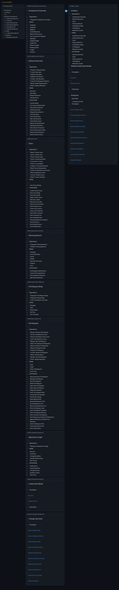

# understand-mode.md

Compiler: main 800081b75ad8eb1b6ecbbfb59ac382592f496853

Source files opened by the compiler appear beside the bundle body. The opening compiler paragraph appears under Entry Points, with links into the exact stdout file. Opened files can include deferred targets; their presence does not imply their content is bundled. Images simplify Markdown presentation; the stdout file preserves exact content and link destinations. Compact view replaces body content with … while retaining headings and links. Input content is shown through H2; H3 sections show titles only.



### Command

```bash
prosiform --root /tmp/prosiform-diagram-engineering/artifacts/planning/2026-10-22-work-planner-compact-diagram/work-planner --max-output-bytes 1048576 --group artifacts:2 --group protocols:2 --group modes:1 modes/understand-mode.md
```

### Entry Points

This bundle was built for [Understand Mode](understand.stdout.md#understand-mode); everything else is material it references.

### Diagnostics

Exit status: 0

```text
W_ENTRY_DESTINATION: the entry reference 'Understand Mode' resolves to the destination 'understand-mode', which the bundle's entry line links it to
  reference: Understand Mode
  resolved: understand-mode
```
