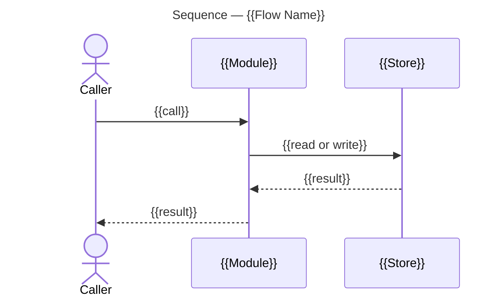

This bundle was built for [Modes/Understand-Mode](#modesunderstand-mode); everything else is material it references.

# Artifacts

## Operations

### Architecture Overview

#### *Populate* Architecture Overview

One architecture overview from supplied measurements.

**Inputs:** Measured structure and flows, pull request head, code permalinks and the output path.

1. Take the graph measurements supplied by the caller and check the proposed diagrams.
   - The diagrams must meet [Measured Structure](#measured-structure) and [Diagrams](#diagrams).
2. Populate the overview from the [Template](#template) at the supplied output path.
   - All populated fields must meet [Fields](#architecture-overview-1), including the required [Sections](#sections).
3. Pin each code reference.
   - Each reference must meet [Code References](#code-references).
4. Return the file for the caller to register in its planning record.

### Delivery Branches

#### *Create* Pull Request Worktree

The detached worktree where the graph reads the reviewed change.

**Inputs:** Repository checkout, pull request number and verified head commit.

1. Run [Fetch Review Head](#fetch-review-head) in the checkout of the repository the pull request changes, passing its number; stop on failure.
2. Run [Read Checkout Revision](#read-checkout-revision) in the repository checkout for `FETCH_HEAD`.
3. If it differs from the verified head, return a changed-head finding before creating a worktree.
4. Take the worktree path from the pull request number, meeting [Review Worktrees](#review-worktrees).
5. If that worktree already exists:
   - Run Read Checkout Revision there for `HEAD`.
   - Run [Read Checkout Status](#read-checkout-status) there.
   - Reuse it only at the verified head and when its status reports detached HEAD with no tracked or untracked changes.
   - Otherwise retain it and select an unused path suffixed with the verified commit.
6. For an unused path, run [Add Review Worktree](#add-review-worktree) with that path and the verified commit.
7. Confirm its HEAD through Read Checkout Revision.
8. Return the selected detached worktree path and head, or the discrepancy before measuring.

### Issue

#### *Close* Tracker Issue

Verified completion of an issue and its linked delivery.

**Inputs:** Issue identity, successful normal delivery result, current issue JSON, complete Development snapshot, confirmed repository setting and fresh linked pull request records.

1. Run [Capture Issue Development](#capture-issue-development) for the issue's complete links and confirmed repository setting.
2. Take the caller's fresh records for every linked pull request, across repositories and states; return missing evidence to the caller.
   - Confirm GitHub's **Auto-close issues with merged linked pull requests** setting is disabled before any delivery pull request is linked or merged. An enabled or unknown setting blocks those actions until configuration is confirmed. Changing repository settings requires explicit authorization.
   - Use the issue's entire Development field to establish membership. Titles, branch names, body mentions and a list filtered to one initiative do not establish completeness. An explicitly empty field adds no pull request requirement.
3. Run [Check Issue Closure](#check-issue-closure) with `--issue`, `--development`, and `--prs` for those fresh records.
4. Require normal delivery checks to pass, every criterion to be verified and ticked, and every currently linked pull request to be merged.
   - Keep the issue open for an open, draft, closed without merge, or unreadable linked pull request.
   - Obtain the user's decision before removing an abandoned or incorrect Development link. A replacement pull request does not remove the requirement on a link still present.
5. Run [Close as Completed](#close-as-completed), which repeats the gate immediately before the write. A changed link set requires another capture and check.

#### *Close* as Completed

An issue closed after its final evidence check.

**Inputs:** Repository, issue number, authenticated access, confirmed repository auto-closing setting, passing normal delivery checks and absolute paths to the current issue, Development and linked pull request evidence.

1. Run [Capture Issue Development](#capture-issue-development) immediately before closure with the issue identity, authenticated access, confirmed repository setting and evidence paths.
2. Compare its links with the supplied fresh pull request records; return a changed link set or missing evidence to the caller for refresh.
3. Run [Check Issue Closure](#check-issue-closure) with the current issue, Development and linked pull request files, using absolute evidence paths when changing directory.
4. Require exit 0 and passing normal delivery checks; a sync report of closable does not permit skipping this gate.
5. Immediately after the gate passes, run [Set Completed State](#set-completed-state) with the issue's repository and number and the passing evidence.
6. Return the saved state or failure.

#### *Capture* Issue Development

The issue's current content and complete Development snapshot.

**Inputs:** Issue identity, authenticated access, observed repository auto-closing setting and issue and Development output paths.

1. Run [Read Issue Development](#read-issue-development) for the entire field across repositories and states. An inaccessible field returns incomplete evidence; an empty array means the field was checked and empty.
2. Run [Write Development Snapshot](#write-development-snapshot) with the issue identity, observed link set, completeness result and repository setting, saving `development-943.json` or the supplied path.
   - Set `complete` true only after the full read, and `auto_close_issues` false only after the repository setting is confirmed disabled.
3. Run [Fetch Tracker Issue](#fetch-tracker-issue) into `issue-943.json` or the supplied path.
4. Return both files and any incomplete evidence. The caller supplies fresh linked pull request records in `development-prs-943.json`.

#### *Read* Issue Development

The Development links observed for one issue through authenticated GitHub.

**Inputs:** Issue identity and authenticated access.

1. Read every page and state, across repositories, recording each linked pull request's identity.
2. Return the observed links and whether the entire field was readable.

#### *Confirm* Repository Auto-Close

Whether the repository auto-closes issues whose linked pull requests merge, established for this session.

**Inputs:** Repository and authenticated access.

1. Read the setting where the authenticated API exposes it, and take a read value as the answer.
2. Where no API field carries it, put the setting to the user and take their explicit answer, meeting [Auto-Close Setting](#auto-close-setting).
3. Return the confirmed value. An unconfirmed setting is a blocker, and an enabled one leaves the caller to obtain authorization before the repository is reconfigured.

### Planning Record

#### *Populate* Planning Record

One planning directory and its artifact inventory.

**Inputs:** Record identity, folder path and supplied artifact files and links.

1. Prepare the selected record:
   - For a new record:
     - Create the folder with [Add Planning Record](#add-planning-record).
     - Populate README.md from the [Template](#template-1).
   - For an existing record:
     - Read its README, retaining its creation date, other artifacts and links.
     - Update only the supplied content.
   - The folder must meet [Layout](#layout).
   - All populated README fields must meet [Fields](#planning-record-1).
2. Register the artifact files supplied by the caller, using their chosen names.
   - Each file must have a row meeting [Layout](#layout) and [Artifacts](#artifacts-1).
   - File content remains supplied by the caller; this operation does not author that artifact's content.

#### *Publish* Planning Record

The record's folder committed and pushed, so every link into it resolves for a reader.

**Inputs:** Planning-folder path, the files written into it and a commit message file.

1. Run [Find Engineering Worktree](#find-engineering-worktree) for the path the record is written on.
2. Run [Commit Planning Record](#commit-planning-record), which stages and commits that folder in one call.
   - Confirm the commit holds the files this record wrote, meeting [Shared Worktree](#shared-worktree).
3. Run [Push Engineering Branch](#push-engineering-branch).
   - Report a push that will not fast-forward rather than rewriting the branch.

### Pull Request Body

#### *Link* Architecture Overview

One pull request body referencing its published overview.

**Inputs:** Current body, published overview URL on the engineering branch and output body path.

1. Add the Architecture Overview reference to the body's References section, creating that section in its [Template](#template-2) position when absent.
2. Preserve an existing row already naming the overview. The link uses the engineering-artifacts base URL so later files resolve from the same record.

      ```markdown
      - **R1.** [Architecture Overview](https://github.com/{owner}/{repo}/tree/engineering/artifacts/planning/2026-10-08-950-queue-placement/architecture-overview.md) — the change's structure, its flows, and the order to read the diff.
      ```

3. Return the complete updated body file for publication.

### Pull Request

#### *Access* Development Links

The observed or updated Development relation for a pull request.

**Inputs:** Pull request identity, authenticated access and requested relation read or write; for an edit, the issue identity, confirmed repository prerequisite and any user decision authorizing removal of an abandoned or incorrect link, meeting the applicable preconditions in [Close Tracker Issue](#close-tracker-issue).

1. Run [Read Development Links](#read-development-links) for the actual field, including every page and state. A missing tool or inaccessible field is a blocker, not an empty link set.
2. Return the complete relation for a read-only request.
3. For a link edit:
   - Take the supplied repository prerequisite from [Confirm Repository Auto-Close](#confirm-repository-auto-close); an unconfirmed setting blocks the edit.
   - For an addition, run [Set Development Link](#set-development-link) with the pull request and issue identities.
   - For removal of an abandoned or incorrect link:
     - Require the supplied user decision.
     - Run [Remove Development Link](#remove-development-link) with those identities.
4. Run [Read Development Links](#read-development-links) again for the same pull request.
5. Compare the field with the intended edit.
6. Return the verified relation or discrepancy.

#### *Fetch* Pull Request Issue Links

The complete issue-link snapshot for a supplied set of pull requests.

**Inputs:** Current pull request records, authenticated access and destination link-snapshot file.

1. For every pull request in `prs.json`, run [Access Development Links](#access-development-links) with a read-only request and its identity. An observed empty field supplies an empty array; an unreadable field leaves the fetch incomplete.
2. Repeat that read after a link changes.
3. If any relation is unreadable, return the incomplete result.
4. Run [Write Pull Request Links](#write-pull-request-links) with the observed complete relations and destination `links.json`, including one entry per pull request and every linked issue's repository and number.
5. Return the snapshot for the scripts' `--links` input.

#### *Link* Pull Request to Issue

The verified delivery-issue relation for a pull request.

**Inputs:** Pull request identity, delivery issue identity, current pull request records, link-snapshot destination, authenticated access and the caller's confirmed repository prerequisite documented in [Close Tracker Issue](#close-tracker-issue).

1. Run [Access Development Links](#access-development-links) with the supplied identities, requested link addition and confirmed repository prerequisite.
2. Stop on a blocker or an unverified edit.
3. Run [Fetch Pull Request Issue Links](#fetch-pull-request-issue-links) with the current records and destination after the edit.
4. Return the verified relation and refreshed snapshot.

#### *Read* Pull Request State

One current pull request and its requested supporting records.

**Inputs:** Repository, pull request number, output paths and requested records: metadata, changed paths or reviews.

1. Run [Fetch Pull Request](#fetch-pull-request) or [Save Pull Request Snapshot](#save-pull-request-snapshot) for current identity, state, head and base.
2. Run [Fetch Pull Request Files](#fetch-pull-request-files) or [Fetch Pull Request Reviews](#fetch-pull-request-reviews) when the caller requests those records.
3. Return the snapshots or missing evidence.

#### *Publish* Pull Request

One pull request created or updated from supplied content and metadata.

**Inputs:** Repository, optional pull request number, task, epic or planning-discussion kind, body file and selected title, head or base changes, and, for a created delivery pull request, its delivery issue identity, the repository setting confirmed for the session and a link-snapshot destination.

1. For creation, run [Open Task Pull Request](#open-task-pull-request), [Open Epic Pull Request](#open-epic-pull-request) or [Open Discussion Pull Request](#open-discussion-pull-request) for the supplied kind, body, title, head and base, preserving epic and discussion draft state.
   - For a task or epic pull request, run [Link Pull Request to Issue](#link-pull-request-to-issue) with it, the supplied delivery issue, that confirmed setting and the snapshot destination, meeting [Issue Links](#issue-links).
2. For an existing pull request, run [Patch Pull Request Body](#patch-pull-request-body), [Retitle Pull Request](#retitle-pull-request) or [Retarget Pull Request](#retarget-pull-request) for the supplied changes, preserving other fields.
3. Re-read through [Read Pull Request State](#read-pull-request-state).
4. Return the saved state or discrepancy.

### Repository Graph

#### *Measure* Repository Change

Current graph evidence for the supplied change.

**Inputs:** Worktree, verified head commit and base branch.

1. Run [Index Status](#index-status) in the supplied worktree. Every graph command runs in that worktree.
2. If the repository is unindexed or behind the verified head:
   - Run [Index Repository](#index-repository).
   - Confirm freshness.
3. Run [Change Surface](#change-surface) against the supplied base using `--base-ref`.
4. For each changed symbol, run [Symbol Context](#symbol-context).
5. For each reported flow, run [Flow Trace](#flow-trace).
6. Inspect the staleness block on every response. For a behind index:
   - Discard its measurements.
   - Reindex.
   - Repeat the affected measurements.
7. Return only evidence current with the supplied head, meeting [Fields](#repository-graph-1), or a freshness blocker.

## Fields

### Architecture Overview

#### Template

````markdown
# Architecture Overview — {{Change Name}}

> architecture-overview · [{{owner/repo#950}}]({{pull request URL}}) · {{YYYY-MM-DD}}

## Summary

{{Three sentences at most: what the change does, which part of the system it lands in, and what it makes possible.}}

## Structure

{{One paragraph placing the change: the areas it reaches and what each is for.}}

```mermaid
---
title: Components — {{Change Name}}
---
flowchart LR
    Caller([Caller])

    subgraph Area [{{Area Name}}]
        Entry[{{Module}}]
        Store[({{Store}})]
    end

    Caller -->|{{interaction}}| Entry
    Entry -->|{{interaction}}| Store

    style Entry fill:#c8e6c9,stroke:#2e7d32
    style Store fill:#f5f5f5,stroke:#9e9e9e
```

### {{Area Name}}

- **{{Element}}.**
  {{What it is responsible for, and what the change gives it.}}

## Behaviour

{{One sentence naming the flows below.}}

### {{Flow Name}}

{{One sentence: what starts this flow and what it yields.}}



- **{{Step}}.**
  {{What happens here, and the condition it rests on.}}

## What Changed

### {{Area Name}}

- **{{Element}}.**
  {{The behaviour it now has.}}

## Reading Order

1. **[{{file}}]({{permalink}})** — {{why the diff starts here}}.

## Risks and Watch Points

- **{{Risk}}.**
  {{What can go wrong, and where the reviewer sees it.}}

## References

- **R1.** [{{Title}}]({{URL}}) — {{what the reader finds there}}.
````

#### Diagrams

Every overview carries one structural diagram and one functional diagram. A further diagram is carried when the change warrants it, and displaces prose rather than adding to it.

| Diagram | Notation | Shows | Carried |
| --- | --- | --- | --- |
| Component | `flowchart` with subgraphs | The areas the change reaches and the dependencies between them | Always, as the structural diagram |
| Class | `classDiagram` | The types the change adds or alters, their members and their relations | In place of the component diagram when the change sits in one area and lands in its types |
| Sequence | `sequenceDiagram` | One flow's ordered interactions between components | Always, one per flow the change runs through, as the functional diagram |
| State | `stateDiagram-v2` | One subject's states and the transitions between them | When the change alters a lifecycle |
| Before and After | A pair in the notation of the structure they show | The arrangement the change replaces beside the one it establishes | When the change rearranges structure or reorders a flow |

Component node shapes: `[text]` a module, `[(text)]` a store, `[[text]]` a process boundary, `([text])` an actor.

#### Register

The reader is an engineer meeting this codebase for the first time. A component, type or function carries the name the diff carries, so the document and the diff name one thing once. A term the codebase coins is defined where it first appears.

#### Code References

A reference is a permalink pinned to the pull request's head commit with its line anchors, on the words it supports, as the code references rule states. A link resolved against a branch moves under the reader.

#### Measured Structure

A component diagram's areas and edges, and a sequence's step order, are the ones measured over the graph. A boundary taken from the directory layout, and a call order traced by hand, are each a defect.

#### One Concept Per Diagram

Five to ten elements. A diagram that needs more splits by concept, and relationships between areas carry it rather than the internals of one.

#### Highlight

An element the change adds or alters carries a distinct fill, and untouched context is grey. A name and its fill hold across every diagram in the overview.

#### Labelled Edges

Every edge names its interaction, and its direction is the direction data or control travels.

#### Collections

Items of one kind go in a bulleted list, never packed into a paragraph. Each opens with a bold lead naming the item, and its body is the line beneath.

#### What Changed

What Changed states the behaviour each area now has. The change-by-change listing is the pull request's Changes section, which the overview links rather than reproduces.

#### Reading Order

One numbered entry per file the reviewer opens, ordered so the change reads from its entry point outward to what it calls. Each entry links the file at the head commit and gives one line on why it comes there. A file the change touches incidentally is left out.

#### Length

About two hundred lines, diagrams counted.

#### Sections

Summary, Structure, Behaviour, What Changed and Reading Order are always present. Risks and Watch Points, and References, are deleted when they have nothing to say.

### Delivery Branches

#### Review Worktrees

A reviewed pull request is read in a detached worktree, named by its number under the worktree directory of the repository's main working tree.

- **Example.**
  Pull request 950 is read at `.worktrees/pr-950`.

### Issue

#### Auto-Close Setting

GitHub's **Auto-close issues with merged linked pull requests** repository setting, which must be disabled before a delivery pull request is linked or merged, so that closure follows the criteria rather than the merge.

- The setting is confirmed per repository and holds for the session; it is not inferred from an issue that stayed open.
- No REST field and no GraphQL field of `gh` 2.46 carries it, so on such a host the user's explicit answer is the only source.
- An enabled setting closes issues on merge whatever their criteria. Where it cannot be disabled, each affected issue's state is read after every merge and reopened where its criteria are unmet.

### Planning Record

#### Template

```markdown
# [Descriptive name] — [Month Year]

> [Classifier] · Created [YYYY-MM-DD]

## Executive Summary

[Two paragraphs on the purpose of this work and why it matters.]

## Artifacts

| Artifact | What it holds |
| --- | --- |
| [Name](file.md) | What this artifact holds |

## Links

| Resource | Link |
| --- | --- |
| [External reference] | [link] |
```

#### Shared Worktree

The engineering branch has one worktree and every session writes its records there, so they share one index. A commit therefore names the folder it is for, and a session confirms its own files landed in its own commit rather than assuming the index held only its staging.

#### Layout

README.md is the one file the folder must hold. Any file beyond README.md is added as the work needs it.

```text
./
├── README.md
└── …
```

Each file beyond README.md is a row in the README's Artifacts.

#### Header

One blockquote: the classifier, the day the record was created, and a revised date when the README is updated after the work is done.

#### Executive Summary

Two paragraphs: the purpose of this work, and why it matters.

#### Artifacts

- One row for every artifact in the record other than README.md, added when the file is produced.
- The link sits on the artifact's name. The row says what the artifact holds, and the artifact is the home of that content.

#### Links

External references only: a tracker issue, a parent epic, a pull request. An artifact of this plan is an Artifacts row.

### Pull Request Body

#### Template

````markdown
## Overview

{{One paragraph: what this pull request delivers and why.}}

## Changes

{{One sentence on what changed and why it was needed. Then one heading per area the changes sit in. A heading is two to five words, in title case, such as Queue Placement or Task Readiness. Under each heading, one bullet per functional change in that area. The bullet opens with a bold lead, as the scheme's Bold leads rule lays one out. The change is at most two lines, the lead included: the lead names what it does, and the behavior is the single line under it.}}

### {{Queue Placement}}

- **{{What it does.}}**
  {{The behavior as it is.}}

## Test Plan

| Test | Description | Coverage | Pass |
| --- | --- | --- | --- |
| T1 | {{Check name, per [Test Plan](#test-plan).}} | {{Observed criteria, if any.}} | [{{Result}}]({{Planning document URL#test-section}}) |

## Open Questions

- {{An undecided point. Resolve it, then delete the section.}}

## References

- **R1.** [{{Title}}]({{URL}}) — {{What the reader finds there. The issue this pull request delivers is not a reference: the Development field carries that link, as [Issue Links](pull-request.md#issue-links) state. Delete the section when there is none.}}
````

### Pull Request

#### Issue Links

- GitHub shows the link in the pull request's Development field and in the issue's Linked pull requests field, which the project board reads.
- A task pull request links the task's issue, and a review pull request links its epic's issue.
- The link is addressed by issue, so a pull request whose work carries no issue links nothing. A task pull request delivering rows that have no issue of their own is the whole of what stays unlinked.
- The link is stored on the pull request. It holds on any base branch and on a pull request that has merged, and a later body edit leaves it standing.
- A linked issue remains open until its criteria and delivery requirements hold and every Development-linked pull request is merged.
- The field is the whole of the relation: neither body links the other. The pull request's References carry its sources, and the issue it delivers is not among them.
- A pull request with a delivery issue but no Development link is uncited.

### Repository Graph

#### Revision

The graph identifies its worktree and indexed commit. Measurements describe the supplied pull request head and its difference from the supplied base branch.

#### Freshness

Graph responses carry a JSON `staleness` block. A behind index is not current with the requested head; measurements from it are invalid.

#### Changed Symbols

The surface identifies symbols touched by the diff and the flows containing them. It compares with the supplied base branch, rather than the branch's whole history.

#### Symbol Relationships

Each changed symbol has callers, callees, containing flows and file locations. Files group into component areas; their measured relationships determine edges between areas.

#### Flow Traces

Each flow contains symbols in step order. Each `process_symbols` entry includes `step_index`, file and lines. Those ordered measurements supply sequence-diagram participants and interactions. A manually inferred call order does not establish a graph trace.

## Commands

### Delivery Branches

#### Fetch Review Head

Fetches one pull request head into FETCH_HEAD.

**Inputs:** Repository checkout and pull request number.

```bash
git fetch origin 'pull/<pull-request-number>/head'
```

**Example:**

```bash
git fetch origin pull/950/head
```

#### Add Review Worktree

Creates a detached worktree at the fetched review head.

**Inputs:** Repository checkout, worktree path and fetched head commit.

- The path resolves against the directory the command runs in, so supply it as [Review Worktrees](#review-worktrees) anchors it rather than relative to a linked worktree.

```bash
git worktree add --detach '<worktree-path>' '<head-commit>'
```

#### Read Checkout Revision

Resolves one revision to its commit in the selected checkout.

**Inputs:** Checkout and revision, such as HEAD or FETCH_HEAD.

```bash
git -C '<checkout>' rev-parse '<revision>^{commit}'
```

#### Read Checkout Status

Reports branch or detached-HEAD state and tracked and untracked changes in one checkout.

**Inputs:** Checkout path.

```bash
git -C '<checkout>' status --porcelain --branch
```

### Issue

#### Fetch Tracker Issue

Saves an issue whole, as JSON, for the scripts that read issues.

**Inputs:** Repository, issue number and destination JSON file.

```bash
gh api 'repos/<owner>/<repo>/issues/<issue-number>' > '<issue-json-file>'
```

**Example:**

```bash
gh api 'repos/<owner>/<repo>/issues/943' > issue-943.json
```

#### Check Issue Closure

Checks the issue criteria, the complete link snapshot and every linked pull request.

**Inputs:** Current issue JSON, complete Development snapshot and fresh linked pull request records.

- `--issue`, `--development`, and `--prs` are the fresh issue JSON, Development snapshot, and linked pull request records.
- Exit 0 means the closure gate passes; normal delivery checks must also pass. Exit 1 reports blockers. The command performs no network calls or writes.

```bash
cd "<workspace>" && "<workspace>/scripts/sbx" python3 skills/work-planner/scripts/closure.py --issue '<issue-json-file>' --development '<development-snapshot-file>' --prs '<linked-pull-request-records-file>'
```

**Example:**

```bash
cd "<workspace>" && "<workspace>/scripts/sbx" python3 skills/work-planner/scripts/closure.py --issue issue-943.json --development development-943.json --prs development-prs-943.json
```

#### Set Completed State

Sets an issue to closed with the completed reason and returns its state.

**Inputs:** Repository, issue number, passing normal delivery checks and an immediately preceding successful closure gate on current evidence.

```bash
gh api --method PATCH 'repos/<owner>/<repo>/issues/<issue-number>' -f state=closed -f state_reason=completed --jq .state
```

**Example:**

```bash
gh api --method PATCH 'repos/<owner>/<repo>/issues/943' -f state=closed -f state_reason=completed --jq .state
```

#### Write Development Snapshot

Saves an observed Development field and repository setting as JSON.

**Inputs:** Repository and issue number, observed links, completeness result, confirmed or unknown auto-closing setting and destination file.

Write the supplied values in this shape. Substitute the issue number as a JSON integer, completeness as a boolean, and the auto-closing setting as a boolean or `null` when unknown. Supply every observed pull request URL, or an empty array when there are none. Preserve incomplete evidence as incomplete.

```text
{
  "repo": "<owner>/<repo>",
  "number": <issue-number>,
  "complete": <complete>,
  "auto_close_issues": <auto-close-issues>,
  "pull_requests": ["<pull-request-url>"]
}
```

**Example payload:**

```json
{
  "repo": "owner/repo",
  "number": 943,
  "complete": true,
  "auto_close_issues": false,
  "pull_requests": ["https://github.com/owner/repo/pull/980"]
}
```

### Planning Record

#### Find Engineering Worktree

Prints the checkout holding the engineering branch, which is where every planning record is written.

**Inputs:** Any checkout of the project.

- The engineering branch has one long-lived worktree and takes no further one.

```bash
git worktree list | grep '\[engineering\]'
```

#### Commit Planning Record

Stages and commits one planning folder on the engineering worktree.

**Inputs:** Engineering worktree, planning-folder path and a commit message file.

- Staging and committing are one call, and the commit names its folder, so a concurrent session's staged work cannot ride along. See [Shared Worktree](#shared-worktree).
- Pass the message through a file; the worktree is a linked one, so git writes here run unsandboxed.

```bash
cd '<engineering-worktree>' && git add '<planning-folder-path>' && git commit -F '<message-file>' -- '<planning-folder-path>'
```

**Example:**

```bash
cd .engineering && git add artifacts/planning/2026-10-15-950-queue-plan && git commit -F msg.txt -- artifacts/planning/2026-10-15-950-queue-plan
```

#### Push Engineering Branch

Publishes the engineering branch so a record's links resolve.

**Inputs:** Engineering worktree.

- Planning records go straight to the branch; they take no pull request.

```bash
cd '<engineering-worktree>' && git push
```

#### Add Planning Record

Adds the folder for one planning record on the long-lived engineering worktree.

**Inputs:** Engineering worktree and planning-folder path composed from the date, optional issue or pull request number, and slug.

- `<planning-folder-path>` is `artifacts/planning/<yyyy-mm-dd>[-<ref>]-<slug>/`. The date is the day the record is opened.
- `<ref>` is the bare number of the issue or the pull request the record is for. A record for ad hoc work, which has neither, has no ref segment.
- The slug is lowercase words separated by hyphens, a short name of the work.
- The folder's files are the [planning layout](#layout).
- Edits are made on that worktree. The engineering branch takes no further worktree and no branch.

```bash
mkdir -p '<planning-folder-path>'
```

**Example:**

```bash
mkdir -p artifacts/planning/2026-10-15-950-queue-plan
```

### Pull Request

#### Open Discussion Pull Request

Opens a draft for the supplied planning branch and body.

**Inputs:** Repository owner and name, title, planning branch, target branch and body file.

```bash
gh api --method POST 'repos/<owner>/<repository>/pulls' -f title='<title>' -f head='<planning-branch>' -f base='<target-branch>' -F body=@'<body-file>' -F draft=true
```

**Example:**

```bash
gh api --method POST repos/m2ux/workflow-server/pulls -f title='Queue Planning: Scope and Delivery' -f head=planning/queue -f base=engineering -F body=@discussion.md -F draft=true
```

#### Retarget Pull Request

Points a pull request at another base branch, such as its epic's base branch.

**Inputs:** Repository, pull request number and target branch.

```bash
gh api --method PATCH 'repos/<owner>/<repo>/pulls/<pull-request-number>' -f base='<target-branch>' --jq .base.ref
```

**Example:**

```bash
gh api --method PATCH 'repos/<owner>/<repo>/pulls/950' -f base='i07/e00/main' --jq .base.ref
```

#### Fetch Pull Request

Appends one pull request, as one JSON line, to the supplied file.

**Inputs:** Repository, pull request number and destination JSON-lines file.

```bash
gh api 'repos/<owner>/<repo>/pulls/<pull-request-number>' --jq . >> '<pull-request-records-file>'
```

**Example:**

```bash
gh api 'repos/<owner>/<repo>/pulls/439' --jq . >> prs.json
```

#### Retitle Pull Request

Replaces a pull request's title.

**Inputs:** Repository, pull request number and complete title.

```bash
gh api --method PATCH 'repos/<owner>/<repo>/pulls/<pull-request-number>' -f title='<title>' --jq .title
```

**Example:**

```bash
gh api --method PATCH 'repos/<owner>/<repo>/pulls/950' -f title='[I07:E00] Purpose' --jq .title
```

#### Open Task Pull Request

Creates a pull request from a unit's branch to its epic base.

**Inputs:** Repository, title, task head, epic base and populated body file.

- Supply the epic prefix and purpose as title, the task branch as head, the epic base as base, and the complete body file.

```bash
gh api --method POST 'repos/<owner>/<repo>/pulls' -f title='<title>' -f head='<task-branch>' -f base='<epic-base>' -F 'body=@<body-file>' --jq .html_url
```

**Example:**

```bash
gh api --method POST 'repos/<owner>/<repo>/pulls' -f title='[I07:E00] Purpose' -f head='i07/e00/w01-purpose' -f base='i07/e00/main' -F body=@body.md --jq .html_url
```

#### Open Epic Pull Request

Creates the draft pull request from an epic base to its long-lived target.

**Inputs:** Repository, title, epic head, long-lived base and populated review body file.

- Supply the epic prefix and name as title, the epic base as head, its long-lived branch as base, and the populated review body file.
- `draft` is true, including when the work is already complete.

```bash
gh api --method POST 'repos/<owner>/<repo>/pulls' -f title='<title>' -f head='<epic-base>' -f base='<long-lived-base>' -F draft=true -F 'body=@<body-file>' --jq .html_url
```

**Example:**

```bash
gh api --method POST 'repos/<owner>/<repo>/pulls' -f title='[I07:E00] Name' -f head='i07/e00/main' -f base='main' -F draft=true -F body=@body.md --jq .html_url
```

#### Patch Pull Request Body

Replaces a pull request's body.

**Inputs:** Repository, pull request number and complete populated body file.

- The file is the whole body. The issue a pull request delivers is linked on the pull request itself, so this call leaves that link standing.

```bash
gh api --method PATCH 'repos/<owner>/<repo>/pulls/<pull-request-number>' -F 'body=@<body-file>' --jq .html_url
```

**Example:**

```bash
gh api --method PATCH 'repos/<owner>/<repo>/pulls/950' -F body=@pr-950.md --jq .html_url
```

#### Read Development Links

Returns the complete Development relation through authenticated GitHub or an available supported tool.

**Inputs:** Pull request identity and authenticated access.

Read the actual field across every page and state, recording repository and number for each linked issue. Return the links and whether the field was fully readable.

#### Set Development Link

Adds one pull request to an issue's Development relation.

**Inputs:** Pull request identity, issue identity, authenticated access and confirmed repository prerequisite.

Use [GitHub's sidebar linking procedure](https://docs.github.com/en/issues/tracking-your-work-with-issues/using-issues/linking-a-pull-request-to-an-issue): in the issue's Development selector, select the pull request's repository and pull request, including a different repository when required. Return the edit result.

#### Remove Development Link

Removes one selected Development relation.

**Inputs:** Pull request and issue identities, authenticated access and the user's decision authorizing removal of the abandoned or incorrect link.

Deselect the supplied relation in the authenticated Development selector and save the edit. Return the edit result.

#### Write Pull Request Links

Saves complete observed Development-linked issues as a JSON array.

**Inputs:** One complete relation per pull request, with all repository and number pairs, and destination link-snapshot file.

Write the supplied relations in this shape. Substitute numbers as JSON integers. Include each pull request and all its linked issues; use an empty array for a complete relation with no linked issues. Each repository is the one belonging to that pull request or issue.

```text
[
  {
    "repo": "<pull-request-owner>/<pull-request-repo>",
    "number": <pull-request-number>,
    "closingIssuesReferences": [{"repo": "<issue-owner>/<issue-repo>", "number": <issue-number>}]
  }
]
```

**Example payload:**

```json
[
  {
    "repo": "owner/repo",
    "number": 950,
    "closingIssuesReferences": [{"repo": "owner/repo", "number": 637}]
  }
]
```

#### Save Pull Request Snapshot

Saves one complete pull request response, replacing the destination file.

**Inputs:** Repository, pull request number and destination JSON file.

```bash
gh api 'repos/<owner>/<repo>/pulls/<pull-request-number>' > '<pull-request-json-file>'
```

**Example:**

```bash
gh api 'repos/<owner>/<repo>/pulls/980' > epic-pr.json
```

#### Fetch Pull Request Reviews

Saves every review on one pull request.

**Inputs:** Repository, pull request number and destination file.

```bash
gh api --paginate 'repos/<owner>/<repo>/pulls/<pull-request-number>/reviews?per_page=100' > '<reviews-file>'
```

**Example:**

```bash
gh api --paginate 'repos/<owner>/<repo>/pulls/980/reviews?per_page=100' > reviews.json
```

#### Fetch Pull Request Files

Saves the paths a pull request changes.

**Inputs:** Repository, pull request number and destination path-list file.

```bash
gh api --paginate 'repos/<owner>/<repo>/pulls/<pull-request-number>/files' --jq '.[].filename' > '<changed-paths-file>'
```

**Example:**

```bash
gh api --paginate 'repos/<owner>/<repo>/pulls/950/files' --jq '.[].filename' > changed-files.txt
```

### Repository Graph

#### Index Status

Reports whether the repository is indexed, and how far behind the index sits.

**Inputs:** Repository worktree and requested revision.

```bash
gitnexus status
```

#### Index Repository

Indexes the repository, which an unindexed or behind repository needs before any measurement.

**Inputs:** Repository worktree and requested revision.

```bash
gitnexus analyze
```

#### Change Surface

Reports the symbols a pull request's diff touches and the flows they sit in, against the base branch.

**Inputs:** Current indexed worktree and comparison base branch.

- `--base-ref` is the pull request's base, so the surface is the change rather than the branch's whole history.

```bash
gitnexus detect-changes --scope compare --base-ref '<base-branch>'
```

**Example:**

```bash
gitnexus detect-changes --scope compare --base-ref main
```

#### Symbol Context

Reports one symbol's callers, its callees and the flows it sits in, each with the file it sits in.

**Inputs:** Symbol identity from the supplied change surface and the current graph worktree.

```bash
gitnexus context '<symbol-identity>'
```

**Example:**

```bash
gitnexus context reserveRow
```

#### Flow Trace

Reports one flow's symbols in step order, the structure a sequence diagram is drawn from.

**Inputs:** Flow identity from the supplied change surface and the current graph worktree. The result meets [Flow Traces](#flow-traces).

```bash
gitnexus query --query '<flow-identity>' --limit 1
```

**Example:**

```bash
gitnexus query --query "Queue Placement" --limit 1
```

# Modes/Understand-Mode

Explains the named pull request's changes through a measured architecture overview and publishes that overview for its reviewer.

## Procedure

The main path meets [Outcomes](#outcomes).

1. **Select the change.**
   Require the pull request number or URL.
   - Ask and stop when none is supplied. Do not infer it from the current branch.
   - For several supplied pull requests, complete one overview per pull request. An initiative has no overview of its own.
2. **Explain each change.**
   Follow [Change Overview](#change-overview) for each selected pull request, resuming with what it returns.
3. **Report.**
   Report the pull request, record folder, diagrams and References row of each overview.

## Outcomes

- **The change explained.**
  The engineer reviewing the pull request has its structure and its flows, read at the head commit under review.
- **The pull request named.**
  The account is of the pull request the request names, of the open pull request a task in review names, or of each base an epic in review delivers. An initiative has none of its own.
- **One account.**
  The same pull request yields one account, and a later run replaces it with the current change.

# Protocols

## Overview

### Change Overview

The published architecture overview, planning record and pull request link that explain one pull request's change.

## Procedure

1. **Prepare the evidence.**
   Read the supplied pull request's identity, title, base and verified head through [Read Pull Request State](#read-pull-request-state).
   - Call [Create Pull Request Worktree](#create-pull-request-worktree) with the repository checkout, pull request number and verified head.
   - On a changed-head finding:
     - Repeat Read Pull Request State for the same pull request.
     - Repeat Create Pull Request Worktree using its new verified head.
   - Continue to measurement only when the worktree matches that head.
   - Obtain its changed paths through [Read Pull Request State](#read-pull-request-state).
   - Call [Measure Repository Change](#measure-repository-change) with that worktree, head and base.
   - On stale index evidence, repeat Measure Repository Change after its index update.
   - On a changed revision:
     - Repeat Read Pull Request State.
     - Rebuild the worktree evidence.
   - Return any unresolved freshness blocker before writing the overview.
2. **Write the overview.**
   Locate any existing overview record for this pull request number before creating a record.
   - Reuse its folder identity when one exists; otherwise choose a planning-folder identity whose reference is the pull request number and whose slug comes from its title.
   - Call [Populate Planning Record](#populate-planning-record) to prepare that folder.
   - Run [Populate Architecture Overview](#populate-architecture-overview) with the measured structure and flows, verified head, pinned code links and overview path. A repeat replaces its overview while preserving the record's other content.
3. **Register the overview.**
   Call [Populate Planning Record](#populate-planning-record) with the record identity, folder, overview file and pull request link. The overview is its one Artifacts row and the pull request is under Links.
4. **Publish and link.**
   Run [Publish Planning Record](#publish-planning-record) for the record's folder, so the overview resolves.
   - Call [Link Architecture Overview](#link-architecture-overview) with the current body and published overview URL.
   - Publish the returned file through [Publish Pull Request](#publish-pull-request).
   - Return the pull request, record folder, published overview, diagrams and References row to the caller.
