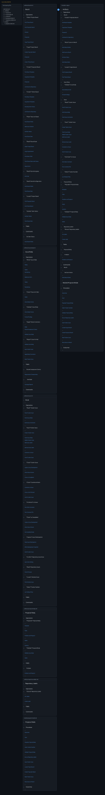
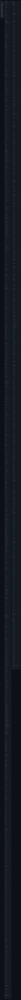
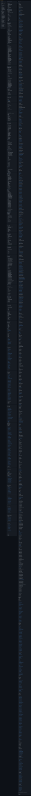
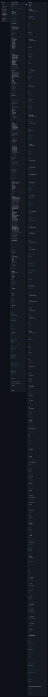
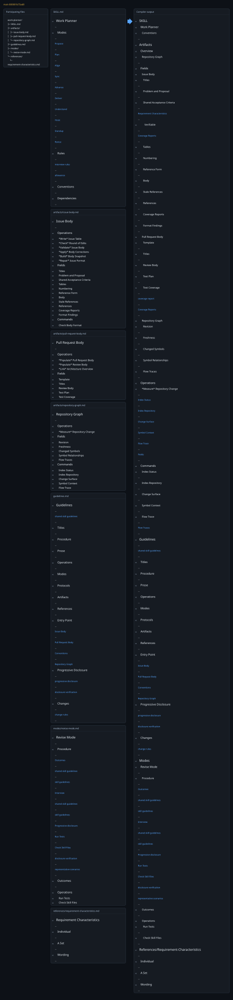

# Work Planner Mode Diagrams

Each mode linked from the copied SKILL.md is compiled separately. Artifacts and protocols pool their canonical H2 sections. Compact images retain headings and links; body content is represented by ….

Compiler: main 68dd39c10ad0f5b1ba8087dabbf924be960f50a1

## Modes

- [Propose](#propose)
- [Plan](#plan)
- [Align](#align)
- [Sync](#sync)
- [Advance](#advance)
- [Deliver](#deliver)
- [Understand](#understand)
- [Hoist](#hoist)
- [Standup](#standup)
- [Revise](#revise)

## Propose

Entry document: [modes/propose-mode.md](work-planner/modes/propose-mode.md).



### Command

```bash
prosiform --root /tmp/prosiform-diagram-engineering/artifacts/planning/2026-10-22-work-planner-compact-diagram/work-planner --max-output-bytes 1048576 --group artifacts:2 --group protocols:2 modes/propose-mode.md
```

### Entry Points

This bundle was built for [Modes/Propose-Mode](diagrams/propose.stdout.md#modespropose-mode); everything else is material it references.

### Diagnostics

Exit status: 0

```text
W_EMPTY_GROUP_RULE: the grouping rule for 'protocols' arranges nothing, because the closure carries no document under a directory of that slug
W_ENTRY_DESTINATION: the entry reference 'Modes/Propose-Mode' resolves to the destination 'modespropose-mode', which the bundle's entry line links it to
  reference: Modes/Propose-Mode
  resolved: modespropose-mode
```

## Plan

Entry document: [modes/plan-mode.md](work-planner/modes/plan-mode.md).



### Command

```bash
prosiform --root /tmp/prosiform-diagram-engineering/artifacts/planning/2026-10-22-work-planner-compact-diagram/work-planner --max-output-bytes 1048576 --group artifacts:2 --group protocols:2 modes/plan-mode.md
```

### Entry Points

This bundle was built for [Modes/Plan-Mode](diagrams/plan.stdout.md#modesplan-mode); everything else is material it references.

### Diagnostics

Exit status: 0

```text
W_ENTRY_DESTINATION: the entry reference 'Modes/Plan-Mode' resolves to the destination 'modesplan-mode', which the bundle's entry line links it to
  reference: Modes/Plan-Mode
  resolved: modesplan-mode
```

## Align

Entry document: [modes/align-mode.md](work-planner/modes/align-mode.md).


### Command

```bash
prosiform --root /tmp/prosiform-diagram-engineering/artifacts/planning/2026-10-22-work-planner-compact-diagram/work-planner --max-output-bytes 1048576 --group artifacts:2 --group protocols:2 modes/align-mode.md
```

### Entry Points

This bundle was built for [Modes/Align-Mode](diagrams/align.stdout.md#modesalign-mode); everything else is material it references.

### Diagnostics

Exit status: 0

```text
W_EMPTY_GROUP_RULE: the grouping rule for 'protocols' arranges nothing, because the closure carries no document under a directory of that slug
W_ENTRY_DESTINATION: the entry reference 'Modes/Align-Mode' resolves to the destination 'modesalign-mode', which the bundle's entry line links it to
  reference: Modes/Align-Mode
  resolved: modesalign-mode
```

## Sync

Entry document: [modes/sync-mode.md](work-planner/modes/sync-mode.md).


### Command

```bash
prosiform --root /tmp/prosiform-diagram-engineering/artifacts/planning/2026-10-22-work-planner-compact-diagram/work-planner --max-output-bytes 1048576 --group artifacts:2 --group protocols:2 modes/sync-mode.md
```

### Entry Points

This bundle was built for [Modes/Sync-Mode](diagrams/sync.stdout.md#modessync-mode); everything else is material it references.

### Diagnostics

Exit status: 0

```text
W_ENTRY_DESTINATION: the entry reference 'Modes/Sync-Mode' resolves to the destination 'modessync-mode', which the bundle's entry line links it to
  reference: Modes/Sync-Mode
  resolved: modessync-mode
```

## Advance

Entry document: [modes/advance-mode.md](work-planner/modes/advance-mode.md).


### Command

```bash
prosiform --root /tmp/prosiform-diagram-engineering/artifacts/planning/2026-10-22-work-planner-compact-diagram/work-planner --max-output-bytes 1048576 --group artifacts:2 --group protocols:2 modes/advance-mode.md
```

### Entry Points

This bundle was built for [Modes/Advance-Mode](diagrams/advance.stdout.md#modesadvance-mode); everything else is material it references.

### Diagnostics

Exit status: 0

```text
W_ENTRY_DESTINATION: the entry reference 'Modes/Advance-Mode' resolves to the destination 'modesadvance-mode', which the bundle's entry line links it to
  reference: Modes/Advance-Mode
  resolved: modesadvance-mode
```

## Deliver

Entry document: [modes/deliver-mode.md](work-planner/modes/deliver-mode.md).



### Command

```bash
prosiform --root /tmp/prosiform-diagram-engineering/artifacts/planning/2026-10-22-work-planner-compact-diagram/work-planner --max-output-bytes 1048576 --group artifacts:2 --group protocols:2 modes/deliver-mode.md
```

### Entry Points

This bundle was built for [Modes/Deliver-Mode](diagrams/deliver.stdout.md#modesdeliver-mode); everything else is material it references.

### Diagnostics

Exit status: 0

```text
W_ENTRY_DESTINATION: the entry reference 'Modes/Deliver-Mode' resolves to the destination 'modesdeliver-mode', which the bundle's entry line links it to
  reference: Modes/Deliver-Mode
  resolved: modesdeliver-mode
```

## Understand

Entry document: [modes/understand-mode.md](work-planner/modes/understand-mode.md).


### Command

```bash
prosiform --root /tmp/prosiform-diagram-engineering/artifacts/planning/2026-10-22-work-planner-compact-diagram/work-planner --max-output-bytes 1048576 --group artifacts:2 --group protocols:2 modes/understand-mode.md
```

### Entry Points

This bundle was built for [Modes/Understand-Mode](diagrams/understand.stdout.md#modesunderstand-mode); everything else is material it references.

### Diagnostics

Exit status: 0

```text
W_ENTRY_DESTINATION: the entry reference 'Modes/Understand-Mode' resolves to the destination 'modesunderstand-mode', which the bundle's entry line links it to
  reference: Modes/Understand-Mode
  resolved: modesunderstand-mode
```

## Hoist

Entry document: [modes/hoist-mode.md](work-planner/modes/hoist-mode.md).



### Command

```bash
prosiform --root /tmp/prosiform-diagram-engineering/artifacts/planning/2026-10-22-work-planner-compact-diagram/work-planner --max-output-bytes 1048576 --group artifacts:2 --group protocols:2 modes/hoist-mode.md
```

### Entry Points

This bundle was built for [Modes/Hoist-Mode](diagrams/hoist.stdout.md#modeshoist-mode); everything else is material it references.

### Diagnostics

Exit status: 0

```text
W_EMPTY_GROUP_RULE: the grouping rule for 'protocols' arranges nothing, because the closure carries no document under a directory of that slug
W_ENTRY_DESTINATION: the entry reference 'Modes/Hoist-Mode' resolves to the destination 'modeshoist-mode', which the bundle's entry line links it to
  reference: Modes/Hoist-Mode
  resolved: modeshoist-mode
```

## Standup

Entry document: [modes/standup-mode.md](work-planner/modes/standup-mode.md).


### Command

```bash
prosiform --root /tmp/prosiform-diagram-engineering/artifacts/planning/2026-10-22-work-planner-compact-diagram/work-planner --max-output-bytes 1048576 --group artifacts:2 --group protocols:2 modes/standup-mode.md
```

### Entry Points

This bundle was built for [Modes/Standup-Mode](diagrams/standup.stdout.md#modesstandup-mode); everything else is material it references.

### Diagnostics

Exit status: 0

```text
W_ENTRY_DESTINATION: the entry reference 'Modes/Standup-Mode' resolves to the destination 'modesstandup-mode', which the bundle's entry line links it to
  reference: Modes/Standup-Mode
  resolved: modesstandup-mode
```

## Revise

Entry document: [modes/revise-mode.md](work-planner/modes/revise-mode.md).



### Command

```bash
prosiform --root /tmp/prosiform-diagram-engineering/artifacts/planning/2026-10-22-work-planner-compact-diagram/work-planner --max-output-bytes 1048576 --group artifacts:2 --group protocols:2 modes/revise-mode.md
```

### Entry Points

This bundle was built for [Modes/Revise-Mode](diagrams/revise.stdout.md#modesrevise-mode); everything else is material it references.

### Diagnostics

Exit status: 0

```text
W_EMPTY_GROUP_RULE: the grouping rule for 'protocols' arranges nothing, because the closure carries no document under a directory of that slug
W_ENTRY_DESTINATION: the entry reference 'Modes/Revise-Mode' resolves to the destination 'modesrevise-mode', which the bundle's entry line links it to
  reference: Modes/Revise-Mode
  resolved: modesrevise-mode
```
