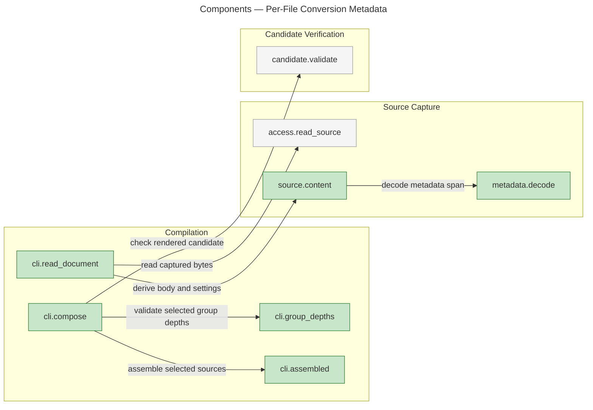
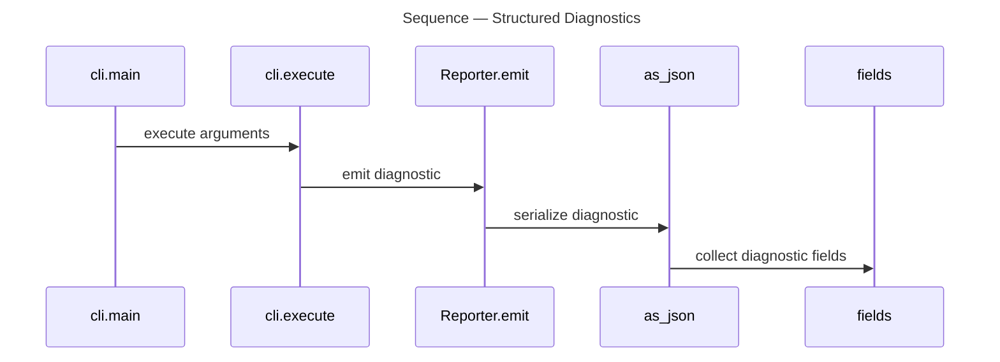

# Architecture Overview — Per-File Conversion Metadata

> architecture-overview · [m2ux/prosiform#222](https://github.com/m2ux/prosiform/pull/222) · 2026-10-23

## Summary

The Python compiler reads each Markdown file's group and depth from its own YAML frontmatter. Captured bytes supply both immutable settings and the Markdown body, so linked selections retain the destination's settings. Conflicting group depths stop publication and identify both declarations.

## Structure

The command coordinates source access, metadata decoding, selection and candidate validation. `Source` holds the body and conversion value; `Capture` retains the bytes' hash for the publication recheck. The graph's measured calls connect these components:

### Source Capture

- **Raw accounting.**
  [read_document](https://github.com/m2ux/prosiform/blob/93fe6b354a85e244f64e33af700a55aab4f26044/src/prosiform/cli.py#L710) checks raw byte budgets before decoding and retains the full-file hash. Opened deferred targets share the cache and recheck, without contributing content through deferred links.
- **Immutable settings.**
  [content](https://github.com/m2ux/prosiform/blob/93fe6b354a85e244f64e33af700a55aab4f26044/src/prosiform/source.py#L250) separates the metadata span from body lines and retains original physical coordinates.
- **Bounded YAML.**
  [decode](https://github.com/m2ux/prosiform/blob/93fe6b354a85e244f64e33af700a55aab4f26044/src/prosiform/metadata.py#L171) validates a bounded event stream, YAML Core scalar identities and paired string fields. It rejects aliases, duplicate and merge keys, custom tags and unknown reserved fields.

### Compilation

- **Selected ownership.**
  [group_depths](https://github.com/m2ux/prosiform/blob/93fe6b354a85e244f64e33af700a55aab4f26044/src/prosiform/cli.py#L1373) considers contributing sources in deterministic order. Equal exact group names require equal depths, with both field locations available for a conflict.
- **Shared arrangement.**
  [compose](https://github.com/m2ux/prosiform/blob/93fe6b354a85e244f64e33af700a55aab4f26044/src/prosiform/cli.py#L1563) uses the validated depth map for both rendering passes and candidate validation. Existing member naming, overview placement and destination resolution operate on explicitly declared membership.

## Behaviour

The measured diagnostic trace shows how an execution result becomes structured output; source-capture and compilation relationships above are measured calls rather than a claim of a complete process trace.

### Structured Diagnostics

`main` runs the command, and emitted diagnostics serialize their fields into JSON.

- **Original coordinates.**
  [fields](https://github.com/m2ux/prosiform/blob/93fe6b354a85e244f64e33af700a55aab4f26044/src/prosiform/diagnostics.py#L76) includes physical source locations and related locations when supplied. Metadata failures cross the command's existing failure boundary.
- **Publication boundary.**
  Group coherence and candidate validation finish before stdout or file publication. A conflict preserves existing output; check mode validates without publishing.

## What Changed

### Author Interface

- **Per-file declarations.**
  [invocation.md](https://github.com/m2ux/prosiform/blob/93fe6b354a85e244f64e33af700a55aab4f26044/invocation.md#L45) defines paired metadata fields, ordinary Markdown defaults, boundaries, budgets and diagnostics. The CLI supplies operational controls.
- **Evidence.**
  Fixture inputs and worked examples declare their own groups. Decoder, source, compilation and final audit evidence are linked from the merged task pull requests listed on the review.

## Reading Order

1. [cli.py](https://github.com/m2ux/prosiform/blob/93fe6b354a85e244f64e33af700a55aab4f26044/src/prosiform/cli.py#L1710) — follow command execution into capture, selection, compilation and publication.
2. [source.py](https://github.com/m2ux/prosiform/blob/93fe6b354a85e244f64e33af700a55aab4f26044/src/prosiform/source.py#L250) — see how one captured file supplies body lines and immutable settings.
3. [metadata.py](https://github.com/m2ux/prosiform/blob/93fe6b354a85e244f64e33af700a55aab4f26044/src/prosiform/metadata.py#L171) — inspect bounded decoding and exact field validation.
4. [cli.py group_depths](https://github.com/m2ux/prosiform/blob/93fe6b354a85e244f64e33af700a55aab4f26044/src/prosiform/cli.py#L1373) — inspect selected membership and deterministic conflicts.
5. [test_conversion_compilation.py](https://github.com/m2ux/prosiform/blob/93fe6b354a85e244f64e33af700a55aab4f26044/src/tests/test_conversion_compilation.py#L1) — review ownership, deferral, conflict and atomic-output scenarios.
6. [invocation.md](https://github.com/m2ux/prosiform/blob/93fe6b354a85e244f64e33af700a55aab4f26044/invocation.md#L45) — check the author-facing contract against the implementation.

## Risks and Watch Points

- **Selection versus opening.**
  A deferred-only source is validated and accounted for when opened, but its metadata must not add group membership. The distinction is exercised by the compilation tests.
- **Exact identity.**
  Group strings retain their exact identity even when generated headings normalize to the same visible text. Destination allocation must preserve separate group and file identities.
- **Graph limits.**
  GitNexus reports bounded process exploration, including omitted candidates and callees. The overview uses measured symbol relationships and exact ordered rows for the displayed trace; it does not claim the graph enumerates every runtime path. Raw graph evidence and the verified revision accompany this overview.

## References

- **R1.** [Review pull request](https://github.com/m2ux/prosiform/pull/222) — functional changes and merged task references.
- **R2.** [W05 delivery evidence](https://github.com/m2ux/prosiform/tree/engineering/artifacts/planning/2026-10-23-218-i01-e06-w05-metadata-authoring-guidance) — final authoring and representative-corpus validation.
