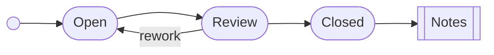

# Ticket Guide

A ticket moves through the states the [lifecycle](#lifecycle) diagram shows.

# Lifecycle

## Notes

Each state is a document of its own.

# Open

A ticket waits for an owner.

# Review

A reviewer reads the change.

# Closed

The ticket is done.
