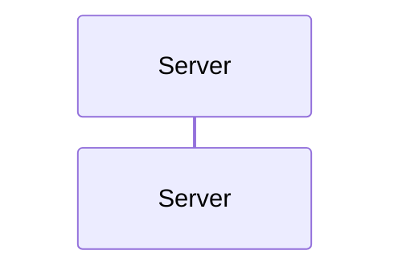

# Validation — W03 Carry Every Click and Every Link Element

> Evidence · 2026-11-01

Every case below ran in the worktree `.worktrees/i07/e00/w03-carry-every-click-and`, on branch `i07/e00/w03-carry-every-click-and`. The branch was cut from `i07/e00/main` at `5bffb717`, and `origin/i07/e00/main` at `5b16c3b4` was merged in before the final check. The build under test is `PROSIFORM_BUILD='uv run --project <worktree>/src --frozen pf'`. Diagrams were rendered with mermaid-cli 11.16.0 (`mmdc`, headless Chrome, `--no-sandbox`).

## Where Mermaid draws an anchor

Finding 20 turns on what the renderer draws, so each diagram type was rendered with an `<a href>` in its label text, and the SVG was read for `<a>` elements.

| Diagram | Anchor in label text |
| --- | --- |
| flowchart, graph: node, edge label, subgraph title | drawn |
| classDiagram, stateDiagram, stateDiagram-v2, mindmap, erDiagram, block-beta, kanban, requirementDiagram | drawn |
| sequenceDiagram: participant alias, message, note | shown as escaped text |
| pie: title and slice label | shown as text |
| timeline, journey, gantt, quadrantChart, gitGraph, xychart-beta, sankey-beta, packet-beta, radar-beta, treemap-beta, C4Context | shown as text |
| flowchart `click` tooltip | a `title` attribute. On hover Mermaid copies it into a tooltip `div` styled `pointer-events: none`, which closes when the pointer leaves the node, so nothing in it can be clicked |

The same rendering showed that Mermaid follows every `click` on one flowchart line. `click A "one.md" "t1"; click B "two.md"`, `click A href "one.md" _blank; click B "two.md"` and `click A "one.md";click B "two.md";` each drew both anchors. A quoted `;` (`click A "o;ne.md"; click B "two.md"`) drew `o;ne.md` and `two.md`, and a node statement before a click on the same line drew both its label anchor and the click. A space before the `;` is a Mermaid parse error, and a class or state diagram rejects `;` as a separator.

For finding 19, Mermaid's `drawPopup` iterates `for (let key in links)` and draws an `<a xlink:href=links[key]>` labelled `key`. An array therefore draws one live entry per element, labelled `0`, `1` and so on. Rendering `links A: ["x.md", "y.md"]` drew `<a xlink:href="x.md">` and `<a xlink:href="y.md">`.

## Finding 19 — a links array

**The break.** `exchange.md` holds `links Server: ["a.md", "b.md"]` in a sequence diagram, and `a.md` and `b.md` exist.

**Before the fix:** exit 0. The bundle carried the line as written, and neither document was compiled:

~~~~
# Exchange


~~~~

**After the fix:** exit 1, no bundle:

```
E_UNSUPPORTED_CONSTRUCT: the sequence diagram's links line holds an array, which Mermaid renders as a menu whose entries are named by their positions, so the skill-markdown-v4 profile cannot carry it
  source: exchange.md:6
  chain: exchange.md
  remedy: write the links value as an object naming each entry
```

An empty array draws no menu and is not refused. An object whose value is an array is refused as before, as a value that is no string.

## Finding 20 — an anchor where Mermaid draws none

**The break.** Three entries, each holding an anchor naming `plan.md`: a flowchart `click B "plan.md" "<a href='plan.md'>the plan</a>"`, a pie slice `"<a href='plan.md'>Plan</a>" : 40`, and a sequence `Note over Alice,Bob: <a href="plan.md">the plan</a>`.

**Before the fix:** each was refused with the node-label diagnostic:

```
E_UNSUPPORTED_CONSTRUCT: the diagram's HTML anchor in a node label names the local Markdown document 'plan.md', which Mermaid renders as a link the skill-markdown-v4 profile does not follow, ...
```

**After the fix:** each publishes at exit 0 with its anchor carried as written. The click's own destination is rewritten to `#plan`, and `# Plan` is compiled:

```
    click B "#plan" "<a href='plan.md'>the plan</a>"
```

**What did not move.** A node label, an edge label and a label in every anchor-drawing type still refuse a local document. The diagnostic's form now reads *HTML anchor in a label*, because edge labels and subgraph titles draw anchors too. A node statement beside a click on one line (`A["<a href='docs/note.md'>N</a>"]; click A "guide.md" "<a href='guide.md'>tip</a>"`) still refuses `docs/note.md` at its line, and the tooltip's `guide.md` is skipped.

## Finding 25 — two clicks on one line

**The break.** `click A "one.md"; click B href "two.md" "Two"` in a flowchart, with `one.md` and `two.md` present.

**Before the fix:** exit 0. Both source paths were published and neither document was compiled:

```
    click A "one.md"; click B href "two.md" "Two"
```

**After the fix:** exit 0. Both destinations were rewritten in place and both documents compiled:

```
    click A "#one"; click B href "#two" "Two"
```

## Render check

`checks/render.py` gained two entries. `make check` leaves this check out, because mermaid-cli is no dependency of the build, so it was run directly with `MERMAID_CLI` naming the local `mmdc`:

| Fixture | Anchors drawn |
| --- | --- |
| `rewriting/every-click-on-one-diagram-line` | `#open`, `#closed` |
| `reference/an-html-anchor-mermaid-draws-as-no-anchor-is-text` | `#plan` only, so the tooltip, pie and note anchors carried as written are drawn as no link |

```
render check: 17 fixture(s), 17 pass, 0 fail
```

## The case each finding ships with

Each case was run with `src/prosiform` stashed and the new tests in place. All of them failed, 48 in total. A few unit cases also fail on the renamed form label or the new `listed` field, which shows they are bound to this change. The behavioural cases:

| Case | Without the fix | With it |
| --- | --- | --- |
| `test_cli.py::test_a_links_array_is_refused_naming_its_line` | fail, exit 0 | pass |
| `test_cli.py::test_an_anchor_mermaid_draws_as_no_anchor_is_carried[tooltip, pie-label, sequence-note]` | fail, refused | pass |
| `test_cli.py::test_every_click_on_one_line_is_followed` | fail, source paths published | pass |
| `test_cli.py::test_an_anchor_in_a_label_beside_a_click_is_still_refused` | pass, the control | pass |
| `test_profile.py::test_a_links_array_is_refused_naming_its_line` | fail | pass |
| `test_profile.py::test_an_anchor_mermaid_draws_as_no_anchor_is_carried` (3) | fail | pass |
| `test_source.py::test_every_click_on_one_line_names_its_destination` (4, class `link` included) | fail | pass |
| `test_source.py::test_a_quoted_semicolon_ends_no_click_statement` | fail | pass |
| `test_source.py::test_a_sequence_menu_value_that_is_an_array_lists_its_line` (2) | fail | pass |
| `test_source.py::test_an_html_anchor_mermaid_draws_as_no_anchor_renders_nothing` (19 diagram forms) | fail | pass |
| `test_source.py::test_an_html_anchor_in_a_drawing_diagram_renders_its_href` (8 types) | fail on the form label | pass |

The corpus holds the same three cases as fixtures: `reference/a-links-value-that-is-an-array`, `reference/an-html-anchor-mermaid-draws-as-no-anchor-is-text` and `rewriting/every-click-on-one-diagram-line`.

One existing profile case asserted the old behaviour: a sequence note naming `../people/user.MD` was refused. It now carries a flowchart edge label naming the same path, which keeps the case-insensitive suffix covered. The sequence note moved to the carried cases.

## Every check run

`make check` ran in full twice with `PROSIFORM_BUILD` naming the worktree's own build, and both runs exited 0: once at `b7b6441c`, and once at the final head after merging the epic base.

The final run's figures, at `f05539a3`:

| Target | Result |
| --- | --- |
| `lock-check` | pass |
| `lint` | pass, `All checks passed!` |
| `format-check` | pass, 206 files already formatted |
| `typecheck` | pass, no issues in 83 source files |
| `steps` | pass, 59 documents |
| `authoring` | pass, 0 findings |
| `test` | 1466 passed |
| `harness` | 1062 passed |
| `corpus` | 377 fixtures, 377 pass, 0 fail, 0 awaited, 0 unexpected pass |
| `smoke` | pass |
| `layout` | pass, 4 trees present |
| `tables` | pass, 22 commands and 8 declarations |
| `links` | every reference in 237 documents resolved |
| `vocabulary` | pass, 46 contract terms |
| `invocation` | pass, 30 statements |
| `conformance` | 305 clauses, 0 declared codes the build reports nowhere, 0 reported codes the contract declares nowhere |
| `independence` | pass |

## No neighbouring behaviour moved

| Observation | Result |
| --- | --- |
| The codes the build reports | No code added; the array refusal reuses `E_UNSUPPORTED_CONSTRUCT`, so `-C` and conformance are unchanged |
| The existing corpus | Every earlier fixture passes unchanged, the node-label refusal and the broken-menu refusal among them |
| The render check | The 15 earlier fixtures still draw exactly their listed anchors |
| A single click, class link, sequence `link` and `links` object | Read as before; the statement split leaves a one-statement line as it was |
