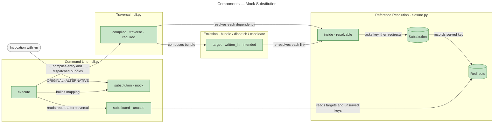
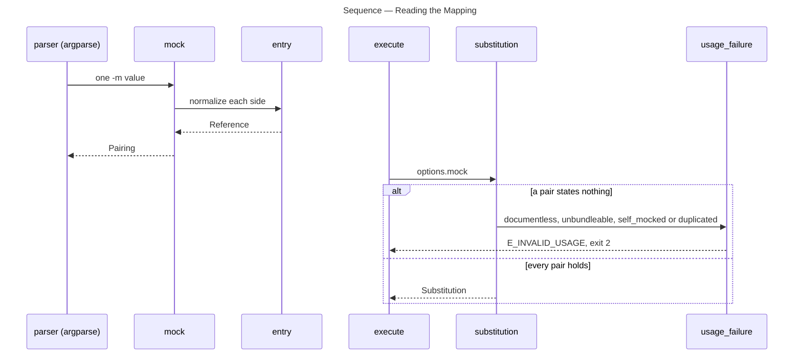
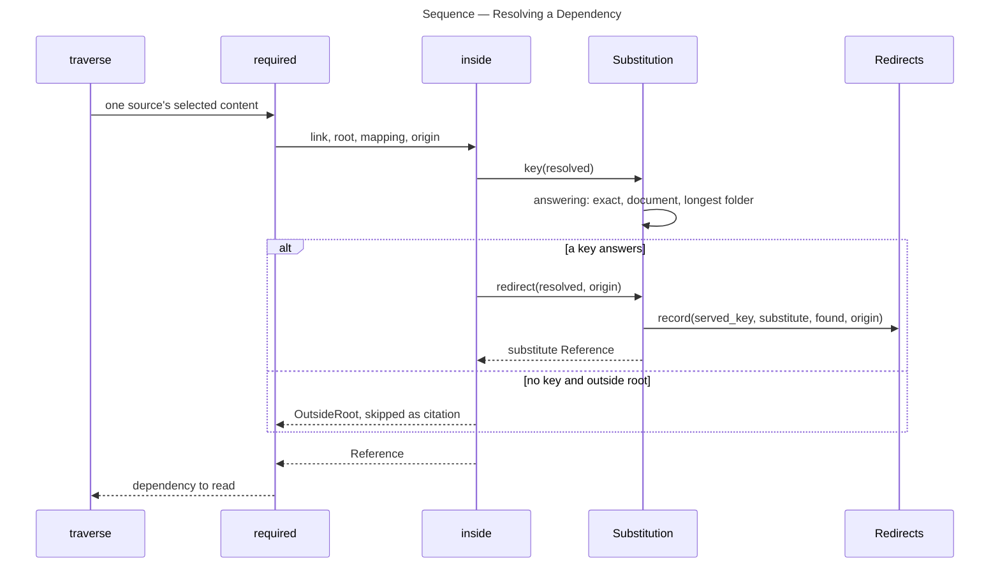
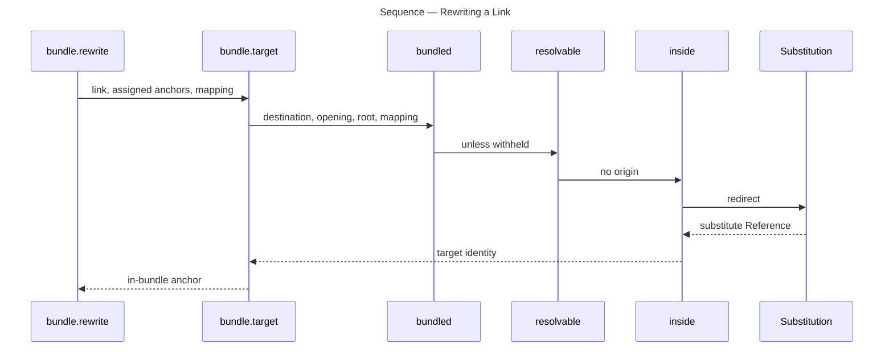

# Architecture Overview — Mock Substitution

> architecture-overview · [m2ux/prosiform#472](https://github.com/m2ux/prosiform/pull/472) · 2026-11-01

## Summary

A run accepts `-m ORIGINAL=ALTERNATIVE` pairs that redirect an authored reference to a stand-in document, section or folder. The mapping is read once on the command line and consulted wherever a link resolves, in the reference-resolution layer (`closure.py`), so traversal, rewriting, dispatch and validation all see the substitute. It lets a bundle be built and checked against stand-in material without editing the tree under test, and every redirect and every unused key is reported.

## Structure

The change reaches four areas. The command line (`cli.py`) parses the pairs, refuses malformed mappings and reports what the run did with them. Reference resolution (`closure.py`) holds the mapping and decides what each link names. Traversal (`cli.py`) and emission (`bundle.py`, `dispatch.py`, `candidate.py`) both resolve links through `closure.inside`, so they carry the mapping as an argument. Edges below are measured call edges at the head commit.

### Command Line

- **[`mock` and `marked`](https://github.com/m2ux/prosiform/blob/b6a6e8cff293b2242d79ecdecc5ca39132a85337/src/prosiform/cli.py#L430-L481).**
  The argparse type for `-m`. It splits one pair, reads a trailing separator as a folder side before normalization drops it, and returns a `Pairing`: both sides normalized by `entry`, the grammar a positional reference uses.
- **[`substitution`](https://github.com/m2ux/prosiform/blob/b6a6e8cff293b2242d79ecdecc5ca39132a85337/src/prosiform/cli.py#L483-L533).**
  Builds the run's `Substitution` from every pairing and refuses, as invalid usage, a key naming no document, a substitute naming no Markdown document, a self-mock and a duplicate key.
- **[`substituted` and `unused`](https://github.com/m2ux/prosiform/blob/b6a6e8cff293b2242d79ecdecc5ca39132a85337/src/prosiform/cli.py#L2098-L2147).**
  Turn the run's record into `W_MOCK_SUBSTITUTED` (one per served key and target, at the first link that reached it) and `W_MOCK_UNUSED` (one per key no reference named).

### Reference Resolution

- **[`Substitution`](https://github.com/m2ux/prosiform/blob/b6a6e8cff293b2242d79ecdecc5ca39132a85337/src/prosiform/closure.py#L226-L435).**
  An immutable mapping. A key is a normalized identity: `(path, fragment)` for a document or section key, a bare path for a folder key. `answering` is the one lookup every caller reads. `UNSUBSTITUTED` is the empty mapping a run without `-m` carries.
- **[`Redirect` and `Redirects`](https://github.com/m2ux/prosiform/blob/b6a6e8cff293b2242d79ecdecc5ca39132a85337/src/prosiform/closure.py#L154-L223).**
  The run's mutable record, held on the mapping. One record per served key and substitute path; the first reference to reach it keeps its source position.
- **[`inside`](https://github.com/m2ux/prosiform/blob/b6a6e8cff293b2242d79ecdecc5ca39132a85337/src/prosiform/closure.py#L713-L774).**
  Resolves one link from its document. It asks the mapping before the root check, so a key can redirect a reference its author's root would refuse. The substitute is exempt from that root.

## Behaviour

Three flows carry the mapping: reading it, resolving a dependency during traversal, and rewriting a link in the composed bundle.

### Reading the Mapping

Argument parsing yields one `Pairing` per `-m`; `execute` then builds the mapping or refuses the run before any source is read. Steps are the measured flows `Mock → Identity` (steps 1–2) and `Execute → Usage_failure`.

- **Sides first, then comparisons.**
  A pair's own sides are tested before the two tests that compare them, so an empty side is reported as such rather than as a self-mock.
- **One kind per pair.**
  `mock` refuses a pair with a folder on one side and a document on the other, and a folder side carrying a section.

### Resolving a Dependency

`compiled` traverses one bundle; each dependency link resolves through `inside`, which consults the mapping and records the redirect. Steps are the measured trace `compiled → traverse → required → inside → redirect → record` and the lookup steps of `Assembled → Answering`.

- **Precedence.**
  `answering` tries the exact document and section, then the document alone, then the longest folder key holding the path. A substitute that is itself a key is not looked up again.
- **Folder remainder.**
  A folder key's substitute is the substitute folder joined with the remainder past the key. If that path is not Markdown, `redirect` takes no effect and the key stays unserved.
- **Entry references.**
  `execute` passes each positional entry through `entry(reference, mapping)`, which redirects with no origin; the measured trace is `execute → entry → redirect → record`.

### Rewriting a Link in the Bundle

Composition re-resolves every link to write its destination, through the same lookup. Steps are the measured flow `Rewrite → Identity`.

- **One record per run.**
  Emission passes no origin, so it adds no new position: the record keeps the traversal's first link.
- **Same answer everywhere.**
  `group`, `file_heading`, `written_in`, `intended` and `preserved` resolve through `withholding_target` or `bundled` with the same mapping, so headings, dispatch placement and candidate validation agree with the rewritten links.

## What Changed

### Command Line

- **Mapping option.**
  `-m, --mock ORIGINAL=ALTERNATIVE` is repeatable; both sides resolve from the working directory.
- **Run-level warnings.**
  `publication` emits the mapping's warnings after every bundle's own, in check mode as in a publishing run.
- **Absent folder substitute.**
  `read_document` reports a folder-derived path through `missing`, naming the authored reference, the key and the resolved path.

### Reference Resolution

- **Mapping-first resolution.**
  `inside`, `resolvable`, `bundled` and `withholding_target` take the mapping and an origin; a keyed reference is redirected whether or not the author's root admits it.
- **Deferral path.**
  `rebased` publishes the substitute's path, and a section key's fragment, for a withheld target.

### Emission and Metadata

- **Substitute as a full source.**
  A redirected source is read as the substitute, so its front matter, group, depth, root and links are its own.

## Reading Order

1. **[docs/references.md](https://github.com/m2ux/prosiform/blob/b6a6e8cff293b2242d79ecdecc5ca39132a85337/docs/references.md#the-substitution-mapping)** — the clause: what a key is, precedence, and the root exemption.
2. **[src/prosiform/cli.py · mock, substitution](https://github.com/m2ux/prosiform/blob/b6a6e8cff293b2242d79ecdecc5ca39132a85337/src/prosiform/cli.py#L430-L615)** — where pairs enter and which shapes are refused.
3. **[src/prosiform/closure.py · Redirect, Substitution](https://github.com/m2ux/prosiform/blob/b6a6e8cff293b2242d79ecdecc5ca39132a85337/src/prosiform/closure.py#L154-L435)** — the mapping, its one lookup and the run's record.
4. **[src/prosiform/closure.py · inside](https://github.com/m2ux/prosiform/blob/b6a6e8cff293b2242d79ecdecc5ca39132a85337/src/prosiform/closure.py#L713-L895)** — mapping before root, and the resolvers that pass it through.
5. **[src/prosiform/cli.py · entry, traverse, required](https://github.com/m2ux/prosiform/blob/b6a6e8cff293b2242d79ecdecc5ca39132a85337/src/prosiform/cli.py#L723)** — entry redirect and the traversal call sites that supply an origin.
6. **[src/prosiform/bundle.py · target](https://github.com/m2ux/prosiform/blob/b6a6e8cff293b2242d79ecdecc5ca39132a85337/src/prosiform/bundle.py#L496)** — link rewriting under the mapping; `dispatch.py` and `candidate.py` follow the same pattern.
7. **[src/prosiform/cli.py · substituted, unused, publication, execute](https://github.com/m2ux/prosiform/blob/b6a6e8cff293b2242d79ecdecc5ca39132a85337/src/prosiform/cli.py#L2098-L2160)** — how the record becomes warnings, and where `execute` wires it all.
8. **[src/tests/test_mock.py](https://github.com/m2ux/prosiform/blob/b6a6e8cff293b2242d79ecdecc5ca39132a85337/src/tests/test_mock.py)** — unit coverage of lookup, refusals and warnings.
9. **[fixtures/mock](https://github.com/m2ux/prosiform/tree/b6a6e8cff293b2242d79ecdecc5ca39132a85337/fixtures/mock)** — 25 corpus cases, one per observable behaviour.
10. **[checks/mock_scenarios.py](https://github.com/m2ux/prosiform/blob/b6a6e8cff293b2242d79ecdecc5ca39132a85337/checks/mock_scenarios.py#L607-L655)** — the example work-planner skill bundled against stubs and compared with its unmocked bundle.

## Risks and Watch Points

- **Default-argument threading.**
  About thirty functions take `substitution: Substitution = UNSUBSTITUTED`. A call site that omits it silently resolves the authored path. Every current caller of `inside`, `resolvable`, `bundled` and `withholding_target` passes it; `mock` calls `entry` without one on purpose.
- **Shared mutable record.**
  `Redirects` is mutable state on a frozen dataclass (`compare=False`) and is shared by the entry bundle and every dispatched bundle of the run. Warnings are per run, and the first origin recorded wins.
- **Root exemption.**
  A substitute is not held to the writing source's root; it is opened by the bounded no-follow walk from the working directory, the access a positional entry already has. See `inside`.
- **Unused folder keys.**
  A folder key whose remainders all land on non-Markdown files substitutes nothing and is reported only as `W_MOCK_UNUSED`.

## References

- **R1.** [The substitution mapping](https://github.com/m2ux/prosiform/blob/b6a6e8cff293b2242d79ecdecc5ca39132a85337/docs/references.md#the-substitution-mapping) — the design clause and the classification figure.
- **R2.** [invocation.md](https://github.com/m2ux/prosiform/blob/b6a6e8cff293b2242d79ecdecc5ca39132a85337/invocation.md) — the `-m` option and its invocation rules.
- **R3.** [m2ux/prosiform#472](https://github.com/m2ux/prosiform/pull/472) — the change-by-change listing and the task pull requests merged into the base.
- **R4.** [Agent review](https://github.com/m2ux/prosiform/blob/engineering/artifacts/planning/2026-10-30-414-i05-e09-mock-substitution/agent-review-472-2.json) — the review record for this head and target.
