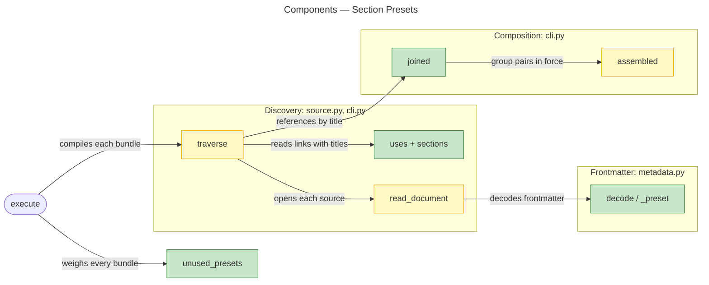
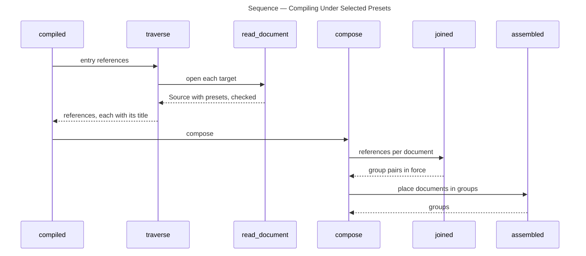
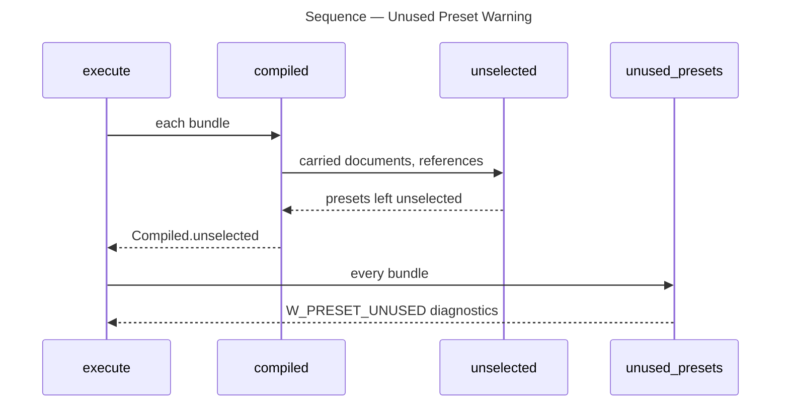

# Architecture Overview — Section Presets

> architecture-overview · [m2ux/prosiform#508](https://github.com/m2ux/prosiform/pull/508) · 2026-11-02

## Summary

A document's `prosiform` frontmatter now holds named presets, and the title of the section holding a link selects which presets of the linked document govern its content. The change lands in frontmatter decoding, reference discovery and bundle composition. It lets one document be placed in different groups for different consumers without a run-wide option.

## Structure

Decoding turns a declaration into presets; discovery tags each reference with the title of the section it is written in; composition reads, per reference, the presets that title selects and places the document under the `group` pair in force; the run then warns of presets nothing selected.

### Frontmatter

- **`Conversion`, `Preset`, `Membership`, `Subst`.**
  A declaration is a tuple of presets; each holds at most one `group` pair (`Membership`) and a list of `subst` entries. `Conversion.default` returns the `default` preset, or an empty one.
- **`decode` and `_preset`.**
  Every top-level key must hold a mapping; inside a preset only `group` and `subst` are admitted, each checked where it is written.

### Discovery

- **`uses` and `sections`.**
  Each link a source carries records the title of the document-level heading above it, so the reference built from it carries `Reference.title`.
- **`read_document`.**
  Runs `substs` (each `subst` side read by the reference grammar) and `stated_once` (a preset stating a `subst` rule twice or against itself) on every source it opens.
- **`traverse`.**
  A link reaching an already-carried target from a new title is kept as a further reference, so the target can be bundled under each selection.

### Composition

- **`joined`.**
  For every reference reaching a document, selects presets by title (`keywords`), refuses disagreeing selections (`agreed`) and records the `group` pair in force (`pair`).
- **`assembled` and `group_depths`.**
  Place a document in each group its pairs name, holding every member of a group to one depth (`E_GROUP_CONFLICT`).

## Behaviour

Two flows: compiling one bundle under per-reference presets, and warning of unused presets across the run.

### Compiling Under Selected Presets

A run's entry starts it, and it yields the bundle's groups.

- **Title selection.**
  `keyworded` matches a preset name as a whole word, ignoring case; `default` is never selected by title and is always in force beneath any selection.
- **Entry title.**
  An entry reference has no section, so `entry_title` reads the named section's heading or the document's own title.
- **Refusal.**
  Two selected presets naming different pairs, or mapping one `subst` key to two alternatives, raise `E_INVALID_USAGE`, exit 2.

### Unused Preset Warning

Every bundle of a run reports, per carried document, the presets no reference selected; `unused_presets` intersects them and `execute` emits `W_PRESET_UNUSED` for each that remains.

- **Deferral.**
  A document reached only through a deferral is carried by no bundle, so none of its presets is weighed.

## What Changed

### Frontmatter

- **Presets alone.**
  `prosiform` admits only preset names; `group` is one `{name: depth}` pair and `subst` a list of single-entry mappings. A run checks `subst` entries and redirects no reference by them.

### Discovery

- **Titled references.**
  References carry the title of the section holding them, and a target reached from two titles is carried under both.

### Composition

- **Per-reference placement.**
  A document joins each group a reference's selection puts in force; candidate coverage is held per group.

## Reading Order

1. **[src/prosiform/metadata.py](https://github.com/m2ux/prosiform/blob/5ccc55c2273e0a595a24a4ce09deab091e5ba706/src/prosiform/metadata.py#L287)** — `decode`, `_preset`, `_membership`, `_subst`: the shape of a declaration.
2. **[src/prosiform/source.py](https://github.com/m2ux/prosiform/blob/5ccc55c2273e0a595a24a4ce09deab091e5ba706/src/prosiform/source.py#L1144)** — `uses` and `sections`: where a link's title comes from.
3. **[src/prosiform/cli.py `read_document`](https://github.com/m2ux/prosiform/blob/5ccc55c2273e0a595a24a4ce09deab091e5ba706/src/prosiform/cli.py#L1092)** — the per-source `substs` and `stated_once` checks, defined at [L487](https://github.com/m2ux/prosiform/blob/5ccc55c2273e0a595a24a4ce09deab091e5ba706/src/prosiform/cli.py#L487).
4. **[src/prosiform/cli.py `traverse`](https://github.com/m2ux/prosiform/blob/5ccc55c2273e0a595a24a4ce09deab091e5ba706/src/prosiform/cli.py#L1754)** — reselecting a carried target from a new title.
5. **[src/prosiform/cli.py `keyworded` to `joined`](https://github.com/m2ux/prosiform/blob/5ccc55c2273e0a595a24a4ce09deab091e5ba706/src/prosiform/cli.py#L1994)** — selection, entry titles, agreement and pairs in force.
6. **[src/prosiform/cli.py `assembled`](https://github.com/m2ux/prosiform/blob/5ccc55c2273e0a595a24a4ce09deab091e5ba706/src/prosiform/cli.py#L2386)** — placing a document in each group.
7. **[src/prosiform/cli.py `unused_presets`](https://github.com/m2ux/prosiform/blob/5ccc55c2273e0a595a24a4ce09deab091e5ba706/src/prosiform/cli.py#L3143)** — the run-wide warning.
8. **[docs/sources.md](https://github.com/m2ux/prosiform/blob/5ccc55c2273e0a595a24a4ce09deab091e5ba706/docs/sources.md)** — the user-facing statement of presets.

## Risks and Watch Points

- **`subst` is checked, not applied.**
  Entries are validated and held to agreement, but the `-m` mapping remains the only substitution a run applies; `docs/sources.md` states this.
- **One document in several groups.**
  Two titles selecting different pairs emit the document once in each group; `candidate.coverage` holds exactly-once per group rather than per bundle.
