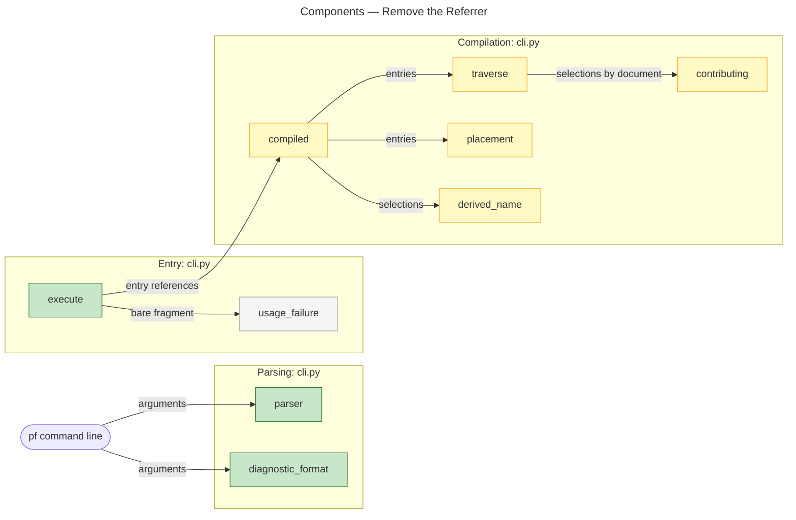
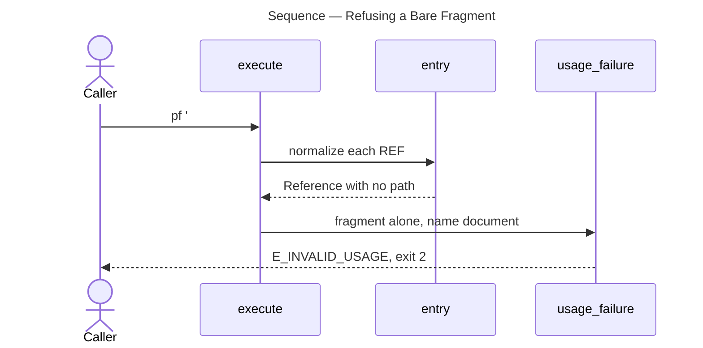
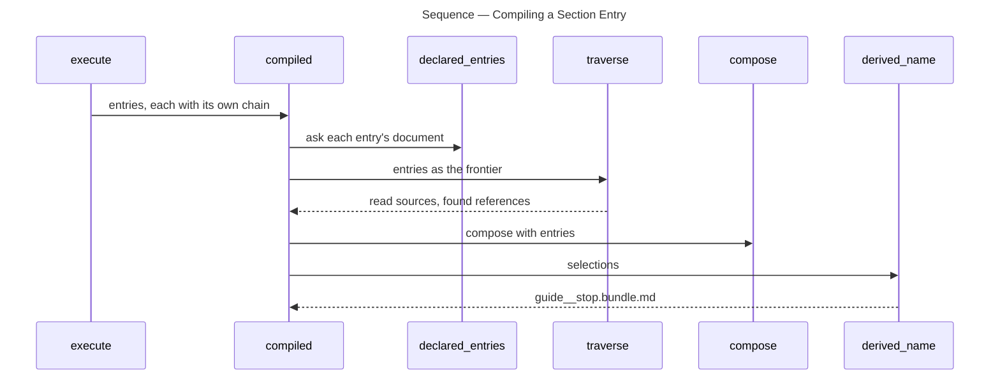

# Architecture Overview — Remove the Referrer

> architecture-overview · [m2ux/prosiform#521](https://github.com/m2ux/prosiform/pull/521) · 2026-11-02

## Summary

A section on the command line is named as `document#fragment` alone, and the `-f` option that named a referring document for a bare `#fragment` is retired. The change lands in argument parsing and the entry path of `cli.py`, and in the corpus, guide and design pin that state the contract. A run's entries now carry their own document, so nothing threads a referrer through traversal, placement or naming.

## Structure

Parsing admits positional references only; `execute` refuses a fragment alone before any source is read; compilation reads each entry's document from the entry itself.

### Parsing

- **`parser`.**
  Declares no `-f`; `REF` is `document or document#fragment`, and `make invocation` holds that row to `invocation.md`.
- **`diagnostic_format`.**
  Scans for the value-taking short options the grammar declares, so `-d json` is found after any of them.

### Entry

- **`execute`.**
  Refuses an entry whose reference has no path with `E_INVALID_USAGE`, exit `2`, naming the reference and `document#fragment`.

### Compilation

- **`entered`, `declared_entries`, `contributing`, `placement`, `selections`, `derived_name`.**
  Each takes the entry references alone and reads a reference's document from `one.path`.
- **`traverse` and `compiled`.**
  The frontier starts from the entries; `dispatched_set` compiles a dispatched target with the same signature.

## Behaviour

Two flows: refusing a bare fragment, and compiling a section entry.

### Refusing a Bare Fragment

`pf '#stop'` reaches `execute`, which refuses it before any source is opened.

- **Refusal.**
  The message names the reference and the remedy; the fixture `cli/a-bare-fragment-is-invalid-usage` declares both texts.

### Compiling a Section Entry

`pf 'guide.md#stop'` compiles the section from the document it names.

- **Name.**
  A section entry's name is its document's path and fragment, as `docs/bundles.md` Derived names states.

## What Changed

### Command Line

- **One spelling for a section.**
  `document#fragment` is the only way to name a section; a bare fragment is invalid usage.

### Compilation

- **No referrer.**
  Every entry carries its document, so no compilation step takes a referring document.

### Contract and Corpus

- **Design, guide and fixtures agree.**
  The pinned design states the refusal and the retirement; `invocation.md`, `docs/glossary.md` and `docs/bundles.md` name no referrer; the three `-f` fixtures are withdrawn or rewritten.

## Reading Order

1. **[src/prosiform/cli.py `execute`](https://github.com/m2ux/prosiform/blob/38c028c3b5ff06dabcf63f4cc0faebda44f985f0/src/prosiform/cli.py#L3196)** — the refusal at [L3223](https://github.com/m2ux/prosiform/blob/38c028c3b5ff06dabcf63f4cc0faebda44f985f0/src/prosiform/cli.py#L3223) and the entry path.
2. **[src/prosiform/cli.py `parser`](https://github.com/m2ux/prosiform/blob/38c028c3b5ff06dabcf63f4cc0faebda44f985f0/src/prosiform/cli.py#L803)** — the grammar without `-f`, and `diagnostic_format` at [L896](https://github.com/m2ux/prosiform/blob/38c028c3b5ff06dabcf63f4cc0faebda44f985f0/src/prosiform/cli.py#L896).
3. **[src/prosiform/cli.py `compiled`](https://github.com/m2ux/prosiform/blob/38c028c3b5ff06dabcf63f4cc0faebda44f985f0/src/prosiform/cli.py#L3042)** — the entries reaching `declared_entries`, `traverse`, `compose` and `derived_name`.
4. **[fixtures/cli/a-bare-fragment-is-invalid-usage/manifest.toml](https://github.com/m2ux/prosiform/blob/38c028c3b5ff06dabcf63f4cc0faebda44f985f0/fixtures/cli/a-bare-fragment-is-invalid-usage/manifest.toml)** — the refusal as the corpus states it.
5. **[invocation.md](https://github.com/m2ux/prosiform/blob/38c028c3b5ff06dabcf63f4cc0faebda44f985f0/invocation.md)** — the option table and the Bundling statement.

## Risks and Watch Points

- **Callers passing `-f`.**
  A script that passed `-f DOC '#fragment'` now fails with `E_INVALID_USAGE` naming an undeclared option; the remedy is `DOC#fragment`.
- **Fragment-only links are untouched.**
  `[Check](#section)` inside a document still resolves against that document; the fixtures under `rewriting/`, `inclusion/` and `dispatch/` cover it.
