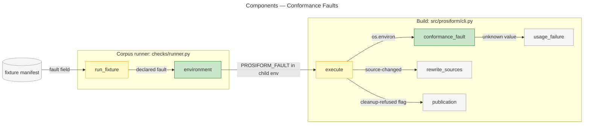
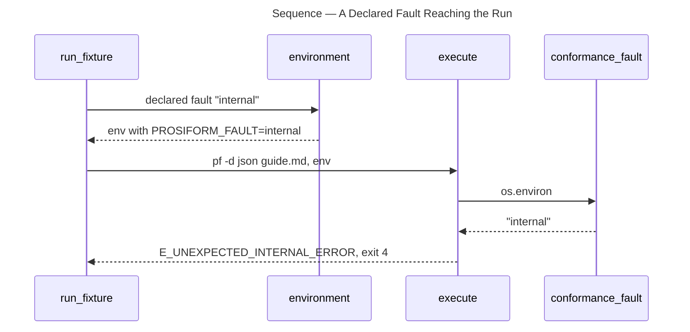
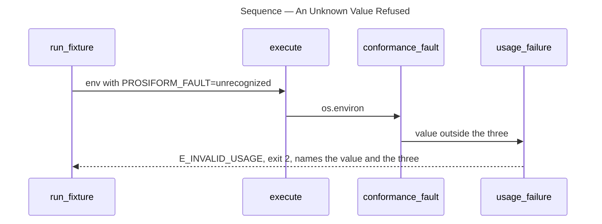

# Architecture Overview — Conformance Faults

> architecture-overview · [m2ux/prosiform#540](https://github.com/m2ux/prosiform/pull/540) · 2026-11-02

## Summary

A conformance run asks the build to fail in itself through the `PROSIFORM_FAULT` environment variable, and the command line carries no `-x` option. The change lands in `cli.py`, where `execute` reads the variable once through `conformance_fault`, and in the corpus runner `checks/runner.py`, which sets the variable from a manifest's `fault` field. A **conformance fault** is a condition no source tree can produce — a source changing mid-run, an internal failure, an earlier set that cannot be removed — which the run performs on itself so a fixture can observe the build's own detection. The integration also removes the dedicated refusals of retired options (`-r`, `-g` and retired long forms): each is refused as any undeclared option.

## Structure

The runner reaches the build through its environment; the build reads that environment in `execute` and passes the fault to three points of the run.

### Corpus Runner

- **`environment`.**
  Copies the runner's own environment without `PROSIFORM_FAULT`, then sets it to the declared fault when one is declared, so a fixture naming none runs with the variable absent.
- **`run_fixture`.**
  Passes that environment to the build's subprocess and appends `-d json` and the manifest's arguments; no fault reaches the command line.

### Build

- **`parser` and `diagnostic_format`.**
  Declare no `-x`; the diagnostics-format scan no longer treats `x` as value-taking.
- **`conformance_fault`.**
  Returns the variable's value when it is one of `source-changed`, `internal` or `cleanup-refused`, `None` when absent, and raises `E_INVALID_USAGE` (exit 2) naming the value and the three otherwise.
- **`execute`.**
  Calls `conformance_fault` once, after the informational responses and before any entry is resolved, and uses the result where `options.fault` stood.

## Behaviour

Two flows: a fixture's fault reaching the run, and an unknown value refused.

### A Declared Fault Reaching the Run

`fixtures/diagnostics/a-run-that-fails-in-itself` declares `fault = "internal"`.

- **Placement.**
  `source-changed` rewrites the captured sources before the recheck, `internal` raises after it, and `cleanup-refused` is handed to `publication`; all three positions are unchanged.

### An Unknown Value Refused

`fixtures/cli/an-unknown-fault-is-invalid-usage` declares `fault = "unrecognized"`, a schema value the contract names as no fault.

## What Changed

### Command Line

- **No fault option.**
  `pf -h` and `invocation.md` name no `-x`; `make invocation` compares no row for it.

### Fault Channel

- **One channel.**
  The fault arrives only through `PROSIFORM_FAULT`; an unknown value fails as invalid usage.

### Corpus

- **Manifest field unchanged.**
  Fixtures keep `fault = "<name>"`; the schema adds `unrecognized` for the refusal fixture, and the fixtures README lists seven `E_INVALID_USAGE` faults.

### Retired Options

- **Refused as undeclared.**
  No fixture, smoke step or unit test refuses `-r`, `-g` or a retired long form by name.

## Reading Order

1. **[src/prosiform/cli.py `conformance_fault`](https://github.com/m2ux/prosiform/blob/9510d2d5c358242b93b41860876249df8d4356b8/src/prosiform/cli.py#L1310-L1326)** — the variable, its values and the refusal.
2. **[src/prosiform/cli.py `execute`](https://github.com/m2ux/prosiform/blob/9510d2d5c358242b93b41860876249df8d4356b8/src/prosiform/cli.py#L3228)** — where the fault is read, and its uses at [L3265](https://github.com/m2ux/prosiform/blob/9510d2d5c358242b93b41860876249df8d4356b8/src/prosiform/cli.py#L3265-L3269) and [L3289](https://github.com/m2ux/prosiform/blob/9510d2d5c358242b93b41860876249df8d4356b8/src/prosiform/cli.py#L3289).
3. **[checks/runner.py `environment`](https://github.com/m2ux/prosiform/blob/9510d2d5c358242b93b41860876249df8d4356b8/checks/runner.py#L521-L532)** — the child environment, and `run_fixture` at [L567](https://github.com/m2ux/prosiform/blob/9510d2d5c358242b93b41860876249df8d4356b8/checks/runner.py#L567).
4. **[fixtures/cli/an-unknown-fault-is-invalid-usage/manifest.toml](https://github.com/m2ux/prosiform/blob/9510d2d5c358242b93b41860876249df8d4356b8/fixtures/cli/an-unknown-fault-is-invalid-usage/manifest.toml)** — the refusal as the corpus states it.
5. **[fixtures/README.md](https://github.com/m2ux/prosiform/blob/9510d2d5c358242b93b41860876249df8d4356b8/fixtures/README.md)** — the `fault` field, the `E_INVALID_USAGE` table and the fault section.
6. **[invocation.md](https://github.com/m2ux/prosiform/blob/9510d2d5c358242b93b41860876249df8d4356b8/invocation.md)** — the option table without `-x`.

## Risks and Watch Points

- **A stray variable in a caller's shell.**
  An exported `PROSIFORM_FAULT` holding a valid name makes every run fault; holding anything else makes every compiling run fail as invalid usage. The runner strips it for fixtures declaring none.
- **Informational responses ignore the variable.**
  `-h`, `-v` and `-C` answer before the fault is read, so a bad value surfaces only on a compiling run.
