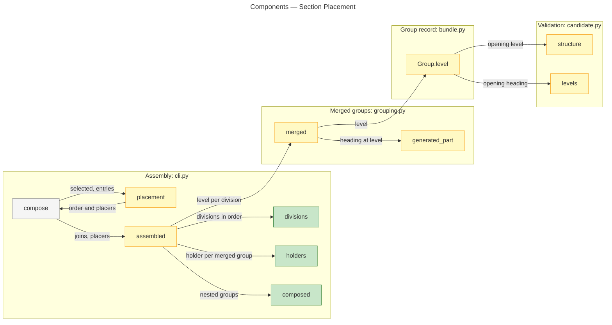

# Architecture Overview — Section Placement

> architecture-overview · [m2ux/prosiform#541](https://github.com/m2ux/prosiform/pull/541) · 2026-11-02

## Summary

A file's `group` pair places that file's own sections in the result its parent merges. Composition runs from the leaves up: a merged group nests inside the division of the document whose link placed its first member, one heading level deeper per enclosing division, and is finished before that division merges it. A heading the nesting pushes past H6 fails the run with `E_HEADING_DEPTH_OVERFLOW`; the group is not lifted to the top level.

The change lands in assembly (`cli.py`), the merged-group writer (`grouping.py`), the group record (`bundle.py`), dispatch placement (`dispatch.py`) and candidate validation (`candidate.py`), with the design pin, the guide and the pages that state where a group stands.

Terms the codebase coins:

- **Division.** One group of the bundle: a *file group* (one document under its file heading) or a *merged group* (every document whose `group` pair names it, under one heading).
- **Placer.** The document whose link first placed another document in the bundle. An entry has none.
- **Holder.** The division a nested merged group stands inside: the division holding its first member's placer.

## Structure

Assembly decides each division's holder and level; the merged-group writer emits at that level; validation reads the level back.



Green is added, yellow altered, grey context.

### Assembly

- **`placement`.**
  Returns, beside the placement order, the placer of every document a link placed.
- **`divisions`.**
  Lists each file group and merged group in the order its first document is placed.
- **`holders`.**
  Maps each merged group whose first member has a placer to that placer's division: its file group, or the earliest-placed merged group it joins. A holder carries a document placed earlier, so no group holds itself.
- **`composed`.**
  Returns a division's group followed by each group nested in it, recursively composed.
- **`assembled`.**
  Sets each division's level (1 at the top, the holder's plus one when nested), builds every group, and emits the top-level divisions through `composed`.

### Merged Groups

- **`merged`.**
  Takes the level its heading stands at; `Assembly` offsets the overview, member and section levels by the same amount.
- **`generated_part`.**
  Raises `Overflow` against the member when a generated heading would pass H6.

### Group Record and Dispatch

- **`Group.level`.**
  The level the group's opening heading takes; it replaces the former placement-order key. `dispatch.Placing` keeps the wrapper at that level.

### Validation

- **`structure`.**
  Checks each wrapped group opens on a heading at its own level.
- **`levels`.**
  Group isolation holds every placed heading below the group's opening heading, at whatever level that opening stands.

## Behaviour

### Composing a Nested Group

`pf guide.md`, where `guide.md` links `notes.md` and `notes.md` declares `group: {notes: 1}`. Edges are the call edges the graph measures from `compose` and `assembled`.

```mermaid
---
title: Sequence — Composing a Nested Group
---
sequenceDiagram
    participant C as compose
    participant P as placement
    participant A as assembled
    participant H as holders
    participant M as merged
    participant K as composed
    participant V as validate

    C->>P: selected documents, entries
    P-->>C: guide, notes; notes placed by guide
    C->>A: joins, placers
    A->>H: divisions, members, placers
    H-->>A: group notes held by file group guide
    A->>M: notes at level 2
    M-->>A: Group, level 2
    A->>K: guide's division
    K-->>A: guide's group, then notes inside it
    A-->>C: groups in order
    C->>V: candidate
    V-->>C: each group opens at its level
```

- **Overflow.**
  Where the nesting pushes any heading past H6, `merged` raises `Overflow` and the run fails with `E_HEADING_DEPTH_OVERFLOW`, as the fixture `grouping/a-nested-group-pushing-a-heading-past-the-sixth-fails` records.
- **Entries.**
  A merged group whose first member is an entry has no placer and stands at the top level, as every file group does.

## What Changed

### Composition

- **Leaves up.**
  Each file's `group` pair places its own sections; a merged group stands inside its first member's placer's division, after that division's own content.
- **Depth.**
  Every enclosing division moves a group's headings one level down; past H6 is refused.

### Validation

- **Group isolation at the group's level.**
  A group's opening and its contents are checked at the level it stands at, not at H1.

### Contract and Pages

- **Design and documentation agree.**
  The README pins design `bda1fb52`, which carries E02's leaves-up clause and I08:E04's; `invocation.md`, `docs/hierarchy.md`, `docs/architecture.md`, `docs/glossary.md`, `docs/selection.md` and `docs/validation.md` state where a group stands.

The pull request's Changes section lists each change.

## Reading Order

1. **[src/prosiform/cli.py `placement`](https://github.com/m2ux/prosiform/blob/fc6940ee6d6e91e1fe24ebff2d106b9fe7a1a2bd/src/prosiform/cli.py#L2344)** — where each document's placer is recorded.
2. **[src/prosiform/cli.py `divisions`, `holders`, `composed`](https://github.com/m2ux/prosiform/blob/fc6940ee6d6e91e1fe24ebff2d106b9fe7a1a2bd/src/prosiform/cli.py#L2386-L2461)** — the holder rule and the leaves-up recursion.
3. **[src/prosiform/cli.py `assembled`](https://github.com/m2ux/prosiform/blob/fc6940ee6d6e91e1fe24ebff2d106b9fe7a1a2bd/src/prosiform/cli.py#L2464-L2564)** — levels per division and the emitted order.
4. **[src/prosiform/grouping.py `merged`](https://github.com/m2ux/prosiform/blob/fc6940ee6d6e91e1fe24ebff2d106b9fe7a1a2bd/src/prosiform/grouping.py#L553)** — the group written at its level, with [`generated_part`](https://github.com/m2ux/prosiform/blob/fc6940ee6d6e91e1fe24ebff2d106b9fe7a1a2bd/src/prosiform/grouping.py#L423) raising the overflow and [`Assembly`](https://github.com/m2ux/prosiform/blob/fc6940ee6d6e91e1fe24ebff2d106b9fe7a1a2bd/src/prosiform/grouping.py#L438) the offset.
5. **[src/prosiform/candidate.py `structure`](https://github.com/m2ux/prosiform/blob/fc6940ee6d6e91e1fe24ebff2d106b9fe7a1a2bd/src/prosiform/candidate.py#L632) and [`levels`](https://github.com/m2ux/prosiform/blob/fc6940ee6d6e91e1fe24ebff2d106b9fe7a1a2bd/src/prosiform/candidate.py#L905)** — group isolation at the group's level.
6. **[fixtures/grouping/an-intermediate-group-nests-inside-its-parent/manifest.toml](https://github.com/m2ux/prosiform/blob/fc6940ee6d6e91e1fe24ebff2d106b9fe7a1a2bd/fixtures/grouping/an-intermediate-group-nests-inside-its-parent/manifest.toml)** — the nesting as the corpus states it.
7. **[docs/hierarchy.md](https://github.com/m2ux/prosiform/blob/fc6940ee6d6e91e1fe24ebff2d106b9fe7a1a2bd/docs/hierarchy.md#where-a-group-stands)** — where a group stands and what nesting costs.

## Risks and Watch Points

- **Deep shared documents overflow.**
  A shared group whose first member is linked from a deep division can push headings past H6 and fail the run; the remedy is a shallower placing document or shallower member headings. The example tree's Plan and Advance usage-example runs record that refusal.
- **Re-recorded bundles.**
  Corpus fixtures whose arrangement changed were re-recorded; a reviewer compares them against the holder rule rather than the former flat order.
