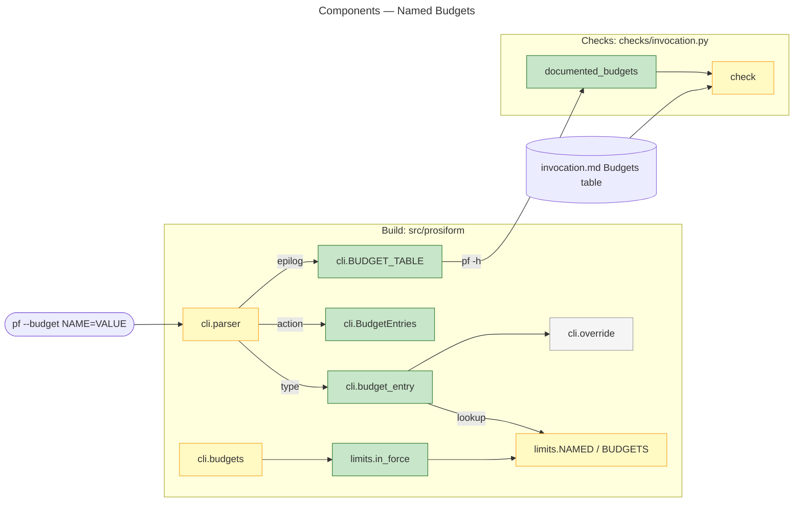
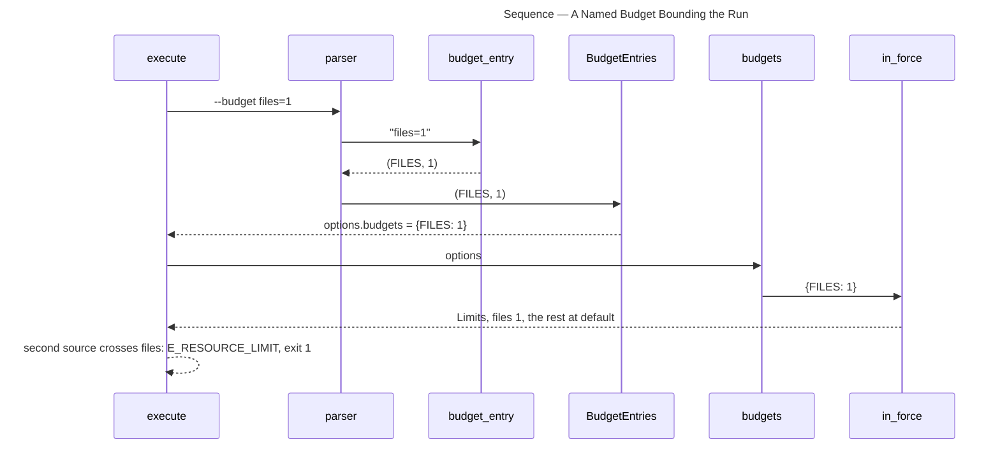
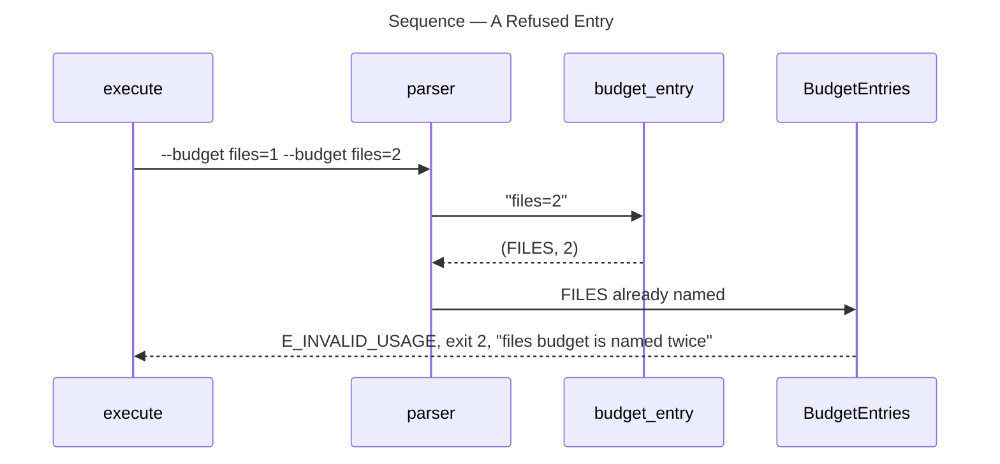

# Architecture Overview — Named Budgets

> architecture-overview · [m2ux/prosiform#550](https://github.com/m2ux/prosiform/pull/550) · 2026-11-02

## Summary

A run sets each resource budget by name through one repeatable option, `--budget NAME=VALUE`, in place of eight single-letter options. The change lands in `limits.py`, where each `Budget` carries its name and an optional floor, and in `cli.py`, where one value parser and one action read the entries into the budgets in force. A **budget** is a ceiling a run fails on rather than truncating a bundle — files opened, bytes read or written, targets, links, nesting and link depth.

## Structure

The command line parses each entry against the declared budgets; the run reads the parsed entries once into the `Limits` every stage counts against. The help output lists the budgets, and the invocation check holds the documented table to it.

### Budgets

- **`Budget`.**
  Carries `name`, `default`, `counted` and `least`; `nesting` holds `least=2`, the depth of a `prosiform` declaration.
- **`NAMED`.**
  Each budget under the name a command line sets it by.
- **`in_force`.**
  One entry per declared budget: the named figure, or the default.

### Command Line

- **`budget_entry`.**
  Splits at the first `=`; refuses no `=`, an empty name, an unknown name, a figure `override` rejects, and a figure below `least`.
- **`BudgetEntries`.**
  Accumulates entries into a mapping and refuses a budget named twice.
- **`budgets`.**
  Calls `in_force` with the parsed entries; `execute` and `compiled` read it.
- **`BUDGET_TABLE`.**
  The help epilog's `budgets:` section, one line per budget.

### Invocation Check

- **`documented_budgets`.**
  Reads the help's `budgets:` section through `listed`, which also reads exit statuses; `check` compares it with the `Budget` table in `invocation.md` in both directions.

## Behaviour

Two flows: a named budget bounding a run, and a refused entry.

### A Named Budget Bounding the Run

`fixtures/limits/a-named-budget-bounds-the-run` passes `--budget files=1`.

### A Refused Entry

`fixtures/cli/a-budget-named-twice-is-refused` passes `--budget files=1 --budget files=2`.

- **Other refusals.**
  `budget_entry` refuses `key=1`, `files`, `=1`, `files=0` and `nesting=1` before any source is read, each `E_INVALID_USAGE`, exit 2.

## What Changed

### Command Line

- **One option.**
  `-F`, `-B`, `-I`, `-O`, `-T`, `-L`, `-N` and `-E` are gone; `--budget` is the only way to set a budget, and `diagnostic_format` treats only `-o`, `-d` and `-m` as value-taking.

### Diagnostics

- **Crossings name the budget.**
  `Crossed` and the frontmatter decoder name `files`, `file-bytes`, `nesting` and the rest, and the remedy is `raise --budget <name>`.

### Corpus and Documentation

- **Fixtures pass names.**
  Every budget fixture passes `--budget <name>=<n>` and declares `Resource limits — <name>`; six new fixtures cover the named bound and each refusal.
- **Pages name budgets.**
  `invocation.md` carries one option row and a Budgets table; `docs/` and the README pin to design `a7069f30` name budgets by name.

## Reading Order

1. **[src/prosiform/limits.py `Budget`](https://github.com/m2ux/prosiform/blob/c84a25ea9e1dcb5ff35e24bae7a40ef88e99621e/src/prosiform/limits.py#L61-L105)** — the eight budgets, their names and the nesting floor.
2. **[src/prosiform/limits.py `in_force`](https://github.com/m2ux/prosiform/blob/c84a25ea9e1dcb5ff35e24bae7a40ef88e99621e/src/prosiform/limits.py#L149-L155)** — the budgets in force.
3. **[src/prosiform/cli.py `budget_entry` and `BudgetEntries`](https://github.com/m2ux/prosiform/blob/c84a25ea9e1dcb5ff35e24bae7a40ef88e99621e/src/prosiform/cli.py#L461-L520)** — parsing, refusals and `budgets`.
4. **[src/prosiform/cli.py `--budget`](https://github.com/m2ux/prosiform/blob/c84a25ea9e1dcb5ff35e24bae7a40ef88e99621e/src/prosiform/cli.py#L922-L932)** — the option, and the help table at [L271-L279](https://github.com/m2ux/prosiform/blob/c84a25ea9e1dcb5ff35e24bae7a40ef88e99621e/src/prosiform/cli.py#L271-L279).
5. **[checks/invocation.py `listed`](https://github.com/m2ux/prosiform/blob/c84a25ea9e1dcb5ff35e24bae7a40ef88e99621e/checks/invocation.py#L165-L189)** — the help sections the check reads.
6. **[invocation.md Budgets](https://github.com/m2ux/prosiform/blob/c84a25ea9e1dcb5ff35e24bae7a40ef88e99621e/invocation.md#budgets)** — the documented table.
7. **[fixtures/cli/](https://github.com/m2ux/prosiform/tree/c84a25ea9e1dcb5ff35e24bae7a40ef88e99621e/fixtures/cli)** — the refusal fixtures.

## Risks and Watch Points

- **Callers using the letters.**
  A script passing `-O` or `-N` now fails as an undeclared option; `scripts/render-diagram.py` is updated, and the tree carries no other caller.
- **Split at the first `=`.**
  A figure is a decimal integer, so a second `=` makes the figure invalid rather than part of the name.
