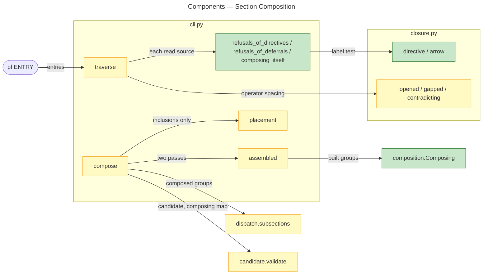
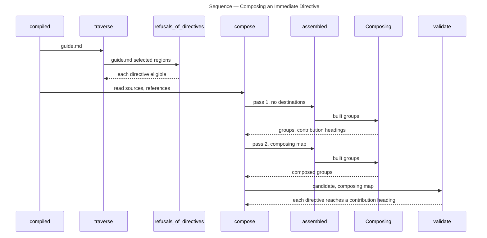
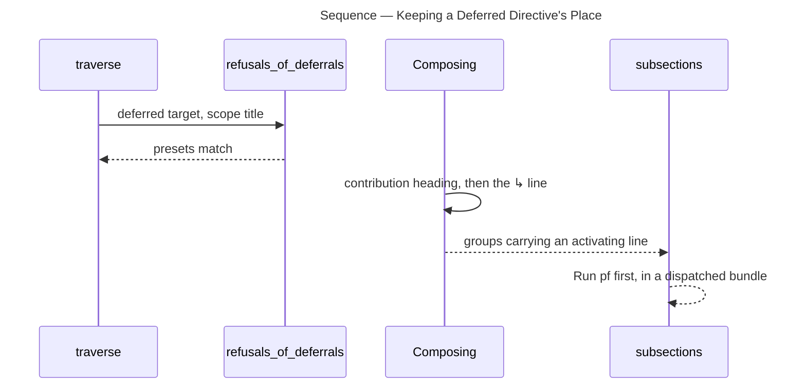

# Architecture Overview — Section Composition

> architecture-overview · [m2ux/prosiform#556](https://github.com/m2ux/prosiform/pull/556) · 2026-11-02

## Summary

A link whose label is one Unicode arrow, such as `[→](read.md#inputs)`, becomes a **composition directive**: the run places the section it names beneath the section writing it, instead of bundling that document as a division of its own. The change adds `composition.py`, a pass over the built groups ahead of dispatch, and teaches traversal, placement, rewriting, dispatch and candidate validation about it. A procedure step can then carry the contracts of the calls it makes, and `[¬→]` defers that placement to the run its generated `↳` line names.

## Structure

Recognition lives in `closure.py`; traversal in `cli.py` refuses every directive the run cannot place before anything is built; `compose` runs the composition pass twice, once to learn the headings and once with their destinations; `dispatch.py` and `candidate.py` read composed parts as content of the scope that composed them.

### Closure

- **`directive` and `arrow`.**
  A label is a directive when, read as plain text with entities decoded, it is one arrow other than `⇉` or `↳`, or the deferral mark written against one. An arrow is an assigned scalar of the four Arrows blocks, or a Dingbats or Miscellaneous Symbols and Arrows scalar whose name holds the word `ARROW`.
- **`opened`, `gapped` and `contradicting`.**
  Symbols are written together with one blank before the text: a blank between two symbols, and a dispatch mark against a directive's label, are refused.

### Command Line

- **The refusals.**
  `refusals_of_directives` refuses a directive in a preamble, one naming a missing document, a remote address, a resource, a silent document or a whole document, and a section composed and deferred in one scope. `refusals_of_deferrals` refuses a deferral whose scope and target heading select different presets. `composing_itself` warns `W_COMPOSE_SELF`.
- **`placement`.**
  Reads inclusions only, so a document only directives reach takes no group; a composed section's own links place documents as its scope's document would.
- **`assembled` and `compose`.**
  Build the groups, run the composition pass, and repeat both with the destination map so every directive points at its contribution heading.

### Composition

- **`Composing`.**
  Walks each group's parts; when a scope closes, `flush` emits one destination section per title and `contribute` emits each directive's contribution heading and the target's regions, recursing for directives inside them. It refuses a parentless target, a heading past H6, a cycle on the placing chain and a collision with an authored child, and holds `output-bytes` per emission.

## Behaviour

Two flows: composing an immediate directive, and keeping a deferred one's place.

### Composing an Immediate Directive

`fixtures/composition/titles-from-several-sources-share-one-destination-section` runs `pf guide.md`, whose `## Prepare` writes three directives into `read.md` and `write.md`.

- **Scope.**
  The directives are read from `## Prepare`'s regions; the destination sections `### Inputs` and `### Outputs` follow its own content.
- **Contributions.**
  `#### Read` and `#### Write` name each target's parent; the target's regions are rewritten against their own source.
- **Links.**
  The second pass rewrites `[→](read.md#inputs)` to `[→](#read)`, the slug its contribution heading took.

### Keeping a Deferred Directive's Place

`fixtures/composition/a-deferred-directive-is-activated-by-the-run-its-line-names` runs `pf fetch.md#implementation`, the section `guide.md` defers; that section composes `net.md#open` and writes `[¬→](net.md#retry)`.

- **Withheld.**
  The target is confirmed to exist and carried nowhere; the contribution carries `[↳ Retry](net.md#retry)`.
- **Activation.**
  This run is itself an activation: it compiles `fetch.md#implementation` as an entry, composing `#### Open` and deferring `#### Retry` again; `pf net.md#retry` activates that one in turn.

## What Changed

### Closure

- **Recognition.**
  The directive predicate and the shared spacing rule for operator marks and directive labels.

### Command Line

- **Traversal.**
  Every directive the run cannot place is refused before a group is built; a self-composition warns.
- **Composition in two passes.**
  Inline-only targets take no group; every directive points at its own contribution.

### Dispatch and Validation

- **Composed parts.**
  Destination sections and contributions close no section of the scope; a dispatch in an inline-only contribution takes its own sub-section; a dispatched bundle needing a later run opens with `## Run pf first`.
- **Candidate checks.**
  Composed ranges stand outside coverage and source order; each directive must reach a contribution heading and each `↳` line one target.

## Reading Order

1. **[closure.py `arrow` to `directive`](https://github.com/m2ux/prosiform/blob/b83f0b3d596408737f972d0b66bdedf7d894ffad/src/prosiform/closure.py#L497-L695)** — what a directive is, and the spacing rule it shares with the operators.
2. **[cli.py `refusals_of_directives`](https://github.com/m2ux/prosiform/blob/b83f0b3d596408737f972d0b66bdedf7d894ffad/src/prosiform/cli.py#L1693-L1880)** — every refusal made before building, with the deferral and self-composition checks after it.
3. **[cli.py `placement`](https://github.com/m2ux/prosiform/blob/b83f0b3d596408737f972d0b66bdedf7d894ffad/src/prosiform/cli.py#L2631-L2686)** — why an inline-only target takes no group.
4. **[composition.py](https://github.com/m2ux/prosiform/blob/b83f0b3d596408737f972d0b66bdedf7d894ffad/src/prosiform/composition.py#L1-L86)** — the module docstring states the model; then `Composing.group`, `flush` and `contribute`.
5. **[cli.py `compose`](https://github.com/m2ux/prosiform/blob/b83f0b3d596408737f972d0b66bdedf7d894ffad/src/prosiform/cli.py#L3037-L3162)** — the two passes and the composing map.
6. **[bundle.py `rewrite`](https://github.com/m2ux/prosiform/blob/b83f0b3d596408737f972d0b66bdedf7d894ffad/src/prosiform/bundle.py#L437-L573)** — a directive's link rewritten to its contribution, and a directive in a text-only heading refused.
7. **[dispatch.py `first_run` and `Placing`](https://github.com/m2ux/prosiform/blob/b83f0b3d596408737f972d0b66bdedf7d894ffad/src/prosiform/dispatch.py#L494-L770)** — composed headings in the dispatch pass and the first-run section.
8. **[candidate.py `contributions` and `activation`](https://github.com/m2ux/prosiform/blob/b83f0b3d596408737f972d0b66bdedf7d894ffad/src/prosiform/candidate.py#L1238-L1303)** — what validation holds a composed bundle to.
9. **[docs/composition.md](https://github.com/m2ux/prosiform/blob/b83f0b3d596408737f972d0b66bdedf7d894ffad/docs/composition.md)** — the published grammar beside its fixtures.

## Risks and Watch Points

- **Two passes must agree.**
  Pass 1 counts only generated headings against `output-bytes`; pass 2 counts every byte. A heading pass 2 emits that pass 1 did not would misplace destinations; `contributions` in `candidate.py` catches a directive reaching anything but a contribution heading.
- **Arrow names come from Python's Unicode database.**
  The Dingbats and Miscellaneous Symbols and Arrows test reads `unicodedata.name`, so a Python release adding scalars there can admit a new label.
- **Depth.**
  Each directive spends two heading levels below its scope; a scope inside a nested group reaches H6 quickly, and the run refuses rather than lifts.

## References

- **R1.** [Section composition](https://github.com/m2ux/prosiform/blob/4958ad38bc2bb6a0786f93aa6de30a7b6a2e27c9/artifacts/planning/2026-10-17-prosiform-v1/design.md#section-composition) — the design clause at the pin.
- **R2.** [Epic #460](https://github.com/m2ux/prosiform/issues/460) — the work breakdown and criteria.
