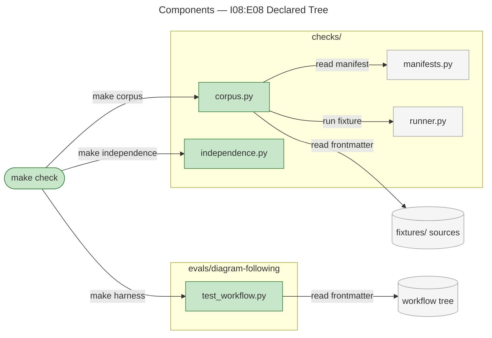
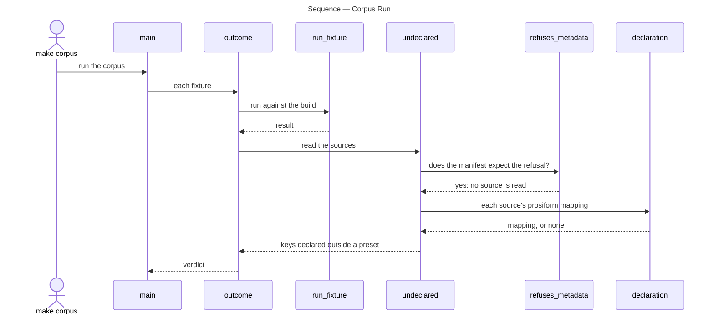
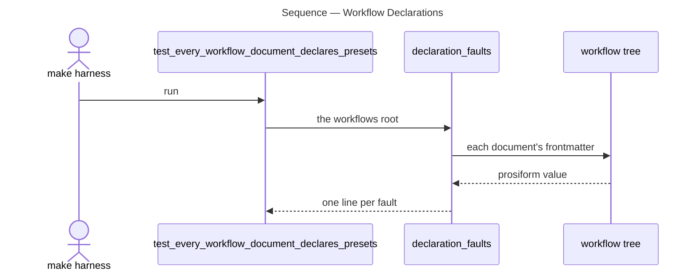

# Architecture Overview — I08:E08 Declared Tree

> architecture-overview · [m2ux/prosiform#559](https://github.com/m2ux/prosiform/pull/559) · 2026-11-02

## Summary

The integration removes the unmaintained `example/` tree and every check, fixture, test and drawing that read it, keeping the tree readable at the annotated tag `archive/example-work-planner`. It lands in the repository's own checks and documents, not in the compiler: no file under `src/prosiform` changes. The corpus runner and the diagram-following eval each gain a guard holding their sources to the preset shape, so a setting declared outside a preset fails a check rather than drifting.

## Structure

The change reaches three areas: the `make check` pipeline that names the checks, the corpus and contract checks under `checks/`, and the diagram-following eval's workflow tests under `evals/`. The documents a reader follows, `README.md`, `invocation.md`, `checks.md` and the guides beside the checks, now run their worked commands over corpus fixture source trees.

### `make check`

- **The pipeline.**
  The `check` target runs the lockfile, lint, format, type, test, harness, corpus, smoke and documentation checks, then the contract checks. The `steps`, `authoring` and `boundary` targets, which read the example tree alone, are gone with their scripts and tests.

### checks/

- **`corpus.py`.**
  Runs every fixture against the build under test and reads its sources: a source key of `prosiform` that names a setting or holds anything but a mapping fails the fixture.
- **`independence.py`.**
  Admits a shaped term only where the design, the glossary or the declared interface names it; example-tree headings are no longer a source of names.

### evals/diagram-following

- **`test_workflow.py`.**
  Holds every workflow document to a `prosiform` mapping whose keys each name a preset holding a mapping.

## Behaviour

Two flows carry new behaviour: the corpus run reading a fixture's declarations, and the eval reading the workflow tree's declarations.

### Corpus Run

`make corpus` starts the run; it yields one verdict per fixture.

- **The verdict.**
  A fixture naming any undeclared key fails whatever the build answered; otherwise its result and its `awaiting` marker decide as before.
- **The exemption.**
  A fixture expecting `E_INVALID_CONVERSION_METADATA` is about refusing such a declaration, so its sources are its subject and are skipped.
- **What is read.**
  Every `.md` file of the fixture outside `expected/`, symbolic links excepted. A source whose `prosiform` is absent or not a mapping declares nothing, as the design states, and is not reported.

### Workflow Declarations

`make harness` runs the eval's tests; one asserts the whole workflow tree declares.

- **The faults.**
  A document declaring no `prosiform`, declaring it as anything but a mapping, or carrying a key whose value is not a mapping.

## What Changed

### Repository

- **The example tree.**
  `example/`, the `usage-example` fixtures, the `compilation` and `agent-rules` drawings and the handoff round-trip suite are removed; the tag `archive/example-work-planner` names `00f16692`, the parent of the removal.
- **Documentation.**
  `README.md` and `invocation.md` run their worked commands in fixture source trees, and the README pins the design at `cf382468`, which carries no usage-examples clause.

### Checks

- **Corpus declarations.**
  `make corpus` fails a fixture source declaring a setting outside a preset.
- **Eval declarations.**
  `make harness` fails a workflow document declaring outside presets.

## Reading Order

1. **[Makefile](https://github.com/m2ux/prosiform/blob/8221ce2a18334a4f4763928ad949d32ddf480370/Makefile#L68)** — the checks `make check` now names.
2. **[checks/corpus.py](https://github.com/m2ux/prosiform/blob/8221ce2a18334a4f4763928ad949d32ddf480370/checks/corpus.py#L132-L178)** — the declaration guard and where the verdict reads it.
3. **[checks/tests/test_corpus_run.py](https://github.com/m2ux/prosiform/blob/8221ce2a18334a4f4763928ad949d32ddf480370/checks/tests/test_corpus_run.py)** — the guard's cases, the exemption included.
4. **[evals/diagram-following/test_workflow.py](https://github.com/m2ux/prosiform/blob/8221ce2a18334a4f4763928ad949d32ddf480370/evals/diagram-following/test_workflow.py#L69-L92)** — the eval's declaration guard.
5. **[checks/independence.py](https://github.com/m2ux/prosiform/blob/8221ce2a18334a4f4763928ad949d32ddf480370/checks/independence.py#L173)** — the names the contract admits.
6. **[checks/README.md](https://github.com/m2ux/prosiform/blob/8221ce2a18334a4f4763928ad949d32ddf480370/checks/README.md)** and **[checks.md](https://github.com/m2ux/prosiform/blob/8221ce2a18334a4f4763928ad949d32ddf480370/checks.md)** — the checks as documented.
7. **[README.md](https://github.com/m2ux/prosiform/blob/8221ce2a18334a4f4763928ad949d32ddf480370/README.md#L43)** and **[invocation.md](https://github.com/m2ux/prosiform/blob/8221ce2a18334a4f4763928ad949d32ddf480370/invocation.md#L45)** — the worked commands over fixture trees.

## Risks and Watch Points

- **Coverage that read the tree.**
  The handoff round-trip suite compiled the example's modes; deferral and dispatch remain held by the `deferral/` and `dispatch/` fixture families.
- **The design pin.**
  `cf382468` also carries I09:E04's recognition amendment `ee8df501` ahead of that epic's delivery; `make conformance` passes there.

## References

- **R1.** [I08:E08 Declared Tree](https://github.com/m2ux/prosiform/issues/465) — the epic and its criteria.
- **R2.** [Archive tag](https://github.com/m2ux/prosiform/tree/archive/example-work-planner/example/work-planner) — the removed tree as it stood.
