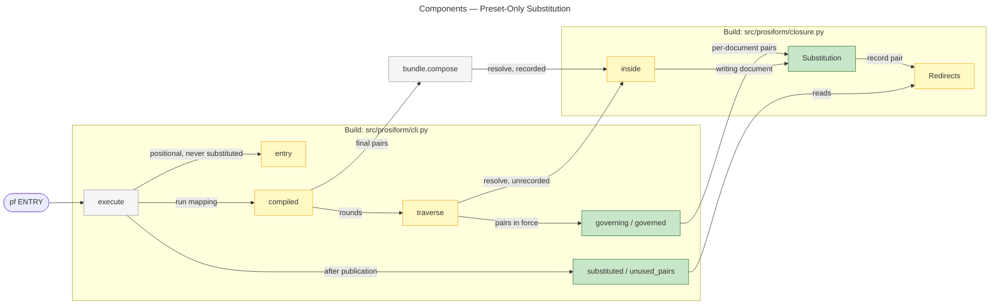
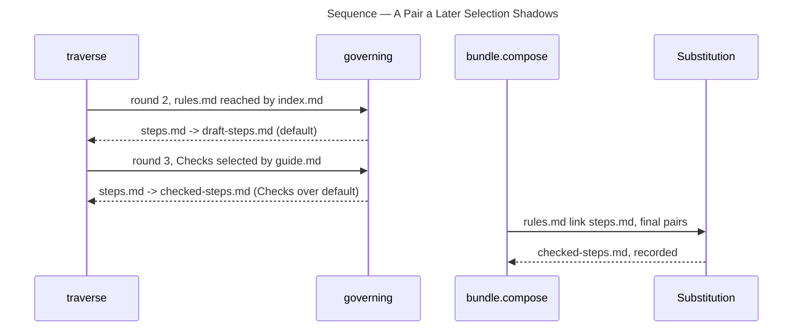

# Architecture Overview — Preset-Only Substitution

> architecture-overview · [m2ux/prosiform#561](https://github.com/m2ux/prosiform/pull/561) · 2026-11-02

## Summary

A preset's `subst` entry becomes the only way a run redirects a reference: the `-m` option, its folder form and the example mock scenarios are removed. The change lands in `closure.py`, where the `Substitution` mapping holds pairs per declaring document, and in `cli.py`, where the pairs each document's presets put in force are computed during traversal and used when the bundle is composed. A **substitution** redirects a link to a stand-in document so a bundle can be built against stand-in material without editing the tree under test.

## Structure

The command line no longer carries a mapping. Traversal reads each carried document's presets, computes the pairs in force for the links that document writes, and resolves links through that mapping without recording; composition resolves the same links under the final pairs and writes the run's record, which the two warnings read.



### Closure

- **`Substitution`.**
  Holds `documents`, the pairs each document's presets put in force keyed by that document's path, and a `writer`. `writing(document)` selects the pairs for one document's links; `redirect` looks up the exact section, then the whole document, and records the hit under `(writer, key)`. `unrecorded()` returns the same mapping with a throwaway record.
- **`Redirects`.**
  The run's record of substitutions, keyed by pair, so two documents declaring one key state two pairs.
- **`inside`.**
  Resolves one link from the writing document's directory and asks `substitution.writing(document)`.

### Command Line

- **`governing`.**
  For each carried document: `default`'s pairs, then the pairs of each preset a reaching reference selects, held over `default` for the same key; two selected presets mapping one key two ways are refused (`E_INVALID_USAGE`).
- **`subst_reference` / `subst_identity`.**
  Resolve each side from the declaring document's directory.
- **`substs` and `stated_once`.**
  Refuse a folder side (`E_INVALID_CONVERSION_METADATA`) and an alternative naming no Markdown document.
- **`entry`.**
  Normalises a positional reference; no pair redirects it.
- **`substituted` / `unused_pairs`.**
  Emit `W_SUBST_USED` per recorded pair and `W_SUBST_UNUSED` per pair in force that nothing used, naming the declaring document.

## Behaviour

Two flows: a pair redirecting a link, and a pair a later selection shadows.

### A Pair Redirecting a Link

`fixtures/inclusion/a-subst-pair-stays-in-its-document` runs `pf index.md`; `guide.md`'s `default` maps `rules.md` to `stub.md`.

```mermaid
---
title: Sequence — A Pair Redirecting a Link
---
sequenceDiagram
    participant X as execute
    participant C as compiled
    participant T as traverse
    participant G as governing
    participant B as bundle.compose
    participant I as inside
    participant S as Substitution

    X->>C: index.md, run mapping
    C->>T: rounds
    T->>G: carried documents
    G-->>T: guide.md: {rules.md: stub.md}
    T->>I: guide.md link rules.md (unrecorded)
    I-->>T: stub.md, read next round
    C->>B: final pairs
    B->>I: guide.md link rules.md
    I->>S: writing(guide.md).redirect
    S-->>B: stub.md, recorded (guide.md, rules.md)
    X-->>X: W_SUBST_USED at guide.md:8; W_SUBST_UNUSED for stub.md key
```

- **Reach.**
  `index.md` and `notes.md` link `rules.md` too; their own presets state no pair, so they keep `rules.md`.

### A Pair a Later Selection Shadows

`fixtures/inclusion/a-pair-a-selected-preset-overrides-records-no-substitution`: `index.md` reaches `rules.md` with no keyword, and `guide.md`'s `## Checks` reaches it a round later.



- **Recording.**
  The round-2 resolution records nothing, so the run warns once, for `checked-steps.md`, and `draft-steps.md` is not bundled.

## What Changed

### Command Line

- **No substitution option.**
  `-m` / `--mock` and its parser are gone; `diagnostic_format` treats only `-o` and `-d` as value-taking, and `-m` is refused as an undeclared option.

### Substitution

- **Per-document pairs.**
  A pair redirects only the links its declaring document writes, resolved from that document; the folder lookup, `Pairing` and the folder diagnostics are removed.
- **Renamed warnings.**
  `W_SUBST_USED` and `W_SUBST_UNUSED` replace the `W_MOCK_` codes; a heading read outside the selection records nothing.

### Corpus, Checks and Documentation

- **Fixtures state presets.**
  Each `fixtures/mock` fixture declares its pair in its entry document's `default`; new `fixtures/inclusion` fixtures cover reach, basis, entry, folder refusal and the shadowed pair.
- **Mock scenarios removed.**
  `checks/mock_scenarios.py`, its tests and `make mock-scenarios` are gone.
- **Pages.**
  `invocation.md`, `docs/sources.md`, `docs/references.md` and `docs/glossary.md` state `subst` as the only channel; the README pins design `187478e4`.

## Reading Order

1. **[src/prosiform/closure.py `Substitution`](https://github.com/m2ux/prosiform/blob/f3b902c1f53d957bc2f3db193101d80a45049b9f/src/prosiform/closure.py#L225-L336)** — the per-document mapping and its lookup.
2. **[src/prosiform/closure.py `inside`](https://github.com/m2ux/prosiform/blob/f3b902c1f53d957bc2f3db193101d80a45049b9f/src/prosiform/closure.py#L647-L697)** — where a link asks its writer's pairs.
3. **[src/prosiform/cli.py `governing`](https://github.com/m2ux/prosiform/blob/f3b902c1f53d957bc2f3db193101d80a45049b9f/src/prosiform/cli.py#L724-L827)** — the pairs in force per document.
4. **[src/prosiform/cli.py `substs` and `stated_once`](https://github.com/m2ux/prosiform/blob/f3b902c1f53d957bc2f3db193101d80a45049b9f/src/prosiform/cli.py#L520-L662)** — side refusals.
5. **[src/prosiform/cli.py `traverse`](https://github.com/m2ux/prosiform/blob/f3b902c1f53d957bc2f3db193101d80a45049b9f/src/prosiform/cli.py#L1740-L1950)** — rounds resolving through an unrecorded mapping.
6. **[src/prosiform/cli.py `compiled` and `unused_pairs`](https://github.com/m2ux/prosiform/blob/f3b902c1f53d957bc2f3db193101d80a45049b9f/src/prosiform/cli.py#L3148-L3276)** — composition under final pairs, and the warnings.
7. **[fixtures/inclusion/](https://github.com/m2ux/prosiform/tree/f3b902c1f53d957bc2f3db193101d80a45049b9f/fixtures/inclusion)** — the behaviour fixtures.

## Risks and Watch Points

- **Callers passing `-m`.**
  A script passing `-m` now fails with `E_INVALID_USAGE`; the tree carries none.
- **Design pin carries I09:E04 clauses.**
  `187478e4` follows I09:E04's section-composition clauses (`601cba55`, `99bec9f7`), so `main` carries them and the glossary's *composition directive* before I09:E04 lands; conformance passes with them.
- **Whole-document pair union.**
  Pairs are unioned per document across every reaching reference, so one document's links resolve one way per run.
