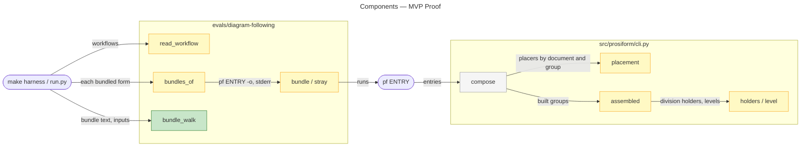
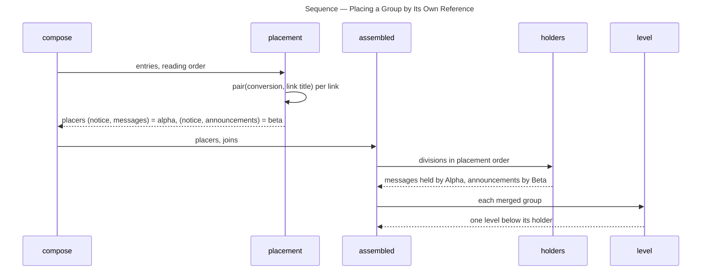
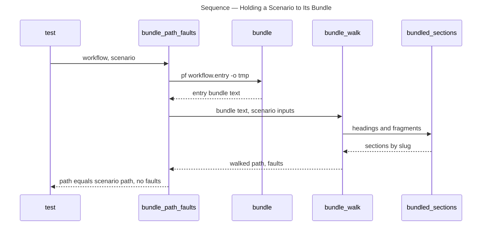

# Architecture Overview — MVP Proof

> architecture-overview · [m2ux/prosiform#585](https://github.com/m2ux/prosiform/pull/585) · 2026-11-03

## Summary

The change brings every page of the repository to the merged build, amends the pinned design where the build carried a deliberate decision, and gives each grouping and composition feature a diagram-following workflow whose bundle states the path an agent walks. Its code lands in two places: `cli.py` places each `group` a document joins by the reference that placed it there, and the eval harness under `evals/diagram-following/` compiles a workflow from a named entry, admits the warnings a workflow declares, and walks the diagram form's bundle. The six feature workflows are what [I10:E05](https://github.com/m2ux/prosiform/issues/594) runs live.

## Structure

Two areas carry code. The build's placement pass in `cli.py` decides which division holds each merged group; the harness reads each workflow's `scenarios.toml`, has `pf` bundle its forms and holds each scenario's path to the walk the bundle states. Everything else in the diff is documentation, the corpus fixtures for the new design clauses, and the workflow sources.

### Build

- **`placement`.**
  Records, for each document and each group the pair its reaching link puts in force names, the document whose link first placed it there. A group an entry places a document in is recorded as entered and gets no placer.
- **`holders` and `level`.**
  `holders` nests each merged group inside the division of its first member's placer, and leaves at the top level a group whose placer stands inside it. `level` reads a division's heading level from its holder chain, wherever the holder falls in placement order.

### Eval Harness

- **`read_workflow`.**
  Reads a top-level `entry` (`workflow.md` when absent) and `warnings` from each `scenarios.toml`.
- **`bundle`, `stray` and `bundles_of`.**
  Run `pf` on the workflow's entry, and refuse a run reporting any diagnostic beyond the declared warnings.
- **`bundle_walk`.**
  Walks the diagram form's bundle alone: the bundle's diagram names each edge, and each state is entered at the heading its predecessor's link names, or the one the diagram clicks.

## Behaviour

Two flows: placing a document two references reach under different pairs, and holding a scenario to its bundle.

### Placing a Group by Its Own Reference

`fixtures/inclusion/two-documents-placing-one-document-in-two-groups`: Alpha links `notice.md` under its default pair `{messages: 1}`, Beta from `## Announce` under `{announcements: 1}`.

- **Per-group placer.**
  The key is the document and the group, so the second reference records its own placer instead of inheriting the first's.
- **No group holds itself.**
  `holders` walks the holder chain before recording a holder; a chain that returns to the group leaves it at the top level (`grouping/a-group-its-own-member-places-stands-at-the-top-level`).

### Holding a Scenario to Its Bundle

`test_each_scenario_path_is_the_walk_its_bundle_states` runs for every diagram-form scenario, `subst-redirect`'s `preset-over-default` among them.

- **Sections.**
  A section's text runs to the next heading at its level, less any subsection carrying an action of its own, which is another state placed inside it by a group.
- **Faults.**
  A bundled action that differs from the source's is a fault, since the scorer holds a session to the source's.

## What Changed

### Build

- **Group placement.**
  Each group a document joins stands inside the division of the document whose reference placed that group's first member; the design's *Nested groups* and *Composition from the leaves up* state it, and the pages follow.

### Design

- **Brought to the build.**
  The design states the made `-o` folder, `subst` pairs combining across every reference reaching a document, and the `-C`/`--codes`, `--version` and `--help` options; the README pins it at [682cdf7e](https://github.com/m2ux/prosiform/blob/682cdf7ec4e35bcb5e9c7974de22d4253ca6e885/artifacts/planning/2026-10-17-prosiform-v1/design.md).

### Eval Harness

- **Named entries, declared warnings and the bundle walk.**
  Six workflows cover presets, `group`, `subst`, section entries, composition and declared inclusion; the default matrix is 580 sessions within `EVAL_BUDGET_TOKENS`.

### Documentation

- **Every page states the build.**
  [#585's Changes](https://github.com/m2ux/prosiform/pull/585) list each page by area.

## Reading Order

1. **[src/prosiform/cli.py — `placement`](https://github.com/m2ux/prosiform/blob/6f253815d8e65b589d38847571002e54cc7fb2ec/src/prosiform/cli.py#L2631-L2702)** — the only build change: the placer keyed by document and group.
2. **[src/prosiform/cli.py — `holders` and `level`](https://github.com/m2ux/prosiform/blob/6f253815d8e65b589d38847571002e54cc7fb2ec/src/prosiform/cli.py#L2730-L2778)** — how a placer becomes a holder, and the self-holding guard.
3. **[evals/diagram-following/workflow.py — `bundle` to `bundle_walk`](https://github.com/m2ux/prosiform/blob/6f253815d8e65b589d38847571002e54cc7fb2ec/evals/diagram-following/workflow.py#L835-L1030)** — the entry, the warning filter and the bundle walk.
4. **[evals/diagram-following/run.py — `bundles_of`](https://github.com/m2ux/prosiform/blob/6f253815d8e65b589d38847571002e54cc7fb2ec/evals/diagram-following/run.py#L383-L401)** — the runner refusing undeclared diagnostics.
5. **[evals/diagram-following/workflows/subst-redirect/scenarios.toml](https://github.com/m2ux/prosiform/blob/6f253815d8e65b589d38847571002e54cc7fb2ec/evals/diagram-following/workflows/subst-redirect/scenarios.toml)** — a feature workflow's `warnings` and scenarios, the shape the other five share.
6. **[docs/hierarchy.md](https://github.com/m2ux/prosiform/blob/6f253815d8e65b589d38847571002e54cc7fb2ec/docs/hierarchy.md)** — where a group stands, as the pages now state it.

## Risks and Watch Points

- **A group's holder can follow it in placement order.**
  Levels no longer assume the holder was placed first; `level` recurses up the chain, and the cycle guard is what keeps that recursion finite.
- **The bundle walk follows a link by its text.**
  `bundle_walk` takes the next state's fragment from a link whose text is the state's name, so a workflow whose links name states differently falls back to the diagram's click.

## References

- **R1.** [I09:E05 review](https://github.com/m2ux/prosiform/blob/engineering/artifacts/planning/2026-11-02-463-i09-grouping-and-composition/e05/review.md) — the W01 review of the merged build against the pinned design, and its three departures.
