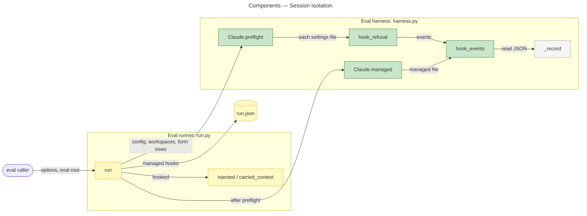
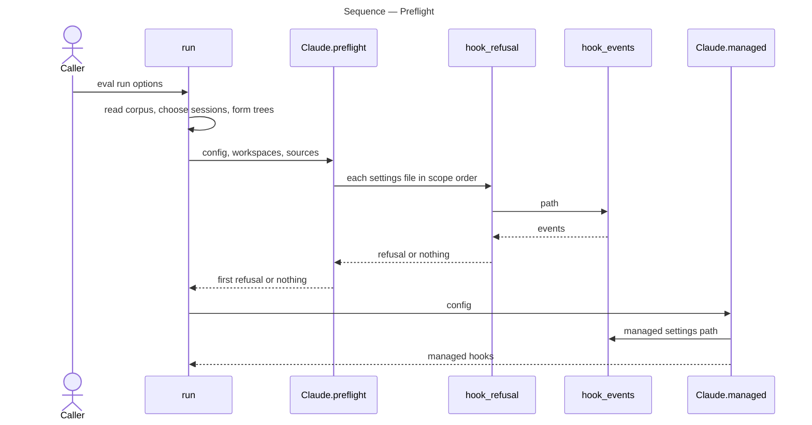

# Architecture Overview — Session Isolation

> architecture-overview · [m2ux/prosiform#600](https://github.com/m2ux/prosiform/pull/600) · 2026-11-03

## Summary

The diagram-following eval's preflight reads every settings scope a Claude Code session will see before the run starts a session. It refuses a project-scope `.claude` settings file that declares a hook, in a form tree or above the workspaces, and records the hook the host's managed settings file declares in `run.json`. The change lands in the eval harness, `evals/diagram-following/harness.py` and `run.py`, and leaves the `pf` build and its bundling contract untouched.

## Structure

The runner `run` reads the corpus and chooses its sessions, then asks the harness to preflight the settings and to read the managed hooks; both reads go through one settings reader. A **hook** is a settings file's `hooks` block, a command Claude Code runs on an event such as `SessionStart`, whose response becomes context the run did not supply.

### Eval Harness

- **`Claude.preflight`.**
  Takes the config directory, the workspace root and the form trees a session's workspace is copied from, and refuses the first settings file declaring a hook: the config directory's `settings.json`, each tree's `.claude/settings.json` or `.claude/settings.local.json`, then the same two files in the `.claude` of the workspace root and every ancestor.
- **`hook_events` and `hook_refusal`.**
  Name the events a settings file declares a hook for, and phrase the refusal with its remedy: remove the file, or pass an `--eval-root` outside the ancestor.
- **`Claude.managed`.**
  Reads `managed_settings`, the platform's managed settings path from `MANAGED_SETTINGS`, held as a field so a test can plant it; returns the file and its events, or no hook. Cursor and opencode record none.

### Eval Runner

- **`run`.**
  Runs the preflight after the corpus is read and sessions are chosen, before any run directory or session, and writes the managed hooks to `run.json` under `managed`.
- **`injected` / `carried_context`.**
  Take `hooked`; where a managed hook is recorded, a hook response is that hook's and fails no run.

## Behaviour

Two flows change: the preflight before the first session, and the context read after the sessions finish.

### Preflight

`run` starting a run yields a refusal naming a file and its events, or the managed hooks the run records.

- **Scope order.**
  The config directory's file, then each form tree, then the workspace root and its ancestors to the filesystem root; the first file declaring a hook refuses the run and no results folder is made.
- **Unreadable file.**
  A settings file that is not JSON is refused through `_record`, never read as declaring nothing.

### Context Read

After the sessions finish, `run` reads each transcript through `injected(transcript, hooked)`, where `hooked` is whether `managed.hooks` is non-empty; a hook response is then accounted for, and an appended system prompt or memory file still fails the run.

## What Changed

### Eval Harness

- **Project scope.**
  A hook in a form tree's or an ancestor's `.claude` settings is refused before any session.
- **Managed scope.**
  The host's managed hook is recorded, not refused, per the user decision of 2026-11-03.

### Documentation

- **Eval README and `checks.md`.**
  State each refused file, its scope, `--eval-root` as the ancestor remedy, and the managed record.

## Reading Order

1. **[harness.py `Claude.preflight`](https://github.com/m2ux/prosiform/blob/82ac5e5573dec5b078801cd38b5e82864677b7e3/evals/diagram-following/harness.py#L220-L310)** — the scopes read, their order, and the managed read.
2. **[run.py `run`](https://github.com/m2ux/prosiform/blob/82ac5e5573dec5b078801cd38b5e82864677b7e3/evals/diagram-following/run.py#L745-L756)** — the form trees passed and where the preflight now runs.
3. **[run.py `carried_context`](https://github.com/m2ux/prosiform/blob/82ac5e5573dec5b078801cd38b5e82864677b7e3/evals/diagram-following/run.py#L459-L514)** — the `hooked` exemption.
4. **[test_run.py](https://github.com/m2ux/prosiform/blob/82ac5e5573dec5b078801cd38b5e82864677b7e3/evals/diagram-following/test_run.py#L934-L1108)** — a stub-agent test per scope.
5. **[README.md Isolation](https://github.com/m2ux/prosiform/blob/82ac5e5573dec5b078801cd38b5e82864677b7e3/evals/diagram-following/README.md#L131-L146)** — the operator's statement of each scope.

## Risks and Watch Points

- **Caller's home above the eval root.**
  The default eval root sits under the caller's home, so a hook in `~/.claude/settings.json` now refuses the run; the refusal names `--eval-root` as the remedy.
- **Managed hook exempts every hook response.**
  Where a managed hook is recorded, the context read admits any hook response, since the preflight admits no other source.
- **Overlap with I10:E05 W00.**
  `i10/e05/main` also changes `Claude.preflight`, `Claude.managed`, `hooked` and the README's Isolation section; its integration reconciles with this one.
