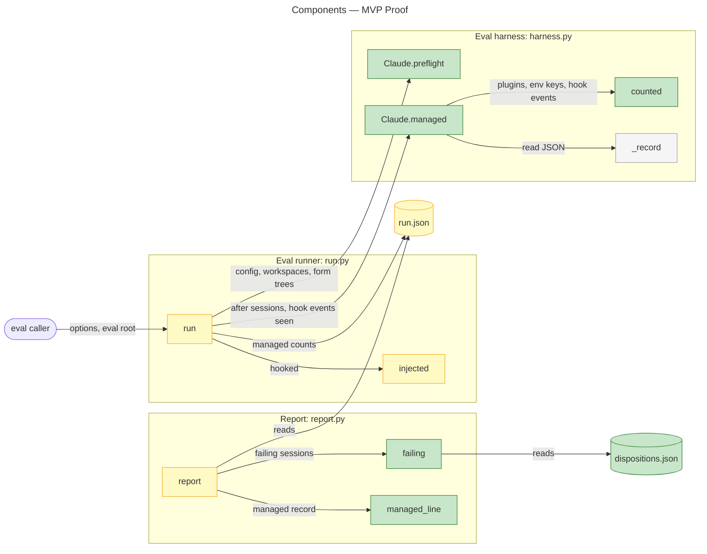
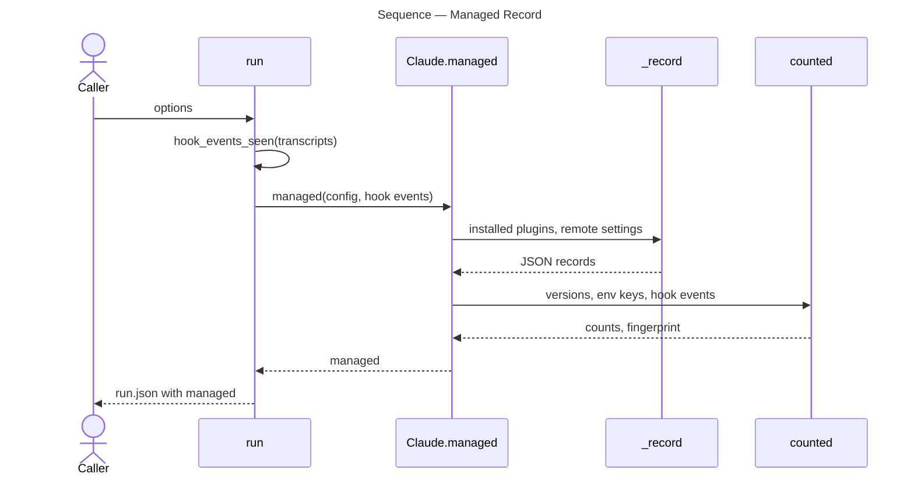
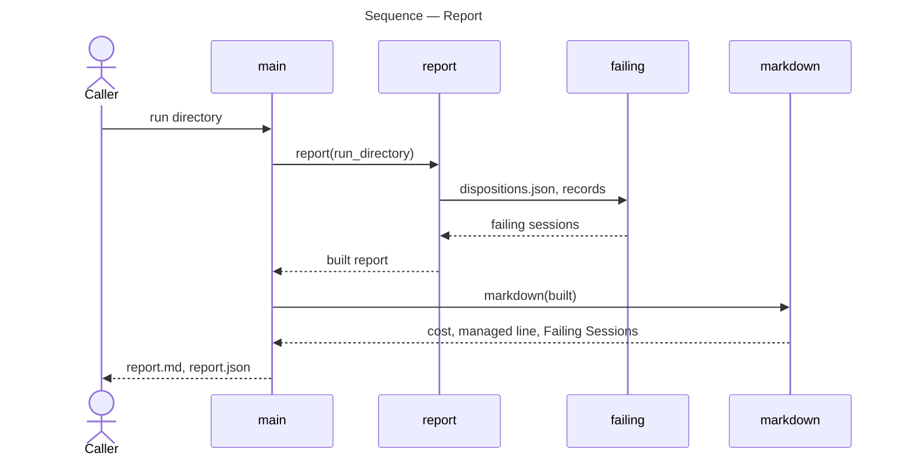

# Architecture Overview — MVP Proof

> architecture-overview · [m2ux/prosiform#616](https://github.com/m2ux/prosiform/pull/616) · 2026-11-03

## Summary

The diagram-following eval gains a runbook and triage rubric for every live run, a run record that counts and fingerprints the managed configuration its sessions carried, a report that sums cost and lists each failing session with its disposition, and the committed MVP proof run. The change lands in the eval harness, `evals/diagram-following/`, and leaves the `pf` build and its bundling contract untouched. It lets a live run be repeated to the letter and read without naming any platform's configuration.

## Structure

The runner `run` asks the harness to preflight the eval's settings and then to read the **managed configuration**: a plugin installed at managed scope or enabled by signed remote settings, the environment those settings add, and the hooks it delivers, counted from the hook events the session transcripts show. `counted` turns it into counts and a fingerprint, a SHA-256 digest over the sorted identifiers, versions, keys and events. The report reads that record and the triage's `dispositions.json` beside `run.json`.

### Eval Harness

- **`Claude.preflight`.**
  Admits a plugin installed at managed scope or enabled by remote settings with a signature beside them; refuses one at any other scope, one unsigned remote settings enable, and every settings hook the config directory, a form tree or a workspace ancestor declares.
- **`Claude.hooked`.**
  Whether a managed plugin is present or the host's managed settings declare a hook, so a hook response can be the managed configuration's.
- **`Claude.managed` and `counted`.**
  Collect the managed plugins with versions and the signed `env` keys, take the hook events the run saw, then return counts and a fingerprint, null when nothing is managed. Cursor and opencode count nothing.

### Eval Runner

- **`run`.**
  Runs the preflight after the corpus read and session choice, asks whether a managed hook can reach a session, and once the sessions finish writes the managed record to `run.json` under `managed`.
- **`hook_events_seen`.**
  Reads each hook event the transcripts show a hook responding to, never the hook's output.
- **`injected`.**
  Takes `hooked`, so a hook response is the managed configuration's and fails no run where one can be.

### Report

- **`report` and `failing`.**
  Sum every session's reported cost into `cost_usd` and list each failing session with the disposition `dispositions.json` gives it, refusing an unknown disposition or an entry naming no failing session.
- **`managed_line`.**
  States the counts and fingerprint, or none.

## Behaviour

Two flows change: reading the managed configuration before the first session, and writing the report from a finished run.

### Managed Record

`run` finishing its sessions yields a `managed` record of counts and a fingerprint.

- **Managed hooks.**
  Each hook event a session's transcript shows a hook responding to counts once; no hooks file is read for the count.
- **Signed settings.**
  The remote settings' enabled plugins and `env` keys count only with the signature file beside them.

### Report

`main` writing a report yields `report.md` and `report.json` with cost, managed configuration and failing sessions.

- **Untriaged.**
  A failing session the file does not name reads `untriaged`.

## What Changed

### Eval Harness

- **Managed configuration.**
  A managed plugin starts its sessions and is recorded by count and fingerprint, naming none of it, its hooks counted from the transcripts.

### Eval Runner

- **Run record.**
  `run.json` holds `managed` as counts and a fingerprint.

### Report

- **Cost and triage.**
  The report sums cost and lists each failing session with its disposition.

### Runbook and Proof

- **Runbook.**
  `RUNBOOK.md` holds the triage rubric and each live run's arguments, caps and stop rules.
- **Proof record.**
  `mvp-proof.json` and `mvp-proof.md` hold the live proof run, with `baseline.json` unchanged.

## Reading Order

1. **[RUNBOOK.md](https://github.com/m2ux/prosiform/blob/2136ccf7698d3f47d8eef8445e922d5ae0e8c307/evals/diagram-following/RUNBOOK.md#triage-rubric)** — the rules every live run and its triage follow.
2. **[harness.py](https://github.com/m2ux/prosiform/blob/2136ccf7698d3f47d8eef8445e922d5ae0e8c307/evals/diagram-following/harness.py#L136-L164)** — `counted`, then [`Claude.preflight`](https://github.com/m2ux/prosiform/blob/2136ccf7698d3f47d8eef8445e922d5ae0e8c307/evals/diagram-following/harness.py#L253-L331) and [`Claude.managed`](https://github.com/m2ux/prosiform/blob/2136ccf7698d3f47d8eef8445e922d5ae0e8c307/evals/diagram-following/harness.py#L340-L391).
3. **[run.py](https://github.com/m2ux/prosiform/blob/2136ccf7698d3f47d8eef8445e922d5ae0e8c307/evals/diagram-following/run.py#L747-L892)** — where `run` preflights and records the managed configuration, then [`hook_events_seen`](https://github.com/m2ux/prosiform/blob/2136ccf7698d3f47d8eef8445e922d5ae0e8c307/evals/diagram-following/run.py#L526-L546).
4. **[report.py](https://github.com/m2ux/prosiform/blob/2136ccf7698d3f47d8eef8445e922d5ae0e8c307/evals/diagram-following/report.py#L199-L275)** — `report`, `place` and `failing`, then [`managed_line`](https://github.com/m2ux/prosiform/blob/2136ccf7698d3f47d8eef8445e922d5ae0e8c307/evals/diagram-following/report.py#L362-L371).
5. **[README.md](https://github.com/m2ux/prosiform/blob/2136ccf7698d3f47d8eef8445e922d5ae0e8c307/evals/diagram-following/README.md#isolation)** — Isolation and MVP proof as the eval states them.
6. **[mvp-proof.md](https://github.com/m2ux/prosiform/blob/2136ccf7698d3f47d8eef8445e922d5ae0e8c307/evals/diagram-following/mvp-proof.md)** — the proof run's report.

## Risks and Watch Points

- **Hooks seen, not declared.**
  A managed hook that never fires in any session is not counted, since the count is what the transcripts show.
- **Signature by presence.**
  Remote settings count as signed when the signature file exists; its content is not verified.
