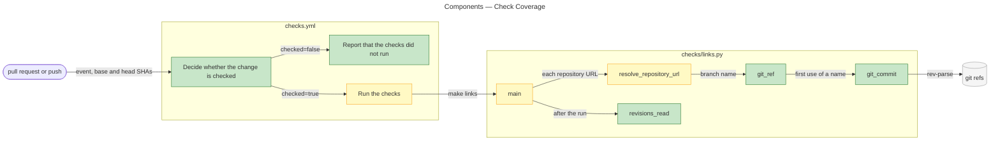
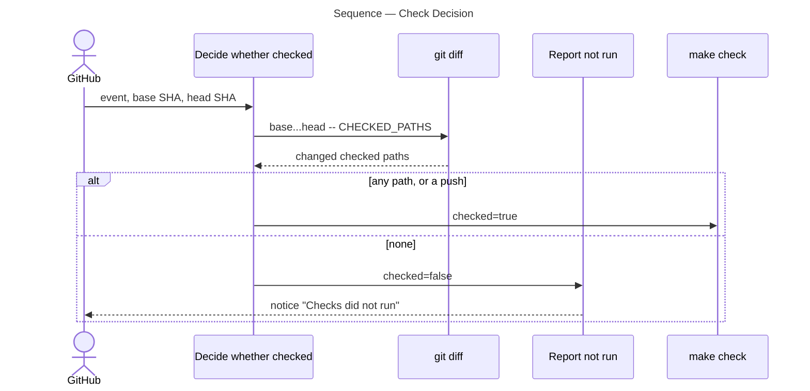
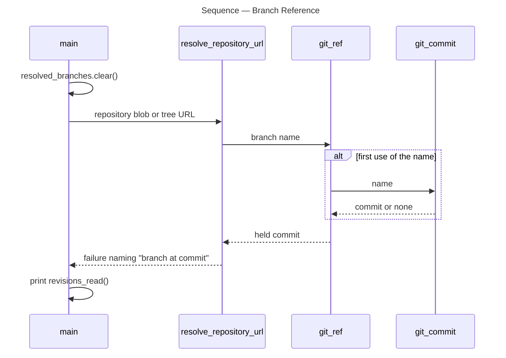

# Architecture Overview — Check Coverage

> architecture-overview · [m2ux/prosiform#618](https://github.com/m2ux/prosiform/pull/618) · 2026-11-03

## Summary

The repository's checks run on a pull request by the paths its change touches, and a pull request touching none of them reports that its checks did not run. The link check resolves each branch it reads to one commit per run and names that commit in its summary and failures. The change lands in the continuous integration workflow, the link check and the checks page, and leaves the `pf` build untouched.

## Structure

Two areas change. The **workflow**, `.github/workflows/checks.yml`, decides per event whether `make check` runs. The **link check**, `checks/links.py`, resolves references into this repository's branches through git. A **checked path** is one entry of the workflow's `CHECKED_PATHS`, a list of git pathspecs naming every file a check reads; the workflow is configuration, so its steps below are read from the file, while the link check's edges are measured over the repository graph.

### Workflow

- **Trigger.**
  A pull request into `main` or an `i[0-9][0-9]/**` initiative or epic branch starts the workflow, and so does a push to `main`.
- **Decide whether the change is checked.**
  A push is always checked; a pull request is checked when `git diff --name-only base...head` over `CHECKED_PATHS` names a file.
- **Report that the checks did not run.**
  An unchecked pull request passes, raising a notice titled `Checks did not run` and a run summary line.

### Link Check

- **`git_ref`.**
  Holds each branch name's commit in `resolved_branches` from first use, so every reference into one branch reads one commit; a full 40-hex commit name reads as written.
- **`git_commit`.**
  Resolves a name to a commit, trying `origin/<name>` first.
- **`revisions_read`.**
  Lists `read <branch> at <commit>` for each branch resolved, printed after the summary line on success and failure.

## Behaviour

Two flows change: the workflow's decision per event, and the link check's resolution of a reference into a branch.

### Check Decision

A pull request event yields either a `make check` run or a notice that the checks did not run.

- **Push to `main`.**
  Checked whatever it changed, so the merge commit always carries a run.
- **Pathspec expansion.**
  `set -f` keeps the shell from expanding the `:(glob)` entries, so git receives them as written.

### Branch Reference

`main` checking a document yields its failures and, after the summary, one line per branch read.

- **One commit per run.**
  A branch moving during the run is still read at the commit its first reference resolved.

## What Changed

### Workflow

- **Trigger and decision.**
  The checks run where a change can break what they read, whatever the branch is called, and an unchecked change says so.

### Link Check

- **Named revisions.**
  A result names the commit of every branch it read.

### Checks Page

- **Trigger rule.**
  `checks.md` names the events that run the checks, links `CHECKED_PATHS` as the one place the path set is stated, and states what a skipped run reports.

## Reading Order

1. **[.github/workflows/checks.yml](https://github.com/m2ux/prosiform/blob/c43c12e03705eeffa3954b5428f657058ad5bef1/.github/workflows/checks.yml#L9-L22)** — the events that start the workflow.
2. **[.github/workflows/checks.yml](https://github.com/m2ux/prosiform/blob/c43c12e03705eeffa3954b5428f657058ad5bef1/.github/workflows/checks.yml#L41-L100)** — the path set, the decision and the steps it gates.
3. **[checks.md](https://github.com/m2ux/prosiform/blob/c43c12e03705eeffa3954b5428f657058ad5bef1/checks.md#L19-L26)** — the rule as the checks page states it.
4. **[checks/links.py](https://github.com/m2ux/prosiform/blob/c43c12e03705eeffa3954b5428f657058ad5bef1/checks/links.py#L158-L198)** — `git_commit`, `git_ref` and `revisions_read`.
5. **[checks/links.py](https://github.com/m2ux/prosiform/blob/c43c12e03705eeffa3954b5428f657058ad5bef1/checks/links.py#L250-L273)** — failures naming the commit read.
6. **[checks/links.py](https://github.com/m2ux/prosiform/blob/c43c12e03705eeffa3954b5428f657058ad5bef1/checks/links.py#L459-L509)** — the cache cleared per run and the revisions printed.
7. **[checks/tests/test_links.py](https://github.com/m2ux/prosiform/blob/c43c12e03705eeffa3954b5428f657058ad5bef1/checks/tests/test_links.py#L548-L632)** — the tests against a throwaway repository.

## Risks and Watch Points

- **A new checked area.**
  A check that starts reading a path outside `CHECKED_PATHS` leaves a change to it unchecked until the push to `main`; the set is edited with the check.
- **A short commit in a URL.**
  A URL naming an abbreviated commit is resolved like a branch and listed among the revisions read.
