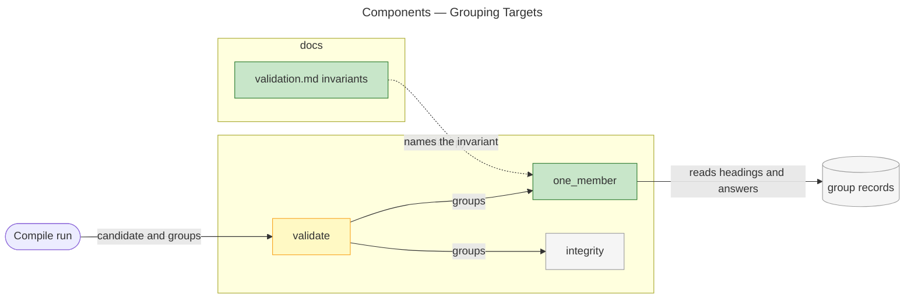
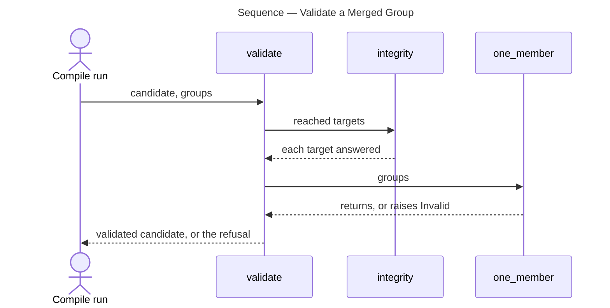

# Architecture Overview — Grouping Targets

> architecture-overview · [m2ux/prosiform#636](https://github.com/m2ux/prosiform/pull/636) · 2026-11-03

## Summary

Candidate validation refuses a merged group whose emitted heading answers the targets of two documents, so no two members of a group reach one destination. The change lands in candidate validation and the validation page, and leaves group construction untouched.

## Structure

One area changes. **Candidate validation**, `src/prosiform/candidate.py`, compares the finished candidate with the provenance the run recorded. A **group** is the unit the bundle emits for one document or one merged set of documents; its **record** lists each emitted heading and the source targets, as `(path, fragment)` pairs, that heading answers.

### Candidate Validation

- **`one_member`.**
  Walks each merged group's emitted headings and raises `Invalid` under `ONE_MEMBER` when a heading's answers name more than one document.
- **`validate`.**
  Calls `one_member` over the groups straight after `integrity`.

### Validation Page

- **Invariants table.**
  Lists one member per destination beside target integrity.

## Behaviour

One flow changes: validating a candidate whose groups include a merged group.

### Validate a Merged Group

A compile run hands its candidate to `validate`; a merged group whose heading answers two documents stops the run.

- **Skip unmerged groups.**
  A group whose record is not merged is passed over.
- **Collect the documents a heading answers.**
  The distinct paths among a heading's answers; more than one raises `Invalid` naming the heading, the group and two paths.
- **Fail the run.**
  The refusal surfaces as `E_UNEXPECTED_INTERNAL_ERROR`, exit 4, like every candidate-validation failure, and nothing is published.

## What Changed

### Candidate Validation

- **A shared heading is refused.**
  A candidate whose merged group has a heading answering two documents fails under the invariant name.

### Validation Page

- **The invariant is stated.**
  A reader of `docs/validation.md` meets the rule the build holds.

## Reading Order

1. **[one_member](https://github.com/m2ux/prosiform/blob/b192f07184f128e7762a3a409594c851a2a54753/src/prosiform/candidate.py#L1058-L1081)** — the check itself.
2. **[validate](https://github.com/m2ux/prosiform/blob/b192f07184f128e7762a3a409594c851a2a54753/src/prosiform/candidate.py#L1371)** — where the check runs in the sequence of invariants.
3. **[ONE_MEMBER](https://github.com/m2ux/prosiform/blob/b192f07184f128e7762a3a409594c851a2a54753/src/prosiform/candidate.py#L167)** — the invariant name a failure reports.
4. **[Invariants table](https://github.com/m2ux/prosiform/blob/b192f07184f128e7762a3a409594c851a2a54753/docs/validation.md#L21)** — the page row.
5. **[Tests](https://github.com/m2ux/prosiform/blob/b192f07184f128e7762a3a409594c851a2a54753/src/tests/test_candidate.py#L309-L383)** — a two-member heading fails; variant and single-contributor headings pass.

## References

- **R1.** [Design clause](https://github.com/m2ux/prosiform/blob/5af5013aa70c627675243713017c3db394971701/artifacts/planning/2026-10-17-prosiform-v1/design.md#L631) — the invariant as the canonical design lists it.
