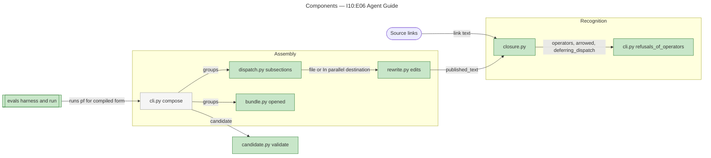
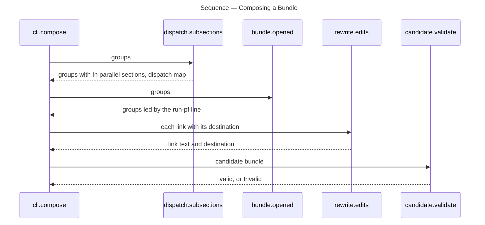
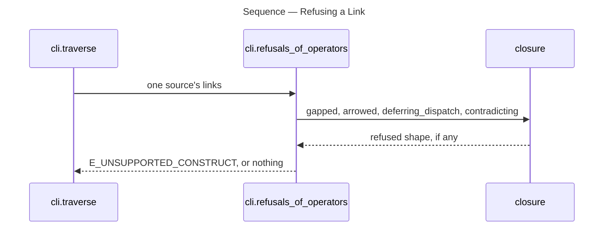

# Architecture Overview — I10:E06 Agent Guide

> architecture-overview · [m2ux/prosiform#648](https://github.com/m2ux/prosiform/pull/648) · 2026-11-03

## Summary

Bare `pf` prints a plain-text guide holding every rule an agent follows a bundle by, and every bundle opens with one line telling its reader to run that guide first. A `⇉` link stays inline pointing at its compiled file, a `⫽` set becomes one `In parallel` sub-section, deferred dispatch and arrow labels are refused, and `↳` is the composition mark. The eval's `compiled` form carries the build as `pf` so a session can read the guide.

## Structure

The change lands in the bundling pipeline of `src/prosiform/` — operator recognition (`closure.py`), refusals and assembly (`cli.py`), dispatch placement (`dispatch.py`), heading text and the opening line (`bundle.py`), link rewriting (`rewrite.py`) and candidate validation (`candidate.py`) — and in the eval harness under `evals/diagram-following/`.

### Recognition

- **`closure.py`.**
  Reads a link's operator marks. `↳` joins the operators; the one admitted combination is `¬↳`. `arrowed`, `deferring_dispatch` and `contradicting` name the refused shapes, and `published_text` decides the mark a published link keeps.
- **`cli.py` refusals.**
  `refusals_of_operators` refuses an arrow label, `¬⇉`/`¬⫽` and `⇉↳`/`⫽↳` under `E_UNSUPPORTED_CONSTRUCT` before anything is built.

### Assembly

- **`dispatch.py`.**
  `Placing` emits an `In parallel` sub-section only for a set of two or more targets; every other dispatched link maps to its target's bundle file.
- **`bundle.py`.**
  `opened` puts the run-pf line ahead of the first group; `sole_set` and `pointing` keep a heading's shown text equal to what the rewrite publishes.
- **`rewrite.py`.**
  `edits` keeps `⇉ ` on a link pointing at a file and drops every other mark.

### Eval

- **`run.py` and `harness.py`.**
  A `compiled` session gets the build as `pf` on its path; Claude gets `Bash` limited by `Bash(pf:*)`. `staged` is not a form.

## Behaviour

Two flows carry the change: one bundle's composition, and the refusal of a link before composition.

### Composing a Bundle

A run's `compiled` call composes one bundle and returns its text.

- **Placing.**
  A `⇉` link and a set of one map to a file destination; a larger set maps to its sub-section's anchor.
- **Opening.**
  The run-pf line is a part of the first group, so a file heading after it is a part, not the heading the group opens on.
- **Validating.**
  `dispatches` accepts a file destination and holds an anchor to an `In parallel` sub-section; `preserved` reads heading text with the same dispatch map.

### Refusing a Link

`traverse` reads each selected source and calls `refusals_of_operators` before any composition.

- **Order.**
  A blank between marks, then an arrow label, then a deferred dispatch, then a contradiction, then two dispatch marks.

## What Changed

### Recognition

- **Operators.**
  `¬`, `⇉`, `⫽` and `↳`, with `¬↳` the only combination; arrow labels are refused.

### Assembly

- **Bundle shape.**
  Every bundle opens with the run-pf line; no Prosiform section or protocol paragraph is generated.
- **Dispatch.**
  `⇉` stays inline at its file; a set is one `In parallel` sub-section.

### Guide

- **`pf` with no arguments.**
  Prints `GUIDE` as plain text: running `pf`, `↳`, `⇉`, `In parallel`, failures together and the `Question:` first line.

## Reading Order

1. **[src/prosiform/closure.py](https://github.com/m2ux/prosiform/blob/7ec0ecfb41bcc8bef1d2f56dc6d3bbe8e8ee2594/src/prosiform/closure.py#L553-L695)** — the operator shapes and `published_text`, which everything below calls.
2. **[src/prosiform/cli.py](https://github.com/m2ux/prosiform/blob/7ec0ecfb41bcc8bef1d2f56dc6d3bbe8e8ee2594/src/prosiform/cli.py#L1559-L1704)** — the refusals, then [`GUIDE`](https://github.com/m2ux/prosiform/blob/7ec0ecfb41bcc8bef1d2f56dc6d3bbe8e8ee2594/src/prosiform/cli.py#L307-L336) and [`compose`](https://github.com/m2ux/prosiform/blob/7ec0ecfb41bcc8bef1d2f56dc6d3bbe8e8ee2594/src/prosiform/cli.py#L3061-L3186).
3. **[src/prosiform/dispatch.py](https://github.com/m2ux/prosiform/blob/7ec0ecfb41bcc8bef1d2f56dc6d3bbe8e8ee2594/src/prosiform/dispatch.py#L417-L548)** — where each dispatched link points.
4. **[src/prosiform/bundle.py](https://github.com/m2ux/prosiform/blob/7ec0ecfb41bcc8bef1d2f56dc6d3bbe8e8ee2594/src/prosiform/bundle.py#L1236-L1258)** — the run-pf line, then `pointing` and `sole_set` at [L374](https://github.com/m2ux/prosiform/blob/7ec0ecfb41bcc8bef1d2f56dc6d3bbe8e8ee2594/src/prosiform/bundle.py#L374-L434).
5. **[src/prosiform/rewrite.py](https://github.com/m2ux/prosiform/blob/7ec0ecfb41bcc8bef1d2f56dc6d3bbe8e8ee2594/src/prosiform/rewrite.py#L529-L562)** — the published mark.
6. **[src/prosiform/candidate.py](https://github.com/m2ux/prosiform/blob/7ec0ecfb41bcc8bef1d2f56dc6d3bbe8e8ee2594/src/prosiform/candidate.py#L1236-L1260)** — what validation holds a dispatch to.
7. **[evals/diagram-following/run.py](https://github.com/m2ux/prosiform/blob/7ec0ecfb41bcc8bef1d2f56dc6d3bbe8e8ee2594/evals/diagram-following/run.py#L195-L196)** — the forms given `pf`, then [harness.py](https://github.com/m2ux/prosiform/blob/7ec0ecfb41bcc8bef1d2f56dc6d3bbe8e8ee2594/evals/diagram-following/harness.py#L190-L245).

## Risks and Watch Points

- **Later harness edits.**
  E04 and E00 W04 edit `harness.py`, `run.py` and their tests; they reconcile onto `main` after this lands.
- **A compiled session that never runs `pf`.**
  Not scored as a failure on this base; E04's run classes cover it.

## References

- **R1.** [Design at the pin](https://github.com/m2ux/prosiform/blob/fa29043d1f9d56f9a4f4e4fdf107e311d15a1b93/artifacts/planning/2026-10-17-prosiform-v1/design.md) — *Guide*, *Link classification and resource handling* and *Section composition*.
