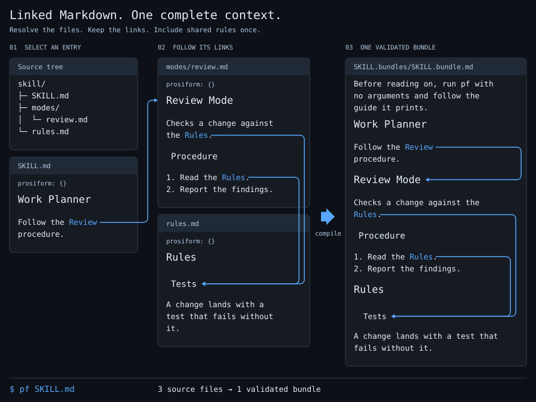

# Illustration Validation

Baseline: `11a872918669362260cf16b875694342f262d2c2`.

Tested implementation: [`fac70a9403370a12a84da473e379367d77b0a3e8`](https://github.com/m2ux/prosiform/commit/fac70a9403370a12a84da473e379367d77b0a3e8).

The source tree is the existing `run` case in `scripts/examples.json`. The compiler source, dependencies and example contents are those of the baseline; the implementation changes the drawing and its documentation.

## Compiler Content and Regeneration

**Pass.** All nine example cases ran against the worktree's locked compiler environment. Eight cases publish their expected bundle sets; the refusal case returns its declared exit status of 1 and publishes nothing. The other eight SVGs match the baseline byte for byte.

The independent verification script compiles the README case in a fresh temporary directory and compares the generated SVG with the committed illustration. Markdown-it parses the source and output separately to check that every heading, paragraph and link is represented. The output has three internal links: one to `#review-mode` and two to `#tests`, with one Tests section. All six source and output link labels have coordinates for their connectors.

Run from the implementation checkout, using its locked Python environment:

```bash
src/.venv/bin/python scripts/render-example.py --build /absolute/path/to/checkout/src/.venv/bin/pf
src/.venv/bin/python /absolute/path/to/this/record/verify.py /absolute/path/to/checkout
```

The verification script needs Qt's `ksvgtopng5` for the PNG previews. The product renderer writes SVG using its existing dependencies.

Evidence: [generation](generation.txt), [verification](verification.txt), [complete bundle](compiled.md).

## Renderer Checks

**Pass.** The renderer passes Ruff lint and formatting with the repository's configuration. The commit passes `git diff --check`.

```bash
src/.venv/bin/ruff check --config src/pyproject.toml scripts/render-example.py
src/.venv/bin/ruff format --check --config src/pyproject.toml scripts/render-example.py
git diff --check
```

Evidence: [Ruff output](ruff.txt).

## Documentation Checks

**Pass.** The command-table check confirms 19 documented commands and eight dependency declarations. The online link check resolves every reference across 203 documents.

```bash
python3 checks/tables.py
python3 checks/links.py --online
```

Evidence: [tables](tables.txt), [links](links.txt).

## Visual Review

**Pass.** The full-size and 900-pixel previews were inspected at their native aspect ratio. The illustration uses three columns, stronger heading sizes, dark title bars and curved blue connectors. Each Rules link reaches Tests, and each bundle connector terminates after its destination heading. Text stays inside its panel and the SVG includes its accessible title and description.

The drawing uses the standard `monospace` font family. This preserves character spacing in both browsers and Qt's SVG renderer without requiring a named local font. The body is 26 pixels on an 1800-pixel canvas, or 13 pixels at the inspected README width; the baseline uses 20 pixels on a 2142-pixel canvas, or about 8.4 pixels at that width.

[Before](before.png) · [Full-size result](after.png)


