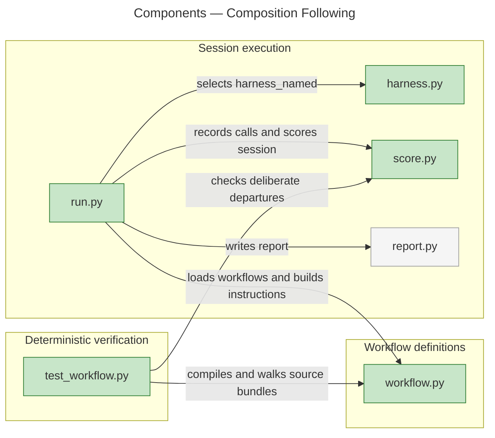
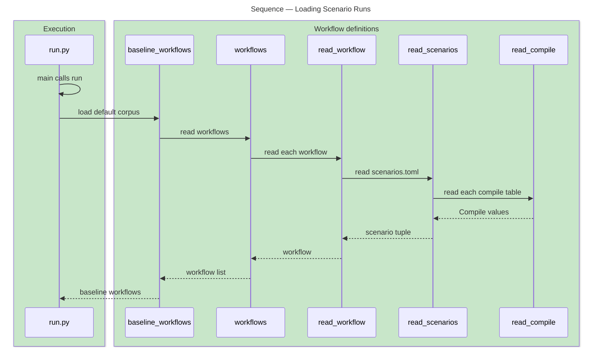
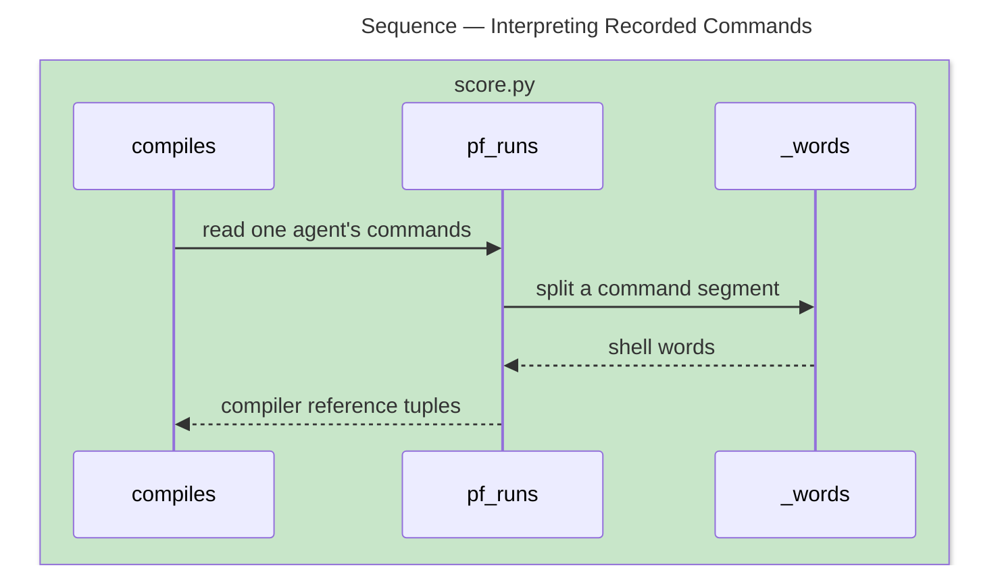

# Architecture Overview — Composition Following

> architecture-overview · [m2ux/prosiform#622](https://github.com/m2ux/prosiform/pull/622) · 2026-11-06

## Summary

The diagram-following evaluation states each agent's ordered compiler runs beside its expected path and dispatched actions. The runner supplies compiled sessions with sources, output bundles and the compiler, and the scorer checks the commands attributed to each agent. Eight edge workflows exercise composition, deferred activation and dispatch through three levels.

## Structure

The measured relationships connect corpus interpretation, session execution, harness selection and verdict production. `run.py` calls the workflow reader and harness selector, its session entry calls the scorer, and deterministic corpus tests call the workflow and scoring functions directly. The report writer is existing context.

### Workflow Definitions

- **Declared runs.**
  [Compile](https://github.com/m2ux/prosiform/blob/8ca53994e89dab6657c2eea9eef72f74c48764e0/evals/diagram-following/workflow.py#L523) contains the dispatch section identifying the agent and the references one run compiles. Scenario loading checks their types; corpus validation checks owners and source destinations.
- **Activated material.**
  [compiled_walk](https://github.com/m2ux/prosiform/blob/8ca53994e89dab6657c2eea9eef72f74c48764e0/evals/diagram-following/workflow.py#L1356) runs the configured compiler on reached deferred lines and reads the resulting bundles. Conditional and nested activation therefore determine the expected path from emitted content.

### Session Execution

- **Inputs and observation.**
  [prepare](https://github.com/m2ux/prosiform/blob/8ca53994e89dab6657c2eea9eef72f74c48764e0/evals/diagram-following/run.py#L418) supplies sources beside the compiled bundle set. [observable](https://github.com/m2ux/prosiform/blob/8ca53994e89dab6657c2eea9eef72f74c48764e0/evals/diagram-following/run.py#L372) admits scenarios only where the harness reports their nested starts and commands.
- **Agent attribution.**
  [Start](https://github.com/m2ux/prosiform/blob/8ca53994e89dab6657c2eea9eef72f74c48764e0/evals/diagram-following/harness.py#L114) carries parent and command data separately from native actor and response-group identity. Claude messages identify the owning `Agent` call; Codex response groups retain their explicit actor and group fields.
- **Verdict production.**
  [score](https://github.com/m2ux/prosiform/blob/8ca53994e89dab6657c2eea9eef72f74c48764e0/evals/diagram-following/score.py#L568) checks path and actions, dispatch shape, dispatched actions, then each agent's stated compiler runs.

## Behaviour

The representative measured paths show scenario loading and command interpretation. Related branches and all 39 reported flows are retained in the review evidence.

### Loading Scenario Runs

The runner's default corpus reaches each scenario's typed compile declarations through graph process `Main → Read_compile` (`proc_20_main`).

- **Default and edge scopes.**
  The baseline reader filters the edge workflow names; an explicit workflow selection reaches the full corpus. This preserves the default measurement matrix and budget.
- **Early refusal.**
  Compile declarations with malformed fields, unknown dispatch owners or missing source documents fail deterministic corpus validation.

### Interpreting Recorded Commands

Graph process `Compiles → _words` (`proc_125_compiles`) orders command interpretation before comparison with the scenario's expected runs.

- **Failure precedence.**
  Missing stated runs produce `uncompiled`; unstated references produce `overcompiled`; a wrong sequence produces `misordered_compile`. Bare guide runs compile no source.
- **Observed ownership.**
  The session's command list and each dispatched section's command lists are compared independently. The `nested_commands` capability admits per-child run requirements independently of `nested_starts`. Codex retains observable deep chains while scenarios requiring child command attribution are omitted.

## What Changed

### Corpus And Verification

- **Composition edges.**
  Conditional composition, footnote targets, self-composition, conditional and nested deferral, and preset-selected stand-ins have explicit paths and negative checks.
- **Dispatch edges.**
  Deferred dispatch, three-level chains, parallel sets, returned questions and each sub-agent's first compile have emitted-bundle and action checks.

### Execution And Scoring

- **Compiled workspace.**
  The instruction names the entry bundle where the compiler writes it and supplies its source directory for subsequent runs.
- **One recorded call model.**
  Command and start records retain parent attribution and native grouping, and the scorer gives every new run class a triage rubric entry.

## Reading Order

1. **[workflow.py](https://github.com/m2ux/prosiform/blob/8ca53994e89dab6657c2eea9eef72f74c48764e0/evals/diagram-following/workflow.py#L523)** — the declared run and scenario model, followed by activation and dispatch walks.
2. **[run.py](https://github.com/m2ux/prosiform/blob/8ca53994e89dab6657c2eea9eef72f74c48764e0/evals/diagram-following/run.py#L372)** — admission, workspace preparation and session execution.
3. **[harness.py](https://github.com/m2ux/prosiform/blob/8ca53994e89dab6657c2eea9eef72f74c48764e0/evals/diagram-following/harness.py#L508)** — nested Claude call attribution and the shared start shape.
4. **[score.py](https://github.com/m2ux/prosiform/blob/8ca53994e89dab6657c2eea9eef72f74c48764e0/evals/diagram-following/score.py#L278)** — recorded calls, command interpretation and failure precedence.
5. **[test_workflow.py](https://github.com/m2ux/prosiform/blob/8ca53994e89dab6657c2eea9eef72f74c48764e0/evals/diagram-following/test_workflow.py#L503)** — actual compiler runs, corpus invariants and intentionally broken copies.

## Risks And Watch Points

- **Observation boundaries.**
  Dynamic harness method calls have incomplete static graph attribution. The overview draws only measured edges; source review and recorded-transcript tests establish those runtime method contracts. Graph process extraction reports bounded coverage and omitted candidates, so absent graph edges establish no absence of behavior.
- **Measurement boundary.**
  Deterministic checks validate the corpus and harness implementation. The live edge shakedown, agent measurements and measured-results publication belong to I14, issue 661.
- **Integration order.**
  This revision uses the compiler grammar of its main base. I10 E07 owns explicit link-title presets and the single-entry command grammar; merging either integration requires current target and caller checks.

## References

- **R1.** [Review and graph evidence](https://github.com/m2ux/prosiform/tree/engineering/artifacts/planning/2026-11-06-i10-e04-review-handoff) — exact revision, all 360 contexts, all 39 reported flow traces and validation.
- **R2.** [Conflict-resolution validation](https://github.com/m2ux/prosiform/tree/engineering/artifacts/planning/2026-11-06-622-conflict-resolution) — the full implementation check run and preservation of unpublished local work.
- **R3.** [Composition Measurements](https://github.com/m2ux/prosiform/issues/661) — the deferred live measurement scope.
