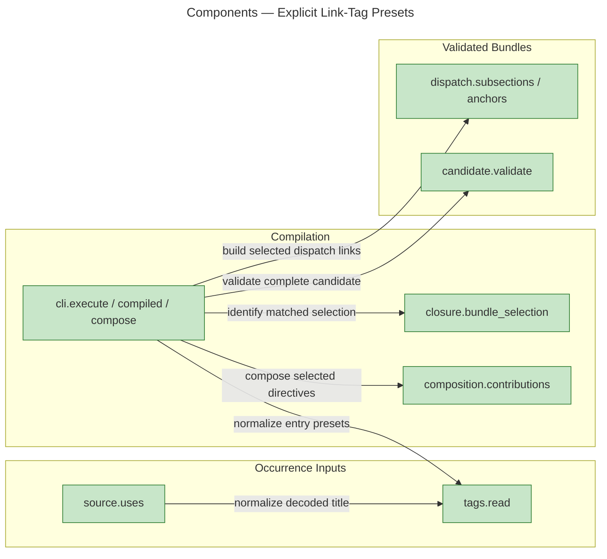
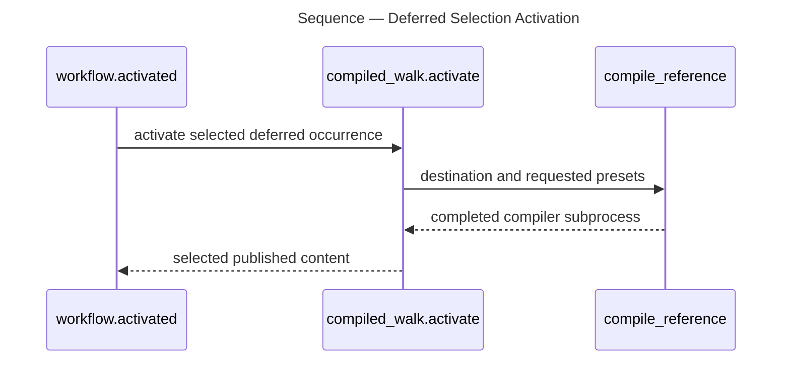
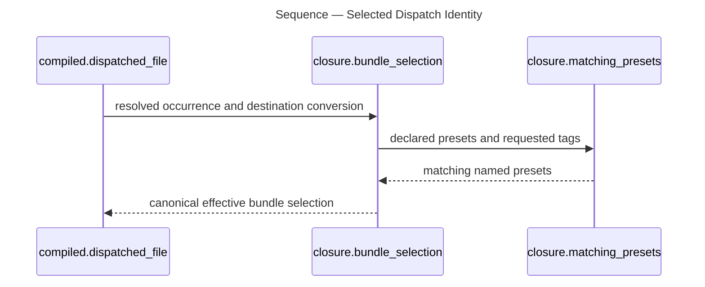

# Architecture Overview — Explicit Link-Tag Presets

> architecture-overview · [m2ux/prosiform#666](https://github.com/m2ux/prosiform/pull/666) · 2026-11-06

## Summary

Each Markdown link occurrence selects its destination's named presets through title tags, and the CLI accepts the equivalent single-entry command. Compilation retains that selection through substitution, composition, dispatch and deferred activation. Distinct effective dispatch selections produce separately validated bundles with deterministic names.

## Structure

The measured graph connects the command coordinator to the source reader, shared tag reader, effective selection identity, composition, dispatch and candidate validation. An **effective selection** is the canonical destination and fragment plus the named presets actually matched on that destination; unknown tokens and implicit default add no identity. Deterministic evaluation observes the published handoff through the same explicit command grammar.

### Occurrence Inputs

- **Shared list grammar.**
  [`tags.read`](https://github.com/m2ux/prosiform/blob/3164e8a5c8f695f965a464d8cefef0847cff4a72/src/prosiform/tags.py#L11-L17) splits literal commas, strips surrounding whitespace and case-folds complete names into an immutable set.
- **Authored occurrence.**
  [`source.py`](https://github.com/m2ux/prosiform/blob/3164e8a5c8f695f965a464d8cefef0847cff4a72/src/prosiform/source.py#L1177-L1250) supplies the parsed title separately from visible labels and containing headings; image, external and Mermaid text do not supply preset tags.
- **Entry occurrence.**
  [`execute`](https://github.com/m2ux/prosiform/blob/3164e8a5c8f695f965a464d8cefef0847cff4a72/src/prosiform/cli.py#L3780-L3824) supplies the explicit entry's `--presets` value to that same reader.

### Compilation

- **Destination-owned matching.**
  [`BundleSelection` and `bundle_selection`](https://github.com/m2ux/prosiform/blob/3164e8a5c8f695f965a464d8cefef0847cff4a72/src/prosiform/closure.py#L181-L217) retain declared spellings of matched named presets while keeping capture identity separate.
- **Bundle-local compilation.**
  [`compiled`](https://github.com/m2ux/prosiform/blob/3164e8a5c8f695f965a464d8cefef0847cff4a72/src/prosiform/cli.py#L3574-L3653) obtains selected declarations, traverses references, composes content and records effective dispatch selections under per-bundle budgets.
- **Occurrence-preserving substitution.**
  [`closure.py`](https://github.com/m2ux/prosiform/blob/3164e8a5c8f695f965a464d8cefef0847cff4a72/src/prosiform/closure.py#L1-L217) distinguishes requested tags from destination identity, allowing a substitute's declarations to answer the retained request.
- **Deferred composition.**
  [`composition.contributions`](https://github.com/m2ux/prosiform/blob/3164e8a5c8f695f965a464d8cefef0847cff4a72/src/prosiform/composition.py#L645-L664) emits contributions whose generated activation line retains the authored decoded title.

### Validated Bundles

- **Deterministic names.**
  [`selection_name` and `bundle_file`](https://github.com/m2ux/prosiform/blob/3164e8a5c8f695f965a464d8cefef0847cff4a72/src/prosiform/cli.py#L3531-L3546) hash sorted matched preset names as compact UTF-8 JSON, appending the full SHA-256 qualifier only for named selections.
- **Selection-aware dispatch.**
  [`dispatched_set`](https://github.com/m2ux/prosiform/blob/3164e8a5c8f695f965a464d8cefef0847cff4a72/src/prosiform/cli.py#L3720-L3743) schedules distinct effective selections; [`dispatch.py`](https://github.com/m2ux/prosiform/blob/3164e8a5c8f695f965a464d8cefef0847cff4a72/src/prosiform/dispatch.py#L690-L780) constructs sets and destinations used by candidate validation.
- **Whole-set publication.**
  [`execute`](https://github.com/m2ux/prosiform/blob/3164e8a5c8f695f965a464d8cefef0847cff4a72/src/prosiform/cli.py#L3820-L3876) checks cycles, all captured sources and depth before publishing the complete validated bundle set.

## Behaviour

The graph measures deferred activation and selected dispatch identity as ordered flows; component contexts supply the compiler dependencies above without asserting a graph-proven total order over every success-path call.

### Deferred Selection Activation

A decoded deferred link supplies its destination and tags to a later compile command, whose output is inspected by the deterministic workflow walker.

- **Measured order.**
  Process `proc_129_activated` orders [`activated`](https://github.com/m2ux/prosiform/blob/3164e8a5c8f695f965a464d8cefef0847cff4a72/evals/diagram-following/workflow.py#L1314-L1333), [`compiled_walk.activate`](https://github.com/m2ux/prosiform/blob/3164e8a5c8f695f965a464d8cefef0847cff4a72/evals/diagram-following/workflow.py#L1472-L1485), then [`compile_reference`](https://github.com/m2ux/prosiform/blob/3164e8a5c8f695f965a464d8cefef0847cff4a72/evals/diagram-following/workflow.py#L1150-L1165).
- **Explicit subprocess words.**
  The final step uses `Compile(...).args`, the authored source root and a separate output folder. Selection-qualified output lookup is observed by the related effective-presets and entry-bundle flows.
- **Negative controls.**
  Workflow and scorer tests reject omitted or incorrect deferred tags and missing, repeated or reversed dispatch selections; historical paid-run results are not evidence of current tag behavior.

### Selected Dispatch Identity

A dispatch occurrence resolves its effective destination selection before the compiler derives the selected bundle filename.

- **Measured order.**
  Process `proc_212_dispatched_file` orders [`dispatched_file`](https://github.com/m2ux/prosiform/blob/3164e8a5c8f695f965a464d8cefef0847cff4a72/src/prosiform/cli.py#L3603-L3609), `bundle_selection` and [`matching_presets`](https://github.com/m2ux/prosiform/blob/3164e8a5c8f695f965a464d8cefef0847cff4a72/src/prosiform/closure.py#L180-L192).
- **Selection and naming boundary.**
  Matched declared names determine identity; a local filename collision between distinct effective selections raises before composition can publish. Global publication checks collisions across the entire scheduled set.
- **CLI failure boundary.**
  Separate measured process `proc_146_execute` orders `execute`, `conformance_fault` and `usage_failure` for an invalid configured fault. Source and corpus tests also exercise positional, repeated, missing-entry, quoted and leading-dash values without attributing every parser failure to that trace.

## What Changed

### Source And Selection

- **Occurrence-local presets.**
  Titles and CLI arguments carry explicit requests. Heading wording and visible labels determine presentation, not selection.
- **Effective bundle keys.**
  Matched named presets participate in bundle identity; equivalent requests share a bundle and physical capture remains source-owned.

### Composition And Dispatch

- **Tagged deferred activation.**
  Published titles prescribe later commands with immediate/deferred selection parity under unrelated headings.
- **Variant-aware output.**
  Dispatch scheduling, links, parallel sets, cycles, depth and candidate checks identify the same effective selections.
- **Atomic failure boundary.**
  A collision, invalid candidate, source mutation or budget failure prevents partial publication.

### Callers And Guidance

- **Executable command contract.**
  Smoke, corpus, renderer examples, deterministic evaluation and maintained guides use the single-entry command.
- **Audited guidance.**
  The documentation audit separates maintained claims and executable specimens from historical measurements and live-agent behavior.

## Reading Order

1. **[`tags.py`](https://github.com/m2ux/prosiform/blob/3164e8a5c8f695f965a464d8cefef0847cff4a72/src/prosiform/tags.py#L1-L17)** — the shared complete-name grammar.
2. **[`source.py`](https://github.com/m2ux/prosiform/blob/3164e8a5c8f695f965a464d8cefef0847cff4a72/src/prosiform/source.py#L1177-L1250)** — occurrence titles and resource boundaries.
3. **[`closure.py`](https://github.com/m2ux/prosiform/blob/3164e8a5c8f695f965a464d8cefef0847cff4a72/src/prosiform/closure.py#L1-L217)** — requested tags, matched presets and canonical identity.
4. **[`cli.py`](https://github.com/m2ux/prosiform/blob/3164e8a5c8f695f965a464d8cefef0847cff4a72/src/prosiform/cli.py#L3531-L3876)** — deterministic names, compilation, scheduling and whole-set publication.
5. **[`composition.py`](https://github.com/m2ux/prosiform/blob/3164e8a5c8f695f965a464d8cefef0847cff4a72/src/prosiform/composition.py#L645-L664)** — selected contribution and deferred activation emission.
6. **[`dispatch.py`](https://github.com/m2ux/prosiform/blob/3164e8a5c8f695f965a464d8cefef0847cff4a72/src/prosiform/dispatch.py#L690-L780)** — effective dispatch-set destinations.
7. **[`candidate.py`](https://github.com/m2ux/prosiform/blob/3164e8a5c8f695f965a464d8cefef0847cff4a72/src/prosiform/candidate.py#L1367-L1452)** — source-to-output invariants before publication.
8. **[`workflow.py`](https://github.com/m2ux/prosiform/blob/3164e8a5c8f695f965a464d8cefef0847cff4a72/evals/diagram-following/workflow.py#L1150-L1165)** — deterministic execution of published later commands.

## Risks And Watch Points

- **Shared substitution fixed point.**
  Later occurrences can add presets for a source already seen; traversal must settle the complete bundle-local mapping without collapsing distinct requests.
- **Identity consistency.**
  Naming, scheduling, graph checks and candidate validation must agree on destination, fragment and matched preset set.
- **Measured graph limits.**
  The exact-head index reports 781 changed symbols across 834 paths and 245 affected flows. Process discovery is bounded; missing flows are not proof of absent behavior. The tag-reader context reports two unresolved receiver call sites. Direct code review and regression checks complement these lower-bound measurements.
- **Conformance coverage.**
  Passing conformance validates declarations and code agreement; 67 of 365 clauses remain uncovered by fixtures. Sixteen clauses cannot be stated by a run, three sections state no behavior and three installation claims remain outside corpus observation.

## References

- **R1.** [Pull request changes](https://github.com/m2ux/prosiform/pull/666/files) — the complete integration diff and actual task merges.
- **R2.** [Validation](validation.md) — exact-head checks, criterion evidence and target requirements.
- **R3.** [Graph measurements](graph-measurements.md) — revisions, measured relationships and ordered flow evidence.
- **R4.** [Documentation audit](https://github.com/m2ux/prosiform/blob/engineering/artifacts/planning/2026-11-06-662-i10-e07-w10-all-documentation-is-accurate/audit.md) — claim review, coverage and exclusions.
