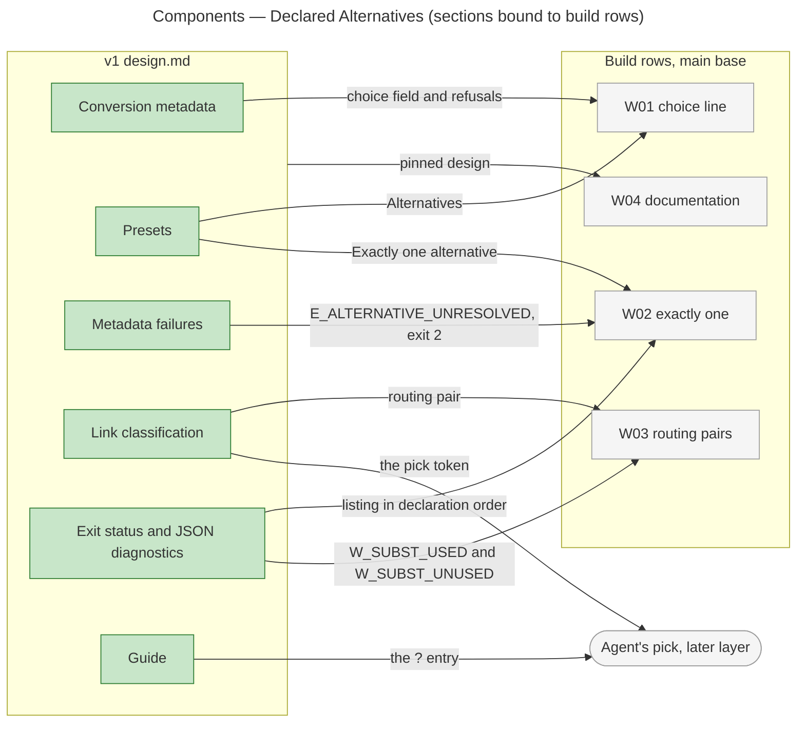

# Architecture Overview — Declared Alternatives

> architecture-overview · [m2ux/prosiform#711](https://github.com/m2ux/prosiform/pull/711) · 2026-11-12

## Summary

The pull request changes one file, the v1 design, so that it states declared alternatives: a preset holding `choice`, the rule that exactly one alternative is in force, the `E_ALTERNATIVE_UNRESOLVED` failure, routing pairs, and the agent's pick through the `?` title token. It lands in the design's Presets, Conversion metadata, Metadata failures, Link classification and Exit status sections. It is the contract that build rows W01-W04 of epic [#708](https://github.com/m2ux/prosiform/issues/708) implement and that the documentation pins.

## Structure

The change is documentation alone. The graph reads the design as Markdown sections and measures no calls, no imports and no execution flows between them, so the edges below come from the epic's Work Breakdown and the W00 section read, not from the graph. Each changed section is the one home of a rule; the build rows on the `main` base implement the rules their acceptance criteria name.

### v1 design

- **Conversion metadata.**
  Defines a preset's admitted fields. It gains `choice`: a preset holding it is an *alternative* (one of a set of presets a reference picks exactly one from), and its value is the *choice line* stating when to pick it.
- **Presets.**
  Defines how a link's title tags select a target's presets. It gains **Alternatives**, **Exactly one alternative** and **The agent's pick**, and three existing bullets now name the exactly-one rule where an empty or unmatched selection meets a document declaring alternatives.
- **Metadata failures.**
  Indexes each metadata code. It gains the `E_ALTERNATIVE_UNRESOLVED` row and the exit-2 exception for it.
- **Link classification and resource handling.**
  Defines the substitution mapping and how each link form is published. It gains the *routing pair* (a `subst` pair an alternative states) and **The pick token**.
- **Exit status and JSON diagnostics.**
  Defines exit codes and diagnostic payloads. It gains the `E_ALTERNATIVE_UNRESOLVED` listing and the routing-pair exception to `W_SUBST_USED` and `W_SUBST_UNUSED`.
- **Guide.**
  Holds the text a bare `pf` prints. It gains the `?` symbol-grammar entry.

## Behaviour

The design file has no execution flows: the graph reports zero affected processes, so no sequence is drawn. The rules the change states run in this order when a document declaring alternatives is compiled.

- **Declare.**
  A preset holding a one-line `choice` is an alternative; a malformed `choice`, a `choice` in `default` and a preset named `?` fail with `E_INVALID_CONVERSION_METADATA`.
- **Count.**
  Exactly one alternative is in force per bundle, counted on the union of presets every reference reaching the document selects. None or several fail with `E_ALTERNATIVE_UNRESOLVED`, exit 2, publishing nothing.
- **Report.**
  The failure lists each alternative with its choice line in declaration order. An unpicked alternative raises no `W_PRESET_UNUSED`.
- **Route.**
  A routing pair a link uses raises no `W_SUBST_USED`; it warns `W_SUBST_UNUSED` only when no link its document writes names its key.
- **Defer the pick.**
  A deferral carrying `?` publishes its title; the later run answers with the listing and the agent reruns with one alternative named. `?` on any non-deferred link is refused with `E_UNSUPPORTED_CONSTRUCT`.

## What Changed

### v1 design

- **Alternatives and the exactly-one rule.**
  The design states them as preset rules with their own failure code and exit status 2.
- **Routing pairs.**
  The substitution mapping distinguishes a pair routing an alternative's links from a stand-in pair, and only the latter reports use.
- **The agent's pick.**
  The `?` title token, its permitted link forms and its guide entry are stated as the layer above the alternatives the build rows enforce.
- **Terminology.**
  A `subst` value is its *substitute* throughout, so *alternative* names one thing.

## Reading Order

1. **[design.md: Conversion metadata, the `choice` row and choice holds one line](https://github.com/m2ux/prosiform/blob/59382d3a2e92e9d0ab12117f72fc96b2e4dc366b/artifacts/planning/2026-10-17-prosiform-v1/design.md#L430-L439)** — where an alternative is declared and what is refused.
2. **[design.md: Presets, Alternatives to the unused-preset warning](https://github.com/m2ux/prosiform/blob/59382d3a2e92e9d0ab12117f72fc96b2e4dc366b/artifacts/planning/2026-10-17-prosiform-v1/design.md#L462-L468)** — the exactly-one rule, the union it counts on, and the unused-preset exception.
3. **[design.md: Metadata failures](https://github.com/m2ux/prosiform/blob/59382d3a2e92e9d0ab12117f72fc96b2e4dc366b/artifacts/planning/2026-10-17-prosiform-v1/design.md#L472-L478)** — the new code and its exit-2 exception.
4. **[design.md: the substitution mapping and the pick token](https://github.com/m2ux/prosiform/blob/59382d3a2e92e9d0ab12117f72fc96b2e4dc366b/artifacts/planning/2026-10-17-prosiform-v1/design.md#L498-L515)** — routing pairs and where `?` is admitted.
5. **[design.md: Exit status and JSON diagnostics](https://github.com/m2ux/prosiform/blob/59382d3a2e92e9d0ab12117f72fc96b2e4dc366b/artifacts/planning/2026-10-17-prosiform-v1/design.md#L745-L767)** — the listing's shape and the warning exceptions.
6. **[design.md: Guide and the Alternatives fixture row](https://github.com/m2ux/prosiform/blob/59382d3a2e92e9d0ab12117f72fc96b2e4dc366b/artifacts/planning/2026-10-17-prosiform-v1/design.md#L174-L176)** — the guide's `?` entry; the fixture row is at [L816](https://github.com/m2ux/prosiform/blob/59382d3a2e92e9d0ab12117f72fc96b2e4dc366b/artifacts/planning/2026-10-17-prosiform-v1/design.md#L816).

## Risks and Watch Points

- **The design runs ahead of the build.**
  **The pick token** refusals and the guide's `?` entry are stated here, while the epic leaves the agent's pick to a later layer; the guide on the `i15/e00/main` base carries no `?` entry. A reader of the design alone may take those rules as built.
- **One code, three causes.**
  An absent pick, an unknown name and `?` all answer with `E_ALTERNATIVE_UNRESOLVED`; the reviewer checks the build's message names each alternative in declaration order rather than the cause.
- **Metadata failures wording.**
  "Both fail check mode" follows a sentence that now names two exit-2 exceptions, so "Both" reads as those two rather than as the exit-1 and exit-2 classes.

## Measurements

- **Revision.** Index built with `gitnexus analyze --index-only` in the review worktree at `59382d3a2e92e9d0ab12117f72fc96b2e4dc366b`; status up to date.
- **Comparison base.** Merge base of head and base `27010a9c79b8adf9114850ac41551f80f1d83d79` is the base itself.
- **Change surface.** `detect-changes`: 1 file, 13 changed Section symbols, 0 affected processes, risk low.
- **Symbol context.** Guide, Conversion metadata, Presets, Metadata failures, Link classification and resource handling, Exit status and JSON diagnostics and Metadata conformance cases each report no incoming or outgoing relationships and no processes. The component edges above are therefore planning bindings, not graph edges.

## References

- **R1.** [Epic #708](https://github.com/m2ux/prosiform/issues/708) — acceptance criteria AC1-AC9 and the Work Breakdown binding each row to its criteria.
- **R2.** [W00 #710](https://github.com/m2ux/prosiform/pull/710) — the delivering pull request for this design change.
- **R3.** [Preset Alternatives design](https://github.com/m2ux/prosiform/blob/engineering/artifacts/planning/2026-11-12-preset-alternatives/design.md) — the record whose rules this change places in the v1 design.
