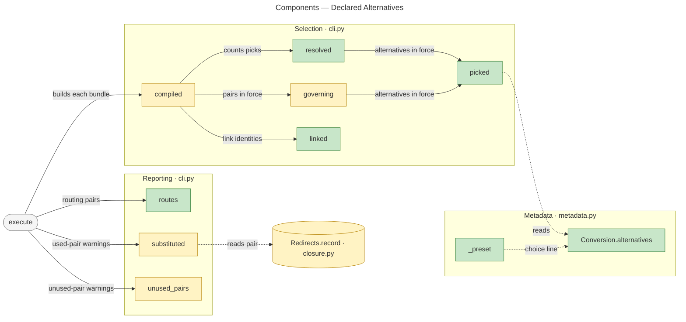
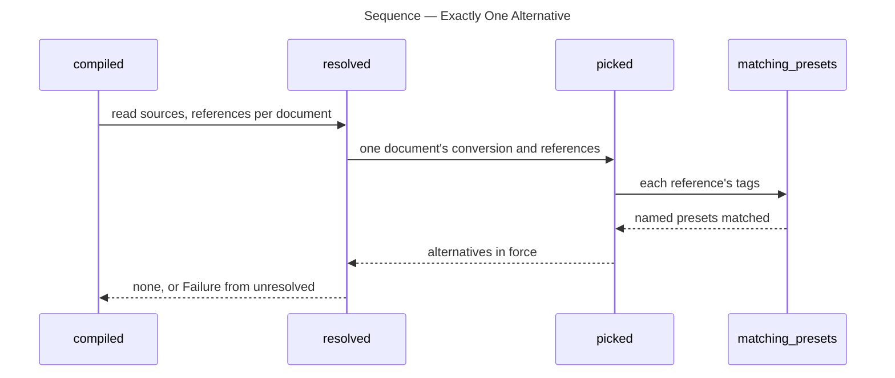
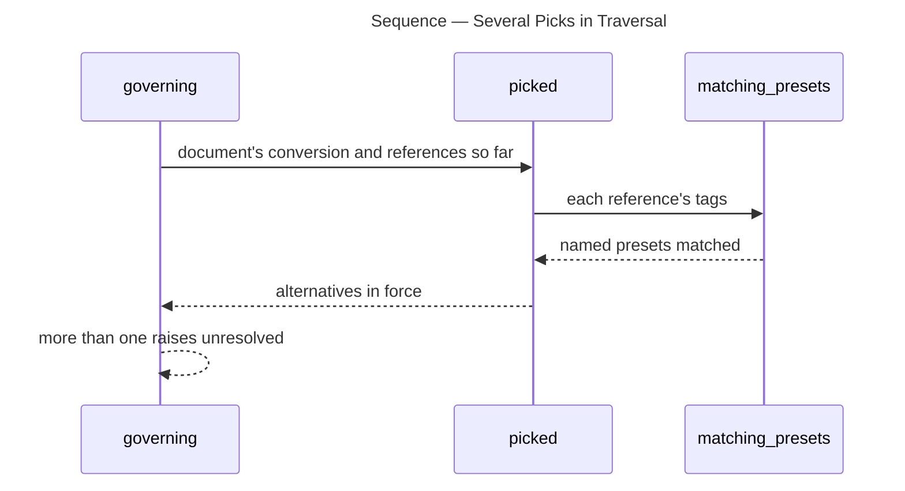

# Architecture Overview — Declared Alternatives

> architecture-overview · [m2ux/prosiform#713](https://github.com/m2ux/prosiform/pull/713) · 2026-11-12

## Summary

A preset holding a `choice` line is an *alternative*, and a document declaring alternatives compiles only with exactly one of them in force in each bundle. The change lands in metadata decoding, preset selection and the run's warning pass in `cli.py`, with the pages and fixtures that state the rules. A document serving several kinds of work can route its links to the picked kind's material, and a missing or doubled pick fails with a listing of every alternative and when to pick it.

## Structure

The change reaches three areas. **Metadata** decodes a document's `prosiform` frontmatter into presets. **Selection** decides which presets are in force for each document a bundle carries and which `subst` pairs redirect its links. **Reporting** turns the run's record of redirects into warnings after every bundle is built. The `closure.py` redirect record carries the pair that served each redirect, so reporting can tell a routing pair from a stand-in.

Green is added, amber is altered, grey is untouched. Solid edges are measured calls; dotted edges are data reads.

### Metadata

- **`_preset`.**
  Decodes one preset's fields. It accepts `choice` beside `group` and `subst`, and refuses a `choice` that is not a one-line non-empty string and a `choice` in `default`.
- **`decode`.**
  Refuses a preset named `?`, the *pick token* a later layer reserves for leaving the pick to an agent.
- **`Conversion.alternatives`.**
  The presets holding a choice line, in declaration order.

### Selection

- **`picked`.**
  The alternatives in force for one document: the union every reference reaching it selects, filtered to alternatives.
- **`resolved`.**
  Holds every document a bundle carries to exactly one alternative in force, raising `E_ALTERNATIVE_UNRESOLVED` otherwise.
- **`governing`.**
  Builds the `subst` pairs in force per document. It refuses several alternatives before comparing their pairs, and marks each pair an alternative states as a *routing pair*.
- **`linked`.**
  Reads every link a document writes, in every region, as the identity it was written to name.

### Reporting

- **`routes`.**
  The pairs only alternatives put in force across the run; a pair `default` or an ordinary preset states anywhere is a stand-in.
- **`substituted`** and **`unused_pairs`.**
  Skip `W_SUBST_USED` for a routing pair, and warn `W_SUBST_UNUSED` for one only where no link of its document names its key.

## Behaviour

Two measured flows carry the exactly-one rule: the per-bundle count and the traversal's early refusal of several picks.

### Exactly One Alternative

`compiled` runs it after traversal for every bundle, the entry's and each dispatched one's; it yields nothing or an `E_ALTERNATIVE_UNRESOLVED` failure at exit status 2.

- **Count on the union.**
  `picked` gathers every reference's matched preset names, so a link with no title beside one picking `epic` leaves one in force.
- **Listing.**
  `unresolved` pads each alternative's name to the longest and prints its choice line beneath the message, in declaration order.

### Several Picks in Traversal

`traverse` calls `governing` in each round; several alternatives in force fail before two routes for one key are compared as `E_INVALID_USAGE`.

- **Monotonic rounds.**
  References reaching a document only grow across rounds, so several in force in any round are several at the fixed point.

## What Changed

### Metadata

- **Presets.**
  A preset carries an optional choice line; `Subst` names its second side `substitute`, freeing "alternative" for the new term.

### Selection

- **Pick count.**
  A document declaring alternatives fails with `E_ALTERNATIVE_UNRESOLVED` and exit 2 unless exactly one is in force per bundle; an unpicked alternative raises no `W_PRESET_UNUSED`.

### Reporting

- **Routing pairs.**
  An alternative's pair raises no `W_SUBST_USED`, and `W_SUBST_UNUSED` only where no link of its document names its key.

### Documentation

- **Pages.**
  `sources.md`, `selection.md`, `invocation.md`, `glossary.md` and `validation.md` state the rules and pin the v1 design at `c04f5d8e6`.

## Reading Order

1. **[src/prosiform/metadata.py](https://github.com/m2ux/prosiform/blob/eead56b5096870dbcd0703787a73261ce0cd2c76/src/prosiform/metadata.py#L494-L544)** — the choice line enters here, with its three refusals.
2. **[src/prosiform/cli.py `picked` to `governing`](https://github.com/m2ux/prosiform/blob/eead56b5096870dbcd0703787a73261ce0cd2c76/src/prosiform/cli.py#L796-L906)** — the pick count, the listing and the routing flag.
3. **[src/prosiform/cli.py `compiled` and `linked`](https://github.com/m2ux/prosiform/blob/eead56b5096870dbcd0703787a73261ce0cd2c76/src/prosiform/cli.py#L3697-L3812)** — where each bundle is held to one pick and records its link identities.
4. **[src/prosiform/cli.py `routes` and `unused_pairs`](https://github.com/m2ux/prosiform/blob/eead56b5096870dbcd0703787a73261ce0cd2c76/src/prosiform/cli.py#L3847-L3905)** — how routing pairs are kept quiet.
5. **[src/prosiform/closure.py `Redirect`](https://github.com/m2ux/prosiform/blob/eead56b5096870dbcd0703787a73261ce0cd2c76/src/prosiform/closure.py#L235-L256)** — the pair each redirect record now carries.
6. **[docs/selection.md](https://github.com/m2ux/prosiform/blob/eead56b5096870dbcd0703787a73261ce0cd2c76/docs/selection.md#L44-L60)** — the rules as a user reads them.

## Risks and Watch Points

- **Routing flag follows declaration order.**
  [`governing`](https://github.com/m2ux/prosiform/blob/eead56b5096870dbcd0703787a73261ce0cd2c76/src/prosiform/cli.py#L900) keeps the first preset stating a key, so an alternative and an ordinary preset stating one identical pair warn `W_SUBST_USED` or stay silent depending on which is declared first.
- **Remedy names `--presets` alone.**
  The [remedy](https://github.com/m2ux/prosiform/blob/eead56b5096870dbcd0703787a73261ce0cd2c76/src/prosiform/cli.py#L832) suits an entry; for a document reached by a link, the fix is the link title. The v1 design states this remedy text verbatim.
- **Link identities read every region.**
  [`linked`](https://github.com/m2ux/prosiform/blob/eead56b5096870dbcd0703787a73261ce0cd2c76/src/prosiform/cli.py#L3785-L3797) counts a link outside the selection, so a routing pair is silent there by design; a reviewer expecting the stand-in rule sees no warning.

## Measurement Notes

- **Index.** `gitnexus analyze --index-only` in a detached worktree at `eead56b`; `gitnexus status` reports up to date. The analyzer reports 301 of 501 candidate entry points unranked, so an absent flow does not mean an absent path.
- **Change surface.** `detect-changes` against comparison base `5d517e49e` (equal to the PR base): 107 files, 98 symbols, 49 affected flows.
- **Flows.** The two sequences are the measured processes `Resolved → Matching_presets` and `Governing → Matching_presets`. The warning pass (`execute` → `routes`, `substituted`, `unused_pairs`) has measured call edges but no ranked process, so it appears in the component diagram only.
- **Unmeasured edge.** The graph links `linked` to `uses` and `regions` but not to `closure.named`, which it also calls.

## References

- **R1.** [Epic I15:E00](https://github.com/m2ux/prosiform/issues/708) — the criteria this pull request delivers.
- **R2.** [v1 design at c04f5d8e6](https://github.com/m2ux/prosiform/blob/c04f5d8e6/artifacts/planning/2026-10-17-prosiform-v1/design.md#presets) — Presets, Conversion metadata and Link classification state the rules.
- **R3.** [Agent review](https://github.com/m2ux/prosiform/blob/engineering/artifacts/planning/2026-11-12-713-declared-alternatives/agent-review.json) — the review record for this head.
