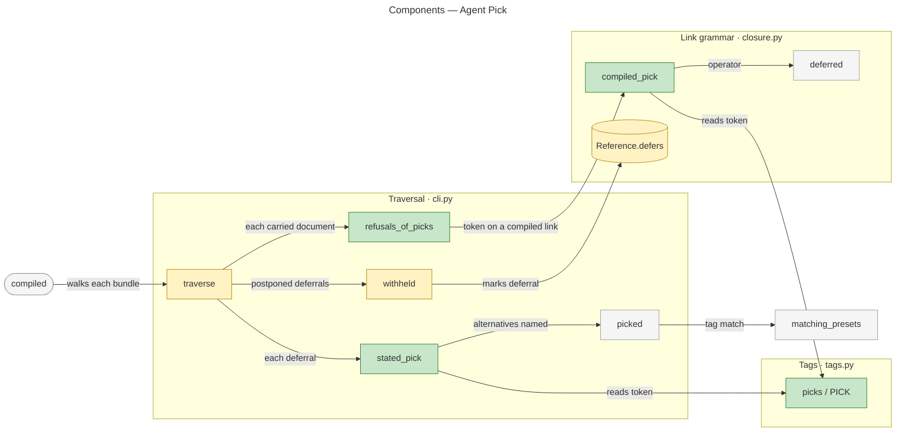
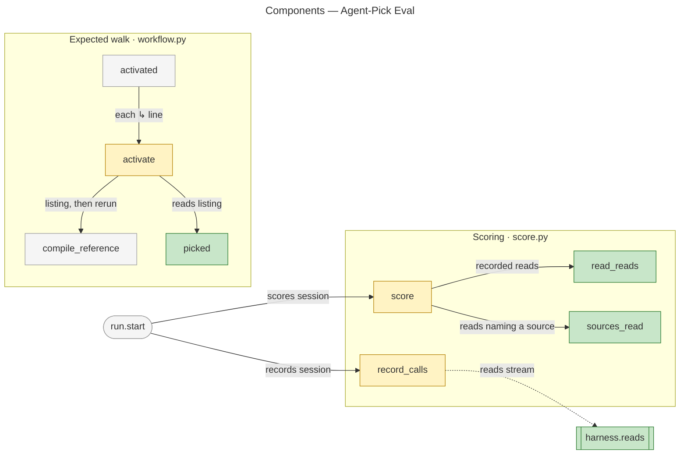
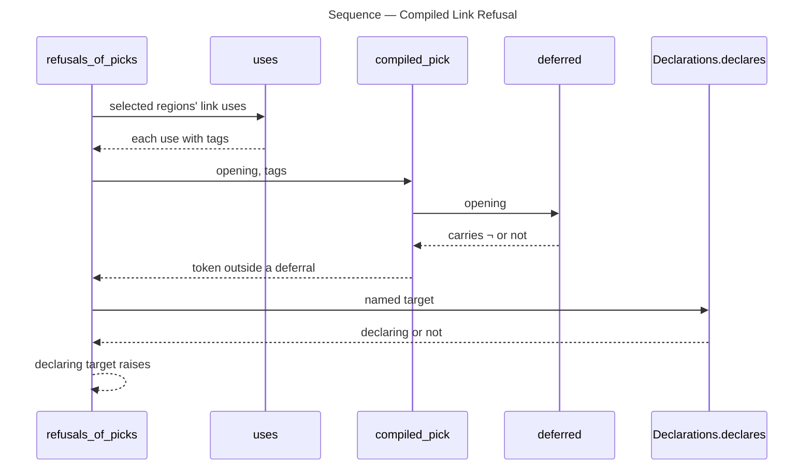
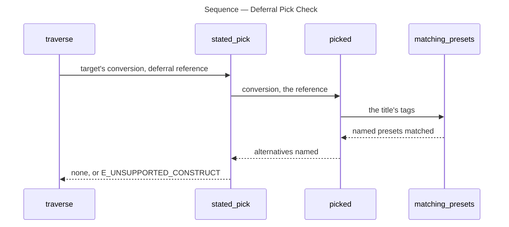

# Architecture Overview — Agent Pick

> architecture-overview · [m2ux/prosiform#722](https://github.com/m2ux/prosiform/pull/722) · 2026-11-12

## Summary

A `?` among a deferred link's title tags is the *pick token*: it leaves the pick among the target's *alternatives* (presets holding a `choice` line) to the agent that compiles the deferral in a later run. The change lands in title-tag reading, link classification and the traversal's refusals in `cli.py`, with the guide, the reference pages, router fixtures and an agent-pick workflow in the diagram-following eval. An agent handed a generic document can now pass the title as `--presets`, read the alternatives `pf` lists, and rerun with the one that fits.

## Structure

The change reaches four areas. **Tags** reads a link title into preset names and now recognises the pick token apart from them. **Link grammar** in `closure.py` classifies a link by its operators — `¬` deferral, `↳` composition directive, `⇉` dispatch, `⫽` parallel dispatch — and marks the references a deferral writes. **Traversal** in `cli.py` walks every document a run carries and refuses what the run cannot compile; it gains two checks. **Eval** measures whether a headless agent follows a compiled workflow; it gains a walk that makes the pick and a check on the files a session reads.



Green is added, amber is altered, grey is untouched. Every edge is a measured call except `withheld → Reference.defers`, a field it sets.



The dotted edge is a call through the harness interface, which the graph does not resolve.

### Tags

- **`PICK` and `picks`.**
  `?` is a complete token of a title's tag list; `picks` says whether a list carries it. It names no preset, and `metadata.py` refuses a preset named `?`.

### Link Grammar

- **`compiled_pick`.**
  True for a link carrying the pick token without the `¬` operator: a link whose target this run compiles, so no agent is left to pick.
- **`Reference.defers`.**
  A reference a deferral writes states that it defers: a later run compiles its target with the deferral's title as its selection.

### Traversal

- **`refusals_of_picks`.**
  Refuses the pick token on an ordinary, `↳`, `⇉` or `⫽` link naming a declaring document, with `E_UNSUPPORTED_CONSTRUCT`.
- **`stated_pick`.**
  Holds each deferral to the pick its target compiles with: exactly one alternative named, or `?` alone; `?` to a target declaring none is refused.
- **Guide.**
  The symbol grammar gains the `?` entry, and "Compiling a link" runs a bundle's link as written from the directory `pf` compiled that bundle in.

### Eval

- **`picked` (workflow.py).**
  Reads the `E_ALTERNATIVE_UNRESOLVED` listing and picks the alternative whose choice line an input holds, else the one declared last.
- **`reads` and `sources_read`.**
  Each harness reports the files its read tool opened; a passing shell-form session that read a source document fails `read_source`.

## Behaviour

Three measured flows carry the change: the refusal of a compiled pick, the deferral's pick check, and the eval's expected pick.

### Compiled Link Refusal

`traverse` runs `refusals_of_picks` on each carried document every round; it yields nothing or an `E_UNSUPPORTED_CONSTRUCT` failure naming the link.



- **Declaring targets only.**
  A link naming a document that declares no `prosiform` is text, so its title selects nothing and `?` stays the author's words.

### Deferral Pick Check

After the fixed point, `traverse` reads each postponed reference's target and calls `stated_pick` for every one that defers.



- **One, or `?` alone.**
  With alternatives declared, one named and no `?`, or none named beside `?`, publishes; every other title fails, listing the target's alternatives.
- **Postponed key.**
  The postponed key gains `defers`, so a deferral and another withheld reference with one title stay distinct.

### Expected Pick Walk

The eval's `compiled_walk` runs `pf` on each `↳` line a state reaches; a line carrying `?` takes two runs.

```mermaid
---
title: Sequence — Expected Pick Walk
---
sequenceDiagram
    participant Activated as activated
    participant Activate as activate
    participant Compiled as compiled
    participant Picked as picked
    participant Reported as reported

    Activated->>Activate: Compile request
    Activate->>Compiled: request with ?
    Compiled-->>Activate: exit 2 and listing
    Activate->>Picked: listing, inputs
    Picked->>Reported: diagnostic codes
    Reported-->>Picked: E_ALTERNATIVE_UNRESOLVED
    Picked-->>Activate: alternative
    Activate->>Compiled: request with ? replaced
    Compiled-->>Activate: picked kind's bundle
```

- **Inputs pick.**
  Two choice lines held by the inputs, or no listing, is a corpus fault rather than a pick.

## What Changed

### Tags

- **Pick token.**
  `?` is read apart from preset names; `PICK` lives in `tags.py` and `metadata.py` imports it.

### Traversal

- **Compiled pick refused.**
  `?` on an ordinary, `↳`, `⇉` or `⫽` link to a declaring document fails with `E_UNSUPPORTED_CONSTRUCT`.
- **Deferral pick stated.**
  A deferral to alternatives names one or carries `?` alone; `?` to a target without alternatives fails.
- **Guide.**
  States how to resolve `?`, and runs a bundle's links from the directory `pf` compiled it in.

### Documentation and Fixtures

- **Pages.**
  `docs/references.md` gains The pick token; `selection.md`, `glossary.md` and `invocation.md` link it and pin the design at `c04f5d8e6`.
- **Fixtures.**
  Fourteen `deferral/` fixtures, two `dispatch/` fixtures and the guide response cover the grammar and the router's listing and picks.

### Eval

- **Agent-pick workflow.**
  `workflows/agent-pick` defers a kind router with `?`; four scenarios each pass only on the picked kind's state.
- **Read check.**
  `read_source` holds every shell-form session to what `pf` prints and writes.
- **Measured run.**
  `agent-pick.json` and `agent-pick.md` record twenty live sessions: none passed, `read_source` 15, `overcompiled` 4, `uncompiled` 1, each triaged a miss.

## Reading Order

1. **[src/prosiform/tags.py](https://github.com/m2ux/prosiform/blob/d6072b20cfd5541b3edfa561e15677404e0f4cf6/src/prosiform/tags.py#L9-L28)** — the token and how a title carries it.
2. **[src/prosiform/closure.py `compiled_pick`](https://github.com/m2ux/prosiform/blob/d6072b20cfd5541b3edfa561e15677404e0f4cf6/src/prosiform/closure.py#L661-L669)** — which links may carry it.
3. **[src/prosiform/cli.py `refusals_of_picks`](https://github.com/m2ux/prosiform/blob/d6072b20cfd5541b3edfa561e15677404e0f4cf6/src/prosiform/cli.py#L1843-L1879)** — the refusal on a compiled link.
4. **[src/prosiform/cli.py `traverse`](https://github.com/m2ux/prosiform/blob/d6072b20cfd5541b3edfa561e15677404e0f4cf6/src/prosiform/cli.py#L2361-L2380)** and **[`stated_pick`](https://github.com/m2ux/prosiform/blob/d6072b20cfd5541b3edfa561e15677404e0f4cf6/src/prosiform/cli.py#L2430-L2479)** — the deferral's pick check.
5. **[src/prosiform/cli.py guide](https://github.com/m2ux/prosiform/blob/d6072b20cfd5541b3edfa561e15677404e0f4cf6/src/prosiform/cli.py#L335-L369)** — what the agent is told.
6. **[docs/references.md The pick token](https://github.com/m2ux/prosiform/blob/d6072b20cfd5541b3edfa561e15677404e0f4cf6/docs/references.md#L94-L102)** — the rules as a user reads them.
7. **[evals/diagram-following/workflow.py `picked`](https://github.com/m2ux/prosiform/blob/d6072b20cfd5541b3edfa561e15677404e0f4cf6/evals/diagram-following/workflow.py#L1497-L1557)** — the walk a correct session makes.
8. **[evals/diagram-following/score.py `sources_read`](https://github.com/m2ux/prosiform/blob/d6072b20cfd5541b3edfa561e15677404e0f4cf6/evals/diagram-following/score.py#L354-L385)** — the read check.
9. **[evals/diagram-following/agent-pick.md](https://github.com/m2ux/prosiform/blob/d6072b20cfd5541b3edfa561e15677404e0f4cf6/evals/diagram-following/agent-pick.md)** — the measured run.

## Risks and Watch Points

- **Read check matches by path suffix.**
  [`sources_read`](https://github.com/m2ux/prosiform/blob/d6072b20cfd5541b3edfa561e15677404e0f4cf6/evals/diagram-following/score.py#L380-L383) counts any read ending in `/<document>`; no input (`.txt`) or bundle (`.bundle.md`) name collides with a source today.
- **Read check covers every shell form.**
  `read_source` applies to every `compiled` and `bootstrap` workflow, so a rerun of an earlier workflow can fail sessions its committed record passed.
- **`?` on an entry without alternatives.**
  `pf doc.md --presets '?'` compiles as if `?` were absent; only a hand-typed command reaches it, since the deferral check refuses that title.
- **The measured rate is zero.**
  Every live session traced its path and fifteen of twenty opened a source; the record is the measurement, not a defect.

## Measurement Notes

- **Index.** `gitnexus analyze --index-only` in a detached worktree at `d6072b2`; `gitnexus status` reports up to date. 313 of 513 candidate entry points never ranked, so an absent flow does not mean an absent path.
- **Change surface.** `detect-changes --scope compare` against comparison base `e45645c2e` (equal to the PR base): 118 files, 150 symbols, 44 affected flows.
- **Flows.** The sequences are the measured processes `Refusals_of_picks → Regions`, `Compiled_pick → Opened`, `Refusals_of_picks → Answer`, `Stated_pick → Matching_presets` and `Activated → Reported` / `Activated → Compile_reference`. `score → read_reads, sources_read` has measured calls and no ranked process, so it appears in the component diagram only.
- **Unmeasured edge.** `record_calls` calls `harness.reads` through the harness interface; the graph types no receiver for it.

## References

- **R1.** [Epic I15:E01](https://github.com/m2ux/prosiform/issues/709) — the criteria this pull request delivers.
- **R2.** [Preset Alternatives design](https://github.com/m2ux/prosiform/blob/engineering/artifacts/planning/2026-11-12-preset-alternatives/design.md) — the rules each task implements.
- **R3.** [Agent review](https://github.com/m2ux/prosiform/blob/engineering/artifacts/planning/2026-11-12-722-agent-pick/agent-review.json) — the review record for this head.
