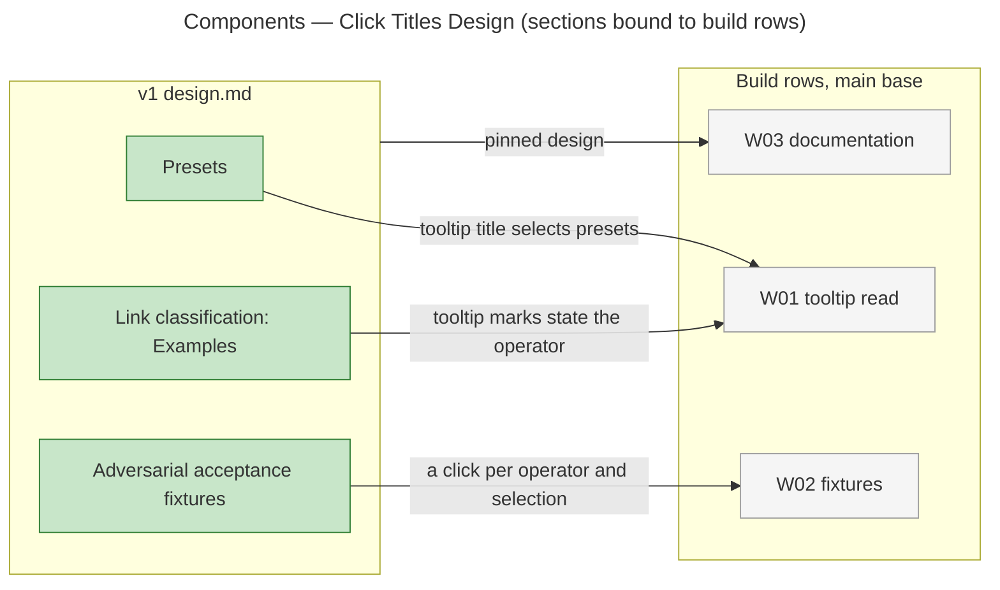

# Architecture Overview — Click Titles Design

> architecture-overview · [m2ux/prosiform#742](https://github.com/m2ux/prosiform/pull/742) · 2026-11-12

## Summary

The pull request changes one file, the v1 design, so that it states the click tooltip rule: a Mermaid `click` line's or class diagram `link` line's quoted tooltip states its link's operator through its opening marks and its title through the rest. It lands in Presets, Link classification and the fixture-family table. It is the contract that build rows W01 and W02 of epic [#739](https://github.com/m2ux/prosiform/issues/739) implement and that W03's documentation pins.

## Structure

The change is documentation alone. The graph reads the design as Markdown sections and measures no calls, imports or execution flows between them, so the edges below come from the epic's Work Breakdown, not from the graph.

### v1 design

- **Presets.**
  Defines how a link's title tags select a target's presets. **Selection belongs to the link** reads a click's tooltip, less its opening marks, as the diagram link's title; **Exactly one alternative** names a diagram link carrying no tooltip as the one that selects nothing.
- **Link classification and resource handling.**
  Defines how each link form is followed and published. **Examples** states that marks opening a tooltip, followed by a blank or its end, are the operator, accepted and refused as a link's text marks are; the rest is the title; the destination is published as the operator states and the tooltip carried as written.
- **Adversarial acceptance fixtures.**
  Lists the fixture families. Deferral, Dispatch, Parallel dispatch, Composition, Presets and Alternatives each gain a click case.

## Behaviour

The design file has no execution flows: the graph reports zero affected processes, so no sequence is drawn. The rule runs in this order on a click carrying a tooltip.

- **Split.**
  Marks opening the tooltip, followed by a blank or the tooltip's end, are the operator; a mark followed directly by text opens none.
- **Check.**
  The operator is accepted or refused as the same marks opening a Markdown link's text are.
- **Select.**
  The rest of the tooltip is the title, its tags selecting presets and carrying the pick token as a link title does.
- **Publish.**
  The destination is rewritten as the operator publishes a link's destination; the tooltip and the rest of the fence are carried as written.

## What Changed

### v1 design

- **A tooltip carries an operator and a title.**
  A diagram link drawn with a tooltip is an operator-bearing, preset-selecting link like a Markdown link.
- **What carries no tooltip stays plain.**
  A diagram link carrying no tooltip, and a sequence diagram's `link` and `links`, carry no operator and select no preset.

## Reading Order

1. **[design.md: Link classification, Examples](https://github.com/m2ux/prosiform/blob/9209d6ba9a1c8d6c5a4528d429919938252d436c/artifacts/planning/2026-10-17-prosiform-v1/design.md#L520)** — the tooltip's operator and title, and what is published.
2. **[design.md: Presets, Selection belongs to the link](https://github.com/m2ux/prosiform/blob/9209d6ba9a1c8d6c5a4528d429919938252d436c/artifacts/planning/2026-10-17-prosiform-v1/design.md#L451)** — the tooltip's title selecting presets.
3. **[design.md: Presets, Exactly one alternative](https://github.com/m2ux/prosiform/blob/9209d6ba9a1c8d6c5a4528d429919938252d436c/artifacts/planning/2026-10-17-prosiform-v1/design.md#L459)** — the untitled diagram link that picks nothing.
4. **[design.md: fixture families](https://github.com/m2ux/prosiform/blob/9209d6ba9a1c8d6c5a4528d429919938252d436c/artifacts/planning/2026-10-17-prosiform-v1/design.md#L779-L812)** — the click case in each family.

## Risks and Watch Points

- **A tooltip may be all marks.**
  `"⇉"` names no text; the node the click is drawn on names the link to its reader, so a diagnostic naming the link names its node.
- **A mark glued to text is a tag.**
  `"⇉Intake"` opens no operator and is a tag naming no preset, which selects nothing and raises no diagnostic of its own.

## Measurements

- **Revision.** Index built with `gitnexus analyze --index-only` in the review worktree at `9209d6ba9a1c8d6c5a4528d429919938252d436c`.
- **Comparison base.** Merge base of head and base `93e33924ac92ced57aab708d04137327c961edf5` is the base itself.
- **Change surface.** `detect-changes`: 1 file, 6 touched Section symbols (Guide, Frontmatter policy, Presets, Link classification and resource handling, Adversarial acceptance fixtures, Metadata conformance cases, the first two and the last being the enclosing headings of the changed lines), 0 affected processes, risk low.
- **Symbol context.** Design sections carry no incoming or outgoing relationships, so the component edges above are planning bindings, not graph edges.

## References

- **R1.** [Epic #739](https://github.com/m2ux/prosiform/issues/739) — acceptance criteria AC1-AC6 and the Work Breakdown binding each row to its criteria.
- **R2.** [W00 #741](https://github.com/m2ux/prosiform/pull/741) — the delivering pull request for this design change.
