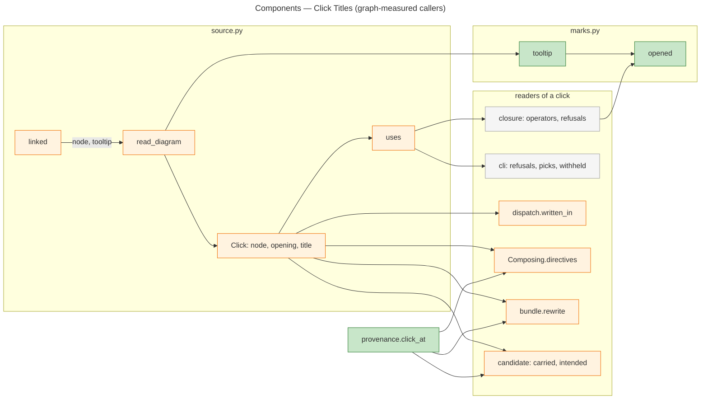
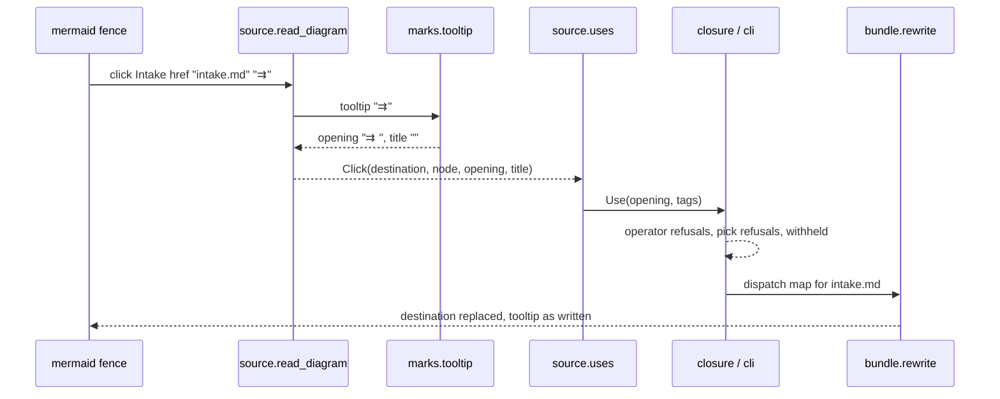

# Architecture Overview — Click Titles

> architecture-overview · [m2ux/prosiform#744](https://github.com/m2ux/prosiform/pull/744) · 2026-11-12

## Summary

The pull request reads a Mermaid `click` line's or class diagram `link` line's quoted tooltip as its link's operator and title. Marks opening the tooltip, followed by a blank or its end, are the operator; the rest selects presets. So `click Intake href "intake.md" "⇉"` bundles as a dispatch and `"¬"` as a deferral. A new `marks` module holds the operator marks, the source model splits each tooltip once, and every consumer of a link's opening or title reads that split. The corpus gains a fixture per rule, and the documentation states the rule in Diagram links. It builds epic [#739](https://github.com/m2ux/prosiform/issues/739)'s rows W01 to W03.

## Structure

The graph places `tooltip` under a single caller, `read_diagram`, and `opened` under `tooltip` and the closure and rewrite readers. Every flow the change touches runs through `uses` or `read_diagram`; the consumers below are the callers the graph reports for those two and for `clicks`.

Green is new, orange changed, grey a caller reading the changed result unchanged.

### Operator marks

- **`marks.opened`.**
  Reads the run of operator marks a link's text opens with and where its text begins. It moved here from `closure.py` unchanged, so the source model can use it without importing the closure.
- **`marks.tooltip`.**
  Splits one tooltip into an *opening* (the text the operator readers read, as they read a link's text) and a *title*. An all-marks tooltip is closed with a blank, so `"⇉"` opens as `"⇉ "` with an empty title; a mark followed directly by text opens nothing and the whole tooltip is the title.

### Source model

- **`QUOTED`, `CLICK_LINE`, `CLASS_LINK`.**
  Capture the tooltip and the node the line is drawn on, which the patterns matched and dropped before.
- **`Click`.**
  Gains `node`, `opening` and `title`. A sequence diagram's `link` and `links` carry none.
- **`uses`.**
  Yields a click with its opening and with tags read from its title, except a remote destination, which selects nothing.

### Consumers

- **`dispatch.written_in`.**
  Walks fences as well as inline blocks; `dispatched_link` builds a dispatched link from either. A click's link text is its node, since a tooltip may be all marks.
- **`Composing.directives`.**
  Walks fences too; `directive` resolves either form into a composition directive, located by `click_at`.
- **`bundle.rewrite`.**
  Rewrites a click's destination through `target` with its opening, tags and dispatch map, or to its contribution heading where it composes; the tooltip is left as written.
- **`candidate`.**
  `carried` gives a click use its opening as text and its title, `positions` locates it by `click_at`, and `intended` and `withdrawn` keep its tooltip and the line's destination as the bundle writes them.
- **`provenance.click_at`.**
  Locates a diagram link by its line, column 0 and its destination's offset, which tells apart two links on one line.

## Behaviour

The graph reports 169 affected flows; each passes through `uses`, `read_diagram`, `linked` or `opened`, as in `Compose → Diagram` and `References → Diagram`. The order for one click is:

- **Read.**
  The fence line yields destination, node and tooltip; the tooltip is split once.
- **Refuse.**
  The closure and command read the opening exactly as a link's text opening, so `"¬ ⇉"`, `"¬⇉"`, `"⇉⫽"`, `"⇉↳"` and `"⫽↳"` are refused with the click's line, and `?` is refused on any operator but a deferral.
- **Publish.**
  Only the destination changes: to a bundle file, a dispatch-set sub-section, a deferral's working-directory path, or a contribution heading.
- **Validate.**
  Candidate validation compares the click's opening, title and destination, so a tooltip the bundle changed fails `reference preservation`.

## What Changed

### Source model

- **The tooltip is captured and split once.**
  A click's opening and title come from one `tooltip` call, which every reader shares.

### Operators on clicks

- **Every operator applies to a click.**
  Dispatch, parallel sets, composition and deferral, with their refusals, read a click's opening as a link's.
- **A click's dispatch-set entry names its node.**
  The set lists a dispatched click by the node it is drawn on.

### Presets on clicks

- **The tooltip's title selects presets.**
  It carries the pick token as a link title does; a click carrying no tooltip selects none.

### Corpus

- **One fixture per rule.**
  Five new fixtures cover a dispatch, a deferral, a preset selection, an alternative pick and a refused combination; `diagram-tooltips-supply-no-preset-selection` is removed.

### Documentation

- **Diagram links states the rule.**
  Operators, Selection by reference, the glossary's pick and Selection link it, and every design link pins `9f1a8e2b5`.

## Reading Order

1. **[marks.py](https://github.com/m2ux/prosiform/blob/722e849a99b81f0c69e9f24521d3f63b2f37b85f/src/prosiform/marks.py#L42-L88)** — `opened` and `tooltip`: the one split every reader takes.
2. **[source.py: QUOTED and the line patterns](https://github.com/m2ux/prosiform/blob/722e849a99b81f0c69e9f24521d3f63b2f37b85f/src/prosiform/source.py#L161-L170)** — the captured node and tooltip.
3. **[source.py: read_diagram and linked](https://github.com/m2ux/prosiform/blob/722e849a99b81f0c69e9f24521d3f63b2f37b85f/src/prosiform/source.py#L873-L1090)** — where a `Click` takes its opening and title.
4. **[source.py: uses](https://github.com/m2ux/prosiform/blob/722e849a99b81f0c69e9f24521d3f63b2f37b85f/src/prosiform/source.py#L1219-L1266)** — the click as a use, its tags read from its title.
5. **[dispatch.py: written_in and dispatched_link](https://github.com/m2ux/prosiform/blob/722e849a99b81f0c69e9f24521d3f63b2f37b85f/src/prosiform/dispatch.py#L415-L503)** — dispatched clicks.
6. **[composition.py: directives and directive](https://github.com/m2ux/prosiform/blob/722e849a99b81f0c69e9f24521d3f63b2f37b85f/src/prosiform/composition.py#L300-L376)** — composing clicks.
7. **[bundle.py: rewrite](https://github.com/m2ux/prosiform/blob/722e849a99b81f0c69e9f24521d3f63b2f37b85f/src/prosiform/bundle.py#L643-L671)** — the destination rewritten as the operator states.
8. **[candidate.py: carried to withdrawn](https://github.com/m2ux/prosiform/blob/722e849a99b81f0c69e9f24521d3f63b2f37b85f/src/prosiform/candidate.py#L349-L515)** — validation holding the tooltip as written.
9. **[test_cli.py](https://github.com/m2ux/prosiform/blob/722e849a99b81f0c69e9f24521d3f63b2f37b85f/src/tests/test_cli.py)** and **[the click fixtures](https://github.com/m2ux/prosiform/tree/722e849a99b81f0c69e9f24521d3f63b2f37b85f/fixtures/dispatch)** — the published bytes for each operator.

## Risks and Watch Points

- **An all-marks tooltip carries a closing blank in its opening.**
  `"⇉↳"` is named in its refusal as `'⇉↳ '`. The epic records this as decided.
- **Fence walking replaced inline walking in dispatch and composition.**
  `written_in` and `directives` iterate `within` and branch on token type in place of `inlines`; inline links are found as before only while `within` yields every inline token `inlines` did. The unit, harness and corpus runs hold this.
- **Diagram link locations share the link location key.**
  `click_at` keys a click by its fence line, column 0 and destination offset; no inline block opens on a fence line, so it cannot collide with `link_at`.
- **A remote click's tooltip still opens an operator.**
  Its tags are dropped, but its opening reaches the operator refusals, which refuse an operator naming a remote address, as for a link.

## Measurements

- **Revision.** Index built with `gitnexus analyze --index-only` in the review worktree at `722e849a99b81f0c69e9f24521d3f63b2f37b85f`; up to date.
- **Comparison base.** Merge base of head and `main` is `4cb6b5c4eda9fb6728b4a378714c474dc47eaf2d`, the base itself.
- **Change surface.** `detect-changes --scope compare`: 53 files, 91 changed symbols (documentation sections among them), 169 affected flows, risk critical: the flows run through the source model's diagram reader, which every compilation reaches.
- **Symbol context.** `tooltip`: one caller, `read_diagram`; calls `opened`. `opened`: callers `closure.gapped`, `operators`, `published_text`, `unmarked`, `marks.tooltip` and `rewrite.edits`; 13 flows. `read_diagram`: caller `linking`; calls `tooltip` and `linked`. `uses`: callers in `cli` (composing_itself, linked, refusals_of_directives, refusals_of_operators, refusals_of_picks, required, resourced, withheld) and `closure.boundary`.
- **Tree.** The head's tree equals W03's head `47a1efe3`, the revision `make check` passed at.

## References

- **R1.** [Epic #739](https://github.com/m2ux/prosiform/issues/739) — acceptance criteria AC1 to AC6 and the Work Breakdown.
- **R2.** [#743](https://github.com/m2ux/prosiform/pull/743) — the build and fixtures (W01, W02).
- **R3.** [#745](https://github.com/m2ux/prosiform/pull/745) — the documentation (W03).
- **R4.** [Design: Link classification](https://github.com/m2ux/prosiform/blob/9f1a8e2b5/artifacts/planning/2026-10-17-prosiform-v1/design.md#link-classification-and-resource-handling) — the rule the build implements.
