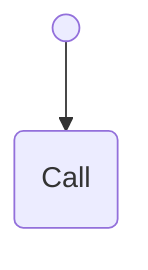

# § Instructions

Run `pf`, then follow the guidance it prints. Follow [Caller](#caller) next.

# Caller

## Graph

### Call

CONTRACT_SENTINEL

[⇉ Call](call.bundle.md)

#### Given

INPUT_SENTINEL

#### Leaves

OUTPUT_SENTINEL

#### Answers

ANSWER_SENTINEL
