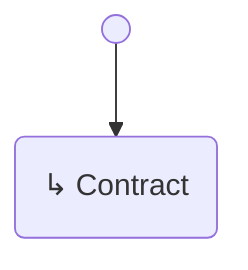

# § Instructions

Run `pf`, then follow the guidance it prints. Follow [Caller](#caller) next.

# Caller

## Graph

### Contract

#### Call

CONTRACT_SENTINEL

##### Given

INPUT_SENTINEL

##### Leaves

OUTPUT_SENTINEL

##### Answers

ANSWER_SENTINEL
