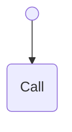

# § Instructions

Run `pf`, then follow the guidance it prints. Follow [Caller](#caller) next.

# Caller

## Graph

# Call

## Contract

CONTRACT_SENTINEL

### Given

INPUT_SENTINEL

### Leaves

OUTPUT_SENTINEL

### Answers

ANSWER_SENTINEL

## Implementation

IMPLEMENTATION_SENTINEL
