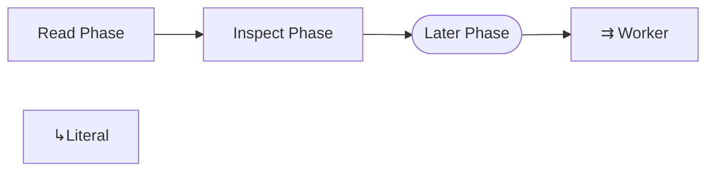

# § Instructions

Run `pf`, then follow the guidance it prints. Follow [Guide](#guide) next.

# Guide

## Flow

### Graph

#### Read Phase

Read the supplied record.

#### Read Phase

Read the supplied record.

#### Later Phase

[↳ Graph](../../source/later.md#graph)

# Read Phase

### Graph

Read the supplied record.
