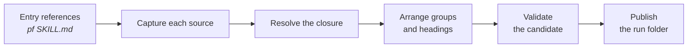
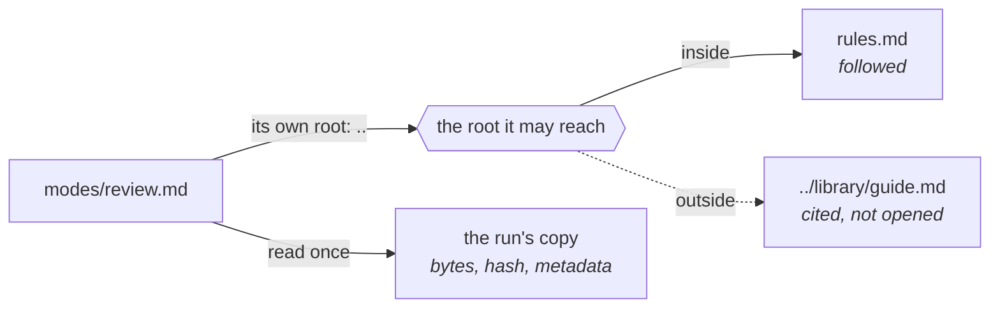
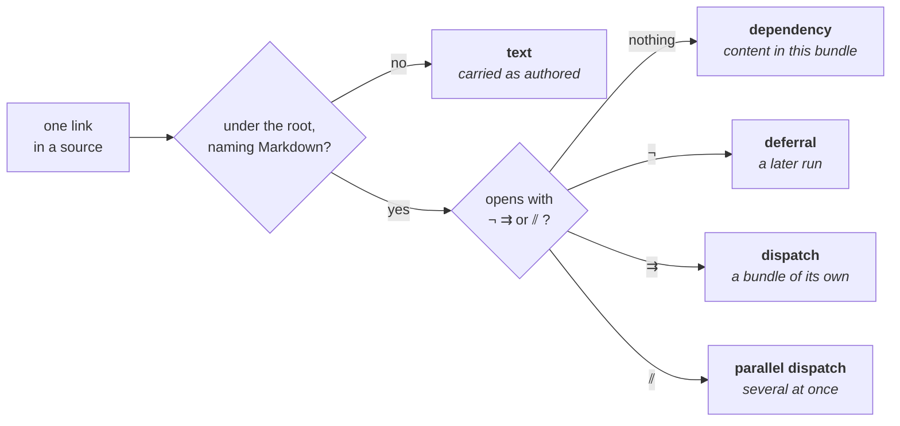
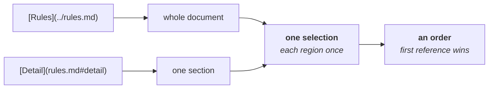
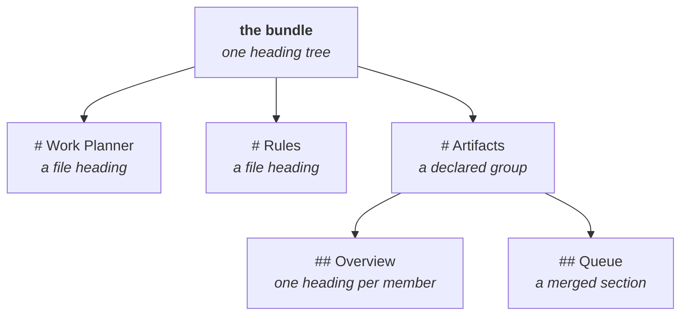
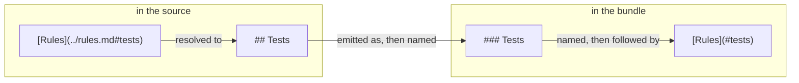
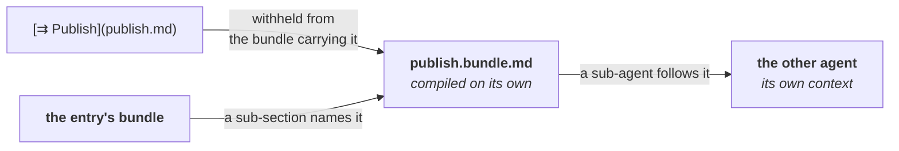
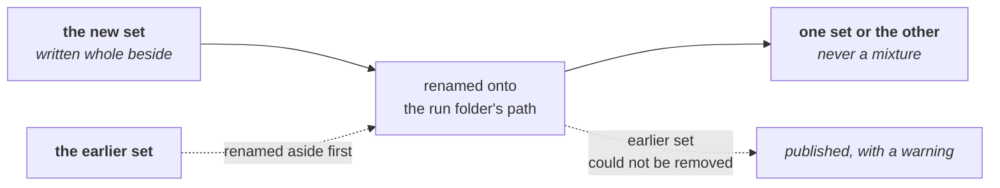
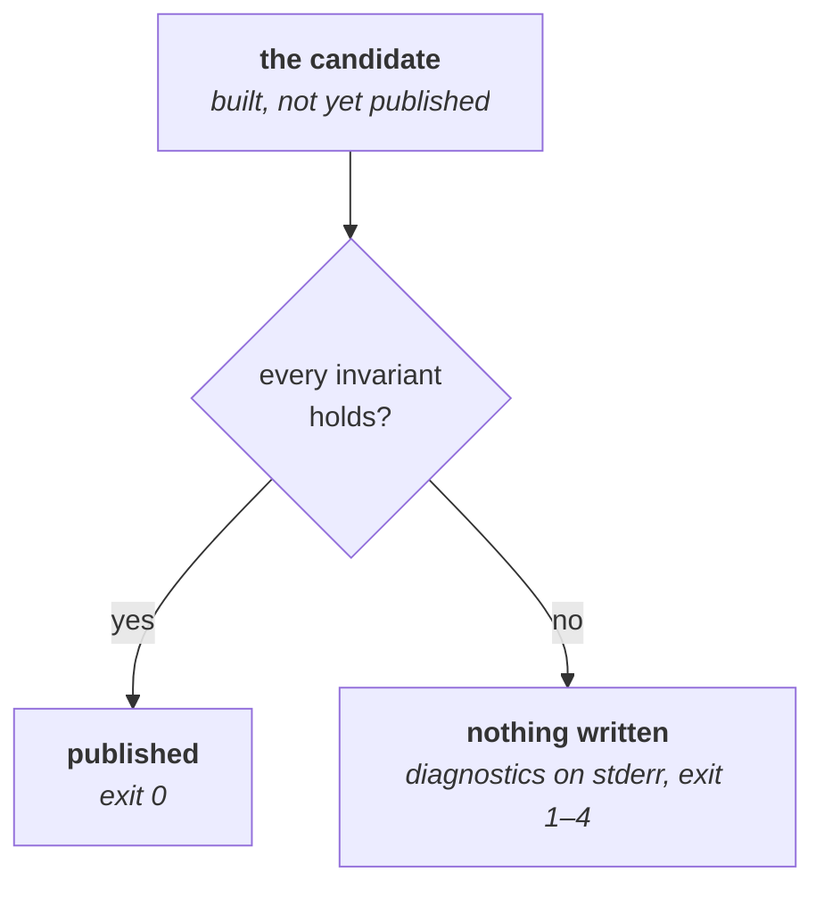

# Architecture

An instruction set for an AI agent is rarely one file. A `SKILL.md` links to a procedure, the procedure links to the rules that govern it, and the rules link onward to reference material. Anyone following that procedure — a person or an agent — has to chase the links to know what to do.

Prosiform chases them ahead of time. Given a document, or a section of one, it returns that text together with everything it links to, assembled as one Markdown file. That file is a **bundle**. A reader starts at the top and needs no further lookups.

The work of producing it is a **run**: read the files, follow the links, arrange the result, check it, write it out. This page names the parts of a run in the order they happen, and each section is the outline of a page that states one part in full.

*Figure 1. One Run, from Entry References to a Published Folder.*

## The words on these pages

Every term the contract uses has one meaning, defined once in the [glossary](glossary.md). These are the ones the rest of this page leans on.

| Word | Means |
| --- | --- |
| **source** | one Markdown file the run reads |
| **reference** | a link inside a source |
| **section** | one heading and everything beneath it, up to the next heading of the same or a higher level |
| **bundle** | the single Markdown file a run produces |
| **run** | one invocation, which produces a folder of bundles |

## Source

The run's raw material is Markdown files on disk. Each one it opens is a [**source**](sources.md), read once and held as bytes, so what was checked is what is published. Its **root** decides which of its links may be followed, and its **frontmatter** declares the metadata the run reads from it — which is how a mode in one directory can cite a rules file in the directory above, and why the frontmatter itself never reaches the bundle.

*Figure 2. A Source Is Read Once, and Its Root Decides What It May Reach.*

## Reference

The links inside a source are what the run follows. Each is a [**reference**](references.md). Most become **dependencies** and are pulled into the bundle. An **operator** on the link withholds it instead: a **deferral** leaves it to another run, a **dispatch** hands it to a sub-agent, and a **parallel dispatch** hands several over together.

*Figure 3. A Reference Is Either Followed, Carried, or Withheld.*

## Selection

Following the links answers which files join the bundle. It also has to answer which part of each file, and in what order — a reference may name a whole document or one section, and two references may name overlapping material. The run follows references until nothing new is reachable, keeps each region once, and settles them into one [**selection**](selection.md), ordered by where each document was first named.

*Figure 4. Overlapping References Settle into One Selection, in a Stated Order.*

## Hierarchy

A bundle is one Markdown document, so everything in it shares one heading tree. Every contributing source becomes one top-level division, headed by its title, following the [**hierarchy**](hierarchy.md) rules for grouping and depth. Documents that declare one **group** in their metadata are merged under a single heading instead, and source headings move down a level beneath whichever heading they land under.

*Figure 5. Every Source Becomes One Division, Unless It Declares a Group.*

## Destination

A reader finds their way around a Markdown document by its headings. When a section is copied into a bundle, a link that pointed at it in its own file must point at it in the bundle instead. Every emitted heading therefore takes a [**destination**](destinations.md) — the fragment a Markdown renderer generates for it — and each compiled link is rewritten to the destination of what it named. Nothing else is rewritten.

*Figure 6. The Heading Is Renamed Where It Lands, and the Link Follows It.*

## Dispatch

Some material is meant for a different agent rather than for the reader of this bundle. A [**dispatch**](dispatch.md) hands it over: the target is compiled as a bundle of its own in the same run folder, and the section that dispatched it says which bundle to follow.

*Figure 7. Withheld Here, Compiled There, Followed by Another Agent.*

## Bundle

The run's output reaches disk as files. It writes its [**bundles**](bundles.md) into one folder of its own, named for its entry, and swaps that folder in whole, so a reader sees one run's output or the previous one, never a mixture. Nothing else in the output folder is touched.

*Figure 8. The Whole Set Is Written, Then Swapped In.*

## Validation

A bundle that is subtly wrong is worse than no bundle, because a reader has no way to notice. Nothing is therefore published before every bundle of the run has been built and passed [**validation**](validation.md). A run that fails writes nothing and reports a diagnostic on standard error, with a stable code and an exit status that says what kind of failure it was.

*Figure 9. Checked Before Written, and a Failure Writes Nothing.*
