# Architecture

An instruction set for an AI agent is rarely one file. A `SKILL.md` links to a procedure, the procedure links to the rules that govern it, and the rules link onward to reference material. Anyone following that procedure — a person or an agent — has to chase the links to know what to do.

Prosiform chases them ahead of time. Given a document, or a section of one, it returns that text together with everything it links to, assembled as one Markdown file. That file is a **bundle**. A reader starts at the top and needs no further lookups.

The work of producing it is a **run**: read the files, follow the links, arrange the result, check it, write it out. This page names the parts of a run in the order they happen, and each section is the outline of a page that states one part in full.

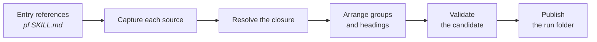

*Figure 1. One Run, from Entry References to a Published Folder.*

## Terms

Every term the contract uses has one meaning, defined once in the [glossary](glossary.md). These are the ones the rest of this page leans on.

| Word | Means |
| --- | --- |
| **source** | one Markdown file the run reads |
| **reference** | a link inside a source |
| **section** | one heading and everything beneath it, up to the next heading of the same or a higher level |
| **bundle** | the single Markdown file a run produces |
| **run** | one invocation, which produces a folder of bundles |

## Source

The run's raw material is Markdown files on disk. Each one it opens is a [**source**](sources.md), read once and held as bytes, so what was checked is what is published. Its **frontmatter** declares `prosiform` when the document is one a bundle carries, and a link is followed only to a document that declares — which is how a mode in one directory can carry a rules file in the directory above, and why the frontmatter itself never reaches the bundle.

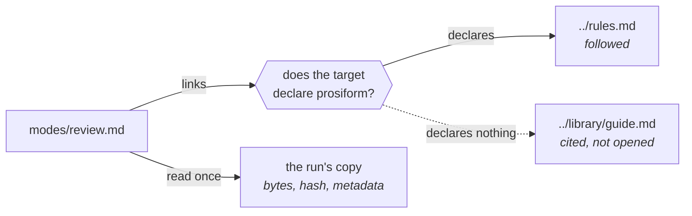

*Figure 2. A Source Is Read Once, and Each Target's Declaration Decides Whether It Is Followed.*

## Reference

The links inside a source are what the run follows. Each is a [**reference**](references.md). Most become **dependencies** and are pulled into the bundle. An **operator** on the link withholds it instead: a **deferral** leaves it to another run, a **dispatch** hands it to a sub-agent, and a **parallel dispatch** hands several over together. A link whose text opens with `↳` is a **composition directive**, which places the section it names beneath the section that writes it.

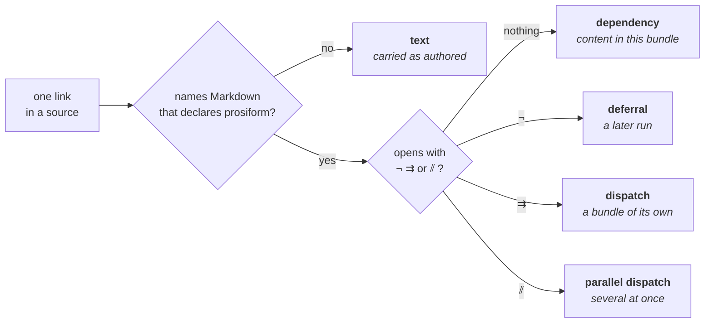

*Figure 3. A Reference Is Either Followed, Carried, or Withheld.*

## Selection

Following the links answers which files join the bundle. It also has to answer which part of each file, and in what order — a reference may name a whole document or one section, and two references may name overlapping material. The run follows references until nothing new is reachable, keeps each region once, and settles them into one [**selection**](selection.md), ordered by where each document was first named.

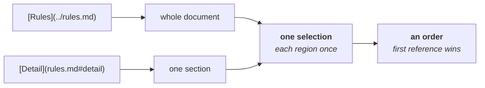

*Figure 4. Overlapping References Settle into One Selection, in a Stated Order.*

## Hierarchy

A bundle is one Markdown document, so everything in it shares one heading tree. Every contributing source becomes one division, headed by its title, following the [**hierarchy**](hierarchy.md) rules for grouping and depth. Documents that declare one **group** in their metadata are merged under a single heading instead, which nests inside the division of the document whose link placed its first member, and source headings move down a level beneath whichever heading they land under.

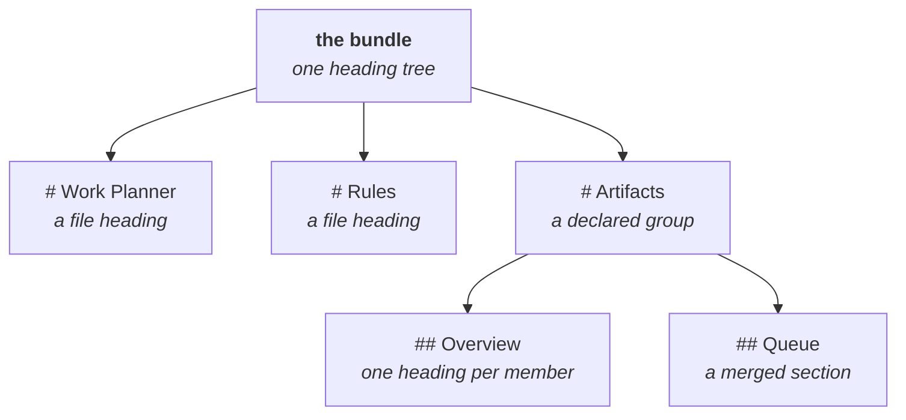

*Figure 5. Every Source Becomes One Division, Unless It Declares a Group.*

## Composition

A step can need a section stated in another document, such as the contract of a call it makes, beneath the step itself rather than in a division of its own. A [**composition directive**](composition.md), a link whose text opens with `↳`, places it there: the target's section becomes a **destination section** one level below the step, and each directive adds a **contribution** beneath it. The mark requests placement and carries no other meaning.

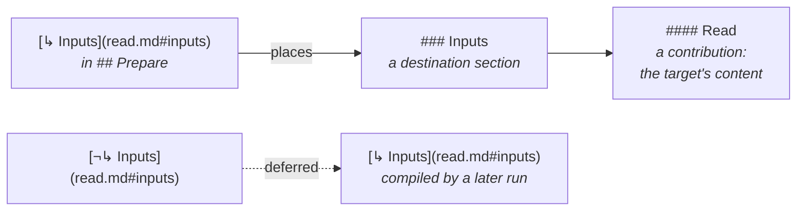

*Figure 6. A Directive Places Its Target Beneath the Section That Writes It.*

## Destination

A reader finds their way around a Markdown document by its headings. When a section is copied into a bundle, a link that pointed at it in its own file must point at it in the bundle instead. Every emitted heading therefore takes a [**destination**](destinations.md) — the fragment a Markdown renderer generates for it — and each compiled link is rewritten to the destination of what it named. Nothing else is rewritten.

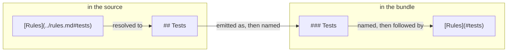

*Figure 7. The Heading Is Renamed Where It Lands, and the Link Follows It.*

## Dispatch

Some material is meant for a different agent rather than for the reader of this bundle. A [**dispatch**](dispatch.md) hands it over: the target is compiled as a bundle of its own in the same run folder, and the section that dispatched it says which bundle to follow.

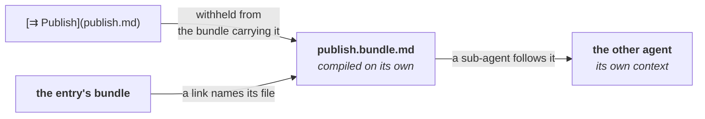

*Figure 8. Withheld Here, Compiled There, Followed by Another Agent.*

## Bundle

The run's output reaches disk as files. It writes its [**bundles**](bundles.md) into one folder of its own, named for its entry, and swaps that folder in whole, so a reader sees one run's output or the previous one, never a mixture. Nothing else in the output folder is touched.

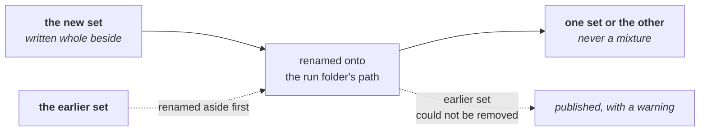

*Figure 9. The Whole Set Is Written, Then Swapped In.*

## Validation

A bundle that is subtly wrong is worse than no bundle, because a reader has no way to notice. Nothing is therefore published before every bundle of the run has been built and passed [**validation**](validation.md). A run that fails writes nothing and reports a diagnostic on standard error, with a stable code and an exit status that says what kind of failure it was.

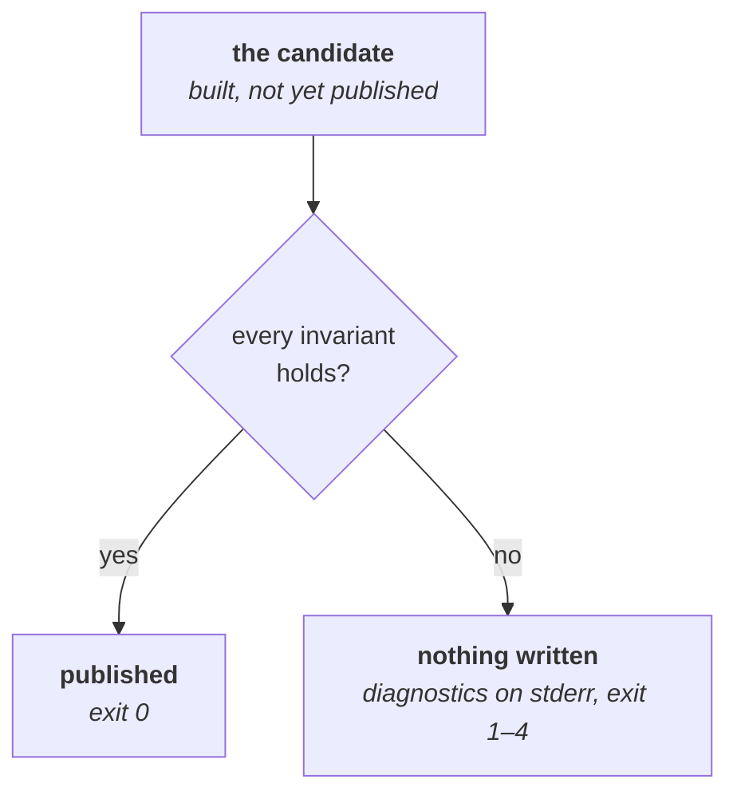

*Figure 10. Checked Before Written, and a Failure Writes Nothing.*

## Modules

The build in `src/prosiform` carries a run in sixteen modules beside the package's `__init__`, which names the profile. `cli` drives the run and calls the stages in turn; no other module calls back into it.

| Module | Responsibility |
| --- | --- |
| `cli` | The `pf` command: reads the command line and its budgets, compiles the entry's bundle and each dispatched one, puts presets and `subst` pairs in force, refuses misplaced operators and directives, and publishes the run folder. |
| `access` | Reads a source, or its frontmatter alone, through a rooted, no-follow directory walk, never past the budget it is given. |
| `source` | Holds one source: removes its byte-order mark and frontmatter, indexes its headings and their slugs, and lists its regions and the links it uses. |
| `metadata` | Decodes a frontmatter block's YAML into conversion settings: presets, `group` pairs and `subst` pairs. |
| `profile` | Configures the `skill-markdown-v4` parser, reads the diagram links in `mermaid` fences as uses, and refuses what the profile does not admit. |
| `closure` | Normalises each reference from the file that writes it, classifies it by its target's declaration, and reads its operators and any directive label. |
| `bundle` | Builds one file group per contributing source from its selected regions, under a file heading and with any structural ancestors, and joins the groups into the candidate. |
| `grouping` | Merges the members of a declared group under one heading, with their overview and variants. |
| `composition` | Places each composition directive's target in a destination section beneath the section that writes it. |
| `dispatch` | Inserts the `In parallel` sub-sections, and finds dispatch cycles, deep chains and self-dispatch. |
| `rewrite` | Rewrites each compiled link to its destination, turns reference-style uses into inline links, and drops definitions. |
| `heading` | Title-cases every heading the bundle generates. |
| `provenance` | Records the source range or generated heading each part of the candidate came from. |
| `candidate` | Reparses the candidate and holds it to its provenance before anything is published. |
| `limits` | Declares the eight budgets and counts each against its boundary. |
| `diagnostics` | Writes the diagnostic stream as text or JSON. |

A source's bytes become its content and settings, then the parser's tokens and uses, then classified references. The arranging modules turn the selection into groups, rewriting each link as a group is built and recording its provenance; validation reads that record against the reparsed candidate, and `cli` publishes what passes. `limits`, `diagnostics` and `heading` serve every stage.

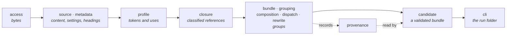

*Figure 11. Each Module Hands the Next What It Made.*
