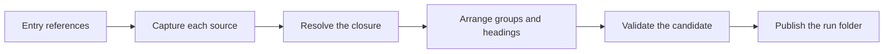

# Architecture

An instruction set for an AI agent is rarely one file. A `SKILL.md` links to a procedure, the procedure links to the rules that govern it, and the rules link onward to reference material. Anyone following that procedure — a person or an agent — has to chase the links to know what to do.

Prosiform chases them ahead of time. Given a document, or a section of one, it returns that text together with everything it links to, assembled as one Markdown file. That file is a **bundle**. A reader starts at the top and needs no further lookups.

The work of producing it is a **run**: read the files, follow the links, arrange the result, check it, write it out. This page names the parts of a run in the order they happen, and each section is the outline of a page that states one part in full.

## A run, end to end

A skill's entry point names one procedure. The procedure links the rules it is held to. The run is `pf SKILL.md`, and the three files become one bundle.

| Written | Compiled |
| --- | --- |
| **`SKILL.md`** `# Work Planner`  `Follow the [Review](modes/review.md) procedure.`  **`modes/review.md`** `---` `prosiform:` `  root: ".."` `---` `# Review Mode`  `Checks a change against the [Rules](../rules.md#tests).`  `## Procedure`  `1. Read the [Rules](../rules.md#tests).` `2. Report the findings.`  **`rules.md`** `# Rules`  `## Tests`  `A change lands with a test that fails without it.` | `# Work Planner`  `Follow the [Review](#review-mode) procedure.`  `# Review Mode`  `Checks a change against the [Rules](#tests).`  `## Procedure`  `1. Read the [Rules](#tests).` `2. Report the findings.`  `# Rules`  `### Tests`  `A change lands with a test that fails without it.` |

*Three files, one document. Every link now points inside the bundle: at a heading, which is where a reader lands.*

What changed is worth naming, because it is what the rest of these pages explain:

- The entry's own text comes first, as written.
- `modes/review.md` joined it as a whole document, headed by its title, and its `## Procedure` sits beneath that heading.
- `rules.md` joined the same way, its `## Tests` one level lower than its author wrote it.
- Both links were repointed from a path to a heading, so neither needs the file it used to name.

## The words on these pages

Every term the contract uses has one meaning, defined once in the [glossary](glossary.md). These are the ones the rest of this page leans on.

| Word | Means |
| --- | --- |
| **source** | one Markdown file the run reads |
| **reference** | a link inside a source |
| **section** | one heading and everything beneath it, up to the next heading of the same or a higher level |
| **bundle** | the single Markdown file a run produces |
| **run** | one invocation, which produces a folder of bundles |

*Figure 1. One Run, from Entry References to a Published Folder.*

## Source

The run's raw material is Markdown files on disk. Each one it opens is a **source**, read once and held as bytes, so what was checked is what is published. Its **root** decides which of its links may be followed, and its **frontmatter** declares the metadata the run reads from it — which is why `modes/review.md` above could reach `rules.md` one directory up, and why its own frontmatter is absent from the bundle.

[Sources](sources.md) covers capture, roots, frontmatter and the Markdown profile.

## Reference

The links inside a source are what the run follows. Each is a **reference**. Most become **dependencies** and are pulled into the bundle. An **operator** on the link withholds it instead: a **deferral** leaves it to another run, a **dispatch** hands it to a sub-agent, and a **parallel dispatch** hands several over together.

[References](references.md) covers each class, the operators, and what is never followed.

## Selection

Following the links answers which files join the bundle. It also has to answer which part of each file, and in what order — a reference may name a whole document or one section, and two references may name overlapping material. The run follows references until nothing new is reachable, keeps each region once, and orders the documents by where they were first named.

[Selection](selection.md) covers closure, consolidation and order.

## Hierarchy

A bundle is one Markdown document, so everything in it shares one heading tree. Every contributing source becomes one top-level division, headed by its title. Documents that declare one **group** in their metadata are merged under a single heading instead, and source headings move down a level beneath whichever heading they land under.

[Hierarchy](hierarchy.md) covers file headings, grouping, variants and depth.

## Destination

A reader finds their way around a Markdown document by its headings. When a section is copied into a bundle, a link that pointed at it in its own file must point at it in the bundle instead. Every emitted heading therefore takes a **destination** — the fragment a Markdown renderer generates for it — and each compiled link is rewritten to the destination of what it named. Nothing else is rewritten.

[Destinations](destinations.md) covers slugs, ordinals and rewriting.

## Dispatch

Some material is meant for a different agent rather than for the reader of this bundle. A **dispatch** hands it over: the target is compiled as a bundle of its own in the same run folder, and the section that dispatched it says which bundle to follow.

[Dispatch](dispatch.md) covers sub-sections, the protocol, depth and cycles.

## Bundle

The run's output reaches disk as files. The run writes them into one folder of its own, named for its entry, and swaps that folder in whole, so a reader sees one run's output or the previous one, never a mixture. Nothing else in the output folder is touched.

[Bundles](bundles.md) covers derived names, publication and delivery.

## Validation

A bundle that is subtly wrong is worse than no bundle, because a reader has no way to notice. Nothing is therefore published before every bundle of the run has been built and checked. A run that fails writes nothing and reports a diagnostic on standard error, with a stable code and an exit status that says what kind of failure it was.

[Validation](validation.md) covers the invariants, the diagnostics and the budgets.
