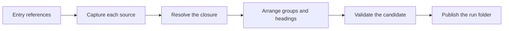

# Architecture

Prosiform compiles linked Markdown. Give it a document or a section, and it returns that material and every local Markdown dependency it reaches, as one validated document.

An agent following a procedure otherwise resolves its links while it works. That puts retrieval inside the reasoning task: prerequisites are missed, reads run wider than the task needs, and a shared rule is copied into every document that wants it. Prosiform takes one fixed answer instead, computed once, before the agent reads anything.

Each section below is the outline of one page, and the page is the account.

*Figure 1. One Run, from Entry References to a Published Folder.*

## Source

A **source** is one local Markdown document the run opens. It is read once, held as bytes, and hashed, so the document that was validated is the document that was published. Its **root** decides which of its links may be followed, and its **frontmatter** declares the metadata the run reads from it.

[Sources](sources.md) covers capture, roots, frontmatter and the Markdown profile.

## Reference

A **reference** is an authored link, or a diagram's link, to a local document or section. Most references become **dependencies** and are bundled. An **operator** on the link withholds it instead: a **deferral** leaves it to another run, a **dispatch** hands it to a sub-agent, and a **parallel dispatch** hands several over together.

[References](references.md) covers each class, the operators, and what is never followed.

## Selection

A reference selects a whole document or one **section**. The run follows references until nothing new is reachable, unions the selections so each region appears once, and orders the documents by where they were first named. A heading kept without its body preserves the outline of a partial selection.

[Selection](selection.md) covers closure, consolidation and order.

## Hierarchy

Every contributing source becomes one top-level division, headed by its title. Documents that declare one **group** in their metadata are merged under a single heading instead. Generated headings are written in title case, and source headings move down one level beneath them.

[Hierarchy](hierarchy.md) covers file headings, grouping, variants and depth.

## Destination

Every emitted heading takes a **destination**: the fragment a Markdown renderer generates for it. Each compiled link is rewritten to the destination of what it named, and nothing else is rewritten.

[Destinations](destinations.md) covers slugs, ordinals and rewriting.

## Dispatch

A dispatched target is compiled as a bundle of its own in the same run folder. The section that dispatches it gains a generated sub-section naming that bundle, and the bundle opens with a Prosiform section stating the protocol a sub-agent follows.

[Dispatch](dispatch.md) covers sub-sections, the protocol, depth and cycles.

## Bundle

The run writes its bundles into one folder of its own, named for its entry, and swaps that folder in whole. A reader sees one run's output or the previous one, never a mixture. Nothing else in the output folder is touched.

[Bundles](bundles.md) covers derived names, publication and delivery.

## Validation

Nothing is published before every bundle of the run has been built and checked. A run that fails writes nothing and reports a diagnostic on standard error, with a stable code and an exit status that says what kind of failure it was.

[Checking](checking.md) covers the invariants, the diagnostics and the budgets.
