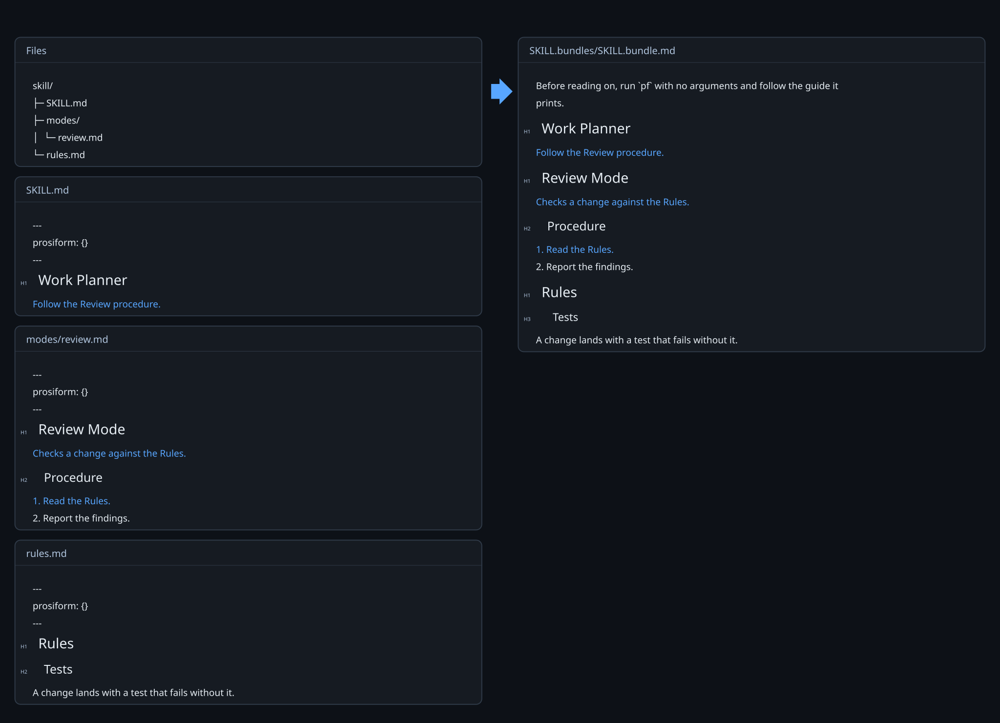
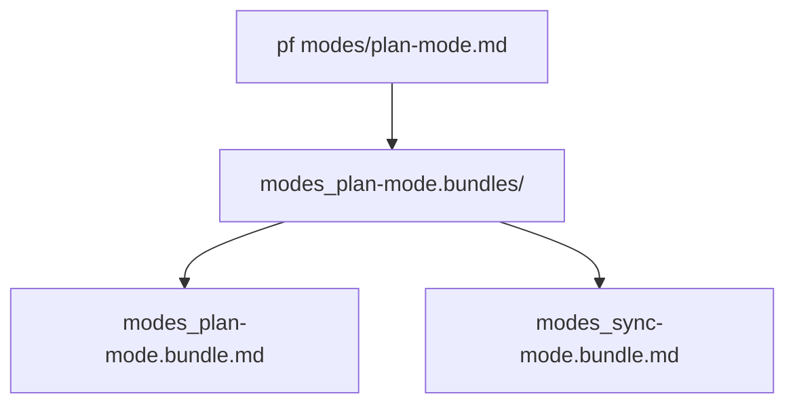
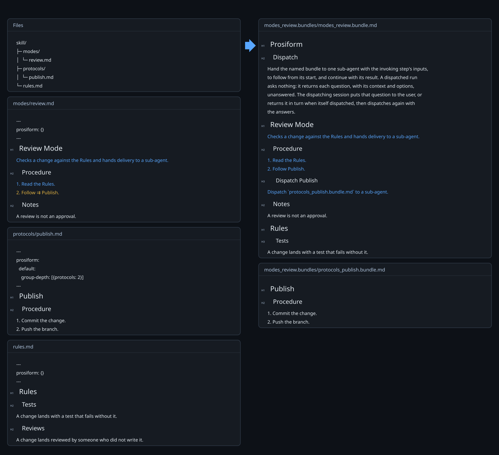
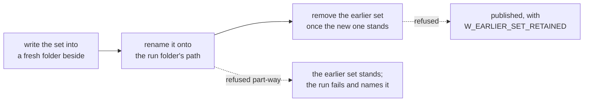

# Bundles

One command can produce more than one file. A bundle that dispatches work hands part of it to a sub-agent, and that part is a bundle of its own — so what reaches disk is not one document but a small set of them, published together.

That set is a **bundle set**: one bundle for the entry, and one for each effective selection the run's dispatches reach. A selection is its canonical document, fragment and matching named presets. Two dispatches of one document under different presets receive separate bundles; equivalent requests share one. The run writes them into a folder of its own, and the folder is what a reader is pointed at.

## The shape of a result

Three files show what a run does. `SKILL.md` links a procedure; the procedure links the rules it is held to.



*Three files read, one bundle written. The links that named other files now name headings in this one.*



*Figure 1. One Run Folder Holds the Entry's Bundle and Each Dispatched Target's.*

## Derived names

A selection's name is its path relative to the working directory, without the Markdown suffix, with each separator written as `_`. A section adds `__` and the fragment.

A selection includes the effective named presets its destination declares. A nonempty set appends `--p-` and the lowercase SHA-256 digest of its canonical serialization: a UTF-8 JSON array of distinct matched names, preserving declaration spelling, sorted by Unicode code point, with no whitespace and without ASCII escaping. Unknown names, tag order, case and repetition do not change that effective set. An empty set adds no qualifier.

The entry name with `.bundles` appended names the run folder; with `.bundle.md` appended it names the entry bundle. Each dispatched selection uses its own name inside that same folder.

The example is a real run of a small skill: one mode that dispatches one protocol. Each panel's header is the file's path, so the bundle panels show the folder each one was written into.



*The entry names the folder. The dispatched target sits beside it under its own selection's name, with its own preset qualifier where selected.*

Each dispatched target's bundle sits in the same folder under its own selection's name.

Directories and group names never rename an output. Parent segments above the working directory are kept as filename text, never joined into the output path.

File and directory names use hyphens rather than underscores. A path separator is written as `_` in that derived name, and an underscore in the source path is written as `_` there too, so a hyphen keeps a directory boundary visible in the filename. A source path that contains an underscore remains valid and compiles.

Two bundles of one run that derive one name are refused with `E_PUBLICATION_FAILED`, naming both selections, before any bundle is written: an entry `a/b.md` dispatching `a_b.md` is one such run. So is a run folder or bundle name longer than the output folder's filesystem allows, naming the selection it derives from.

## Command blocks

A [command block](sources.md#the-profile) is written for a renderer, and a bundle is read as text, so the bundle emits the block as its content. The `<big><pre>` and `</pre></big>` tags are dropped, and so is a line they leave holding nothing else. A strong emphasis enclosing a link's whole text is unwrapped, and each character reference the parser decodes as text is written as the character it names, such as `&lt;` as `<`, `&gt;` as `>` and `&#92;` as `\`, while one in a code span, a link's destination or title or an autolink, one after a backslash and one naming no character stay as written. A line the compaction leaves opening with a character the parser would read as a block of its own, such as the `>` a decoded `&gt;` writes or a `#` the dropped tags leave first, takes a backslash before that character, or before the delimiter after a list number, so every line stays the text of the block's paragraph. Other emphasis stays, and the links are rewritten as any paragraph's are. The block the sources page shows reaches the bundle as:

```markdown
pf --out '[<folder>](#folder)' \
  [<entry>](#entry)
```

A backslash ending a line is a hard line break, so the lines keep the breaks the source wrote. Character references and emphasis outside a command block are emitted as written. Validation reads the raw `<folder>` a decoded reference leaves as the text it spells.

## Publication

The run folder is written whole beside the earlier one and renamed onto it. An earlier set standing there is renamed aside first and removed once the new folder stands, so a reader sees one run's set or the one before it, never a mixture.

Nothing else in the output folder is touched, including an author's folder named like the entry. A symbolic link standing at the run folder's path is replaced as the link it is, and whatever it names is left as it was. Anything else at that path, a regular file among them, is material no run wrote: the run refuses it with `E_PUBLICATION_FAILED`, under `-c` as without it, and leaves it where it stands.

A failure before the new folder stands removes it and leaves the output folder as it was. An earlier set that cannot be removed once the new one stands leaves the run published, and warns with the path that holds it.



*Figure 2. The Swap In Order, and What Each Refusal Leaves Behind.*

## The output folder

`-o DIR` names the folder the run's own folder is written into, made with any absent parents if it is absent. The working directory is the default. `-o -` is refused: standard output carries no bundle, only the guide, an informational response, or nothing.

A run folder holding any source the run reads is refused, so a run can never write over its own input.

An output folder the run cannot make is refused with `E_PUBLICATION_FAILED`. `-c` runs every check publication holds — the output budget, the names, and what stands at the run folder's path — and writes no bundle; it makes an absent output folder as a publishing run does.

## Delivery

Publication is not delivery. A bundle written to disk has been validated; whether a caller's transport carried every byte to an agent is a separate fact the caller checks.

An agent-facing wrapper should therefore:

- check the process exit status rather than the presence of Markdown
- verify complete output and refuse one larger than its transport, rather than truncating it
- never substitute a summary, a partial document, or a list of links for oversized output

The bundle itself carries no commentary. Completion counts, warnings and diagnostics belong to the caller's structured result, never to per-section envelopes inside the bundle.
