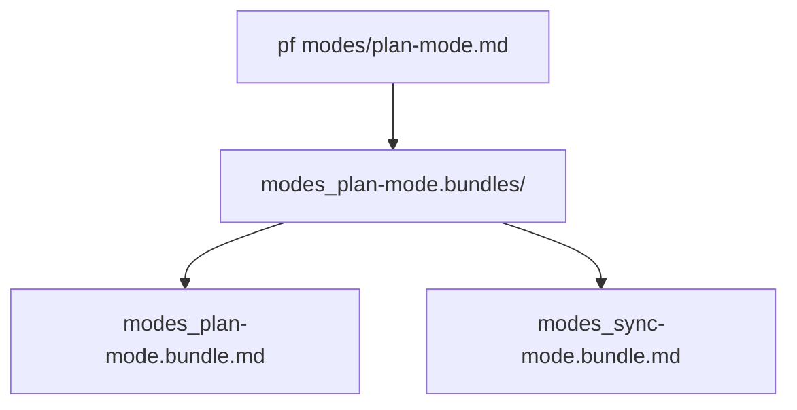
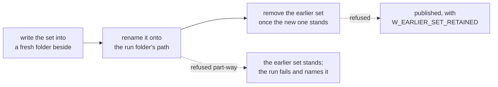

# Bundles

One command can produce more than one file. A bundle that dispatches work hands part of it to a sub-agent, and that part is a bundle of its own — so what reaches disk is not one document but a small set of them, published together.

That set is a **bundle set**: one bundle for the entry, and one for each target the run's dispatches reach. The run writes them into a folder of its own, and the folder is what a reader is pointed at.

*Figure 1. One Run Folder Holds the Entry's Bundle and Each Dispatched Target's.*

## Derived names

A selection's name is its path relative to the working directory, without the Markdown suffix, with each separator written as `_`. A section adds `__` and the fragment.

A run of several selections joins their names with `+`, in the order the command line first names each; equivalent references count once. The joined name names the run's folder with `.bundles` appended, and the entry's bundle with `.bundle.md` appended.

The example is a real run of a small skill: one mode that dispatches one protocol.

| Written | On disk |
| --- | --- |
| **`modes/review.md`** (the entry) `# Review Mode`  `## Procedure`  `1. Read the [Rules](../rules.md#tests).` `2. Follow [⇉ Publish](../protocols/publish.md).`  **`protocols/publish.md`** (dispatched, no content here) | `modes_review.bundles/` `  modes_review.bundle.md` `  protocols_publish.bundle.md` |

*The entry names the folder. The dispatched target sits beside it under its own selection's name, with no `+` in it.*

Each dispatched target's bundle sits in the same folder under its own selection's name.

A fragment-only entry derives its name from the document `-f` supplies. Roots and group names never rename an output. Parent segments above the working directory are kept as filename text, never joined into the output path.

File and directory names use hyphens rather than underscores. A path separator is written as `_` in that derived name, and an underscore in the source path is written as `_` there too, so a hyphen keeps a directory boundary visible in the filename. A source path that contains an underscore remains valid and compiles.

Two bundles deriving one name — `a/b.md` and `a_b.md` — fail the run before anything is written.

## Publication

The run folder is written whole beside the earlier one and renamed onto it. Whatever stood there is renamed aside first and removed once the new folder stands, so a reader sees one run's set or the one before it, never a mixture.

Nothing else in the output folder is touched, including an author's folder named like the entry. A symbolic link standing at the run folder's path is replaced as the link it is, and whatever it names is left as it was.

A failure before the new folder stands removes it and leaves the output folder as it was. An earlier set that cannot be removed once the new one stands leaves the run published, and warns with the path that holds it.

*Figure 2. The Swap In Order, and What Each Refusal Leaves Behind.*

## The output folder

`-o DIR` names an existing folder the run's own folder is written into. The working directory is the default. `-o -` is refused: standard output carries no bundle, only the guide, an informational response, or nothing.

A run folder holding any source the run reads is refused, so a run can never write over its own input.

## Delivery

Publication is not delivery. A bundle written to disk has been validated; whether a caller's transport carried every byte to an agent is a separate fact the caller checks.

An agent-facing wrapper should therefore:

- check the process exit status rather than the presence of Markdown
- verify complete output and refuse one larger than its transport, rather than truncating it
- never substitute a summary, a partial document, or a list of links for oversized output

The bundle itself carries no commentary. Completion counts, warnings and diagnostics belong to the caller's structured result, never to per-section envelopes inside the bundle.
