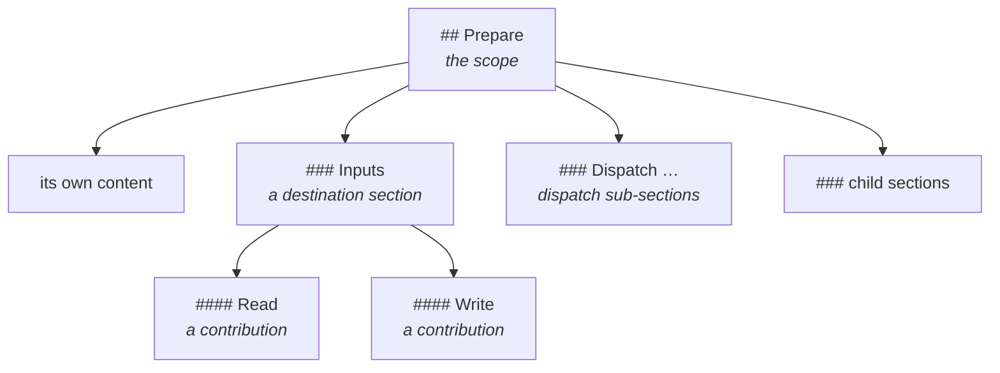

# Composition

A procedure step often needs material stated elsewhere: the contract of a call it makes, the shape of what it reads. Linking that material bundles it as a division of its own, away from the step. A **composition directive** places it beneath the step instead.

A directive is a link whose label is one arrow, as in `[→](read.md#inputs)`. The label requests placement and nothing else. Every arrow means the same, and the run reads no meaning into a label or into the title of the section it places.

The design's [Section composition](https://github.com/m2ux/prosiform/blob/engineering/artifacts/planning/2026-10-17-prosiform-v1/design.md#section-composition) section states every rule in full. This page outlines each one, names the design rule it summarises, and lists the [fixtures](../fixtures/README.md) that hold a build to it.

## What it looks like

One step writes three directives, naming sections of two documents. Both documents carry a section titled `Inputs`, so those two targets share one destination section:

```markdown
## Prepare

Read the path [→](read.md#inputs), then write the text [→](write.md#inputs).

Keep what was read [→](read.md#outputs).
```

The bundle places the targets beneath the step that wrote them:

```markdown
## Prepare

Read the path [→](#read), then write the text [→](#write).

Keep what was read [→](#read-1).

### Inputs

#### Read

The path to read.

#### Write

The text to write.

### Outputs

#### Read

The text read.
```

*From [titles-from-several-sources-share-one-destination-section](../fixtures/composition/titles-from-several-sources-share-one-destination-section). Each directive keeps its label and points at the heading naming its target's parent.*

## Recognition

A link is a directive where its label is plain text of exactly one arrow once entities are decoded, so `[&rarr;](a.md#out)` qualifies and a supplementary-plane `[🡒](a.md#out)` does too. An arrow is a scalar of the four Arrows blocks, or a Dingbats or Miscellaneous Symbols and Arrows scalar whose Unicode name holds `ARROW`, as the [glossary](glossary.md) defines it.

Anything else is an ordinary link: a footnote mark, a superscript, a letter, a label with a blank, emphasis or code around the arrow, two arrows, and a multi-scalar sequence. Reference-style links qualify like inline ones; an arrow inside code or unresolved brackets is text.

Design rule: *Recognition*. Fixtures:

- [a-supplementary-arrow-label-is-a-directive](../fixtures/composition/a-supplementary-arrow-label-is-a-directive)
- [an-entity-decoding-to-one-arrow-is-a-directive](../fixtures/composition/an-entity-decoding-to-one-arrow-is-a-directive)
- [a-reference-style-glyph-label-is-a-directive](../fixtures/composition/a-reference-style-glyph-label-is-a-directive)
- [non-arrow-labels-are-ordinary-links](../fixtures/composition/non-arrow-labels-are-ordinary-links)
- [ascii-and-spaced-labels-are-ordinary-links](../fixtures/composition/ascii-and-spaced-labels-are-ordinary-links)
- [formatted-labels-are-ordinary-links](../fixtures/composition/formatted-labels-are-ordinary-links)
- [multi-scalar-labels-are-ordinary-links](../fixtures/composition/multi-scalar-labels-are-ordinary-links)
- [a-glyph-in-code-or-unresolved-brackets-is-text](../fixtures/composition/a-glyph-in-code-or-unresolved-brackets-is-text)

## Operator marks

The [operators](references.md#operators) and a directive's label share one rule: symbols are written together, with no blank between them, and the one blank stands between the last symbol and the link's text. A directive's label is its whole text, so a mark written against it takes no blank at all.

| Written | Read as |
| --- | --- |
| `[→](a.md#out)` | a directive |
| `[¬→](a.md#out)` | a deferred directive, published with the label `→` |
| `[⇉](a.md)`, `[↳](a.md)` | ordinary links: `⇉` opens a dispatch and `↳` names an inline target, so neither labels a directive |
| `[¬ →](a.md#out)`, `[⇉ →](a.md#out)` | refused: a blank between two symbols states no one operation |
| `[⇉→](a.md#out)`, `[⫽→](a.md#out)`, `[¬⇉→](a.md#out)` | refused: a dispatch sends material to a sub-agent and a directive places it inline, so the two contradict |
| `[¬⇉ the rules](rules.md)` | a deferred dispatch, as [Operators](references.md#operators) states |
| `[¬ the rules](rules.md)` | a deferral, which withholds its target from this bundle |

Design rules: *Operator marks*, and *Operators that combine* under [Link classification and resource handling](https://github.com/m2ux/prosiform/blob/engineering/artifacts/planning/2026-10-17-prosiform-v1/design.md#link-classification-and-resource-handling). Fixtures:

- [a-glyph-written-against-the-deferral-mark-is-a-deferred-directive](../fixtures/composition/a-glyph-written-against-the-deferral-mark-is-a-deferred-directive)
- [operator-marks-are-no-directive-label](../fixtures/composition/operator-marks-are-no-directive-label)
- [an-ordinary-deferred-label-is-a-deferral](../fixtures/composition/an-ordinary-deferred-label-is-a-deferral)
- [a-blank-between-the-deferral-mark-and-a-glyph-is-refused](../fixtures/composition/a-blank-between-the-deferral-mark-and-a-glyph-is-refused)
- [a-blank-between-the-dispatch-mark-and-a-glyph-is-refused](../fixtures/composition/a-blank-between-the-dispatch-mark-and-a-glyph-is-refused)
- [a-dispatch-mark-written-against-a-glyph-is-refused](../fixtures/composition/a-dispatch-mark-written-against-a-glyph-is-refused)

## The target

A directive names a section of a document that declares `prosiform`, resolved as any reference is, the writing document's `subst` included. A missing document or section fails with `E_TARGET_NOT_FOUND`. A whole document, a document that declares nothing, a remote address and a resource are refused with `E_UNSUPPORTED_CONSTRUCT`, because none of them is a section to place.

Design rule: *The eligible target*. Fixtures:

- [a-directive-naming-a-missing-document-is-refused](../fixtures/composition/a-directive-naming-a-missing-document-is-refused)
- [a-directive-naming-a-missing-section-is-refused](../fixtures/composition/a-directive-naming-a-missing-section-is-refused)
- [a-directive-naming-a-whole-document-is-refused](../fixtures/composition/a-directive-naming-a-whole-document-is-refused)
- [a-directive-naming-a-document-that-declares-nothing-is-refused](../fixtures/composition/a-directive-naming-a-document-that-declares-nothing-is-refused)
- [a-deferred-directive-naming-a-document-that-declares-nothing-is-refused](../fixtures/composition/a-deferred-directive-naming-a-document-that-declares-nothing-is-refused)
- [a-directive-naming-a-remote-address-is-refused](../fixtures/composition/a-directive-naming-a-remote-address-is-refused)
- [a-directive-naming-a-resource-is-refused](../fixtures/composition/a-directive-naming-a-resource-is-refused)

## Where it lands

The **scope** is the section holding the directive, at the heading the bundle emits for it. A directive in a preamble, or in a heading the bundle emits as text alone, has no scope and is refused.

Beneath the scope, one level down, each target title takes one **destination section**; directives in one scope naming same-titled targets share it, and sibling steps each carry their own. Beneath that, each directive adds a **contribution**: a heading naming the target's parent, then the target's body and subsections at their relative depth. A target with no parent heading is refused. Titles match exactly as written, so `Inputs` and `inputs` are two titles.



*Figure 1. Destination Sections Follow the Scope's Own Content and Precede Its Dispatch Sub-Sections and Child Sections.*

Destination sections stand in the order their first directive is written, and contributions within one in the order their directives are. A composed heading past H6 fails with `E_HEADING_DEPTH_OVERFLOW`, and an authored child heading of the scope equal to a destination section's fails with `E_HEADING_COLLISION`.

Design rules: *The destination scope*, *Destination sections*, *Contributions*, *Heading depth*, *Generated heading collisions*, *Order*, *Matching* and *The directive's link*. Fixtures:

- [a-glyph-label-in-a-preamble-has-no-scope](../fixtures/composition/a-glyph-label-in-a-preamble-has-no-scope)
- [a-directive-in-an-absorbed-title-has-no-scope](../fixtures/composition/a-directive-in-an-absorbed-title-has-no-scope)
- [a-directive-in-a-title-above-the-selection-has-no-scope](../fixtures/composition/a-directive-in-a-title-above-the-selection-has-no-scope)
- [sibling-steps-each-carry-their-own-destination-section](../fixtures/composition/sibling-steps-each-carry-their-own-destination-section)
- [titles-from-several-sources-share-one-destination-section](../fixtures/composition/titles-from-several-sources-share-one-destination-section)
- [same-titled-parents-keep-a-contribution-each](../fixtures/composition/same-titled-parents-keep-a-contribution-each)
- [a-target-with-no-parent-heading-is-refused](../fixtures/composition/a-target-with-no-parent-heading-is-refused)
- [nested-headings-keep-their-relative-depth](../fixtures/composition/nested-headings-keep-their-relative-depth)
- [a-multi-paragraph-body-is-carried-whole](../fixtures/composition/a-multi-paragraph-body-is-carried-whole)
- [a-list-is-carried-as-written](../fixtures/composition/a-list-is-carried-as-written)
- [a-table-is-carried-as-written](../fixtures/composition/a-table-is-carried-as-written)
- [a-directive-composing-past-the-sixth-level-is-refused](../fixtures/composition/a-directive-composing-past-the-sixth-level-is-refused)
- [an-authored-heading-equal-to-a-destination-section-is-refused](../fixtures/composition/an-authored-heading-equal-to-a-destination-section-is-refused)
- [destination-sections-follow-first-reference-order](../fixtures/composition/destination-sections-follow-first-reference-order)
- [titles-match-exactly-as-written](../fixtures/composition/titles-match-exactly-as-written)

## Composed content

A contribution is its source's content. Its links resolve from its source's directory and against its source's definitions, a diagnostic inside it names that source, and a document it links is bundled, deferred or dispatched as from anywhere else. Every directive contributes, a repeated one included, and an ordinary link to the same section keeps its own meaning.

A document reached only through directives contributes to its contributions alone: no file group and no copy of its own. A document an ordinary link also reaches keeps that inclusion beside its contributions. A dispatch written inside an inline-only contribution takes its own dispatch sub-section one level below the contribution heading holding it, as [Dispatch](dispatch.md#sub-sections) places one beneath any section.

A directive inside composed content composes beneath the heading holding it there.

Design rules: *The source of composed content*, *Every occurrence composes*, *Inline-only targets* and *Nested directives*. Fixtures:

- [a-contribution-resolves-links-from-its-source-directory](../fixtures/composition/a-contribution-resolves-links-from-its-source-directory)
- [colliding-definitions-resolve-against-their-own-source](../fixtures/composition/colliding-definitions-resolve-against-their-own-source)
- [a-diagnostic-inside-a-contribution-names-its-source](../fixtures/composition/a-diagnostic-inside-a-contribution-names-its-source)
- [a-link-inside-a-contribution-includes-its-target](../fixtures/composition/a-link-inside-a-contribution-includes-its-target)
- [a-repeated-directive-contributes-each-time](../fixtures/composition/a-repeated-directive-contributes-each-time)
- [ordinary-and-composing-links-to-one-section-each-keep-their-meaning](../fixtures/composition/ordinary-and-composing-links-to-one-section-each-keep-their-meaning)
- [a-target-only-directives-reach-takes-no-group](../fixtures/composition/a-target-only-directives-reach-takes-no-group)
- [an-inclusion-of-another-section-keeps-only-that-section](../fixtures/composition/an-inclusion-of-another-section-keeps-only-that-section)
- [an-inclusion-of-the-composed-section-keeps-its-group](../fixtures/composition/an-inclusion-of-the-composed-section-keeps-its-group)
- [a-dispatch-in-an-inline-only-contribution-takes-its-own-sub-section](../fixtures/composition/a-dispatch-in-an-inline-only-contribution-takes-its-own-sub-section)
- [a-directive-inside-a-contribution-composes-beneath-it](../fixtures/composition/a-directive-inside-a-contribution-composes-beneath-it)

## Cycles and self-composition

A directive whose target holds it, or holds a directive on the chain that placed it, would compose without end, so the run publishes nothing and fails with `E_UNSUPPORTED_CONSTRUCT`, naming the closing directive, each earlier one and the chain of sections. A directive naming a section of its own document, by fragment or by its own path, places material that document already carries; where it closes no cycle, the run publishes and warns with `W_COMPOSE_SELF`. A deferred directive composes nothing in the run, so it closes no cycle and raises no warning.

Design rules: *Composition cycles* and *Composing its own document*. Fixtures:

- [a-directive-composing-its-own-section-is-refused](../fixtures/composition/a-directive-composing-its-own-section-is-refused)
- [a-contribution-composing-its-own-section-is-refused](../fixtures/composition/a-contribution-composing-its-own-section-is-refused)
- [a-cycle-of-directives-is-refused](../fixtures/composition/a-cycle-of-directives-is-refused)
- [a-directive-composing-a-section-of-its-own-document-by-fragment-warns](../fixtures/composition/a-directive-composing-a-section-of-its-own-document-by-fragment-warns)
- [a-directive-composing-a-section-of-its-own-document-by-path-warns](../fixtures/composition/a-directive-composing-a-section-of-its-own-document-by-path-warns)

## Budgets

Composition adds no budget of its own. Each contribution's bytes count toward `output-bytes` as it is composed, so a multiplying composition fails at the first contribution crossing it, and each directive is a hop toward `depth`. [Validation](validation.md#budgets) states the budgets.

Design rule: *Budgets*. Fixtures:

- [a-multiplying-composition-crossing-the-output-budget](../fixtures/composition/a-multiplying-composition-crossing-the-output-budget)
- [a-directive-is-a-hop-toward-the-expansion-depth](../fixtures/composition/a-directive-is-a-hop-toward-the-expansion-depth)

## Presets and `subst`

A directive is a reference, so its scope's title selects the target's presets as [Selection](selection.md#presets-in-force) states, and they govern the contribution: their `subst` redirects the links the contribution writes. The writer's own `subst` redirects the directive itself. A `group` pair places a document's sections where an ordinary reference bundles it, so it places no contribution.

An immediate directive is held to no heading of its target. A deferred one is compiled later under the presets its target's own heading selects, so a deferred directive whose scope title selects other presets of the target is refused with `E_UNSUPPORTED_CONSTRUCT`, naming both selections.

Design rule: *Presets and `subst`*. Fixtures:

- [a-selected-preset-governs-the-contribution](../fixtures/composition/a-selected-preset-governs-the-contribution)
- [the-writers-subst-redirects-a-directive](../fixtures/composition/the-writers-subst-redirects-a-directive)
- [a-selected-group-pair-places-no-contribution](../fixtures/composition/a-selected-group-pair-places-no-contribution)
- [an-immediate-directive-is-held-to-no-target-heading](../fixtures/composition/an-immediate-directive-is-held-to-no-target-heading)
- [a-deferral-whose-step-and-target-select-no-preset-is-kept](../fixtures/composition/a-deferral-whose-step-and-target-select-no-preset-is-kept)
- [a-deferral-whose-step-and-target-select-one-preset-is-kept](../fixtures/composition/a-deferral-whose-step-and-target-select-one-preset-is-kept)
- [a-deferral-whose-step-selects-a-preset-its-target-does-not-is-refused](../fixtures/composition/a-deferral-whose-step-selects-a-preset-its-target-does-not-is-refused)
- [a-deferral-whose-target-selects-a-preset-its-step-does-not-is-refused](../fixtures/composition/a-deferral-whose-target-selects-a-preset-its-step-does-not-is-refused)

## Deferred directives

A deferred directive contributes no content, but keeps its place: the run emits its destination section and contribution heading, the directive's link points at that heading, and the contribution's body is one generated line, `[↳ <title>](<path>)`, naming the target's heading and its path from the invocation working directory.

```markdown
## Fetch the page

Call the fetcher [→](fetch.md#contract); its body is composed by a later run [¬→](fetch.md#implementation).
```

compiles to

```markdown
## Fetch the page

Call the fetcher [→](#fetch); its body is composed by a later run [→](#fetch-1).

### Contract

#### Fetch

Takes a URL and returns the page it names.

### Implementation

#### Fetch

[↳ Implementation](fetch.md#implementation)
```

*From [a-composed-contract-leaves-its-deferred-implementation-absent](../fixtures/composition/a-composed-contract-leaves-its-deferred-implementation-absent).*

A scope composes a section or defers it: one scope holding an immediate and a deferred directive naming one section is refused.

The `↳` line names the run that activates the target: `pf fetch.md#implementation` compiles it as an entry under every rule an entry is, composing its own immediate directives and deferring its deferred ones again. The guide `pf` prints, as [Invocation](../invocation.md) states, tells an agent to compile, read and follow each `↳` line. A dispatched bundle carrying such a line opens with a `Run pf first` sub-section, because its sub-agent has run no `pf`, as [The Prosiform section](dispatch.md#the-prosiform-section) states.

Design rules: *Deferred composition* and *Activation*, and *The Prosiform section*. Fixtures:

- [a-composed-contract-leaves-its-deferred-implementation-absent](../fixtures/composition/a-composed-contract-leaves-its-deferred-implementation-absent)
- [a-section-composed-and-deferred-in-one-step-is-refused](../fixtures/composition/a-section-composed-and-deferred-in-one-step-is-refused)
- [a-deferred-directive-is-activated-by-the-run-its-line-names](../fixtures/composition/a-deferred-directive-is-activated-by-the-run-its-line-names)
- [a-deferred-body-that-fails-is-deferred-without-failing](../fixtures/composition/a-deferred-body-that-fails-is-deferred-without-failing)
- [a-deferred-body-that-fails-fails-when-activated](../fixtures/composition/a-deferred-body-that-fails-fails-when-activated)
- [a-deferred-directive-in-a-dispatched-bundle-opens-with-a-first-run](../fixtures/dispatch/a-deferred-directive-in-a-dispatched-bundle-opens-with-a-first-run)

## Failure

Every failure above publishes nothing, under `-c` as without it, and in a dispatched bundle as in the entry's. Composition raises no code of its own:

| Code | Raised for |
| --- | --- |
| `E_TARGET_NOT_FOUND` | a missing target document or section |
| `E_UNSUPPORTED_CONSTRUCT` | an ineligible target, a directive with no scope, a target with no parent, a cycle, a refused combination of marks, a section composed and deferred by one scope, and a deferral whose presets differ |
| `E_HEADING_COLLISION` | an authored heading equal to a destination section |
| `E_HEADING_DEPTH_OVERFLOW` | a composed heading past H6 |
| `E_RESOURCE_LIMIT` | a contribution crossing `output-bytes`, or a directive hop crossing `depth` |
| `W_COMPOSE_SELF` | a directive naming a section of its own document, closing no cycle |

Design rule: *Failure*. Fixtures:

- [a-composition-failing-in-a-check-run-publishes-nothing](../fixtures/composition/a-composition-failing-in-a-check-run-publishes-nothing)
- [a-composition-failing-under-a-named-output-folder-publishes-nothing](../fixtures/composition/a-composition-failing-under-a-named-output-folder-publishes-nothing)
- [a-composition-failing-in-a-dispatched-bundle-publishes-nothing](../fixtures/composition/a-composition-failing-in-a-dispatched-bundle-publishes-nothing)
