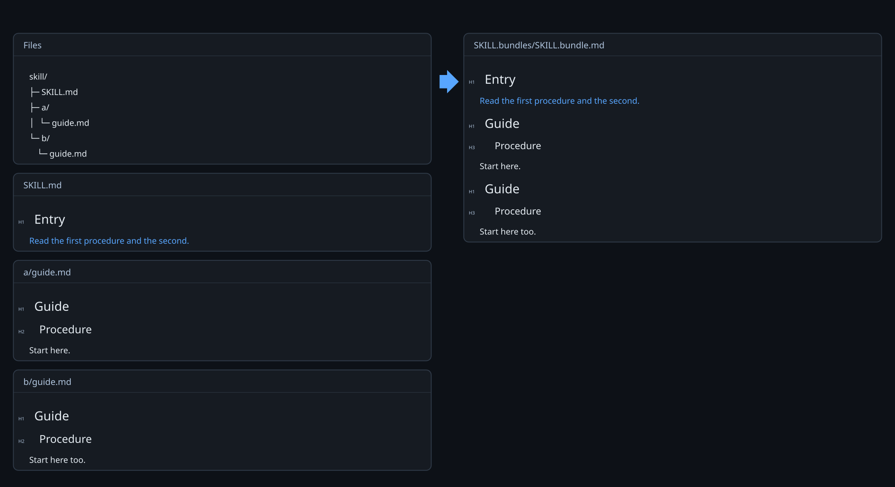
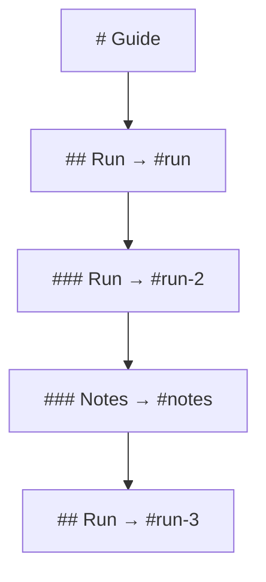
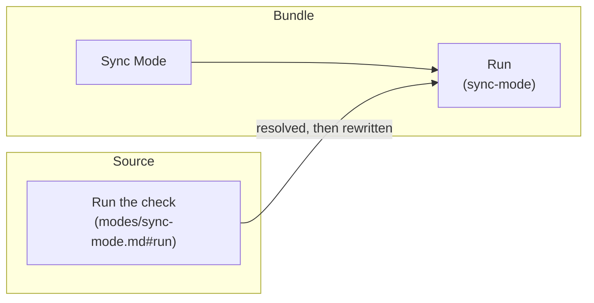

# Destinations

Copying a section into a bundle breaks every link that pointed at it, because the section is no longer where it was. Its heading is now somewhere else in a different document, and a reader clicking the link has to land on that heading.

So the run names every heading in the bundle, and repoints each link at the name of what it used to reach. That name is a **destination**.

## The destination

A destination is a fragment of the bundle, not of its source, so it is assigned over the whole bundle rather than per file. One section whose heading text is unique in the bundle needs no qualification, and a reference from one file heading to another is spelled like a reference within one.

Two documents with the same heading text make the point, because the second has to be told apart from the first.



*Both links still reach the section they named. The second took the ordinal `1`, so it no longer collides with the first, and the run warned that two file headings read alike.*

```text
#heading-slug        a heading whose slug is unique in the bundle
#heading-slug-2      the second heading in the bundle to carry that slug
```

The bundle carries no anchor elements and no identifiers. The headings it already emits are what a renderer indexes, so a destination is a name for a place rather than markup in it.

## Ordinals

Headings are walked in bundle order — file headings, structural ancestors, selected source headings, and headings inside a retained container alike — and each takes its slug. A heading whose slug something already carries takes the slug and an ordinal, counting from one and passing over any ordinal already in use.

An ordinal is safe in a bundle in a way it is not in a source. In a source, an edit elsewhere changes how many similar headings precede a target, so a stored link silently repoints. A bundle is generated whole in one pass and validated against the map that produced it, so every ordinal it carries is assigned and checked in the same run.



*Figure 1. Headings Are Walked in Bundle Order, and Each Repeat Takes the Next Ordinal, Whatever Its Level.*

## Source fragments

A fragment is resolved against the original document, before anything is arranged, so a destination follows from source identity rather than from traversal order.

A source heading's own fragment is the slug its visible text produces. Nothing numbers two headings of one source apart, so a fragment names a heading by what its author wrote rather than by how many similar headings precede it. Two headings in one source producing one slug are not disambiguated: a fragment needing one of them fails the run, and the author retitles.

## Rewriting

A compiled reference is rewritten to the destination of the target it resolved to. A reference the run compiled is a reference the bundle carries, so each one has a destination.

The rest keep the bytes their author wrote: a link outside the root, a link with a scheme, an image, a non-Markdown target. A deferred link points at a path from the invocation working directory, and a dispatched link at its generated sub-section. Each is published without its operator mark.



*Figure 2. A Link Reaches the Destination of What It Named, Not One Whose Slug Coincides.*

## Definitions

Reference-style links resolve against their own source's definitions alone, so `[runner]` in one document stays literal even if another document defines it.

Selected content's reference-style uses are converted to inline links, and every definition node is removed from the emitted content — the unused ones included. A definition left behind is an edge the bundle carries that validation does not account for.

## What validation holds

The map that assigned destinations is the map validation checks against:

- every supported reference resolves to a known document or section
- every rewritten link reaches the destination its own target was assigned, not one whose slug coincides
- each destination occurs once and resolves in the renderer that reads the bundle
- no source text parsed as literal brackets becomes a link through bundling
