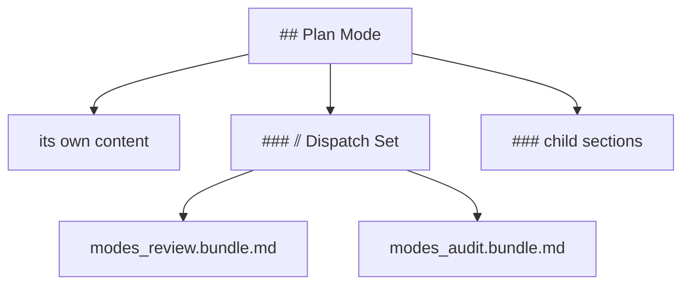
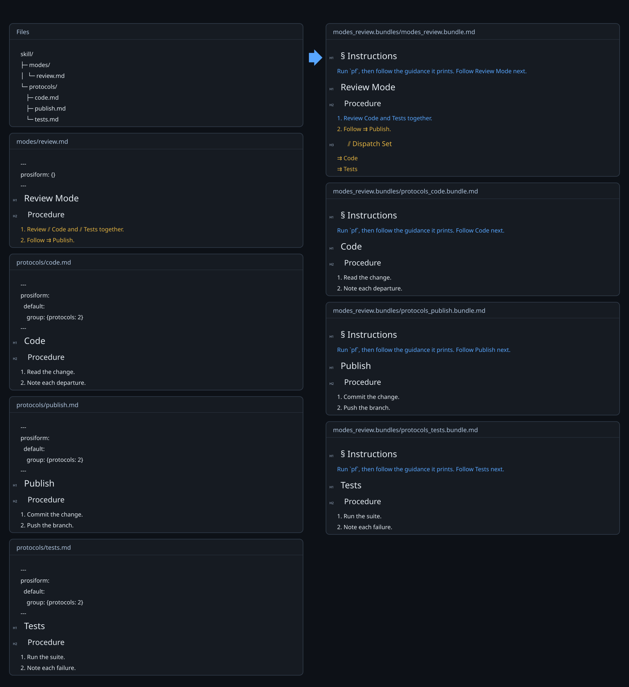
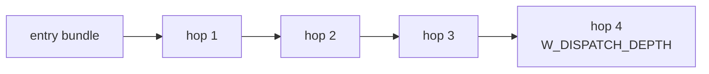

# Dispatch

Not every link points at material for the reader of the bundle. A guide might say "for the review pass, follow the review procedure" — and the review belongs to a different agent, run at a different time, with its own context.

Sending it anyway would pad the bundle with instructions nobody is about to follow. Leaving it out entirely would lose the procedure. A **dispatch** is the third option: the material is bundled on its own, and the bundle that linked it says which one to hand over.

## What it looks like

One step of a procedure carries the mark. The run opens three files, and publishes two bundles: the entry's, which links the second, and the second on its own.


*Every panel is the build's own output: the left column is what the run read, the right what it wrote.*

The entry's bundle keeps the link where its author wrote it, with its mark, and points it at the file `Publish` was bundled to, as if it had been asked for on its own. A reader opens the file the link names, and an agent follows it as the [guide](../invocation.md#guide) states: give a sub-agent the linked file's path, with the inputs the dispatching step states as given, and continue with its answer. A condition the author writes stays in the prose around the link.

## What a dispatch changes

A `⇉` or `⫽` link contributes nothing to the bundle that carries it: no content, no dependency through the link, no group membership. Its target is required to exist, to declare `prosiform` and to name the heading it names, because a sub-agent will follow it and the bundling must be able to succeed.

The run bundles each distinct effective selection once, transitively: a dispatched bundle's own dispatches are further bundles in the same run folder. The selection comprises the canonical document, fragment and matching named presets. Two dispatches of one destination selecting different named presets produce distinct bundles, even if their settings happen to agree; reordered, repeated, differently cased and unknown tags add no variant. Every dispatch names its selection's bundle file, whose deterministic preset qualifier [Bundles](bundles.md#derived-names) defines.

A dispatch is bundled up front, so a deferral mark has nothing to defer: `[¬⇉ the lift](lift.md)` and `[¬⫽ the lift](lift.md)` are refused, as [References](references.md#operators) states.

Each is bundled under every rule an entry's is. Budgets hold per bundle, so `depth` counts hops from that bundle's entry and the others count what that bundle alone opens, reaches and publishes.

## Where the links point

A `⇉` link publishes in place with its mark and the one blank after it, pointing at its target's bundle file. Unless it carries a [brief](#briefs), a section gains no generated structure for it, and a dispatch in a level-6 section publishes like any other.

A `⇉` link whose title carries the [pick token](references.md#the-pick-token) `?` leaves its pick to the agent that dispatches it. The run bundles its target once for each alternative the target declares, each a bundle of its own, as a link naming that alternative does, and any other name beside `?` selects the target's ordinary preset in every one of them. The section writing the link gains one dispatch-pick sub-section for it, headed by the dispatch's link text, placed as a set's sub-section is and after it. Its body holds one dispatch line for each alternative, in declaration order, followed by an em dash and the alternative's choice line:

```markdown
### Stage

[⇉ Stage](stage--p-9aae….bundle.md) — One pull request's worth of work.
[⇉ Stage](stage--p-3d08….bundle.md) — Lists its tasks in a Work Breakdown table.
```

The link itself is published without its mark, its title as authored, pointing at the sub-section, and the agent hands on the one bundle whose choice line fits its work, as the guide states. A `⫽` link carrying `?` is refused, because a set hands on every member and no agent is left to pick.

The `⫽` links in a section's own content are one **set**, and a child section's links form its own. A set of two or more distinct effective selections gains one dispatch-set sub-section, headed `⫽ Dispatch Set`, one level below the section, after the section's own content and any destination sections [composition](composition.md#where-it-lands) places there, and before its child sections. The set's links are published without their marks and point at it. A set of one distinct effective selection is a single dispatch: each of its links is published as a `⇉` link to the target's bundle file, and the section gains no sub-section.



*Figure 1. A Set's Sub-Section Sits Between a Section's Own Content and Its Child Sections.*

The sub-section's body holds one bare dispatch-link line for each distinct effective selection, in the order its first link is written: `[⇉ the lift](lift__do.bundle.md)`, the first link's text without its mark. It carries no bullet marker or instruction sentence; the guide states how to dispatch its members. A set states no order. A set above a group's first heading takes that heading's level.

A run carrying both kinds shows them together. Two `⫽` links form one set and publish one bundle each; a `⇉` link on its own publishes a third and stays where it was written:



*The entry's bundle links what to hand over; the three procedures are bundled as if each had been asked for on its own.*

A set, a `⇉` link carrying `?`, or one carrying a brief, whose sub-section would stand past H6, in a level-6 section or nested in a brief's or a set's sub-section, leaves no level for it, so the run fails rather than inventing one. A dispatched link with no text after its mark shows its reader nothing, and is refused too.

A dispatch in a heading the bundle emits as text alone has no link to publish, so the run publishes nothing and fails with `E_UNSUPPORTED_CONSTRUCT`, naming the link. Such a heading is a referenced document's title its file heading absorbs, a merged group member's title its subsection absorbs, or a title standing above the selection. The entry's own title heads its bundle, so a dispatch there publishes. Its author writes the dispatch in the body beneath the heading.

## Briefs

A target can state what its dispatcher must do before handing it on: the inputs it needs written down, a check to run first. Its preset names that section as a **brief**, a fragment of its own document, as [Sources](sources.md#frontmatter) states:

```yaml
prosiform:
  default:
    brief: "#given"
```

A dispatch whose presets in force for its target name a brief carries it. In `default`, every dispatch of the target does; in a named preset, a dispatch selects it by its link title, and one selecting no preset declaring `brief` publishes as the sections above state. A named preset's brief holds over `default`'s, and two selected presets naming different briefs fail with `E_INVALID_USAGE`, naming both.

A `⇉` link carrying a brief, and a set of one, is lifted into a sub-section one level below the section writing it, headed by its link text, as `### Investigate`. Its body is the brief's lead content, the content above its first heading, then the dispatch line naming the target's bundle file, then the brief's child sections and the sections its directives compose, each one level below the sub-section. The dispatch line therefore stands under no heading the brief emits, and its reader meets the brief's own instruction first. The link is published without its mark, its title as authored, pointing at the sub-section. A diagram link naming that local section also drops the dispatch mark from its node or class label; one pointing directly at a bundle keeps the mark. The sub-section stands where a dispatch-set sub-section does, after the section's own content and composed destinations and before its child sections, after the set's own sub-section and beside the section's dispatch-pick sub-sections in the order their first links are written:

```markdown
## Plan

1. [Investigate](#investigate)

### Investigate

Write the case number to the case file before you dispatch.

[⇉ Investigate](investigate.bundle.md)
```

*From [a-dispatch-to-a-target-declaring-a-brief-is-lifted-into-a-sub-section](../fixtures/dispatch-brief/a-dispatch-to-a-target-declaring-a-brief-is-lifted-into-a-sub-section).*

```markdown
### Investigate

Write the case number to the case file, then [Tests](#rules).

[⇉ Investigate](investigate.bundle.md)

#### Tests

##### Rules

Run the tests.

#### Case

The case number is on the ticket.
```

*From [a-brief-s-sections-follow-its-dispatch-line](../fixtures/dispatch-brief/a-brief-s-sections-follow-its-dispatch-line).*

The brief is bundled as a `↳` composition of its section is, under the presets its dispatch selects: its links resolve through those presets' `subst` pairs layered over the target's `default`, as [Composition](composition.md#presets-and-subst) states for a contribution, and are followed into the dispatching bundle's closure, its own heading gives way to the generated one, and its child sections nest one level below it. The target's own bundle carries the section unchanged. Every dispatch of a briefed target carries its own complete copy of the brief, alike in content but for the links its own dispatch's presets route, its headings at the level its copy stands at; two dispatches sharing a sub-section share one copy. A link the brief writes to one of its own child sections points at that child in the same copy. A region a `↳` composition copies more than once is the exception for dispatches: a later copy points its dispatches at the places its first copy gave them where they name the targets the first copy's dispatches name, and a copy whose presets route them elsewhere places its own. Two copies routing one briefed dispatch apart fail the run with `E_HEADING_COLLISION`, as two dispatches of one text naming two selections do: each route carries its own brief around its own dispatch line, so the two need a sub-section each, and both take their heading from the one link text the copies share, so one heading would name two bundles.

A dispatch the brief writes is a dispatch of its own: it has a bundle of its own and publishes where the brief writes it, a brief its target declares lifted by the same rules, its sub-section one level below the one holding the brief, after the brief. It is never a member of a set around the brief. A brief whose dispatches carry briefs leading back to it would be lifted inside itself without end, so the run publishes nothing and fails with `E_DISPATCH_CYCLE`, naming the chain, as `guide.md`, `a.md`, `b.md`, `a.md`, and the dispatch closing it. The loop is found by walking the dispatches each brief writes before the dispatch's sub-section is fitted to a level, so a loop through briefs is reported as the cycle it is wherever it starts; a section a brief composes past H6 still fails as a composition does.

A `⇉` link carrying `?` places its brief in its named pick sub-section around the pick lines, as a lifted sub-section places it around its dispatch line: the lead content above them, the child sections beneath. The brief bundles with no alternative in force, so it publishes where no alternative changes it, as [Presets in force](selection.md#presets-in-force) states for a link, and the run fails with `E_ALTERNATIVE_UNRESOLVED`, listing the alternatives, where one changes it: an alternative routing a link the brief writes, or one naming a brief of its own. The first is remedied by writing the brief so it bundles with no alternative in force, naming the brief's section; the second names the dispatch, and its remedy is to declare the brief in `default` or an ordinary preset, so it does not vary by alternative.

In a `⫽ Dispatch Set` sub-section holding a member that carries a brief, every member is lifted into a sub-section of its own one level below the set's, headed by its link text, as `#### Investigate`, in the set's written order. A briefed member's sub-section holds the brief's lead content, the member's own dispatch line, and the brief's sections one level further down; a member carrying no brief holds its dispatch line alone. Each member's line therefore stays with its brief, and no line stands beneath another member's headings. A set none of whose members carries a brief lists its bare lines as the sections above state.

Two `⇉` links in one section with the same text and effective selection share one sub-section, and so do two naming one target with the same title tags, under the first one's text, as they share one destination. A lifted sub-section, or a heading a brief emits, past H6 fails with `E_HEADING_DEPTH_OVERFLOW`, as a set's does. A pick or lifted heading equal to an authored heading, or using the same dispatch text for a different selection, fails with `E_HEADING_COLLISION`. A `brief` naming another document, or a fragment no reference decodes, fails with `E_INVALID_CONVERSION_METADATA`, and one naming a heading its document lacks with `E_TARGET_NOT_FOUND`. A `brief` in force for a link that is no dispatch has no effect.

## Models

A workflow's stages ask different things of the model that runs them: some read and record, others weigh evidence and judge. A stage declares the capability level its work needs, and the entry maps each level to a model, so each sub-agent starts on the model its stage needs:

```yaml
prosiform:
  default:
    level: judgement
```

```yaml
prosiform:
  default:
    levels:
      retrieval: haiku
      judgement: opus
  trial:
    levels:
      judgement: haiku
```

The run's **level map** is the `levels` the presets its entry puts in force state, as [Sources](sources.md#frontmatter) states the fields. It is read from the entry alone, and every dispatch the run bundles resolves against it, in every bundle, dispatched bundles included, as a [stub](selection.md#presets-in-force) is selected for the whole run. A selected named preset's map layers over `default`'s level by level, so a title tag on the entry changes it as it changes any setting: `pf '[Guide](guide.md "trial")'` runs every `judgement` stage on `haiku`. Two selected presets mapping one level to different models fail with `E_INVALID_USAGE`, naming both. The map follows from the presets the entry selects, so two maps are two entry selections, and each run writes its bundles into a run folder named by its own.

A target's level is the `level` its dispatch's presets in force state, a selected named preset's holding over `default`'s, as a [brief](#briefs) does. Every `⇉` link pointing at a bundle file, every line of a `⫽ Dispatch Set` or dispatch-pick sub-section and every dispatch line a lifted brief holds, whose target has a level, is published with `on` and the model the map gives that level after the link:

```markdown
[⇉ Gather the Facts](stages_gather-the-facts.bundle.md) on haiku
[⇉ Decide the Folder](stages_decide-the-folder.bundle.md) on opus
```

A pick line carries its own alternative's model before the em dash and its choice line, so alternatives stating different levels name different models. A target with no level is published with nothing after its link. A [diagram link](references.md#diagram-links)'s line holds a node, a destination and a tooltip alone, so its model stands on a Mermaid comment line beneath it naming the node, which a renderer draws nothing for:

```text
click D "stages_decide.bundle.md"
%% D on opus
```

 The model is a dispatch setting, not prompt text: the guide tells the dispatching agent to start the sub-agent on it, and the hand-over still carries the bundle's path and its inputs alone.

A level the map names no model for fails the run with `E_LEVEL_UNMAPPED`, naming the level and the dispatch, so no dispatch is left to a default the run did not choose. The operator's own session follows the entry's bundle, so `pf` applies no model there, and a `level` in force for the entry fails the run with `E_LEVEL_ON_ENTRY`. A [deferral](references.md#operators) is bundled by a run of its own, whose entry is the deferred target, so a deferred stage runs on the operator's session and states no level, and that run reads its own entry's map.

## The guide

The rules for following a bundle live in the guide `pf` prints with no arguments, as [Invocation](../invocation.md#guide) states, and in no bundle: that a bundle's instructions are followed as written, by a sub-agent as by the agent first handed one, what `↳`, `⇉` and `⫽` ask of an agent, what `?` on a `⇉` link asks of it, that what a brief, the text above a `⇉` line in the sub-section a `⇉` link points at in place of a bundle file and the sections beneath that line, asks of the agent is done before that bundle is handed on, while the work it states the bundle leaves or answers is the sub-agent's, and how a bundle is handed over. A bundle travels by its path: a sub-agent is given the path of the bundle file and reads it there, and the dispatching agent hands on its link without opening it and takes its answer as given, neither checking nor redoing its work. Its inputs are those the dispatching step states as given. Where `on <model>` follows a `⇉` link, or a diagram's `%% <node> on <model>` comment stands beneath its node's link, the dispatching agent starts the sub-agent on that [model](#models), and where neither does, as its harness does by default. How a sub-agent's question reaches the user is agent conversation rather than bundled form, so the guide states no marker and no protocol for it.

## The run-pf line

Every bundle a run writes opens with one line, whatever it holds, followed by one blank line: ``Run `pf`, then follow the guidance it prints.`` It is the bundle's first bytes, ahead of any preamble content and every heading, in wording the profile fixes. A bundle carries no protocol paragraph and no section that restates the guide, so a reader holds [the guide](#the-guide)'s rules before it meets a `↳` line, a `⇉` link or a dispatch-set sub-section.

## Depth and cycles

**Dispatch depth** is the number of dispatch hops along one chain, counted from the run's entry. A chain reaching a fourth hop warns: flattening the chain is the author's optimisation rather than a defect in the bundle, so the run publishes and says so.

A chain returning to a bundle already on it is a **cycle**, and the run fails with `E_DISPATCH_CYCLE`; a dispatch naming the run's own single selection closes the shortest one. Neither search follows a target already on its chain, so the analysis terminates on any graph of dispatches.



*Figure 2. A Chain Reaching a Fourth Hop Publishes and Warns; the Limit Is Fixed.*


A dispatched link naming the document that writes it warns where it closes no cycle: the sub-agent is being handed material the dispatching session's own document already carries. Its author moves the procedure to a document of its own, or links it without the operator.

## Generated headings

An authored heading whose text equals the dispatch-set, dispatch-pick or a lifted [brief](#briefs) heading pf emits in the same bundle would give two sections one name, so the run refuses it with `E_HEADING_COLLISION`, naming the heading and the text it equals.

The comparison is exact, and case-sensitive: an authored heading differs from the derived one in any character publishes, and takes the ordinal the renderer gives a repeated slug.

A heading the run does not emit in that bundle is the author's there: a bundle carrying no set and no `⇉` link carrying `?` may carry any heading, `In parallel` among them.

## Target shape

A dispatch hands a procedure to a sub-agent, and a target that carries no numbered step gives the sub-agent nothing to follow. The corpus treats that as a convention rather than a defect: it bundles with no diagnostic. The same holds for a `⫽` target holding a paragraph, a numbered list, or an item linking no document.
